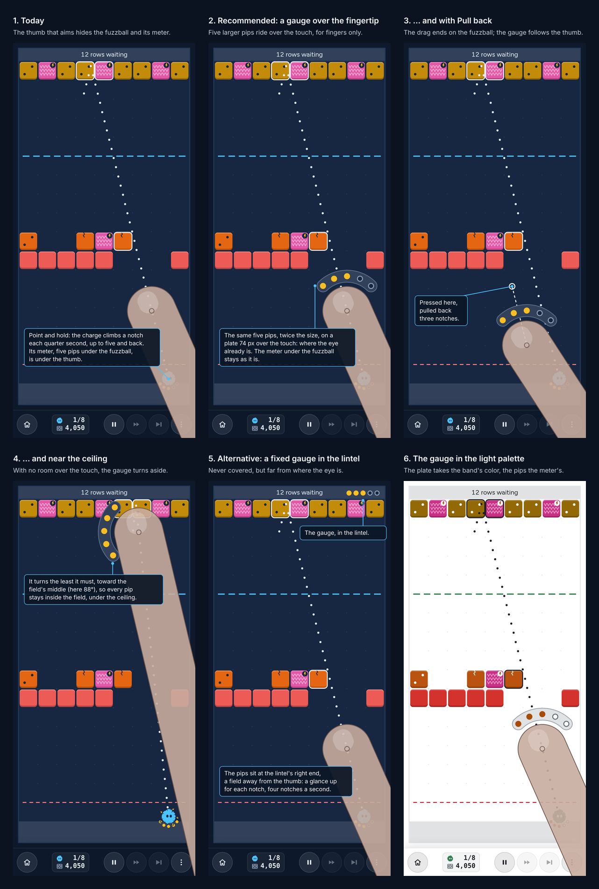
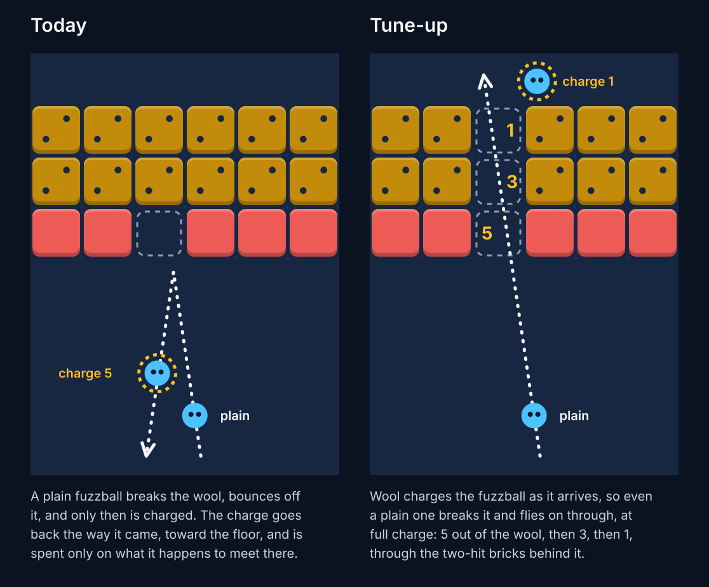
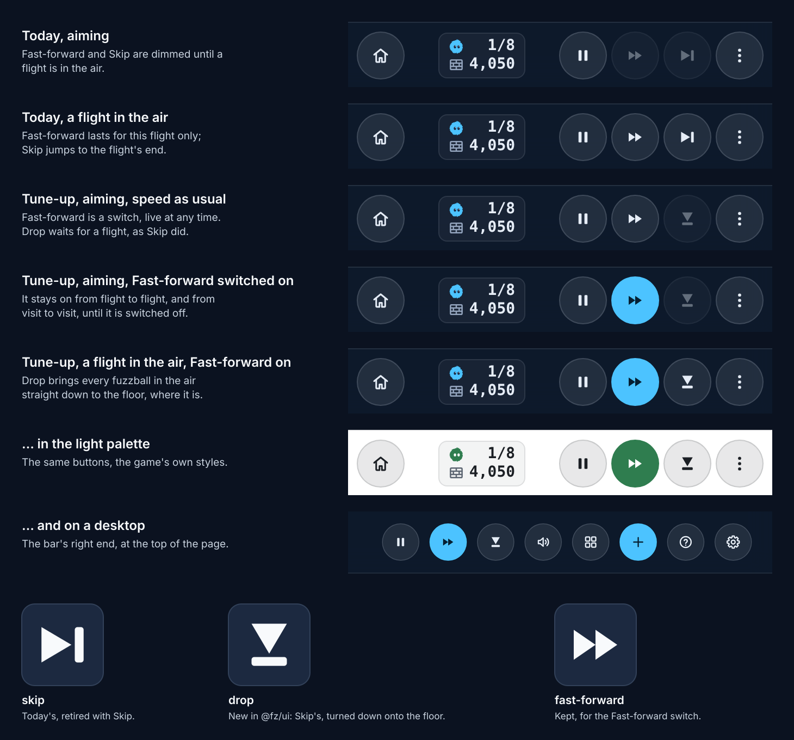

# Brick Fuzz Pop tune-up: plan

Five changes to Brick Fuzz Pop, asked for after playing it on a phone, with
what each one should be, the evidence for it, the files and specs it touches,
the assets to add or regenerate, and the order to build them in. Nothing in
the game has been changed yet: this folder holds the plan, the prototype and
the measurements behind it (`sim/`), and the mocks (`mocks/`).

Paths without a folder are relative to `frontend/games/brick-fuzz-pop/`.

## The five changes at a glance

| #   | Asked for                                                                                                     | Recommended                                                                                                                                                                                     | Costs                                                                                                                                                |
| --- | ------------------------------------------------------------------------------------------------------------- | ----------------------------------------------------------------------------------------------------------------------------------------------------------------------------------------------- | ---------------------------------------------------------------------------------------------------------------------------------------------------- |
| 1   | The fuzzball gives up too soon: at least twice the air time, reset by touching or breaking a brick, not steel | Boredom from 60 to 180 units; any touch on a brick that can break resets it, shielded faces included; 360 units at most without taking a hit; the 600-unit cap moved to 900                     | Every certificate and par regenerated; ten specs rewritten with change 3's; the site's screenshots retaken; the same shots fly 7% longer at the mean |
| 2   | On a phone the finger hides the charge; show it somewhere else too                                            | A second gauge that rides over the fingertip, for touch only, the meter under the fuzzball left as it is; the notch's tick rising in pitch with the charge                                      | Three new atlas frames, a painter, a function that places it                                                                                         |
| 3   | Wool should charge the fuzzball before it hits, so it breaks through                                          | Wool's rule charges the fuzzball as it strikes, so a plain one breaks it, flies on through and keeps a full charge                                                                              | Rides on change 1's regeneration; Wool socks plays two rounds shorter                                                                                |
| 4   | The speed-up control should be a toggle for speed generally                                                   | Fast-forward becomes a switch: live with or without a flight, kept from flight to flight and from visit to visit; the F key switches it rather than being held                                  | One new setting; the held key goes                                                                                                                   |
| 5   | The jump-to-end control should drop the fuzzball to the ground at once                                        | Skip becomes Drop: every fuzzball in the air comes straight down where it is, and the round ends with what it had done by then; records are kept as a flight lands rather than as it is let fly | The round is flown again at the press; a new icon, a new sound; a flight in the air as the page is hidden lands as it would have                     |

Changes 1 and 3 change what a shot does, so they share one regeneration of
the certificates. Changes 4 and 5 are the bar's two flight buttons. Change 2
changes neither the rules nor the bar, but it shares the steering and the
scene with changes 4 and 5, so it is built after them.

## How the numbers were found

`sim/` plays the game's own rules in a scratch copy of the workspace, with
the candidate rules behind switches (`sim/variant.ts`, `sim/flight.patch`),
so nothing here is estimated by hand:

- **Whole games.** The careless player the game's own floors use
  (`src/testing/casual.ts`, the best of sixteen shots a round) plays all 36
  levels on fields 11, 13, 16, 19 and 22 deep from 12 seeds under each of 34
  variants of the rules: 2,160 games and about 22,000 rounds a variant.
- **The same shots.** The 23,269 rounds of the games played by today's rules
  are flown again under every variant, shot for shot, which is the fair
  comparison of what a rule does to a flight; and so is a shot drawn at
  random at each of those walls, which the careless player's taste doesn't
  bias.
- **The certificates.** All 432 lines are replayed under every variant.
- **The final rules.** `sim/certify.mjs` certifies every level again under
  the recommended rules with the game's own `tools/certify-levels.mjs`, and
  runs the copy's `sim` and `pure` specs, which says which specs the change
  must rewrite.

`sim/results/results.md` has every table; `sim/results/par.md` how par moves.
[Reproducing the numbers](#reproducing-the-numbers) says how to run them
again. A flight's seconds below are at Normal speed, 14 units a second,
doubling by itself after 8 seconds, as the game plays it.

## 1. Air time

### What happens today

A fuzzball comes home, yawning and dropping to the floor, once it has flown
`BORED` units (60, in `src/rules/tuning.ts`) since it was let fly or since it
last _took a hit off a brick_, and in any case `MOST_FLIGHT` units (600)
after it was let fly. `fly()` keeps the moment in `ball.idleFrom` and moves
it only where `took > 0` (`strikeOnce()`, in `src/rules/flight/flight.ts`).

Sixty units is little on a deep field. A phone's field is up to 22 rows
deep, so the floor to the ceiling and back is 44 units, and a fuzzball that
slips through a gap, turns off the ceiling and a side wall and comes back
down has spent its patience before it meets a second brick. Played by the
careless player:

- **17% of rounds have a yawn, and in 11.8% it is the player's own
  fuzzball** rather than a mate or a friend.
- **It is worst exactly where it was noticed.** The player's own fuzzball
  yawns in 7.1% of rounds on a field 11 deep, 11.9% at 16, and 17.2% at 22,
  a phone's.
- Of 6,755 yawns, 47% happened in open air, 39% among steel and bumpers, and
  14% while the fuzzball was striking shells and plates on a face that
  shields them.

How to play never mentions boredom, so to a player the fuzzball simply gives
up.

### What the request already is, and isn't

"Reset when it touches or breaks a brick, steel aside" is nearly today's
rule. Every strike on a brick that can break takes a hit, with one
exception: a face a **shell** or a **plate** shields (`shelled.ts`,
`plated.ts`). Steel and bumpers carry the `never` trait and take none. (A
portal carries it too, but nothing ever strikes one: a fuzzball flies
through it.) So the request comes to two things:

1. **More patience**, which is what removes the open-air yawns.
2. **Shielded strikes counting**, which is what removes the 954 yawns among
   shells and plates: a fuzzball that is visibly bouncing off bricks and
   then gives up reads as a bug.

The game's first design left shielded strikes out on purpose (decision C2 in
`docs/archive/brick-fuzz-pop/implementation-plan.md`), because a fuzzball
can rattle between two shielded faces for ever, and only the 600-unit cap
ends it. The sim shows the same thing: letting every touch count, with no
other limit, flies 119 fuzzballs to the cap where the hit-only rule at the
same patience flies 61. The answer is a second, longer limit on flying
_without taking a hit_, which keeps what the touch rule gives and takes back
what it costs.

### What was measured

The same 23,269 shots under each rule (the full table, with every variant,
is "The shortlist" in `sim/results/results.md`):

| Rule                                                  | Rounds with a yawn | The player's own yawned | Yawns among shells and plates | Flown to the cap | A round's seconds: mean, 90th, 99th in 100 |
| ----------------------------------------------------- | ------------------ | ----------------------- | ----------------------------- | ---------------- | ------------------------------------------ |
| Today: 60, a hit resets                               | 17.0%              | 11.8%                   | 954                           | 9                | 6.0, 10.3, 15.9                            |
| 120, a hit resets (twice, the least asked for)        | 7.0%               | 4.2%                    | 378                           | 29               | 6.2, 11.1, 17.9                            |
| 180, a hit resets                                     | 3.8%               | 2.2%                    | 216                           | 61               | 6.4, 11.7, 19.6                            |
| 120, a touch resets, 240 at most without a hit        | 6.5%               | 3.8%                    | 117                           | 43               | 6.3, 11.2, 18.7                            |
| 180, a touch resets, no other limit                   | 3.3%               | 1.9%                    | 19                            | 119              | 6.4, 11.8, 20.7                            |
| 180, a touch resets, 360 at most without a hit        | 3.5%               | 2.0%                    | 84                            | 73               | 6.4, 11.8, 20.3                            |
| **The same, the cap at 900, with wool (recommended)** | **3.6%**           | **2.1%**                | **89**                        | **5**            | **6.4, 11.7, 20.2**                        |
| 150, every brick but steel resets (bumpers too)       | 3.6%               | 2.1%                    | 24                            | 136              | 6.4, 11.6, 21.3                            |

What it shows:

- **Twice is not enough.** At 120 the player's own fuzzball still yawns in
  about one round in 25; at 180, one in 50, against one in 8 today. Past 180
  each step buys less (a hit-only 240 gives 1.4% where 180 gives 2.2%) while
  the long flights keep growing.
- **The touch rule is worth having with its limit.** It takes the yawns
  among shells and plates from 954 to 84. Without the limit it sends twice as
  many fuzzballs to the cap.
- **The cap should move with the patience.** At three times the patience, a
  cap of 600 is only 3.3 times the boredom, and it starts cutting off
  fuzzballs that are still breaking bricks: 72 of them, against 9 today. At
  900 it cuts off 5, and a round's 99th percentile doesn't move; only the
  longest round of the 23,269 grows, from 33 to 37 seconds. At 1,200 it cuts
  off none and the longest is 41 seconds.
- **Bumpers should not count.** Read to the letter, "steel doesn't count"
  would let them. It removes a few more yawns in Tricks and buys the longest
  rattles of any rule tried (a round's 99th percentile of 24.8 seconds in
  that set's games, against 21.0 under the recommended rules; "By the set"
  in `sim/results/results.md`), because a bumper kicks a fuzzball back at
  another bumper for as long as it likes.
- **Nothing else moves much.** Bricks broken a round change by under 1%.
  Whole games clear as often (97.3% today, 97.5%), in 10.2 rounds rather than
  10.8.

By the field's depth, whole games, today's rules against the recommended:

| Depth | The player's own yawned | A round's seconds, mean | 99th in 100  | Rounds to clear |
| ----- | ----------------------- | ----------------------- | ------------ | --------------- |
| 11    | 7.1% to 0.9%            | 4.8 to 5.2              | 12.0 to 15.5 | 12.2 to 12.0    |
| 13    | 9.5% to 1.6%            | 5.4 to 5.9              | 13.5 to 18.6 | 10.9 to 10.6    |
| 16    | 11.9% to 2.1%           | 6.1 to 6.9              | 15.6 to 21.0 | 10.5 to 9.9     |
| 19    | 14.2% to 3.0%           | 6.7 to 7.7              | 17.4 to 24.1 | 10.3 to 9.6     |
| 22    | 17.2% to 3.7%           | 7.0 to 8.3              | 17.6 to 25.5 | 10.3 to 9.2     |

Two ideas were tried and dropped. Boredom that grows with the field's depth
did no better than a flat number of the same size. A touch on steel
"costing" patience, to break up rattles, made yawns more common again (8.6%
of rounds) and lost bricks.

### The rule

- **`BORED` is 180.** A fuzzball yawns once it has flown 180 units without
  touching a brick that can break.
- **A touch counts.** A strike on any brick whose kind can break moves
  `idleFrom`, whether it took a hit or a shell or a plate shielded it.
  Steel and bumpers don't, and a portal is never struck.
- **`MOST_IDLE` is 360, twice `BORED`.** A fuzzball that has flown 360 units
  without _taking a hit_ yawns whatever it has touched, so no rattle between
  shielded faces outlasts it. It is derived from boredom, so the debug
  menu's one slider still tunes both.
- **`MOST_FLIGHT` is 900.**

The price is waiting. A fuzzball going nowhere now takes up to about 10
seconds to give up at Normal speed, where it took 4; the same shots fly 7%
longer at the mean; a round in a hundred runs past 20 seconds, and on the
deepest field past 25. That is why this change belongs
with changes 4 and 5: a switch that plays every flight four times faster,
and a button that brings a flight down, put the wait in the player's hands.

### The code

- `src/rules/tuning.ts`: `BORED = 180`, a new `MOST_IDLE` (or the ratio it is
  derived by), `MOST_FLIGHT = 900`, and `BORED`'s doc, which says "without
  taking a hit".
- `src/rules/flight/flight.ts`: `Ball` gains `hitFrom` beside `idleFrom`;
  `plan()` brings a fuzzball home at the least of the three limits;
  `strikeOnce()` moves both moments on a hit, and `idleFrom` alone on a
  strike that took none off a brick that can break. `sim/flight.patch` is
  this change with switches around it.
- `src/rules/round/round.ts`: `RoundRules` hands `fly()` the second limit
  with `bored`; `src/view/debug/debug_tuning.ts`'s `rulesOf()` derives it,
  and its "Bored after" slider, 10 to 300, wants a longer top.
- `src/rules/bricks/traits/shelled.ts` and `plated.ts`: their docs say a
  shielded strike "doesn't count as a hit against its boredom"; it now
  counts as a touch.
- How to play (`src/app/help/help.component.html`) gains the sentence it
  lacks: a fuzzball that flies a long while without touching a brick it
  could break gets bored, yawns and drops to the floor.

### The specs

Run in the scratch copy under the recommended rules, the `sim` project
passes whole once the certificates are regenerated: all 555 tests, every
certificate, every floor and the ten thousand random rounds with "the caps
never reached". These `pure` specs fail, and are the ones to rewrite:

- `src/rules/flight/flight.spec.ts`: "flies bored's round as it was worked
  out", whose fixture yawns at 60; and "brings a fuzzball home at the
  600-unit cap, and counts it", whose fuzzball takes no hit, so the new
  limit brings it home at 360. The cap needs a wall that keeps giving hits,
  and the limit a test of its own.
- `src/rules/round/round.spec.ts`: "plays bored's round as it was worked
  out".
- `src/testing/flight_fixtures.ts`: the hand-made `bored` round both read,
  worked out again for 180.
- `src/rules/bricks/trait_rules.spec.ts`: "counts no strike a shell shields
  as a hit against a fuzzball's boredom" becomes what the rule now is: it
  counts as a touch, and the limit still brings the fuzzball home.
- `src/testing/solver.spec.ts`: three expectations of lines found on small
  walls.
- `tools/capture-screenshots.spec.ts`: `RUN`, which must be the first two
  shots of level 18's new certificate (see [Assets](#assets-and-generated-files)).

Without the cap at 900, the two random-wall specs fail instead: at 180 one
or two flights in 12,000 reach a cap of 600, and none reaches 900.

### The certificates and par

A certificate is a line of shots that clears a level, and almost any change
to a flight breaks some: 207 of the 432 still hold with the air time alone,
177 with wool as well. So every level is certified again, once, after
changes 1 and 3 are both in: `yarn certify:levels` took 28 seconds here on
24 cores, and found a line for every level on every depth at its first
search.

Par is half as many rounds again as a level's line, so it moves with them:
of 432 pars, 80 come down, 337 stay and 15 go up, their sum from 4,239 to
4,123 (`sim/results/par.md`). Stars already earned are kept as they are, as
`brick-fuzz-pop-stats` keeps a level's most stars.

## 2. A second place for the charge

### What happens today

The charge shows in one place: five pips, each about 6 CSS pixels wide, in
an arc under the waiting fuzzball (`MeterPainter`), which is itself about 30
CSS pixels across with its fur and sits on the floor, at the bottom of the
field, right over the bar. On a phone 390 CSS pixels wide a pixel is about a
sixth of a millimetre, so a thumb is about 100 pixels wide: more than three
times the fuzzball.

With **Point and hold**, the default, the charge climbs a notch every
quarter of a second, up to five and back down, and the player lets go at the
charge they want, so the charge has to be read while the finger is down.
Whenever the hand comes up from the bottom of the phone across the
fuzzball, which is most aims, it can't be. With **Pull back** it is worse:
the drag runs away from the aim, which is down, onto the fuzzball.
[`mocks/charge-1-today.png`](mocks/charge-1-today.png) shows it to scale.

### The options

| Where                                           | For                                                                                        | Against                                                                                                           |
| ----------------------------------------------- | ------------------------------------------------------------------------------------------ | ----------------------------------------------------------------------------------------------------------------- |
| **Over the fingertip** (recommended)            | Where the eye already is while aiming; never under the hand; works for both ways of aiming | Moves with the finger; needs a rule near the ceiling and the sides                                                |
| In the lintel, at the top of the field          | Fixed, never covered, simplest to build                                                    | Up to a whole field away from the thumb, for a number that changes four times a second; shares the lintel's count |
| In the bar                                      | Fixed                                                                                      | On a phone the bar is at the bottom, under the same hand                                                          |
| Along the guide's dots                          | No new element                                                                             | Gone when the guide is switched off; the finger sits on the guide too                                             |
| By ear: the notch's tick rising with the charge | Needs no eyes at all                                                                       | Nothing with the sound off; a help, not an answer                                                                 |

The sheet below puts the first two side by side, drawn over the game's own
screenshots, with the thumb to scale.



### The gauge

- **What it is.** The meter's five pips again, twice the size (13 CSS pixels
  across), on a plate in the lintel's color with a rim, in an arc 74 CSS
  pixels from the touch: about 12 mm, clear of a thumb's tip. They light from
  the left as the meter's do, all five for a hot shot.
- **When it shows.** Only for a finger, never for a mouse or the keys, which
  cover nothing; from the moment the finger aims (a pointed press at once, a
  pull back once it is past its dead zone) until it lets go or the shot is
  called off. The meter under the fuzzball stays exactly as it is, so the two
  always agree.
- **Where it goes.** Straight over the touch. Where that would put a pip
  outside the field or over the ceiling's line, the whole gauge turns about
  the touch, the least it must, toward the field's middle
  ([`mocks/charge-4-gauge-ceiling.png`](mocks/charge-4-gauge-ceiling.png)). `gaugeTurn()` in
  `mocks/make-mocks.mjs` is that rule, as the mocks draw it.
- **Its size is the finger's, not the field's.** It is measured in CSS
  pixels, so it is the same on a field 11 deep and one 22 deep. The 74 is a
  first value to settle with a phone in the hand.
- **By ear too.** `WallScene.hearNotch()` plays the notch at the same pitch
  for every charge. Raised 100 cents a notch, as a break's is raised a brick,
  the charge can be heard climbing and falling.

Each at full size: [pointing](mocks/charge-2-gauge.png),
[pulling back](mocks/charge-3-gauge-pull-back.png),
[near the ceiling](mocks/charge-4-gauge-ceiling.png),
[the light palette](mocks/charge-6-gauge-light.png), and
[the lintel](mocks/charge-5-lintel.png) for the alternative.

### The code

- `src/view/steering/steering.ts`: `Steer` says where the finger that aims
  is pressed, in the canvas's pixels, or that none is (a mouse, the keys, no
  press), written in place each frame as its other fields are.
- A new function in the view, tested in Node, that gives the five pips'
  places and the plate's turn from the touch, the field's metrics and the
  pixel ratio.
- `src/view/art/frames.ts` and `src/scene/field_art.ts`: three frames, the
  plate, a lit pip and an unlit one, baked in `flightFrames()` beside the
  meter's, in the meter's colors, sized by `ArtScale.pixelRatio` rather than
  by the unit.
- `src/scene/painters/`: a `GaugePainter`, over the fuzzballs and under the
  rim, from a pool made once, drawing nothing on a frame where nothing
  changed, as `MeterPainter` does.
- `src/view/colors/contrast.spec.ts`: the lit and unlit pips against the
  plate, in each of the four palettes.
- Specs: the placement in the view; the steering's touch; the painter in the
  scene's spec, shown for a finger and hidden for a mouse; the atlas's frames.

## 3. Wool

### What happens today

Wool breaks at one hit, and its rule (`RECHARGES_RULE`, in
`src/rules/bricks/traits/recharges.ts`) charges the fuzzball in `broken`,
after the strike is worked out. A charged fuzzball flies on through a brick
it breaks; a plain one turns off it. So a plain fuzzball breaks the wool,
bounces off, and only then is charged, heading back the way it came, usually
toward the floor. The careless player strikes wool with a plain fuzzball 12
times a game on Wool socks, 5 on The Great Wall, and 2 to 3 on Nutcracker,
Six-pack and Powder keg.



### The rule

Wool charges the fuzzball **as it strikes**. A plain fuzzball arrives at
full charge, takes the wool's one hit, flies on through and is charged to
full again as the wool breaks, so it leaves with five: enough for two
two-hit bricks behind it and one hit more. A fuzzball that was already
charged flies exactly as it does today, and so does a hot shot. A zap or a
blast still only breaks wool.

### What it does to the game

Alone, it leaves 375 of 432 certificates standing and the game as hard as it
was: 97.3% of games cleared before and after. Wool socks clears in 9.3
rounds rather than 10.9, and in 8.6 with the air time as well ("Each level"
in `sim/results/results.md`). Powder keg,
which the careless player cleared less often than its set's floor asks on
fields 11 and 13 deep in this run of 12 games a depth, no longer falls under
it.

### The code

- `src/rules/flight/hooks.ts`: `Struck.charge` becomes one a rule may raise,
  as `hurts` and `earths` are ones a rule may set. `strike()` already reads
  the charge from `Struck`.
- `src/rules/bricks/traits/recharges.ts`: a `struck` rule that sets the
  charge to `MOST_CHARGE` for a fuzzball's strike, beside the `broken` rule
  it keeps.
- `src/rules/catalog/kinds/sparks.ts`: wool's `about`, which How to play, the
  Ready card and In this wall all show: "Charges the fuzzball that strikes it
  to full, so even a plain one breaks through and flies on charged; a zap or
  a blast only breaks it."
- Specs: `src/rules/bricks/traits/recharges.spec.ts` and `flight.spec.ts`'s
  "charges a recharged fuzzball to the most" state the old order and are
  rewritten; a plain fuzzball punching through wool becomes a case of its
  own. The view tells a punch from a break by whether the fuzzball turned, so
  the streak and the punch's sound follow by themselves.

## 4. Fast-forward as a switch

### What happens today

The bar's Fast-forward (`button[appFastForward]`) is dimmed until a flight
is in the air, plays that flight four times faster once pressed, and is let
go again as the next is released (`GameService.fastAsked`). The F key
fast-forwards only while it is held. So a player who wants every flight
fast presses it every round. The settings have a separate, lasting choice of
Normal (14 units a second) or Fast (22).

### The switch

- **Live at any time.** It is never dimmed: it can be pressed while aiming,
  and shows pressed (`aria-pressed`, the accent) until it is pressed again.
  The sheet under this list shows each state, cut from the game's own
  buttons.
- **It stays.** It is not let go at a release, and it is kept with the
  settings (a `fastForward` flag in `brick-fuzz-pop-settings`, off by
  default, read as off where an older entry lacks it, so the version stays
  at 1).
- **The key switches it too.** F toggles at a press, like the button, rather
  than working while held. The announcer says "Fast-forward on" or "off" for
  the key, since the button's own state says it for a press.
- **It still means four times faster**, on top of the settings' Normal or
  Fast, and with a long flight's own doubling. The settings' choice stays as
  the base speed.



### The code

- `src/app/settings/settings.service.ts`: the flag, with its default and its
  reader.
- `src/app/play/game.service.ts`: `fast` reads the setting; `fastAsked` and
  `fastHeld`, and the reset in `release()` and `begin()`, go.
- `src/app/bar/fast_forward.component.ts`: no `flying` input and no dimming.
- `src/view/steering/controls.ts` and `steering.ts`: F becomes a command
  (`FieldCommand`), and `HELD_KEYS`, `heldKeyOf()` and `Steer.fast` go.
- Text: How to play's row ("Hold the left index finger's home key" becomes a
  press) and its "No hurry" paragraph; the settings' line "Fast-forward and
  Skip are there from the start of every flight"; the board's description of
  its keys.

## 5. Drop

### What happens today

Skip (`button[appSkip]`, and the X key) lands the flight at once _with
everything it was going to do_: the playback jumps to its end
(`RoundPlay.skip()`). It can, because a round is decided whole as it is
released: `GameService.release()` has the rules play the round to its end,
takes its outcome into the run, writes the records and the saved game, and
then only plays the flight back.

### What Drop does

Every fuzzball in the air stops where it is and comes straight down to the
floor, as a bored one does, through whatever lies between. Those not yet let
fly (the mates and friends behind the first) never leave. A zap or a blast
already set off still lands. The round then ends as any round does: the
wall comes down, and the next shot starts from where the player's fuzzball
landed.

So a dropped round keeps only what it had done by then, and that changes
what a round is:

- **The rules fly the round again.** `fly()` takes a second kind of stop, a
  moment at which every fuzzball comes home; in `plan()` it is one more limit
  on `home`, beside boredom and the cap. That limit reaches only a fuzzball
  already in the air: `make()` hands each fuzzball its launch as a step
  already planned, so the stop also calls off every launch still waiting at
  that moment, which is what keeps the mates and friends behind the first
  from leaving. Everything before that moment is the same flight, event for
  event, because the rules are exact. `playRound()` hands it on.
- **The view swaps the flight under the playback.** `RoundPlay` takes the
  round flown again and plays on from where it is; the events already played
  are the same ones.
- **The shell takes the round again.** `GameService.drop()` has the rules
  play the round from the same start and shot, under the same `RoundRules`
  it was released with, with the drop at the playback's moment, takes the
  new outcome into the run as it stood before the release, and the saved
  game is written again. The rules are kept with the shot because `tick()`
  reads the debug menu's tuning afresh at each release, and a slider moved
  mid-flight would otherwise fly a different round.

A drop is a new event in the flight, with a sound of its own, rather than a
yawn, so sixteen fuzzballs brought down at once don't all yawn.

### Records move to the landing

Today the records are kept as a round is released (`keepRecords()`): a
level cleared, the levels it opens, a run's end and its best. With Drop, a
round released as one that clears the level can be dropped into one that
doesn't, so they are kept **as the flight lands**, when its outcome can no
longer change. A run's start is still counted at its first release.

The saved game goes on being written at the release, as the run will stand
once the round lands, so reloading the page mid-flight still can't replay a
round; a drop writes it again. That leaves one gap to close: a page that
goes away mid-flight would keep a saved game ahead of its records. So **a
flight in the air as the page is hidden lands at once as it would have
flown**, which is what Skip does today, and its records are written then. A
player who switches away mid-flight comes back to the round landed and the
run paused, rather than to a flight paused in the air.

A page killed with no warning at all, mid-flight, is hidden from nobody, so
that rule can't help it. As a second net, taking up a run that is on the
record marks the levels before the one it is on as cleared; a run the debug
menu took off the record marks none. What such a kill can still lose, where
today it loses nothing, is small and worth saying: the best of the level
that flight cleared; and, if the flight was the run's last, the run's end,
its count and its best, because `saveGame()` keeps nothing of a run that has
ended, so nothing is left to take up. Only keeping the round to be flown in
the saved game closes that whole (see
[Considered and left out](#considered-and-left-out)).

### What it adds to the game, and to say plainly

- **It is the game's first timed input.** The design's rule was that nothing
  here is timed. Drop is never needed: no certificate and no floor uses it,
  and a level is as clearable without it. But it is not only a convenience.
  The fuzzball lands where it is dropped, and the next shot starts there, so
  a well-timed drop places the next shot. That is a skill some players will
  enjoy and others can't use; it follows from "drop to the ground", and the
  alternative, sending a dropped fuzzball back to where the shot began,
  would no longer be a drop.
- **It can only take away.** A dropped round's fuzzballs strike nothing
  more, so it breaks no brick the whole round wouldn't have, and it still
  counts as a round against par.
- **While the debug menu plays a certificate, Drop does nothing,** as a
  line's later shots assume the earlier ones flew whole.

### The code

- `src/rules/flight/flight.ts` and `events.ts`: the stop, the `drop` event
  beside `yawn` in the order of a moment's events, and its doc.
- `src/rules/round/round.ts`: `playRound()` and `playRoundBy()` take the
  stop.
- `src/view/round_play.ts`: taking the round flown again; landing at once
  stays, for the page hidden.
- `src/view/effects/effects.ts`: the drop's sound, a twenty-first in
  `SOUNDS`.
- `src/app/play/game.service.ts`: `drop()` in `skip()`'s place; the run as it
  stood before the release, the shot and the `RoundRules` it was released
  with, kept while a flight is in the air;
  `keepRecords()` called from `playFrame()` as the round lands; landing at
  once as the player looks away with the page hidden.
- `src/app/play/saved_game.service.ts`: its `track` follows the round in
  flight too, so a drop is written.
- `src/app/bar/skip.component.ts` becomes the Drop button, named "Drop" by
  its tooltip, dimmed while there is no flight as Skip is.
- `src/view/steering/controls.ts`: X asks to drop.
- `frontend/lib/ui/src/icon/`: a `drop` icon (see Assets) in the place of
  `skip`, which only this game uses: in `ICON_NAMES` and in `FILLED`, as it
  is a solid icon, in the template's cases, and in the spec's list of the
  filled ones.
- `src/rules/run/run.ts`: `afterLanding()`'s doc, which says to keep the
  records as the round is released.
- Specs: over the seeded random flights of `src/testing/random_flights.ts`,
  a flight dropped at a moment drawn in it is the whole flight up to that
  moment, has every fuzzball in the air come home then and none leave after,
  and keeps `orderProblemsOf()` and `trackProblemsOf()` empty; the run takes
  a dropped round for the round it replaced; records are kept at the landing
  and not before; a flight in the air as the page is hidden lands whole.

## Assets and generated files

| What                                                                                | Add or change        | How                                                                                                                                                                                                                                                                                                                                |
| ----------------------------------------------------------------------------------- | -------------------- | ---------------------------------------------------------------------------------------------------------------------------------------------------------------------------------------------------------------------------------------------------------------------------------------------------------------------------------- |
| `src/rules/levels/certificates/*.json` (four files) and `src/rules/levels/par.json` | Regenerated          | `yarn certify:levels`, once, after changes 1 and 3. `sim/results/par.md` is what to expect.                                                                                                                                                                                                                                        |
| `public/docs/screenshots/brick-fuzz-pop/preview.webp` and `thumb.webp`              | Retaken              | `yarn capture:screenshots`, last of all, so the picture has the new bar. First `RUN` in `tools/capture-screenshots.mjs` takes the first two shots of level 18's new line on a field 11 deep (aims 248 and 160, charges 4 and 3, in the scratch copy), and the shot it aims for the picture is chosen again on the wall they leave. |
| The gauge's plate, lit pip and unlit pip                                            | New, drawn in code   | Three frames in `src/view/art/frames.ts`, baked by `src/scene/field_art.ts`. The mocks give their sizes and colors.                                                                                                                                                                                                                |
| The `drop` icon                                                                     | New, in `@fz/ui`     | Skip's turned a quarter, an arrowhead down onto a bar: `<path d="M5.5 4.25h13l-6.5 11z"/>` and `<rect x="5.5" y="16.5" width="13" height="3.25" rx="1"/>`, a name in `ICON_NAMES` and a case in the template. `mocks/controls-sheet.png` shows it at both sizes.                                                                   |
| The `drop` sound, and `src/scene/sounds/sounds.wav` with `sounds.json`              | New, and regenerated | A recipe in `tools/build-sounds.mjs`, a short falling tone; `yarn build:sounds`. The sound lab plays it.                                                                                                                                                                                                                           |
| The `bored` round in `src/testing/flight_fixtures.ts`                               | Worked out again     | By hand, for a yawn at 180.                                                                                                                                                                                                                                                                                                        |
| The words                                                                           | Changed              | How to play (boredom, wool, the two controls' rows, the gauge under Charge), the settings' line, the board's description of its keys, wool's `about`.                                                                                                                                                                              |
| The mocks and the prototype, in this folder                                         | Done                 | `mocks/capture.mjs` and `mocks/make-mocks.mjs` write them; see below.                                                                                                                                                                                                                                                              |

### The mocks

| File                                                                                                                                                                                           | Shows                                                                                                                 |
| ---------------------------------------------------------------------------------------------------------------------------------------------------------------------------------------------- | --------------------------------------------------------------------------------------------------------------------- |
| [`mocks/charge-sheet.png`](mocks/charge-sheet.png)                                                                                                                                             | The six pictures below, side by side                                                                                  |
| [`mocks/charge-1-today.png`](mocks/charge-1-today.png)                                                                                                                                         | A thumb, to scale, over the fuzzball and its meter                                                                    |
| [`mocks/charge-2-gauge.png`](mocks/charge-2-gauge.png), [`charge-3-gauge-pull-back.png`](mocks/charge-3-gauge-pull-back.png), [`charge-4-gauge-ceiling.png`](mocks/charge-4-gauge-ceiling.png) | The gauge: pointing, pulling back, and turned aside under the ceiling                                                 |
| [`mocks/charge-5-lintel.png`](mocks/charge-5-lintel.png)                                                                                                                                       | The alternative, a fixed gauge in the lintel                                                                          |
| [`mocks/charge-6-gauge-light.png`](mocks/charge-6-gauge-light.png)                                                                                                                             | The gauge in the light palette                                                                                        |
| [`mocks/controls-sheet.png`](mocks/controls-sheet.png)                                                                                                                                         | The bar today and after, aiming and in flight, on a phone and a desktop, in both palettes, with the icons drawn large |
| [`mocks/wool.png`](mocks/wool.png)                                                                                                                                                             | A plain fuzzball meeting wool, today and after                                                                        |
| `mocks/shots/` and `mocks/shots.json`                                                                                                                                                          | The game's own screenshots the mocks are drawn over, and where the field lies in each                                 |

The bars in `controls-sheet.png` are the game's own buttons in its own
styles, changed in the page before the capture. The gauge and the thumb are
drawn over the screenshots; the wool picture is a diagram made of the game's
own bricks.

## What else to update

- `AGENTS.md` here: the bar (Fast-forward and Skip "dimmed while there is no
  flight"), the steering ("fast-forward held"), What It Keeps (the new
  setting; the saved game written at a drop too; records at the landing),
  the sounds ("twenty", twice), the flight's stop, the painters, and
  the screenshots' shots.
- `.agents/skills/brick-fuzz-pop-testing/SKILL.md`: the `bored` fixture and
  whatever it says of records at a release.
- `frontend/lib/ui/AGENTS.md`: its line on the filled icons names skip,
  which becomes drop.
- `tools/sound-lab.ts`: its scene of a bored fuzzball is timed by `BORED`,
  so it plays three times as long; a look that it still reads well, and a
  scene for the drop's sound.
- This folder moves to `docs/archive/` once the change is live, as the
  game's other plans did, with an "As built" section.

## Order of work

Each step ends with `yarn verify:changed` green from `frontend/`, and the
whole with `yarn verify:full` and `yarn check:layout`.

1. **The rules: air time and wool.** Both changes to the flight, their specs
   and the fixture; then `yarn certify:levels` once, and
   `yarn report:levels` to see every level over its floor. This is the step
   with the widest reach and no dependence on the others.
2. **Fast-forward as a switch.** The setting, the service, the button, the
   key, the words.
3. **Drop.** The flight's stop and its property spec first; then the view's
   swap; then the shell, with the records moved to the landing; then the
   icon, the sound and the words. It touches `flight.ts` as step 1 does, so
   it follows it.
4. **The gauge.** The steering's touch, the placement, the frames, the
   painter, the notch's pitch. It shares `src/view/steering/steering.ts`
   with step 2, where `Steer.fast` goes, `src/scene/wall_scene.ts` with
   steps 2 and 3, and How to play with every step, so it follows them rather
   than being built beside them.
5. **Wrap up.** The screenshots retaken; `AGENTS.md` and the skill; a pass on
   a real phone for the three things only a hand can judge: the gauge's
   reach, how a drop feels, and whether 180 is the right patience at each
   speed.

## The choices, settled

The plan left six choices open, each with the default it was written to. On
2026-11-15 the user took every recommendation, so each is settled as
written:

1. **How patient.** 180. (120 is the least the request allows and leaves
   about twice the yawns; it shortens the worst waits by about a second and
   a half.)
2. **Bumpers don't reset boredom.** Only bricks that can break do. (Counting
   them follows the request's words more closely and makes the longest
   rattles. The choice was put as "bumpers and portals"; a portal is never
   struck, so it comes to bumpers.)
3. **The gauge rides over the finger,** not in the lintel.
4. **Fast-forward is remembered between visits.**
5. **A dropped fuzzball lands where it is,** as asked, knowing it lets a drop
   place the next shot.
6. **A flight in the air as the page is hidden lands at once.** This is the
   one behavior nobody asked for; it is what keeps the records right. The
   alternative below costs more.

What only a phone in the hand can settle stays for the build's last step:
the gauge's reach, how a drop feels, and whether 180 is right at each speed.

## Considered and left out

- **Keeping the round to be flown in the saved game**, the shot with the run
  as it stood, and flying it as the run is taken up. It closes the gap
  between the saved game and the records without landing a hidden flight,
  and costs a change to what `brick-fuzz-pop-game` keeps and every check
  that reads it. It is also the only thing that closes what a page killed
  without warning mid-flight can lose (a level's best, or a run's end). Worth
  it only if landing a hidden flight turns out to bother anyone, or that
  loss is ever seen.
- **One speed control instead of two.** Folding the settings' Normal and
  Fast into the bar's switch would be simpler to explain, and would take
  away either the mild speed-up or the strong one. Left as two.
- **Fast-forward hurrying the wall's step and the cards too.** It plays
  flights faster, as today.
- **A vibration at each notch.** iOS Safari has none.
- **Showing the charge on the fuzzball itself, larger.** It is under the
  thumb whatever its size.
- **Skip kept beside Drop.** The request replaces it, and the switch and the
  drop between them cover what it was for.
- **A cap of 1,200.** It cuts off no flight at all, for a longest round of 41
  seconds rather than 37. 900 already keeps "the caps never reached" true
  over the ten thousand random rounds.

## Reproducing the numbers

From the repository's root, with the frontend installed:

```sh
node docs/archive/brick-fuzz-pop-tune-up/sim/run.mjs          # every level, every variant: about 4 minutes on 24 cores
node docs/archive/brick-fuzz-pop-tune-up/sim/summarize.mjs    # writes sim/results/results.md and summary.json
node docs/archive/brick-fuzz-pop-tune-up/sim/certify.mjs --specs   # certifies under the recommended rules, writes sim/results/par.md
```

`run.mjs` makes the scratch copy under the system's temporary folder
(`bfp-tune-up/`) and writes each level's raw counts there, about 40 MB,
which is why only the summaries are kept here. The mocks:

```sh
yarn workspace brick-fuzz-pop dev                                # from frontend/, for capture.mjs alone
node docs/archive/brick-fuzz-pop-tune-up/mocks/capture.mjs       # the screenshots, in a headless Chrome
node docs/archive/brick-fuzz-pop-tune-up/mocks/make-mocks.mjs    # the mocks, drawn over them
```

Where the files can't be opened, as in a session followed from a phone,
`node docs/archive/brick-fuzz-pop-tune-up/preview.mjs` serves this plan as
a page on port 9106, its mocks in it, with every mock at full width at
`/gallery`.

| File                | Holds                                                                                           |
| ------------------- | ----------------------------------------------------------------------------------------------- |
| `sim/variant.ts`    | The switches a variant of the rules sets                                                        |
| `sim/flight.patch`  | `fly()` reading them: the prototype of changes 1 and 3                                          |
| `sim/tune_up.ts`    | The 34 variants, and what is measured of a level under each                                     |
| `sim/mirror.mjs`    | The scratch copy of the workspace, with the three files above laid in                           |
| `sim/run.mjs`       | Every level played in a process of its own                                                      |
| `sim/summarize.mjs` | The tables                                                                                      |
| `sim/certify.mjs`   | The certification under the recommended rules, and the specs run under them                     |
| `sim/results/`      | `results.md`, `summary.json`, `par.md`, and `par.after.json`, the par the certification came to |
