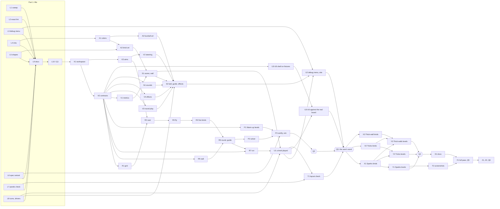

# Brick Fuzz Pop: the implementation plan

Written 2026-11-10, as a companion to [`plan.md`](plan.md). That file is the
design: what the game is, its 24 decisions, its numbers and a first list of
phases. This file is how to build it:

- the questions to settle before any code;
- what to lift into the shared libraries first, and what to leave alone;
- the contracts the parts of the game share;
- each piece of work, file by file, with its specs and the point at which it
  is done;
- the practices each layer keeps;
- the test and performance budgets;
- how the work splits into streams that run side by side.

Where this file and `plan.md`'s "Phases" disagree, this file is the newer.
The user answered §3's six questions the same day, and §12 lists the edits
`plan.md` took for them.

**What it was written from:**

- `plan.md`, read whole.
- The art sheets and the level mocks, rendered and looked at.
- The sketch, read and run again. It printed the same numbers as
  `sketch/results.md`.
- The 36 draft levels, checked by script against "The rules a level keeps".
  All 36 pass, and a flood fill found no brick sealed in.
- Brick Breaker's code, from end to end.
- Where Asteroid Breaker's and Snake's code overlaps with this game's.
- Every library's exports.
- The archive's plans, work logs and reviews, for what went wrong last time.

Paths are relative to `frontend/games/brick-fuzz-pop/` unless they start
with `frontend/` or `docs/`.

## As built (2026-11-11)

Built on 2026-11-10 and 11 to this plan: Part 1's eight lifts on
`brick-fuzz-pop-lift`, cut from `main`, and the game on `brick-fuzz-pop`, cut
from Part 1's tip, by streams in worktrees of their own (§7), each commit
reviewed before it was made, then cherry-picked onto its part's branch by an
integrator, who checked the tip after each. Part 1 merged into `main` first and
alone, the game after it. The streams' work logs and the integrator's were
deleted at the merge, as the user asked, rather than merged into one
`worklog.md` as Z2 planned; they are in git's history under
`docs/brick-fuzz-pop/worklog/`. This plan and those logs describe the code as it
was, so check a path against the tree before following one.

What the build decided that the sections below don't say:

- **The levels:** all thirty-six certified, every line found by the solver, and
  the careless player clearing each, at every depth, at least as often as its
  set's floor asks: Warm-up 90%, Sparks 85%, Tricks 80% and Thick walls 40%. Q4
  watched every certificate played on 11 and 22 deep. It found effects drawn
  past the frame, which the camera's viewport now clips, and a portal's diamond
  too small to read at 22 deep, now hollow and larger. A level's
  number comes from its set's place in `LEVEL_SETS`, so Thick walls was
  certified after Tricks.
- **The contracts:** a cage's tint is 0 to 5 by its place, and
  `TraitRule.broken` takes it; a plated brick's frames are
  `plated-<plating>-<hits>`; a portal's two pairs are told apart by
  `PORTAL_BADGES` (`dot` and `diamond`, in `legend.ts`), which R's words and the
  art both read; `LegendBrick.kind` is typed `BrickKindId`, so the compiler
  refuses a kind the catalog lacks, and `stand_ins.ts`'s `uncataloged()` was
  retired.
- **The bundle:** How to play and the debug menu load on demand through
  `onDemand()` (`src/app/on_demand.ts`), a hand-written `import()`, rather than
  `@defer`, whose runtime cost the main chunk 6.1 kB. The main chunk ended at
  406.74 kB, under §9's 406.8; the scene's at 59.30 kB, over §9's 51, the
  bricks' art and the bakes being in it.
- **Performance:** §9's 4 ms bar is the worst frame at ×6, which neither breaker
  meets, so F1 held the median to it. F1 cut what our code made each frame,
  pooled `SpritePlayer`'s sounds, and baked the standing wall and the field's
  cells, band and dots into two `DynamicTexture`s. The last trace of level 36's
  longest flight: at ×6 a median of 4.4 ms in a full trace and 3.8 in a lighter
  one, and about 14 ms at worst; at ×4 2.9 to 3.0; unthrottled 0.8.
- **Accessibility:** F1's input pass found six issues, all fixed: How to play's
  slow load (marked busy, cancelable, a failure said); Escape's call-off said; a
  lost WebGL context pausing the run behind a card; the bars' buttons named by
  their tooltip alone, in every game; the board's cards headed groups; a held
  press charging by the frames' clock. Lighthouse scores 100 for accessibility
  and for SEO.
- **Left for the user at the merge:** a screen reader through a level, Safari,
  real Firefox's blur behind a dialog and 120 Hz, which no tool here could
  check; the worst frames and the scene's chunk over §9; and, outside this game,
  Asteroid Breaker's `eslint.config.js`, whose later block over its held files
  no spec holds to the rules' fence, as `tools/eslint_config.spec.ts` holds this
  game's, reloading on `vite:preloadError` for lazy chunks, `@fz/phaser`'s
  canvas resize during a window's drag, `dynamicTexture()` shared through
  `@fz/phaser/scene`, the HTML5 Audio throw from `SpritePlayer`'s `hold()`, a
  spec holding each level's name to its draft, Brick Breaker keeping records of
  a run on `?debug`'s retuned numbers, and moving `levels/build.mjs` and the
  drafts it reads out of this folder into the workspace's `tools/`, since adding
  a level still runs it.

---

## 1. Summary

- **The design can be built as written.** About twenty points in it are
  under-specified or contradict the art, and §3 settles each one.
  - Six of them change what a player sees or how the rules play, so they
    were the user's to answer. The user took every recommendation on
    2026-11-10 (answers 1 to 6).
  - The rest are this plan's own calls (C1 to C14).
  - Keeping the lintel (answer 1) costs about every other upright phone a
    row: a phone of 390 × 844 is 17 rows deep, not 18, though one of 360 ×
    800 keeps its 18. Wide windows lose about 4% of a
    brick's size instead. `plan.md`'s table of shapes is worked out again.
- **Part 1 grows from two lifts to eight,** all small (§4).
  - Each that an existing game can use is taken up by it in the same
    branch. L2 has no user before Brick Fuzz Pop, and L7 changes no game.
  - The finds behind the new ones:
    - Brick Fuzz Pop's eight tints are exactly Brick Breaker's `LIGHT_INKS`
      and `DARK_INKS`.
    - The debug menu the plan wants already exists in Asteroid Breaker, with
      `?debug`, the sliders and Copy.
    - The panels beside the field can be checked by `@fz/dev/layout`'s deck
      inspection, given one new option.
    - The game needs three icons the libraries don't have yet.
  - With every library change landed first, no Part 2 stream touches
    `frontend/lib/`. That is what lets the streams run in parallel without
    colliding.
- **A contracts step (K2) fixes the types the streams share:**
  - aims, the grid, the wall and the flight's events;
  - the round's outcome and the catalog's ids;
  - the field's shape, the art's frame names and the sound names.

  After it, four streams start at once: rules; proof and run; art and
  sound; and view and shell (§7.2).

- **The rules are built open to more fuzzballs from the start (R3).**
  - `fly()` handles many fuzzballs, spawning, teleporting and kicking from
    its first commit, tested with a kind that exists only in the specs.
  - So the eleven kinds after the feel gate add only their own trait rules,
    art and catalog entries. Three streams can build them side by side
    without touching the flight.
- **Certification runs offline.**
  - `yarn certify:levels` runs on a pool of workers. In the sketch's timing
    that is 5 to 15 minutes of CPU at degree aims, about 4 times that if
    every level needs quarter-degree aims.
  - The certificates are checked in, with a generated `par.json` beside them.
  - CI replays the certificates (under a second) and holds the careless
    player's floors (70 to 100 seconds of CPU, spread over twelve `sim`
    files).
- **The elapsed time to the feel gate falls to about a third** of building
  the plan's phases one after another (§7). Before Q3 the critical path runs
  through the rules and the proof; art, view, sound and shell run beside it
  against the contracts' fixtures.

---

## 2. Mapping to `plan.md`'s phases

| `plan.md` | Here               | What changed                                                                                                                  |
| --------- | ------------------ | ----------------------------------------------------------------------------------------------------------------------------- |
| L1–L4     | L1–L10             | Six more lifts (§4). `sweepPoint()` is exported for the bumper. The exact lint is specified as an allowlist.                  |
| W1        | K1                 | —                                                                                                                             |
| —         | **K2**             | New: the shared contracts, and the catalog's data for the first five kinds                                                    |
| W2.1      | K3                 | —                                                                                                                             |
| W2.2–W2.4 | R1–R3              | `fly()` handles many fuzzballs from the start. A brute-force reference checks `cast()`.                                       |
| W3        | R4                 | Trait rules get a file each. The catalog is split by set.                                                                     |
| W4        | R5, R6             | R5 runs beside R2–R4. The guide is a bounded `fly()` in the rules.                                                            |
| W5        | P1–P3              | P1 starts at K2. `par.json` is generated. The floors are spread over 12 files.                                                |
| W6        | R7                 | Starts from the contracts                                                                                                     |
| W7        | A1–A3, V1–V4       | Split into two streams, art and view                                                                                          |
| W8        | S1, S2             | —                                                                                                                             |
| W9        | U1, U2             | The debug menu comes from the library (L3).                                                                                   |
| W10       | U3–U6              | **Moved before Q3.** None of it is a kind or a level, so decision 23 doesn't hold it back, and it makes the feel gate fuller. |
| W11       | X1–X3, Y1–Y3       | Kinds in three streams side by side, then the three sets of levels                                                            |
| W12       | N1                 | **Moved before Q3**, so the feel is judged with sound                                                                         |
| W13       | T1 (before Q3), T2 | The layout check runs before the feel gate.                                                                                   |
| W14–W17   | D1, F1, Z1, Z2     | —                                                                                                                             |

---

## 3. Settled before code

### The user's answers (2026-11-10)

Each of these changes what a player sees or how the rules play. The user
took the recommendation on every one. `plan.md` now says each where it
belongs (§12).

| Answer | The question                                                                                                                                                                                                                                                                                  | What the user chose                                                                                                                                                                                                                                                                                                                                                      |
| ------ | --------------------------------------------------------------------------------------------------------------------------------------------------------------------------------------------------------------------------------------------------------------------------------------------- | ------------------------------------------------------------------------------------------------------------------------------------------------------------------------------------------------------------------------------------------------------------------------------------------------------------------------------------------------------------------------ |
| 1      | **The lintel.** By the old rule in "The field", the lintel showing "N rows waiting" appeared on only 4 of the 13 window shapes in its table. An upright phone, every wide window and a desktop got none, because the leftover went to the floor's band first. The art and every mock drew it. | **A lintel of at least 0.5 units on every shape.** The unit is the smaller of the width ÷ 9 and the height ÷ 12.1. Worked out again, that costs a wide window about 4% of its bricks' size, and an upright phone of 390 × 844 a row: 17 deep, not 18, landing a jump on row 7, not 8. A small phone on its side gets a 24 CSS px unit, the layout check's floor exactly. |
| 2      | **Do zaps pass through steel?** The plan didn't say. The sketch lets them through, and the drafts of Gatehouse and Switchboard ("zappers behind steel") were tuned that way.                                                                                                                  | **They pass through,** and steel takes nothing. "Reaches nothing that never breaks" means only that steel isn't hurt.                                                                                                                                                                                                                                                    |
| 3      | **What a zap or blast does to a prism, wool and a cage.** The sketch: a zapped cage frees its friend; a zapped prism and zapped wool just break.                                                                                                                                              | **As the sketch does.** A prism splits a fuzzball and wool charges one, and a zap has neither.                                                                                                                                                                                                                                                                           |
| 4      | **Inks of the special bricks.** The art gives plated, shell, moss, wool, cage, the zappers, the bomb and the prism inks of their own. The plan said a level's rows take the tints in turn.                                                                                                    | **As the art does.** Plain and tough bricks take their row's tint; every special kind keeps its own ink. A kind is still told by shape and mark first, never by color alone.                                                                                                                                                                                             |
| 5      | **Friends' inks.** Six friends need six inks; the art shows three.                                                                                                                                                                                                                            | **Asteroid Breaker's pilot inks,** eight for each mode, lifted into `@fz/phaser/color` (L4). They exist so that a fuzzball stands out in a color of its own against the field and the bar, in every palette.                                                                                                                                                             |
| 6      | **The fuzzball's look at each charge.** The art draws three looks for six charges.                                                                                                                                                                                                            | **Six looks, the fur combed in proportion to the charge,** with sparks at 5 only. The art's relaxed, half and full looks are charges 0, 2–3 and 5.                                                                                                                                                                                                                       |

### The plan's own calls

The user raised nothing against these, so they stand. All but C10 and C13
are now written into `plan.md`'s design reference too. Those two are build
details, and live here, in R2 and P2.

**C1. The order of strikes at one moment.** When several bricks are struck
at the same moment, the charge is spent on faces before corners. Within
each, it goes from the floor up, then left to right. The sketch spent it in
the order a `Map` was filled in, which can't be written down as a rule.

**C2. Boredom.**

- Only a strike that takes a hit resets the distance flown without striking.
  The sketch reset it on any strike, so a plain fuzzball rattling between
  shells or plates flew on to the 600-unit cap.
- The yawn comes at exactly 60.0 units, as an event of its own. The sketch
  checked only at the next contact.
- "Turned eight times without moving" counts consecutive turns with no
  distance between them: 8, not the sketch's 9.

**C3. Portals.**

- A portal takes a fuzzball as its middle crosses into the cell, not while
  the middle is inside it.
- A fuzzball that has come out of a portal ignores every portal until it
  next turns.
- These fix the sketch's way back through a portal after a bounce inside the
  exit cell.

**C4. Prisms and the cap on fuzzballs.**

- A prism's two fuzzballs leave from where the fuzzball struck it, 30°
  either side of the heading it leaves with.
- Each starts its own bored count and its own 600-unit cap.
- The cap of 16 counts fuzzballs in the air at once.
- A split that would pass it makes fewer: the +30° fuzzball comes first.

**C5. Contacts at one moment.** Every contact at a moment is gathered before
the fuzzball turns.

- Faces add their normals together.
- A corner turns the fuzzball only if no face did.
- A corner's normal is divided by its actual length. The sketch divided by
  the radius, which is wrong when the fuzzball already overlaps the corner.
- This fixes the sketch's turn when a corner is met just after a face.

**C6. Where the first shot leaves from.** The first shot of a level leaves
from x = 4.5.

**C7. Aims and keys.**

- Aim index `i` is the direction at `8° + i/4°`, measured from the floor on
  the right, counter-clockwise, for `i` from 0 to 656.
- Left and Right move the aim a degree (4 aims); Shift with them moves it a
  quarter of a degree (1 aim). "Notch" is kept for steps of charge.
- The pointer's angle snaps to the nearest aim, clamped to 8°–172°.

**C8. Escape.** While a charge builds, Escape calls it off; otherwise it
pauses. `GameService` overrides `command()` to do this, and both cases are
specced.

**C9. A game taken up after a reload** comes back paused and between rounds,
as Brick Breaker's and Asteroid Breaker's do. `takenUpBoard()` needs
`data-outcome="paused"`.

**C10. `cast()` takes bounded moves.**

- It walks the grid in moves of no more than one cell.
- `@fz/core/sweep`'s functions return a share of a move between 0 and 1;
  `cast()` turns that back into units.

**C11. Steel's color and the field's.**

- Steel is mixed from the palette with `mixColors`, as Brick Breaker's is,
  so all four palettes get it.
- The field is the palette's `field` role, as "Look" says. Brick Breaker
  uses `panel`.

**C12. The legend keeps a character for each brick of 2–3 hits.**

- `T` is a shell of 3, `V` a brick of 3 plated toward the floor, and `^` a
  brick of 2 plated toward the ceiling, as the sketch has them.
- No draft uses them, but "The bricks" allows 2 to 3 hits for each.

**C13. The careless player keeps the sketch's measure of a wall.**

- The sketch's `score()` becomes `wallScore()` in `src/testing/`, with its
  constants named, since the floors were tuned with it.
- The plan never wrote it down; §6 P2 does.

**C14. Certificates store aim indices** from 0 to 656. The solver tries
every fourth aim first.

---

## 4. Part 1: the lifts (`brick-fuzz-pop-lift`)

### The bar for a lift

`docs/archive/shared-lib-plan.md` set the bar. A piece is lifted when:

- two or more workspaces use it, and it means the same thing in each;
- its API is small, with no mode flags;
- every workspace that adopts it gets shorter;
- it respects the layers' fences;
- it is built in one game and adopted by the others in the same branch.

A new icon goes into `@fz/ui` whoever uses it (`frontend/AGENTS.md`).

The pieces below are independent of one another. They run in parallel
worktrees cut from `brick-fuzz-pop-lift`, and each is rebased and
fast-forwarded in the order listed. All of Part 1 lands, and Q1 passes,
before Part 2's K1, since `brick-fuzz-pop` is cut from the lift branch's
tip (§7.4). Each lift's first user in Part 2: L1 and L2 in K1, L3 in U2, L4
in A1, L5 in A2, L6 in P3, L7 in T1, and L8 in S2 and U1.

| #   | Piece                                                                                                                                                                                                                                                                                                                                                                                                            | Adopted by                                                                                                               | Size   |
| --- | ---------------------------------------------------------------------------------------------------------------------------------------------------------------------------------------------------------------------------------------------------------------------------------------------------------------------------------------------------------------------------------------------------------------- | ------------------------------------------------------------------------------------------------------------------------ | ------ |
| L1  | **`@fz/core/sweep`**: as `plan.md`'s L1.1, **and `sweepPoint()` exported** for the bumper, which is a disc. Doc comments made neutral about which game uses it (Brick Breaker's `Solid` links to `inGrid` and talks of the paddle). The `exposureOf()` spec's `solidFrom` helper takes a width rather than `COLUMNS`. `package.json`'s `exports` and `description`, and core's `AGENTS.md`. Held to core's 100%. | Brick Breaker: `grid.ts`, `travel.ts`, `field.ts`, `bricks.ts`, `capsules.ts`, `paddle.ts`, `balls.ts`, `paddle.spec.ts` | small  |
| L2  | **`phaserGameLayers({ exact })`**, spelled out below.                                                                                                                                                                                                                                                                                                                                                            | none yet; Brick Fuzz Pop is the first                                                                                    | small  |
| L3  | **`@fz/game-ui/debug_menu`**: `DEV_BUILD` and `DEBUG_MENU` as tokens (`DEBUG_MENU` is development builds or `?debug`), `<fz-debug-tuning>` and `createTuning(tuned)`, from Asteroid Breaker's `tokens.ts`, `view/debug_tuning.ts`, `settings/tuning.service.ts` and `settings/debug_tuning.component.*`. Spelled out below.                                                                                      | Asteroid Breaker entirely; Brick Breaker its tokens and its one slider, which gains `?debug`                             | medium |
| L4  | **`@fz/phaser/color` inks.** `TILE_INKS = { light, dark }`, Brick Breaker's eight. `FUZZBALL_INKS = { light, dark }`, Asteroid Breaker's eight pilot inks, for the friends (answer 5). Each game's contrast spec stays its own, checked against its own field.                                                                                                                                                   | Brick Breaker's `inks.ts`, Asteroid Breaker's pilot inks                                                                 | small  |
| L5  | **`@fz/phaser/shapes` areas.** Brick Breaker's `src/view/art/shapes.ts` (`within`, `share`, `inset`, `middleSquare`, `frameAround`, `star`) becomes `areas.ts`, with `outlineRoundRect()`, a stroked rounded rectangle drawn as a band (the art needs one in five places), and `dashes(from, to, dash, gap)` for the jump and danger lines.                                                                      | Brick Breaker's art; Asteroid Breaker's `dashedRing()` over `dashes()` if it gets shorter                                | small  |
| L6  | **`variantOfSpec(file, variants, folder)`** in `@fz/core/testing`: a spec file's variant, a string or a number, read from its name in its folder, by string operations alone, with no `node:path`.                                                                                                                                                                                                               | Brick Breaker's private `speedOfSpec`, Asteroid Breaker's `speed_specs.ts`                                               | small  |
| L7  | **`@fz/dev/layout`: zones all or none.** `PhaserDeck` gains `allOrNone: true`: no zone at all passes, and if any is present every one must be. Brick Fuzz Pop's DOM panels, which lie over the canvas's spare room, then reuse `inspectPhaserDeck()`'s checks (inside the canvas and the window, clear of the field, the bar and each other, `least: 172`).                                                      | Asteroid Breaker is unchanged, since its deck always shows; a spec for each branch                                       | small  |
| L8  | **Icons and scene drivers.** `fast-forward`, `skip` and `star` join `@fz/ui/icon` (`ICON_NAMES` and the template's cases). `@fz/phaser/testing`'s `SceneRun` gains `wheel(deltaY, x, y)`, a `button` option on `pointer()`, and `touch("cancel", …)`, since nothing can drive the wheel, a right click or a cancelled touch through a scene today.                                                               | Brick Breaker's scene spec gains the cancelled-touch and any-button cases its review once asked for                      | small  |
| L9  | Docs: each library's `AGENTS.md`, Brick Breaker's and Asteroid Breaker's `AGENTS.md` and skills (`brick-breaker-content` names "the sweep" at line 124), the `fuzzley-ui` and `phaser-core` skills. `yarn skills:check`.                                                                                                                                                                                         | —                                                                                                                        | small  |
| L10 | **Q1, widened:** `yarn verify`; both breakers' `check:layout`; Brick Breaker's `report:levels` and Asteroid Breaker's `report:waves` printing the same numbers as before; both games played by keys, mouse and touch; both at `?debug` in a production build (`yarn preview`).                                                                                                                                   | —                                                                                                                        | small  |

### L2 spelled out: arithmetic every engine rounds alike

`deterministic()` in `frontend/lib/dev/src/eslint.ts` sets
`no-restricted-properties` and `no-restricted-syntax`. A later block that
sets either rule replaces its options rather than adding to them. So:

1. Give `deterministic(files, { exact = false } = {})` one array for each
   rule, with the exact entries added to it, rather than a block of its own.
2. Split the call that now covers `["src/view/**/*.ts", ...held]`. Exact
   arithmetic covers the rules and the held files, never the view, whose
   art uses `cos` and `sin`.
3. Write it as an **allowlist**, so a `Math` function added to the language
   later is refused until someone checks it:
   - `MemberExpression[object.name="Math"]:not([property.name=/^(abs|ceil|floor|fround|max|min|round|sign|sqrt|trunc)$/])`
     — every other `Math` member, `Math.PI` included. The rules write their
     constants out.
   - `MemberExpression[object.name="Math"][computed=true]`
   - `VariableDeclarator[init.name="Math"]`, which catches `const { sin } = Math`
   - `BinaryExpression[operator="**"]` and `AssignmentExpression[operator="**="]`
4. Spec it in `eslint.spec.ts`:
   - each refused form fails;
   - each allowed one passes;
   - **with `exact` on, `deterministic()`'s own refusals (`Math.random`,
     `Date.now`, `new Date()`) still fail.** That is the replacement bug this
     ordering would otherwise cause.

`@fz/core/sweep` is exact only because someone has read it. Its doc comment
says so, and its spec asserts that `sweepFace` and `sweepCorner` return
bit-identical results on a fixed table of moves. A change that turns one
into `Math.hypot` then fails a spec.

### L3 spelled out: the debug menu

From Asteroid Breaker, and slimmed to what a second game needs:

```ts
// @fz/game-ui/debug_menu
export const DEV_BUILD: InjectionToken<boolean>; // import.meta.env.DEV; a token, since vi.stubEnv can't change it
export const DEBUG_MENU: InjectionToken<boolean>; // DEV_BUILD || the page's URL has ?debug

export interface TuningSlider<Id extends string> {
  readonly id: Id;
  readonly name: string;
  readonly least: number;
  readonly most: number;
  readonly step: number;
}

/** Holds the tuned numbers of a game, the ones a debug menu set, and whether they differ. */
export function createTuning<T extends Readonly<Record<string, number>>>(
  tuned: T,
): Tuning<T>;
// Tuning<T>: { tuning: Signal<T>; retuned: Signal<boolean>; tune(id, value): void; reset(): void; onTune(listener): () => void }
```

`<fz-debug-tuning>` has these inputs and outputs:

- **Inputs:** `sliders` (each with its `value` and `valueText`) and `lines`,
  the text of `tuning.ts` to paste back.
- **Outputs:** `tune` and `reset`.

It holds:

- the sliders;
- Reset the numbers;
- Copy the numbers, which shows the lines when there is no clipboard, as
  on a phone reaching the dev server over plain HTTP;
- a `role="status"` line;
- a `<details>` holding the lines;
- an `<ng-content>` for each game's own controls.

Brick Fuzz Pop's own controls go in that slot: the depth, any level open,
and Play the certificate.

`onTune` stays, because an effect would let a frame step on the old
numbers. Asteroid Breaker's rule comes with it: **a run played on retuned
numbers keeps no records.** For Brick Fuzz Pop the menu also says "The
certificates are stale while the rules are retuned" whenever a number the
rules read has moved.

### Not lifted

The archive weighed each of these and kept it in its game. Brick Fuzz Pop
leaves them there:

- `GameService` beyond `RunLifecycle`;
- a base scene class and the `Painter` interface;
- the bar, result, board card and level choice components;
- the settings, stats and progress services, since `storedSignal()` is
  already the abstraction;
- steering, of which only `PointerView` is shared, as a shape;
- the run rules, saved-game readers, autopilots, report scripts, configs and
  `test-setup.ts`;
- haptics, which is in one game only and which decision 24 leaves out;
- `withLowerCount()`. Only this game needs a count where lower is better (the
  fewest rounds), so it stays in `src/rules/run/stats.ts`, beside a comment
  naming `withHigherCount()`.

---

## 5. Architecture and contracts (Part 2)

### 5.1 Layers and folders

`plan.md`'s "Where the code goes" stands, with these changes:

- Trait rules each get a file under `src/rules/bricks/traits/`, and the
  catalog's kinds get one file per set under `src/rules/catalog/kinds/`. So
  three streams can add kinds without touching each other's files.
- Art gets one file per kind under `src/view/art/kinds/`, for the same
  reason.
- `src/rules/flight/guide.ts` holds the guide, which is a bounded `fly()`.
  The view's `guide.ts` only turns its points into dots.
- `src/rules/levels/par.json` is written by `certify:levels`.
- Following Asteroid Breaker's pattern, `src/view/run_state.ts` is one record
  of the run, replaced whole, and `src/view/round_play.ts` owns playback, the
  card waits and the news. `GameService` is only signals and service calls.
- `src/app/board/board_card.component.ts` holds the cards from the first
  commit (as Asteroid Breaker does), not inline in the board.
- `src/testing/` holds `cast_reference.ts`, a brute-force `cast()` for the
  property spec, and the typed `certify_api.ts`, `report_api.ts` and
  `screenshot_api.ts` that the scripts load (as Asteroid Breaker does).

The fences, from `phaserGameLayers({ heldAsRules, exact })`:

- **Rules:** `src/rules/**` imports only `@fz/core/*`.
- **Exact:** the rules and every held file are held to exact arithmetic,
  as `exact: true` does. None of the held files needs more than L2 allows.
- **Held as rules:** the held files are all in `src/testing/`: `solver.ts`,
  `casual.ts`, `wall_score.ts`, `wall_picture.ts`, `kept_run.ts`,
  `script_api.ts`, `certify_api.ts`, `report_api.ts` and `screenshot_api.ts`.
- **View:** it may also import `@fz/phaser/{color,fuzzball,insets,layout,shapes}`.
- **Scene and app:** as in Brick Breaker.

### 5.2 Coordinates

- **Field units, y up from the floor.**
  - Places run from x = 0 to 9 and from y = 0 to the depth.
  - Rows count from the floor: row 0 is the floor's.
  - The wall counts its own rows from its lowest: wall row 0.
- **Where the wall is.** `Wall.lowestRow` is the field row that wall row 0
  stands in.
  - A brick in field row ≥ depth is waiting over the ceiling.
  - A brick in field row ≤ 0 has reached the floor.
- **The wall knows no depth.** So a change of depth between rounds
  (decision 7) changes only `RoundStart.depth`, and the wall keeps its
  distance from the floor without being touched.
- **`@fz/core/sweep` names its faces for a y that grows down.**
  - `src/rules/grid.ts` maps them: `FLOORWARD` is `SIDE.top` (the smaller y),
    `CEILINGWARD` is `SIDE.bottom`, and `LEFT` and `RIGHT` keep their names.
  - So a `Box`'s `top` is its edge nearest the floor.
  - That is said once, in `grid.ts`'s doc comment, and pinned by a spec drawn
    as a picture.

### 5.3 Rules contracts (K2 writes these)

```ts
// src/rules/tuning.ts: numbers only, `as const`
export const COLUMNS = 9;
export const LEAST_DEPTH = 11;
export const MOST_DEPTH = 22;
export const RADIUS = 0.25;
export const SIDE_MARGIN = 0.5;
export const MOST_CHARGE = 5;
// …every number of "The feel, in numbers" the rules read

// src/rules/shot.ts
export type Charge = 0 | 1 | 2 | 3 | 4 | 5;
export type Boon = "hot" | "triple";
/** An aim's index, 0 to 656: 8° + index / 4°, counter-clockwise from the floor on the right. */
export type Aim = number;
export interface Shot {
  readonly aim: Aim;
  readonly charge: Charge;
}
export function isAim(value: unknown): value is Aim;
export function isCharge(value: unknown): value is Charge;

// src/rules/wall/wall.ts
export interface Brick {
  readonly kind: BrickKindId;
  readonly hits: number; // left; Infinity never appears: a kind that never breaks has hits 0 and the trait "never"
  readonly full: number; // its hits when whole (moss grows back to it)
  readonly plates: number; // a set of FieldFace bits
  readonly tint: number; // 0 to 7: a plain or tough brick's row's, a portal pair's mark, a cage's friend's ink
  readonly twin: number | null; // a portal's twin, as a wall cell
}
export interface Wall {
  readonly bricks: readonly (Brick | null)[]; // wall row × 9 + column
  readonly rows: number;
  readonly lowestRow: number; // the field row wall row 0 stands in
}
export interface Thirds {
  readonly depth: number;
  readonly jump: number;
  readonly jumpLine: number;
  readonly opensOn: number;
}
export function thirdsOf(depth: number): Thirds;

// src/rules/round/round.ts
export interface Crew {
  readonly friends: readonly number[]; // each friend's ink, in the order they were freed
}
export interface RoundStart {
  readonly wall: Wall;
  readonly depth: number;
  readonly x: number; // where the fuzzball waits
  readonly crew: Crew;
  readonly boon: Boon | null; // the boon this shot carries
}
export type RoundResult = "on" | "cleared" | "lost";
export interface RoundOutcome {
  readonly broken: number;
  readonly points: number;
  readonly rowsDown: number;
  readonly jumped: boolean;
  readonly freed: number;
  readonly result: RoundResult;
}
export interface Round {
  readonly flight: Flight;
  readonly outcome: RoundOutcome;
  readonly next: RoundStart; // also when the round cleared or lost the level, for the board to show
}
export interface RoundRules {
  readonly bored: number; // what the debug menu may retune; defaults to RULES
}
export const RULES: RoundRules;
export function playRound(
  start: RoundStart,
  shot: Shot,
  levelBoon: Boon,
  rules?: RoundRules,
): Round;
```

```ts
// src/rules/flight/events.ts
export type BallRole = "player" | "mate" | "friend" | "split";
export type Contact =
  "side" | "ceiling" | "floor" | "face" | "corner" | "bumper";
export type ZapPattern = "row" | "column" | "cross" | "x" | "blast";
export type BreakCause = "fuzzball" | "zap" | "blast";

interface At {
  readonly at: number; // units flown since release, on the round's one clock
}
export type FlightEvent = At &
  (
    | {
        readonly kind: "launch";
        readonly ball: number;
        readonly role: BallRole;
        readonly x: number;
        readonly y: number;
        readonly dx: number;
        readonly dy: number;
        readonly charge: number;
        readonly hot: boolean;
      }
    | {
        readonly kind: "turn";
        readonly ball: number;
        readonly x: number;
        readonly y: number;
        readonly dx: number;
        readonly dy: number;
        readonly off: Contact;
      }
    | {
        readonly kind: "strike";
        readonly ball: number;
        readonly cell: number;
        readonly took: number;
        readonly left: number;
        readonly charge: number;
        readonly earthed: boolean;
      }
    | {
        readonly kind: "break";
        readonly cell: number;
        readonly brick: BrickKindId;
        readonly by: BreakCause;
        readonly streak: number;
        readonly points: number;
      }
    | {
        readonly kind: "zap";
        readonly cell: number;
        readonly pattern: ZapPattern;
        readonly reaches: readonly number[];
      }
    | {
        readonly kind: "recharge";
        readonly ball: number;
        readonly cell: number;
      }
    | {
        readonly kind: "portal";
        readonly ball: number;
        readonly from: number;
        readonly to: number;
      }
    | {
        readonly kind: "split";
        readonly ball: number;
        readonly cell: number;
        readonly into: readonly number[];
      }
    | { readonly kind: "free"; readonly cell: number; readonly ink: number }
    | {
        readonly kind: "yawn";
        readonly ball: number;
        readonly x: number;
        readonly y: number;
      }
    | { readonly kind: "land"; readonly ball: number; readonly x: number }
  );

export interface Waypoint {
  readonly at: number;
  readonly x: number;
  readonly y: number;
}
export interface BallTrack {
  readonly ball: number;
  readonly role: BallRole;
  readonly waypoints: readonly Waypoint[];
}
export interface Flight {
  // In order of at. At one moment, events with a ball go by ball, then by
  // the kinds' order above; a break, zap or free goes right after the
  // strike or zap that caused it, those of one cause by cell.
  readonly events: readonly FlightEvent[];
  readonly tracks: readonly BallTrack[];
  readonly length: number; // the last event's at: a zap may land after the last landing
  readonly capped: number; // fuzzballs stopped by the 600-unit or still caps; 0 in play
}
/** Returns where a fuzzball is at a moment, or null before it leaves or after it lands. */
export function positionAt(track: BallTrack, at: number): Waypoint | null;
```

`cell` in an event is a **wall** cell, `wallRow * 9 + column`, so it
survives the wall's steps. The view turns it into a field row with
`Wall.lowestRow`.

```ts
// src/rules/catalog/bricks.ts: the shape; the data is K2's for the first five kinds
export type BrickTrait =
  | { readonly kind: "never" } // steel, bumper, portal
  | { readonly kind: "earths" } // steel, a plate, a bumper
  | {
      readonly kind: "zaps";
      readonly pattern: ZapPattern;
      readonly hits: number;
      readonly reach: number;
    }
  | { readonly kind: "recharges" } // wool
  | { readonly kind: "frees" } // cage
  | { readonly kind: "kicks"; readonly radius: number } // bumper
  | { readonly kind: "splits"; readonly cos: number; readonly sin: number } // prism: 30°, written out
  | { readonly kind: "teleports" } // portal
  | { readonly kind: "plated" }
  | { readonly kind: "shelled" }
  | { readonly kind: "regrows" };
export interface BrickKind {
  readonly name: string;
  readonly about: string; // How to play's sentence
  readonly hits: number | "never";
  readonly mostHits: number;
  readonly needed: boolean;
  readonly points: number;
  readonly solid: boolean; // a portal isn't
  readonly firstLevel: number; // the level that introduces it; levels.spec holds it
  readonly traits: readonly BrickTrait[];
}
// BRICK_KINDS = { ...WARM_UP_KINDS, ...SPARKS_KINDS, ...TRICKS_KINDS, ...THICK_WALL_KINDS }
//   as const satisfies Readonly<Record<string, BrickKind>>;
// BrickKindId = keyof typeof BRICK_KINDS; BRICK_KIND_IDS = keysOf(BRICK_KINDS) (How to play's order)
```

In K2, `SPARKS_KINDS`, `TRICKS_KINDS` and `THICK_WALL_KINDS` are empty
objects (`{}` typed as the record). Each post-gate stream fills its own
file.

### 5.4 View contracts

```ts
// src/view/field/field_metrics.ts
export interface FieldShape {
  readonly unit: number; // device px, whole
  readonly depth: number; // 11 to 22
  readonly band: number; // units: 0.6 to 1.1
  readonly lintel: number; // units, as answer 1 settles
  readonly panels: boolean;
  readonly pixelRatio: number;
}
export function fieldShape(viewport: Viewport): FieldShape;
export interface FieldMetrics extends ArtScale {
  readonly x: number;
  readonly y: number;
  readonly width: number;
  readonly height: number; // device px
  readonly css: CssRect;
  readonly panels: { readonly left: CssRect; readonly right: CssRect } | null;
}
export function fieldMetrics(
  viewport: Viewport,
  shape: FieldShape,
): FieldMetrics;
export function toCanvas(
  metrics: FieldMetrics,
  x: number,
  y: number,
): { x: number; y: number };
export function toField(
  metrics: FieldMetrics,
  x: number,
  y: number,
): { x: number; y: number };

// src/view/run_state.ts: one record, replaced whole by begin()
export type RoundPhase = "aiming" | "flying" | "settling";
export interface RunState {
  /* the run, the RoundStart, the Round in play or null, the phase, the playback's clock, the pending news */
}

// src/view/round_play.ts
export interface RoundView {
  readonly balls: readonly {
    readonly ball: number;
    readonly role: BallRole;
    readonly x: number;
    readonly y: number;
    readonly charge: number;
    readonly hot: boolean;
  }[];
  readonly wall: Wall; // as it looks at this moment
  readonly wallDrop: number; // 0 to 1 through the step or jump's ease
  readonly events: EventLogView<FlightEvent>; // those reached since the last frame, for flourishes and sounds
}

// src/view/effects/effects.ts
export const SOUNDS = [
  "notch",
  "release",
  "boon",
  "knock",
  "strike",
  "break",
  "punch",
  "clank",
  "zap",
  "blast",
  "bump",
  "portal",
  "cage",
  "land",
  "yawn",
  "step",
  "jump",
  "danger",
  "chime",
  "lost",
] as const;
export type SoundName = (typeof SOUNDS)[number];
```

**Art frame names (K2 fixes them).**

| Frames                                                                                                    | What they are                                                                                  |
| --------------------------------------------------------------------------------------------------------- | ---------------------------------------------------------------------------------------------- |
| `tile-<tint 0–7>`                                                                                         | The plain tile in each tint                                                                    |
| `pips-<2–6>`, `cracks-<1–5>`                                                                              | A tough brick's hits left and its cracks                                                       |
| `steel`, `plated-<floorward\|floorward-sides\|ceilingward>-<1–3>`                                         | Steel, and a plated brick's plates and pips by its plating and hits left, over the orange tile |
| `shell-<2\|3>`, `moss-<2\|3>`, `moss-cap`                                                                 | Shells and moss                                                                                |
| `zapper-<row\|column\|cross\|x>`, `bomb`, `bumper`, `prism`, `portal-<1\|2>`, `wool`, `cage-<whole\|hit>` | The special kinds                                                                              |
| `fuzzball-<0–5>`, `hot-shot`, `friend-<ink>`, `fuzzball-eyes`                                             | The fuzzball at each charge, the hot shot, a friend, and the eyes they all wear                |
| `meter-on`, `meter-off`, `guide-dot`, `guide-punch`                                                       | The meter's pips and the guide                                                                 |

`BRICK_ART` is typed `{ readonly [K in BrickKindId]: KindArt }`. A kind
added to the catalog without art fails to compile.

**The scene's options** (handed in by the board, as plain functions, after
Brick Breaker's `BricksSceneOptions`):

```ts
tick(deltaMs: number, steer: Readonly<Steer>): void
view(): RoundView
guide(): Guide | null
palette(): WallPalette
shape(): FieldShape
motion(): boolean
sound(): boolean
onLayout(metrics: FieldMetrics): void
command(command: FieldCommand): void
onPictures(pictures: () => Pictures): void
```

### 5.5 How a round runs, from end to end

1. **The player aims.** `Steering` turns keys, the mouse or a finger into a
   `Steer`.
2. **The guide is cast.** `GameService` casts `guideOf(start, shot)` each
   time the aim, the charge or the boon changes, not every frame. It is a
   bounded `fly()`: to the first turn and 1.5 units past it.
3. **The player releases.** `playRound()` runs once and returns the whole
   `Round`.
4. **The round is saved at once,** with its outcome. `keepSaved` tracks
   `rounds`, so a reload mid-flight comes back after the round, paused
   (C9).
5. **The view plays it.** `RoundPlay` advances its clock by
   `deltaMs × speed × multiplier`. It hands on the events reached, finds each
   fuzzball with `positionAt()`, and gives each cell's hits from a timeline
   indexed once per round. Fast-forward multiplies the speed. Skip sets the
   clock to `flight.length` and hands on the events skipped with no
   flourishes and one landing sound.
6. **The wall settles.** It eases down a row (260 ms) or a jump (480 ms)
   toward `round.next`, then the next round is aimed, or the level is
   Cleared or Lost.
7. **The depth catches up.** If the window changed during the flight, the
   new depth applies only now, between rounds.

### 5.6 Determinism, written into the rules

- The rules use only `+ - * /`, `Math.sqrt` and the exact functions L2
  allows.
- They read no clock and draw no number.
- Every order is written down:
  - the order of events at one moment (§5.3);
  - the order of strikes (C1);
  - the order of fuzzballs (the player's, then the mates, then the friends
    in the order they were freed, then the splits in the order they were
    made);
  - zaps land after fuzzball contacts at the same moment.
- No result depends on the order a `Map` or `Set` was filled in.
- Every comparator given to `sort()` is a total order.
- Contacts are gathered within `AT_ONCE = 1e-9` units, as Brick Breaker's
  are.
- `fly()` keeps its working state in typed arrays and module-level scratch
  objects (Brick Breaker's `travel.ts` pattern) and allocates per event,
  never per cast. The `Flight` it returns is immutable.

---

## 6. Work packages

Each package ends in one or two commits, each reviewed as the
`commit-review-process` skill says. Before committing, its workspace's
`lint`, `typecheck` and `test` and the root's `yarn lint` pass. "Done when"
lists the package's own conditions on top of those.

The fields of each package:

- **Stream:** which stream does it.
- **After:** what must be in first.
- **Size:** small is up to half a day, medium a day, large more. They are
  rough, in agent-days.

### K: the start (one agent, before the streams)

#### K1: the workspace (W1.1)

- **Stream:** integration. **After:** L1, L2. **Size:** small.
- **Files.** `plan.md`'s W1.1 list, copied from Brick Breaker with
  `vite.config.ts` on port 9006. It also has:
  - `vitest.config.ts` with Asteroid Breaker's four floors, on the rules, the
    view, the scene and the app (the archive found that a missing floor on
    the scene and the shell hid untested code).
  - `pure` covering `src/rules`, `src/view`, `src/testing` and `tools`;
    `sim` covering `src/rules/levels/every_level` and
    `src/rules/levels/every_floor`.
  - `eslint.config.js` with `phaserGameLayers({ heldAsRules, exact: true })`.
  - Asteroid Breaker's `document.fonts` stub in `test-setup.ts`.
  - `"inDevelopment"` stays off the site until U2.
- **Done when:** lint, typecheck, test and build pass. The empty shell
  renders the game's name. `yarn dev` serves it on port 9006.

#### K2: the contracts (new)

- **Stream:** integration. **After:** K1. **Size:** medium.
- **Files:**
  - `src/rules/tuning.ts`, `shot.ts`, `wall/wall.ts` (types only, and
    `thirdsOf()`), `round/round.ts` (types, and a `playRound` that throws
    "not yet"), `flight/events.ts` (types, and `positionAt()`, specced).
  - `catalog/bricks.ts` with `catalog/kinds/warm_up.ts`, the data of brick,
    tough, steel and the row and column zappers, and empty records for the
    other three sets. `catalog.spec.ts`.
  - The legend's characters in `levels/legend.ts`.
  - `src/view/field/field_metrics.ts` (types), `src/view/effects/effects.ts`
    (`SOUNDS`), and `src/view/art/frames.ts` (the frame names as `as const`
    builders).
  - `src/testing/flight_fixtures.ts`: hand-made `Flight`s, among them a
    plain shot, a punch, a zap and a hot shot's bounce off the floor, for
    the view, scene and shell streams to build against before R3 exists.
- **Done when:**
  - every type `§5` names compiles;
  - `thirdsOf()` holds `plan.md`'s table at all twelve depths;
  - `positionAt()` is specced between waypoints, before the launch and after
    the landing;
  - the fixtures pass a spec that checks them against `events.ts`'s ordering
    rule. The same checker later holds `fly()`'s output.
- **Why it is its own step:** every stream codes against these names. A
  change to them after K2 is a commit of its own on the integration branch,
  sent to every stream (§7.4), never made inside a stream.

#### K3: the aims (W2.1)

- **Stream:** integration. **After:** K1. **Size:** small.
- **Files:**
  - `tools/build-aims.mjs` writes `src/rules/aims.ts`, 657 `[dx, dy]` pairs.
    Each number is written with `String(n)`, which round-trips, and the
    bytes are the same every run.
  - `aims.spec.ts` holds each pair to its angle's cosine and sine within
    1e-15 and its length to 1 within 1e-15. It also holds that the file is
    what `build-aims` would write now (rebuilt in memory, so it can't go
    stale).
- **Done when:** `yarn build:aims` leaves the tree unchanged.

### R: the rules (the critical path)

#### R1: the grid (W2.2)

- **After:** K2. **Size:** small.
- **What it does:**
  - `grid.ts`: the cells, `brickBox()`, `FieldFace`, and the mapping onto
    `@fz/core/sweep`'s `SIDE` (§5.2);
  - `exposureOf()` read through the wall at a depth, where cells beyond the
    side walls count as solid and waiting rows count as empty.
- **Specs:** drawn as pictures with `wallFrom()`. `src/testing/wall_picture.ts`
  lands here, with characters reserved for specs alone, such as `?` for a
  kind that splits that exists only in specs.

#### R2: `cast()` (W2.3)

- **After:** R1, K3. **Size:** medium.
- **What it does:** walks the grid along the move, one cell at a time, as
  C10 says. For each step it sweeps:
  - the walls and the floor;
  - the exposed faces and corners of the bricks in the cells the swept disc
    overlaps (at most nine);
  - bumpers, through `sweepPoint()` at `RADIUS + 0.38`.

  Then it gathers everything met within `AT_ONCE`. The work per cast grows
  with the distance flown, not with the size of the wall. The sketch scanned
  every brick on every cast.

- **Specs:**
  - The plan's cases: a face, a seam between two bricks, a corner, an
    inside corner, a brick over the ceiling passed by.
  - The corner already overlapped, C5's normal.
  - A **property spec**: on 2,000 seeded random walls, `cast()` matches
    `src/testing/cast_reference.ts` exactly. The reference is a brute-force
    scan of every brick's faces and corners, and the comparison is `===` on
    the time and the same set of contacts.
- **Done when:** `cast()` matches the reference, and a micro-benchmark spec
  (in `sim`, not timed in CI) prints its median and p99.

#### R3: `fly()`, many fuzzballs from the start (W2.4)

- **After:** R2. **Size:** large.
- **What it does:**
  - `flight/flight.ts`: one event queue on the round's clock.
  - Fuzzballs are launched in their order (§5.6), each leaving 0.7 units
    after the last.
  - At each contact, the fuzzball turns (C5) or punches.
  - Hooks: `spawn` for splits, `teleport` for portals, `kick` for bumpers,
    and zaps waiting their turn on the clock. The hooks are written now and
    driven by a kind that exists only in the specs, so later kinds plug in
    without touching `fly()`.
  - The hot shot's one bounce off the floor.
  - Boredom and the two caps (C2).
  - The 16-fuzzball cap (C4).
  - The landing: the fuzzball waits at least 0.5 units from a side wall.
- **Specs:**
  - flights drawn as pictures, each a wall, an aim and a charge, with the
    events read back;
  - the **two bugs** from the sketch: the flight that never ended, and the
    portal whose twin had sunk, ported to a spec-only kind;
  - the corner just after a face;
  - a re-entry right after a contact (no hit counted twice);
  - a seam struck with charge;
  - the **random flights**: 2,000 seeded shots at random walls, holding
    that:
    - every flight ends;
    - none passes the caps;
    - no fuzzball is ever nearer a brick's box than its radius;
    - the events keep their order (K2's checker);
    - every track's waypoints join in straight lines, at unit speed.
- **Done when:** the random-flight spec holds its counts of capped flights
  at 0, and `yarn verify` passes.

#### R4: the first five kinds (W3)

- **After:** R3. **Size:** medium.
- **What it does:**
  - `bricks/bricks.ts`: `strike()`, as "Charge" and C1 say.
  - `bricks/trait_rules.ts`: `TRAIT_RULES`, typed
    `{ readonly [K in TraitKind]: TraitRule<TraitOf[K]> }`, after Brick
    Breaker's `bricks.ts`.
  - `bricks/traits/never.ts`, `earths.ts` and `zaps.ts`, the zaps covering
    row and column for now. Each later trait is its own file.
  - The traits whose kinds come later (`recharges`, `frees`, `kicks`,
    `splits`, `teleports`, `plated`, `shelled`, `regrows`) get a rule that
    throws "not until <level>", so the map is complete and stays checked by
    the compiler.
- **Specs:** trait by trait, plus:
  - a zap's half unit of delay;
  - zaps chaining;
  - zaps passing through steel (answer 2);
  - steel earthing a charge;
  - a hot shot unearthed.

#### R5: the wall (W4.1)

- **After:** K2. It **runs beside R2–R4**, since it needs no flight.
  **Size:** small.
- **What it does:** `lowerWall()` (a row or a jump; what sinks, a portal
  together with its twin; whether the level is lost), `isCleared()`, and a
  `regrow()` hook for moss, which does nothing until X3.
- **Specs:** at every depth:
  - a jump never loses the level;
  - jumps follow one another;
  - steel, bumpers and portals below the jump line don't stop a jump;
  - a twin sinks with its portal.

#### R6: the round and the guide (W4.2)

- **After:** R4, R5. **Size:** medium.
- **What it does:**
  - `round/round.ts`: `playRound()` and its scoring;
  - `flight/guide.ts`: `guideOf(start, shot)`, which flies with
    `{ stop: "first-turn", extra: 1.5 }` and returns the dots and the cells
    the shot would punch through.
- **Specs:**
  - The same shot twice makes the same round.
  - The input is left untouched: a deep clone is taken first and compared
    with `toStrictEqual` afterwards.
  - The guide's points lie on the flight's first segment and a half.
  - The guide costs under 0.2 ms at p99 over the 36 levels' opening walls.
- **Done when:** `yarn verify` passes, and K2's throwing `playRound` is
  gone.

#### R7: the run (W6)

- **After:** K2 for its types, and R6 to finish. **Size:** medium. It can
  start from the contracts, against `flight_fixtures`.
- **Files:**
  - `run/run.ts`: `Run` is immutable; a move that doesn't fit returns the
    same object, as Brick Breaker's does.
  - `run/scoring.ts`: the streak through `multiplierAt()`, and
    `tierWords()` for How to play.
  - `run/stars.ts`: par is `ceil(1.5 × the certificate's rounds)` at the
    depth the level began on, read from `par.json`.
  - `run/describe.ts`: the announcer's words, including R's reading of the
    rows.
  - `run/progress.ts`.
  - `run/stats.ts`: points and stars as `CountsById`, with the private
    `withLowerCount()` for rounds.
  - `run/saved_game.ts`, at version 1. The checks on the run and on the wall
    are written as separate named checks, as Asteroid Breaker's archive
    finding 13 asked, and a field added later is read as optional.
- **Specs:**
  - the round-trip of a saved game;
  - each impossible state refused;
  - a key's literal words used in the specs, so a rename fails.

### P: levels and their proof

#### P1: the legend and Warm-up (W5.1)

- **After:** K2, which is enough for parsing. It **runs beside R1–R6.**
  **Size:** small.
- **Files:** `levels/legend.ts` (with C12's characters), `level.ts`, `levels.ts`
  and `warm-up.json`, copied from `docs/archive/brick-fuzz-pop/levels/`.
- **How it is written:**
  - `parseLevel()` throws an error that names the level and what is wrong,
    using `unknownKey()` to catch a misspelt key.
  - Tints run from the wall's lowest row up, as the mocks show. A special
    kind takes its own ink (answer 4), but a cage, whose number among the
    wall's cages, from the lowest row up, is its friend's ink (X1).
  - `levels.spec.ts` holds every rule of "The rules a level keeps",
    including the flood fill for sealed bricks, which is ported from the
    check this plan ran.

#### P2: the solver and the careless player (W5.2)

- **After:** R6. **Size:** medium.
- **Files:** `src/testing/solver.ts`, `casual.ts` and `wall_score.ts`, all
  held as rules and to exact arithmetic.
- **The solver:**
  - It is greedy at every fourth aim first (165 × 6 shots), then widens to a
    beam of 4, then to all 657 aims.
  - It tries shots in a fixed order and breaks ties the same way every time.
  - It skips a state it has seen, by a hash of the wall's hits, where the
    fuzzball waits, the crew and the boon.
  - It keeps the margin: no needed brick may ever be in row 1.
  - It gives up after 40 rounds.
- **The careless player:** 16 shots drawn each round from
  `createRandom(seed)`. Seeds are numbered `SEED_STRIDE` apart, as
  `@fz/dev/report` numbers them, so no library change is needed.
- **The measure of a wall,** `wallScore()`, is the sketch's `score()`
  (C13), each constant named:
  - a lost wall is −10⁹, and a cleared one 10⁹ less 1,000 a round;
  - otherwise each needed brick takes away (its hits left + 1.5) × (1 + 14
    ÷ row²), its row counted from the floor;
  - 500 more is taken away if a needed brick is in row 1 or lower, and 60
    if the lowest is in row 2;
  - 6 is added for each friend, and 25 for a boon earned.
- **Specs:** on small walls, in `pure`, as Brick Breaker's autopilot spec
  is.

#### P3: certificates, the report and the `sim` specs (W5.3)

- **After:** P1, P2, L6. **Size:** medium.
- **`tools/certify-levels.mjs`:**
  - Jobs run on a `worker_threads` pool sized by `os.availableParallelism()`,
    one job for each (level, depth).
  - It takes `--set`, `--level` and `--depth`, to certify again only what
    changed.
  - It writes `certificates/<set>.json` and `par.json` with sorted keys,
    the same bytes every run.
  - It prints, for each level, which aims and which beam it needed.
  - It exits with 1 if a level has no line.
  - It loads the rules through `certify_api.ts`, typed, as Asteroid
    Breaker's `report_api.ts` is.
- **`tools/report-levels.mjs`:**
  - It uses `@fz/dev/report` with the depths in place of `speeds`, and a
    `--depth` option, since twelve columns don't fit.
  - It counts in rounds, not time.
  - It has a spec over made-up levels.
- **The `sim` specs:**
  - `every_level/` holds a file for each depth, twelve, each replaying every
    certificate.
  - `every_floor/` holds a file for each set and depth, 4 × 3 for depths 11,
    13 and 22, holding the careless player over 20 seeds.
  - Files take their variant from their names with L6's
    `variantOfSpec(file, variants, folder)`, each passing its own folder; a
    variant may be a number, as a depth is.
  - A spec lists both folders, so a file can't go missing.
  - The message on a failed replay says to run `yarn certify:levels`.
- **Done when:** Q2.

### A: art and color (beside R)

#### A1: the palette, the inks and contrast (W7.4a)

- **After:** K1, L4. **Size:** small.
- **Files:**
  - `view/colors/palette.ts`: `wallPalette(roles, mode)`, with steel mixed
    from the palette (C11).
  - `inks.ts`, over `TILE_INKS` and `FUZZBALL_INKS`.
  - `contrast.spec.ts`, over **all four palettes** read from the
    stylesheet. The art was drawn in only two, so this is where Soft pastel
    and Casino night are checked.
- **What the contrast spec holds to 3:1:**
  - every ink, steel, each special kind's body and glyph, the fuzzball, the
    hot shot, the guide, the jump line, the danger line and the meter,
    against the field;
  - the pips and marks against every ink;
  - each friend's ink against the field and the bar.

#### A2: the bricks' art (W7.4b)

- **After:** A1, L5, K2. **Size:** large.
- **Files:** `view/art/kinds/brick.ts`, `tough.ts`, `steel.ts`,
  `zapper.ts`, `art.ts`, `symbols.ts`, `atlas_frames.ts`.
- **How:** each is ported from the matching function in
  `docs/archive/brick-fuzz-pop/art/make-art.mjs`.
  - Its coordinates in a 100-unit box become shares of an area
    (`within`/`inset`).
  - Stroked rounded rectangles become `outlineRoundRect()`, one command
    each, which fills rightly once baked into the atlas, as every frame is,
    and a stroked polygon becomes a polygon plus `stroke()`.
  - Line widths are clamped with `widthOf()`/`lineWidth()`, and insets snap
    to whole device pixels.
- **What has to be added beyond the sheets:**
  - **five crack frames** (the art has two);
  - **dropping detail under 30 CSS px**: no cracks or rivets, fewer teeth;
  - **no field-colored box outside a tile's rounded square.** The art's
    plate paints one, which would show over the grid's dots and the
    flourishes.
- **Specs:**
  - every frame's commands lie inside its cell (`extentOf`);
  - the atlas at 128 device px a unit is under 2048 × 2048 (`atlasSize()`);
  - the atlas bakes without error at every unit from 1 to 16 device px, at
    pixel ratios 1, 1.5, 2, 2.625 and 3, since Brick Breaker's first bake at
    a tiny unit threw;
  - each kind drawn at 29 and 31 CSS px, either side of the detail rule;
  - `frameNamed`/`drawnIn` checks per kind, as Brick Breaker's are.

#### A3: the fuzzball's art (W7.4c)

- **After:** A1. **Size:** medium.
- **File:** `view/art/fuzzball_art.ts`, on `@fz/phaser/fuzzball`'s
  `fuzzballCommands` and `eyesCommands`.
- **What it draws:**
  - the fur combed by charge, 0 to 5 (answer 6), after Brick Breaker's `FUR`.
    Its `spike()` and `flame()` are private, so this game copies the
    pattern, not the code;
  - the hot shot under a crown of flame;
  - the triple shot's three;
  - a friend in each ink;
  - the eyes looking the way it flies (`FUZZBALL_LOOK`).

### V: the view (beside R)

#### V1: the field's shape and metrics (W7.1)

- **After:** K2. **Size:** medium.
- **What it does:**
  - `fieldShape()` follows the rule in "The field" and answer 1, using
    `roomInside()` and `framePixels()`.
  - A wide room is chosen when 184 CSS px or more are spare on each side,
    so a panel 12 CSS px from the field is at least L7's `least` of 172.
  - `fieldMetrics()` places the panels with `cssRectOf()`.
- **Specs:**
  - every row of `plan.md`'s table of shapes (brought up to date for answer 1);
  - **a resize of one pixel changes neither the depth nor the unit**,
    because a fractional unit once made Asteroid Breaker bake again every
    frame;
  - `toCanvas`/`toField` round-trip;
  - every unit at least 24 CSS px over the layout check's shapes.

#### V2: steering (W7.2)

- **After:** K3. **Size:** medium.
- **What it does:**
  - `steering/controls.ts`: the keys by `event.code`, `RUN_KEYS` spread in,
    with `HeldKeys` for F.
  - `steering.ts`: `PointerView` as Brick Breaker's, with `button`,
    `wasCanceled`, `downTime` and `upTime`.
  - Pull back, with a dead zone of 0.5 units and a notch each 0.9 units.
  - Point and hold, a notch each 250 ms, climbing to 5 and back down.
  - The wheel moves the aim one aim, a quarter of a degree (C7 keeps
    "notch" for charge).
  - The keys, as C7 says.
  - The pointer's angle snaps to the nearest aim.
  - Only the primary button presses. A cancelled touch, a second finger or a
    lost pointer **calls the shot off, never releases it**.
  - Escape (C8).
  - A drag that starts within 16 CSS px of the screen's side is ignored, so
    the browser's swipe keeps it.
- **Specs:** each input mode, a drag that ends over the bar, a second
  finger, and calling the shot off.

#### V3: playing a round (W7.3)

- **After:** K2, using `flight_fixtures`; connected to `playRound()` once R6
  lands. **Size:** medium.
- **What it does:** `run_state.ts` and `round_play.ts`, as §5.5 says.
  - Speeds: 14 units a second at Normal, 22 at Fast, ×4 while F is held, ×2
    by itself after 8 s through `@fz/core/clock`'s `Countdown`.
  - Skip.
  - Pause freezes the clock.
  - The wall's step and its jump.
  - The card waits (`Countdown`).
  - The news gathered for the announcer.
- **Specs:**
  - it reaches the same events at 30, 60 and 144 frames a second;
  - skipping mid-flight;
  - pausing mid-flight;
  - a 70-second flight, with `playFor()` or a larger `frameMs`, since
    `playUntil()` throws past 3,600 frames.

#### V4: effects, flourishes and timing (W7.5)

- **After:** K2. **Size:** small.
- **Files:**
  - `effects/effects.ts`: `effectsOf(event)`, and `detuneOf()`, where a
    broken brick's note rises 100 cents for each brick of the round, up to
    1,200.
  - `flourish.ts`: an overshooting ease written locally for "swells and
    settles", which no library has.
  - `timing.ts`: the durations, `clearedDelayMs()` and `resultDelayMs()`.

### N: sound (moved before Q3)

#### N1: the twenty sounds (W12)

- **After:** K2, for `SOUNDS`. **Size:** small.
- **What it does:**
  - `tools/build-sounds.mjs` writes the sprite with `@fz/dev/sounds`, the
    same bytes every run.
  - `soundLab()` is merged into the game's Vite config, so the sounds can be
    tuned at Q3.
  - The scene's spec holds `SOUNDS` equal to the sprite's map.

### S: the scene (integrates A, V, N)

#### S1: the scene, the atlas, the field and the wall (W8.1)

- **After:** V1, A2, K2. **Size:** medium.
- **What it does:**
  - `scene/wall_scene.ts` follows Brick Breaker's `create()` and `update()`
    order, with the helpers from `@fz/phaser/scene` (`viewportOf`,
    `canvasChanged`, `retakeFrames`, `picturesWhenAsked`, `onFirstFrame`,
    `onPlayerAway`, `onKeyDown`/`onKeyUp`, `onContextRestored`,
    `uniqueSceneKey`).
  - `atlas.ts`. An `outlineRoundRect()` reaches the screen through it, as a
    WebGL `Graphics` thins a path's points and can cut its band; one drawn
    live needs the game's `render.pathDetailThreshold` at 0 (the
    `phaser-core` skill's surprises).
  - `FieldPainter` draws the frame, the floor's band, the lintel, the jump
    line (`dashes()`, whose `{ from, to }` pairs it draws as lines, with its
    count once nine or fewer bricks are left) and the danger line.
  - `WallPainter` keeps a pool of images, 9 × 22 cells × the layers of
    stacked frames, made once.
- **Specs:** through `runKeyedScene()` and a `FakeShell`, after Brick
  Breaker's scene spec.

#### S2: the fuzzball, the guide, effects and the meter (W8.2)

- **After:** S1, V2, V3, V4, A3, N1, L8. **Size:** large.
- **What it does:**
  - `GuidePainter`, `BallPainter` (a pool of 16), `EffectsPainter` (rings,
    shards and bolts, through `@fz/core/turns`) and `MeterPainter`.
  - The input is handed to `Steering`, with `addCapture` for the arrow keys
    and Space.
  - `SpritePlayer` plays the round's sounds through `FrameSounds`.
  - `onPlayerAway` drops a charge.
  - The pictures go to How to play and the panels.
- **Specs:**
  - a lost context and its restore;
  - the wheel, a right click and a cancelled touch, through L8's drivers:
    `wheel(deltaY, x, y)`, `pointer(type, x, y, { button: 2 })` and
    `touch("cancel", x, y)`;
  - the guide following the aim;
  - nothing new made in `update()`. A spec counts the scene's objects
    before and after 600 frames of a flight and expects them equal.

### U: the shell

#### U1: a level played (W9.1)

- **After:** R7, V1, S1 (S2 for the full board), L8. **Size:** large.
- **What it does:**
  - `play/game.service.ts` on `RunLifecycle`:
    - it implements `outcome`, `ended`, `inProgress`, `resultClosed`,
      `pause`, `resume` and `newGame`;
    - it overrides `nextStage()` so that Go on Cleared opens the next level,
      and `command()` for C8;
    - **every stage waits in `"ready"`**, the decision Asteroid Breaker's
      archive came to.
  - `board/`:
    - `<fz-phaser-canvas>` and the placeholder, with `canvasRoom()`;
    - **the board measures itself as it is first drawn and hands the depth
      to the game before the scene's first layout**, which avoids Asteroid
      Breaker's 0.38 layout shift;
    - the ring;
    - `board_card.component.ts` with the Ready, Paused and Cleared cards, a
      `[fzKeepKeys]` on each button;
    - `data-field`, `data-room`, `data-outcome` and `data-panels`;
    - the board's ARIA, as "Accessibility" says.
  - `panels/coming_next.component.ts` and `in_this_wall.component.ts`:
    - placed with `cssRectStyle(metrics.panels.left | right)`;
    - `pointer-events: none`;
    - each a `role="region"` with its own heading.
    - The waiting rows are a CSS grid of small squares in each brick's ink,
      hidden from screen readers, with a sentence beside them. The inks are
      the numbers Phaser takes, so each is written as CSS with
      `@fz/phaser/color`'s `cssHex()`, as Asteroid Breaker's `pilotInk()`
      writes a pilot's.
    - The kinds' pictures come from `picturesWhenAsked`. They are encoded
      once for each palette and unit, and not while a resize is under way;
      Asteroid Breaker's finding 15 measured what encoding them again costs.
  - `bar/`:
    - the level, the rounds against par, the rows left, the score and the
      crew (`<fz-fuzzball>` in each friend's ink, `FUZZBALL_INKS`' number
      written as CSS with `cssHex()`);
    - `fast_forward.component.ts`, modelled on `BarPauseComponent`, using
      the new icons;
    - Pause, Sound and the overflow menu;
    - **below desktop width, only the score and the rounds show**; the
      overflow menu and the panels hold the rest.
- **Specs:** Testing Library by role, on the fake canvas, then on the real
  scene with `runShownScene()`.

#### U2: the debug menu and the site's listing (W9.2)

- **After:** U1, S2, L3. **Size:** medium.
- **What it does:** `<fz-debug-tuning>` with:
  - the flight's speeds, the guide's length and the bored distance (which
    voids the certificates and the records);
  - the depth;
  - any level open;
  - Play the certificate. It loads `certificates/*.json` with `import()`,
    so a production bundle carries them only at `?debug`.

  The site lists the game, `inDevelopment: true`.

- **Done when:** `yarn verify` passes, T1 is green, then Q3. **The build
  waits here for the user.**

#### U3–U6: the rest of the shell (W10, moved before Q3)

- **After:** K2, built against fixtures in wave 2; U1 connects them to the
  game in wave 3. **Size:** each small to medium.
- **The pieces:**
  - **U3:** `settings/`, with `<fz-choice-list>` for aiming and speed, the
    guide, sound and `<fz-theme-picker>`.
  - **U4:** `levels/` (sets, stars, "Locked", `fz.start-tile`, the star
    icon), `result/` (`fz.result-card`), and `stats/` (the `StatsService`
    and `ProgressService` signals).
  - **U5:** `help/`, `<fz-help-dialog>` and `<fz-help-catalog>` over
    `helpEntries(BRICK_KIND_IDS, …)`. Keys are named by what they do and
    where they sit, not by QWERTY letters, since they are read by
    `event.code`.
  - **U6:** `play/saved_game.service.ts`, `keepSaved({ track: () => { rounds(); outcome(); runs(); } })`.
- **Order:** none of them depends on another, so two agents can share them.
  Each component's `.ts`, `.html` and `.scss` are written in one go, since
  the dev server died once on a component whose template wasn't there yet.

### T: checks in a browser

#### T1: the layout check (W13.1, before Q3)

- **After:** U1, L7. **Size:** small.
- **What it does:** `tools/check-layout.mjs` runs `checkPhaserLayout()`.
  - The board's `down` is `--down`, the depth plus the band plus the
    lintel, since the check holds the board's height to `unit × down`.
  - The panels are a deck with `allOrNone`.
  - The game's own inspection: nine units across, each 24 CSS px or more;
    the depth the room's shape asks for; panels where 184 px a side are
    spare, each at least 172 across, and not where they aren't; the wall
    on the row a level opens on at the field's depth, as a level with no
    round played begins again on a depth the field takes (T2 adds the same
    rows from the floor after a turn there and back, once a kept run with
    a round played is taken up).

#### T2: the screenshots (W13.2)

- **After:** Y1, for level 18. **Size:** small.
- **What it does:** `tools/capture-screenshots.mjs` on
  `runScreenshotScript()`, `screenshot_api.ts` typed, and a kept run taken
  up paused (C9); the layout check takes up a kept run with a round played,
  through `LayoutCheck.before()`, and holds the wall's rows from the floor
  through both turns.

### X and Y: after the feel gate

Each X stream brings its kinds' catalog file, trait rules, art, sounds as
they are wired, help entries and specs. None of them touches `flight.ts`;
R3's hooks carry them, but for the brick's tint `TraitRule.broken` is
handed, X1's one contract change, which numbers a cage's friend's ink.

| #   | Kinds                                                                        | Its files                                                                                                                                                     | Size   |
| --- | ---------------------------------------------------------------------------- | ------------------------------------------------------------------------------------------------------------------------------------------------------------- | ------ |
| X1  | bomb, cross and X zappers, wool, cage; friends and the triple shot made real | `catalog/kinds/sparks.ts`, `traits/zaps.ts` (cross, x, blast), `recharges.ts`, `frees.ts`, `art/kinds/{bomb,wool,cage}.ts`, the zapper art's two new patterns | large  |
| X2  | bumper, prism, portal, plated                                                | `catalog/kinds/tricks.ts`, `traits/{kicks,splits,teleports,plated}.ts`, `art/kinds/{bumper,prism,portal,plated}.ts`                                           | large  |
| X3  | shell, moss                                                                  | `catalog/kinds/thick_walls.ts`, `traits/{shelled,regrows}.ts`, `art/kinds/{shell,moss}.ts`                                                                    | medium |

The three can be built at the same moment. The only files they share are
the one-line spreads in `catalog/bricks.ts` and `trait_rules.ts`, and Git
merges those.

The level sets follow, each copying its JSON, certifying, and setting its
set's floor in the report:

- **Y1, Sparks (levels 10–18),** needs X1.
- **Y2, Tricks (19–27),** needs X1 and X2, since levels 23 and 27 use the X
  zapper.
- **Y3, Thick walls (28–36),** needs all three.

The three can run in parallel once their kinds are in, but certification
uses every core, so they take turns certifying. A level that falls out of
its set's floor is redrawn (`plan.md`'s W11). Then Q4.

### D, F, Z: finishing

- **D1 (W14):**
  - the game's `AGENTS.md`;
  - the skills `brick-fuzz-pop-testing` and `brick-fuzz-pop-content`;
  - the repository's and the frontend's lists of games;
  - `frontend/games/AGENTS.md` (9007 is the next port);
  - `README.md` and `docs/operations.md`.
- **F1 (W15):** Q5 as `plan.md` lists it, plus:
  - a performance trace of a window being dragged;
  - a trace at ×6 CPU throttle with the frame bar at 4 ms;
  - 120 Hz, if a screen can show it;
  - the bundle measured against Brick Breaker's: 339 KB of game, 34 KB of
    scene, and Phaser's 1.37 MB shared.
- **Z1 (W16):** the catalog entry loses its badge.
- **Z2 (W17):** Q6, then the merge on the user's word. This folder moves to
  `docs/archive/brick-fuzz-pop/`, and the stream logs are merged into one
  `worklog.md`.

---

## 7. Running it in parallel

### 7.1 The dependencies



### 7.2 Streams and waves

Four streams at once at most, besides the integrator. This machine has 24
cores and 23 GB, and each worktree needs its own `node_modules` (the
node-modules linker: about 600 MB and an install). The `sim` specs and
certification each want every core. So:

- Only one stream certifies or runs a full `yarn verify` at a time.
- Each stream's own runs use `--maxWorkers=4`.

| Wave                   | Integration (the main session)   | Stream 1: rules        | Stream 2: proof and run  | Stream 3: art   | Stream 4: view and shell               |
| ---------------------- | -------------------------------- | ---------------------- | ------------------------ | --------------- | -------------------------------------- |
| 0: Part 1              | merges L1–L8 in order, L9, L10   | L1, L6                 | L2, L7                   | L4, L5          | L3, L8                                 |
| 1: start               | K1, K2, K3                       | —                      | —                        | —               | —                                      |
| 2: before the gate     | merges, rebases, `yarn verify`   | R1 → R2 → R3 → R4 → R6 | R5, P1, R7, then P2 → P3 | A1 → A2, A3, N1 | V1, V2, V3, V4, then U3–U6 on fixtures |
| 3: putting it together | S1 → S2, U1, U2, T1              | fixes from Q2          | Q2                       | art fixes       | U3–U6 against the real board           |
| Q3                     | the user plays; tuning           | —                      | —                        | —               | —                                      |
| 4: after the gate      | merges                           | X1                     | X2                       | X3              | T2 prepared; help entries              |
| 5: the levels          | certification, one set at a time | Y1                     | Y2                       | Y3              | —                                      |
| 6: finishing           | D1, F1, Z1, Z2                   | —                      | —                        | —               | —                                      |

**The rough critical path** in agent-days, by the sizes in §6:

| Stretch      | Path                                                            | Elapsed      | One after another |
| ------------ | --------------------------------------------------------------- | ------------ | ----------------- |
| To Q3        | Part 1, K1 to K3, R1 to R4, R6, P2, P3, and putting it together | **about 10** | about 29          |
| After Q3, Q4 | X, then Y, certification included                               | about 3      | 8                 |
| Finishing    | D1, F1, Z                                                       | about 3      | 3                 |

Integration, reviews and rework add 15 to 25% on top. These are estimates,
for ordering, not promises.

### 7.3 Who owns what

| Owner              | Files                                                                                                                                                                                  |
| ------------------ | -------------------------------------------------------------------------------------------------------------------------------------------------------------------------------------- |
| Integrator         | `package.json`, `eslint.config.js`, `vitest.config.ts`, `src/rules/tuning.ts`, every K2 contract file, `catalog/bricks.ts`, `bricks/trait_rules.ts`, `AGENTS.md`, `plan.md`, this plan |
| Rules stream       | `src/rules/{grid,flight,bricks,round}/`, `src/testing/{wall_picture,cast_reference}.ts`                                                                                                |
| Proof stream       | `src/rules/{wall,levels,run}/` (R5 runs beside R2–R4), `src/testing/{solver,casual,wall_score,every_level,certify_api,report_api}.ts`, `tools/{certify,report}-levels.mjs`             |
| Art stream         | `src/view/{colors,art}/`, `tools/build-sounds.mjs`, `src/scene/sounds/`                                                                                                                |
| View and shell     | `src/view/{field,steering,effects}/`, `round_play.ts`, `run_state.ts`, `src/app/{settings,levels,result,stats,help}/`, `play/saved_game.service.ts`                                    |
| Integrator, wave 3 | `src/scene/` but its sounds, `src/app/` but the view and shell stream's, `tools/check-layout.mjs`: S1, S2, U1, U2 and T1                                                               |

A stream that needs a change to a file it doesn't own asks the integrator
for it. The change lands as a commit of its own on the integration branch,
and every stream rebases onto it.

### 7.4 How the streams work

- **Branches.**
  - The integration branch is `brick-fuzz-pop`, cut from
    `brick-fuzz-pop-lift`'s tip.
  - Each stream works on `bfp/<stream>` in its own worktree, with its own
    `yarn install`.
  - A stream rebases onto `brick-fuzz-pop` at least daily, and whenever a
    contract changes.
  - Each stream's dev server has a port of its own (`yarn dev --port 91x6`),
    so it doesn't clash with 9006.
- **Merging.**
  - The integrator rebases a finished package onto `brick-fuzz-pop`, runs
    its workspace's checks, and fast-forwards, so the history stays linear.
  - A phase's last merge runs `yarn verify` and `yarn check:layout`.
- **Reviews.** Every commit, in every stream, follows `commit-review-process`:
  a fresh `general-purpose` agent, briefed with this plan, `plan.md`, the
  package's id and the skills the change touches. A fix that reshapes the
  change gets another review.
- **The mutation pass.** After each package, its author breaks one bound,
  condition or constant at a time, runs the specs, and logs any change that
  survived, as Asteroid Breaker's log did. Every survivor gets a spec.
- **The work log.**
  - Each stream writes `docs/brick-fuzz-pop/worklog/<stream>.md`, so streams
    don't collide.
  - Each entry has the date, the commit, what was built, any choice this
    plan didn't make, what the checks reported, the review's comments and
    what became of each, and the numbers worth keeping.
  - Z2 merges the logs into one `worklog.md` before the folder moves to the
    archive.
- **What a stream's agent is given.**
  - **Its goal:** its packages from §6, by id.
  - **Its contracts:** §5, which says what it may not change.
  - **What it owns:** §7.3.
  - **What to read:** this plan, `plan.md`'s design reference, the
    repository's, the frontend's and the games' `AGENTS.md`, and the skills
    listed below.
  - **What done looks like:** each package's "Done when".
  - **A reminder:** never push, and never touch `main`.
- **Skills, by layer:**
  - rules: `brick-breaker-testing`;
  - scene: `phaser-core` and `phaser-canvas-performance`;
  - shell: `angular-testing`, `fuzzley-ui` and `web-game-accessibility`;
  - every stream: `commit-review-process`.
- **Browsers.**
  - Use the headed `chrome-devtools` MCP where there is a desktop, and the
    headless one otherwise.
  - Close every Chrome a stream starts once it is done with it.

---

## 8. Practices, layer by layer

### TypeScript, everywhere

- Strict mode with `exactOptionalPropertyTypes`, as `@fz/dev`'s presets set
  it.
- Optional fields are left out, never set to `undefined`.
- Every exported function has an explicit return type.
- Discriminated unions for every kind of thing (events, traits, phases,
  boons), with a `switch` ending in `never`.
- `as const satisfies` for catalogs and art records, so a missing entry
  fails to compile.
- `readonly` on everything a function is handed.
- No `as any`. Unknown input is read with `@fz/core/json`'s readers and a
  type guard.
- Doc comments as `.agents/AGENTS.md` says: one sentence, in the third
  person for a function.

### The rules

- Pure functions over immutable values.
- Mutable scratch is allowed only inside `fly()`, kept in the module, and
  never escapes it.
- Inputs are never changed, and specs check it (R6).
- Exact arithmetic (L2), no clock, no random number, and every order written
  down (§5.6).
- Retunable numbers are passed in (`RoundRules`), not read from a module the
  debug menu could change.
- Specs draw walls as pictures and read events back. Asserting state is
  preferred to asserting interactions.

### The view

- Deterministic, as `phaserGameLayers()` holds it.
- Frame-rate independent: everything advances by `deltaMs`, and §5.5's spec
  holds it.
- No allocation per frame in the playback path: `RoundView` is one object,
  reused.

### Phaser 4

- Every game object is made once in `create()`, in pools sized for the
  worst case (16 fuzzballs, 9 × 22 cells × the layers).
- One atlas, baked at whole device pixels and baked again only when the
  palette or the unit changes.
- `onContextRestored` bakes again after a lost context.
- No `Text` objects: text lives in the DOM.
- Input arrives through `onKeyDown`/`onKeyUp`, since Phaser hands old key
  events over again within a frame. `isShortcut` lets the browser's
  shortcuts through.
- The scene knows nothing of Angular; it is handed plain functions (§5.4).

### Angular

- Standalone, zoneless and signal-driven.
- `input()`, `output()`, `computed()` and `inject()`.
- Templates bind and never compute.
- A `@switch` over a union ends in `@default never;`.
- `afterRenderEffect` for the drawn gate.
- `<fz-dialog>`, `ConfirmService.ask()`, `<fz-icon>`, `.fz-button` and
  `@fz/ui/announcer`, never hand-rolled.
- Visible state is announced state: `aria-pressed` on Fast-forward,
  `aria-current` on the level in play.
- Services hold signals. The logic lives in the rules (records,
  `recordsOf()`-style functions) and the view (`RoundPlay`).

### Sass

- `@fz/style`'s tokens, read with `var()`.
- `@use`, never `@import`.
- Breakpoints by name.
- At most three levels of nesting.
- The panels' styles use `board-card()`'s look for consistency, with no
  colors of their own; inks come in from TypeScript as custom properties.

### Specs

- The repository's rules: arrange, act, assert; one behavior a case;
  Testing Library by role; real objects over mocks; the public API only.
- The `dom` specs use `installFakeViewport()` and `provideMemoryStorage()`.
  `src/testing/play.ts` provides `GAME_RANDOM` seeded, as Brick Breaker's
  `provideSpecLevels()` does, so nothing draws an unseeded number.

### Scripts

- `.mjs` files with JSDoc on every parameter and return.
- They load the game's code only through typed `*_api.ts` entries, so a
  renamed export fails `typecheck`, not the script's next run.
- `readArgs` with usage text, exiting with 2 on a misuse.
- Output is the same bytes every run.

---

## 9. Test and performance budgets

| What                                                                   | Budget                                                                                           | Held by                                                                                                            |
| ---------------------------------------------------------------------- | ------------------------------------------------------------------------------------------------ | ------------------------------------------------------------------------------------------------------------------ |
| Coverage floors (statements, branches, functions, lines)               | rules and view 100/95/100/100; scene 98/92/100/99; app 98/97/97/98 (Asteroid Breaker's)          | `vitest.config.ts`                                                                                                 |
| `playRound()` in Node, over the levels' opening walls and random shots | median ≤ 100 µs, p99 ≤ 2 ms (the sketch: 77 µs and 1.85 ms, scanning every brick)                | a benchmark spec in `sim`, printed and not asserted; Q2 records it                                                 |
| `guideOf()`                                                            | p99 ≤ 0.2 ms                                                                                     | R6's spec, with a generous bound                                                                                   |
| Replaying every certificate                                            | under 5 s                                                                                        | `every_level/`                                                                                                     |
| The careless player's floors in CI                                     | sim under 100 s on CI's runner with one worker                                                   | Q2 measures it. If over: fewer seeds on depth 13, or depths 11 and 22 only in CI and all twelve in `report:levels` |
| The whole workspace's `test` in CI                                     | no more than Asteroid Breaker's 195 s                                                            | Q2, then every phase's `yarn verify`                                                                               |
| A frame during a flight, ×6 CPU throttle                               | ≤ 4 ms at the worst (the archive's bar)                                                          | F1's trace                                                                                                         |
| The atlas                                                              | ≤ 2048 × 2048 at 128 px a unit; bakes from 1 to 16 px a unit                                     | A2's specs                                                                                                         |
| Layout shift on load                                                   | 0                                                                                                | F1's Lighthouse run; U1 measures the board first                                                                   |
| The bundle                                                             | game code ≤ 1.2 × Brick Breaker's 339 KB; scene ≤ 1.5 × its 34 KB; certificates only at `?debug` | F1                                                                                                                 |

---

## 10. Risks to the build, and what answers them

| Risk                                                                                                                     | Answer                                                                                                                                                                                                            |
| ------------------------------------------------------------------------------------------------------------------------ | ----------------------------------------------------------------------------------------------------------------------------------------------------------------------------------------------------------------- |
| Q3 tuning changes the rules (the bored distance, a boon's strength) and invalidates every certificate                    | `certify:levels` takes `--set` and `--level`, and its pool finishes Warm-up in minutes. The debug menu says the certificates are stale. Retuned numbers keep no records.                                          |
| A contract changes in the middle of a wave                                                                               | Only the integrator changes one, in a commit of its own, and every stream rebases. K2's fixtures and the ordering checker catch a stream that drifts.                                                             |
| A set's careless floors go red after the rules move from the sketch to the plan (quarter-degree aims, zap delays, C1–C5) | Expected for a few levels: Gatehouse sits at 90 against Warm-up's floor of 90, Six-pack at 43 against 40. `report:levels` runs first; a level is redrawn by its courses (`levels/build.mjs`) and certified again. |
| Two streams edit the same file                                                                                           | §7.3's ownership. The kinds' and the art's files are split by set and by kind. Shared lists are one-line spreads.                                                                                                 |
| CI time grows past its budget                                                                                            | `sim` is uncovered and split into 24 files; the floors' seeds are a knob. Q2 measures before anything else is built on it.                                                                                        |
| Arithmetic differs between engines                                                                                       | L2's allowlist, `sweep`'s bit-identity spec, and F1 replaying three certificates in Chrome, Firefox and Safari.                                                                                                   |
| The panels cost frames during a drag                                                                                     | Their pictures are encoded once for each palette and unit, never during a resize, and F1 traces a drag.                                                                                                           |
| The lifts change two live games                                                                                          | Part 1 merges first and alone, after L10's widened Q1, with both games' reports printing the same numbers.                                                                                                        |

---

## 11. What each checkpoint adds to `plan.md`'s

- **Q1 (L10):** Asteroid Breaker joins Brick Breaker: its report the same,
  its layout check, and `?debug` in a production build.
- **Q2 (after P3):** also records how long `playRound()` takes and how long
  the `sim` project takes in CI, measured against the §9 budget. It is
  green before wave 3 merges into the integration branch.
- **Q3 (after U2):** the shell's settings, levels, help and saved game, and
  the sounds, are in front of the user too. Screenshots go to the user as
  they are taken.
- **Q4 and Q5:** as `plan.md` has them, with F1's additions.

---

## 12. What `plan.md` took from this plan (2026-11-10)

Once the user had answered, `plan.md` was brought into line, and the art and
the mocks with it.

1. **Its opening and its folder list** name this file, and say the user
   answered its six questions.
2. **Decisions:**
   - 6: the lintel (answer 1);
   - 9: zaps through steel, and what a zap does to a cage, a prism and wool
     (answers 2 and 3);
   - 15: the keys' steps (C7);
   - 18: the special kinds' inks (answer 4);
   - 21: the fur's six looks and the friends' inks (answers 5 and 6);
   - 22: eight lifts, not two (§4).
3. **"How the work runs" and "Phases"** point here:
   - §2 maps the phases;
   - the streams' branches and logs are §7.4's;
   - Q1, Q2 and Q3 ask what §11 adds.
   - W8.1 is specced through `runKeyedScene()` and `runShownScene()`, the
     library's wrappers over `runScene()`, as S1 and U1 say.
4. **"The field":**
   - a unit is the smaller of the width ÷ 9 and the height ÷ 12.1, with a
     lintel of at least 0.5 units on every shape (answer 1);
   - the table of shapes is worked out again, the band and the lintel in
     columns of their own;
   - a brick is now 56 to 97 CSS px in a wide window and 24 to 30 on a
     phone on its side.
5. **"The flight":** contacts at one moment (C5), the first shot from x =
   4.5 (C6), and boredom (C2).
6. **"The bricks":** zaps and blasts (answers 2 and 3), strikes at one
   moment (C1), portals (C3), and prisms and the cap of sixteen (C4).
7. **"Controls":**
   - aims numbered 0 to 656;
   - the keys a degree, or a quarter with Shift, and the wheel a quarter
     (C7);
   - Escape (C8).
8. **"The feel, in numbers":**
   - bored and the caps as C2 has them;
   - the flights' durations and the charge shares to be measured again at
     Q2, by each round's longest fuzzball and without hot shots.
9. **"Look":**
   - the tiles' inks from `TILE_INKS`, and the special kinds' own (answer
     4);
   - five crack frames where the art draws two;
   - the field's `field` role, and steel from `mixColors()` (C11);
   - eight looks for the fuzzball, six of them its charges (answer 6);
   - friends in `FUZZBALL_INKS` (answer 5);
   - detail dropping, still to be drawn.
10. **"The debug menu":** from `@fz/game-ui/debug_menu` (L3). A run on
    retuned numbers keeps no records, and the menu says when the
    certificates are stale.
11. **"What it keeps":** a game taken up comes back paused (C9).
12. **"What it takes from the libraries":** Part 1's lifts, and
    `@fz/core/clock`'s `Countdown`.
13. **"Tests":** every floor names statements, branches, functions and
    lines, and the scene and the shell take Asteroid Breaker's.
14. **"The guarantee":**
    - certification on a pool of workers, off CI;
    - aims stored by number (C14);
    - `par.json`.
15. **The appendix:**
    - the legend gains `T`, `V` and `^` (C12);
    - `levels/build.mjs pictures` prints "levels N to M", as the appendix
      has it.
16. **The art and the mocks**, drawn again for answer 1:
    - **`art/field.svg`:**
      - the phone is 9 × 17 at a unit of 40, under a lintel of 0.9;
      - the wide window has a unit of 56 under a lintel of 0.5, and panels
        of 320 px, 12 px from the field. It was drawn at 62, with panels of 337.
    - **`mocks/`:** each level opens 9 × 17 on the phone and 9 × 11 in the
      wide window, each with its own band and lintel.

---

## 13. What Part 1 built differently (2026-11-10)

Part 1's eight lifts are built, each logged in `worklog/`. Where one went
other than §4 and its spelled-out parts say, the code is the one to follow,
and §6's packages that use them (P3, A2, S1, S2 and U1) now say so.

1. **L1:** `sweepPoint(move, x, y, reach)` takes its reach as an argument
   and reads no radius from its move, so R2's bumper sweeps the fuzzball's
   own move at `RADIUS + 0.38`; `sweepCorner()` hands it the move's radius.
   The spec pins twelve shares to the bit, of faces, corners and points.
2. **L2:** as spelled out, but `Math.random()` and `Math.imul()` keep their
   own messages alone, and the first selector holds only a member reached
   by its name (`[computed=false]`), so `Math[name]` is reported once.
3. **L3:** `createTuning()` tunes numbers and switches
   (`T extends TunedValues<T>`), as Asteroid Breaker's shots' switch needs;
   the menu's outputs are `tune` and `resetNumbers`, since `reset` is a DOM
   event's name; and a slider may carry a `description`, linked to it.
   Brick Breaker's Copy gives `speed.ts`'s lines, and its runs at another
   scale still keep their records: whether they should is the user's
   question.
4. **L4:** both sets are `ModeInks` of the numbers Phaser takes; a shell
   writes one as CSS with `cssHex()`, as Asteroid Breaker's `pilotInk()`
   does and U1's crew and panels will.
5. **L5:** `outlineRoundRect(area, radius, style)` returns one command, a
   polygon, or the filled rounded rectangle where the line leaves no hole,
   and fills rightly in an atlas (S1). `dashes()` returns each dash as a
   `Dash`, `{ from, to }`, for the caller to draw. Asteroid Breaker's
   `dashedRing()` and Brick Breaker's ghost brick's dashes
   (`dashedOutline()`) keep their own, as `dashes()` would make neither
   shorter, and would change the ghost.
6. **L6:** `variantOfSpec(file, variants, folder)` takes the folder too, and
   a variant may be a string or a number.
7. **L7:** a deck shown all or none shows none by an empty list
   (`namedRectsAttribute([])`); a missing attribute still fails, and an
   entry the check can't read counts as listed. The check can't tell panels
   hidden for want of room from panels never shown, so T1's own inspection
   holds where they must show.
8. **L8:** `pointer()`'s fourth argument is `PointerOptions`,
   `{ on, button }`, where it took the element alone, and every event
   carries the buttons held, as a browser's does; Solitaire's specs pass
   `{ on: chrome }`.

Most of what §1 and §4 name of the games' code the lifts took is gone from
the games: Brick Breaker's `src/rules/sweep.ts`, `src/view/art/shapes.ts`,
`src/view/colors/inks.ts` (`LIGHT_INKS`, `DARK_INKS`) and `speedOfSpec()`,
and Asteroid Breaker's pilot inks, `speed_specs.ts`, `TuningService` and
`debug_tuning.component.*`. Each now lives in the library its lift names.
Asteroid Breaker's `src/app/tokens.ts` and `src/view/debug_tuning.ts`
stay, holding the game's own `TUNING` and its numbers (`Feel`).
