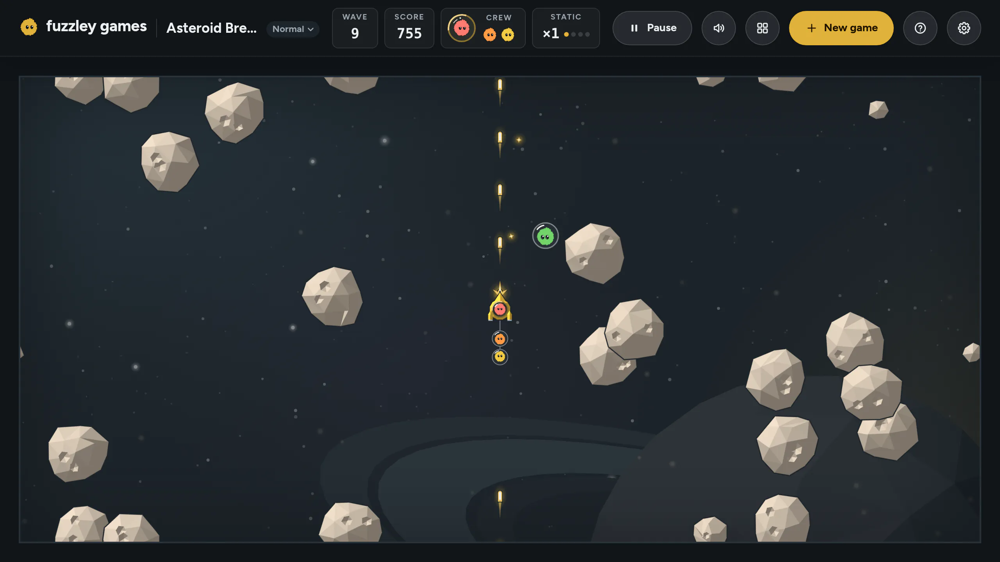
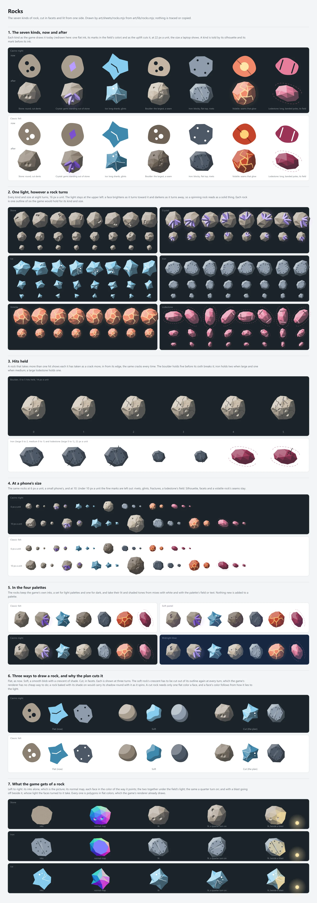
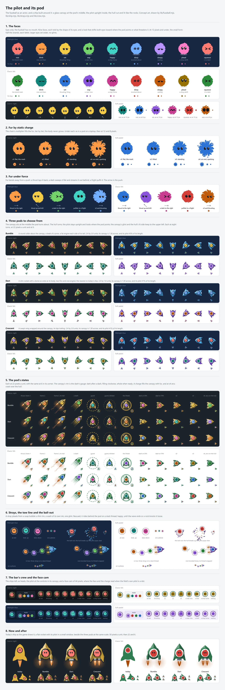
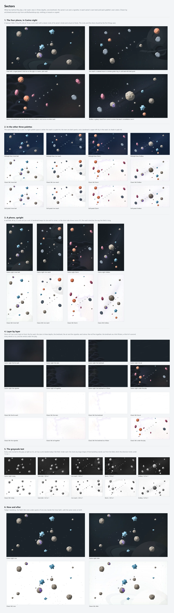
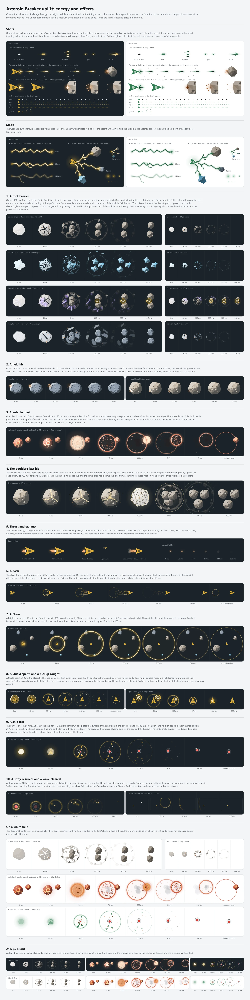
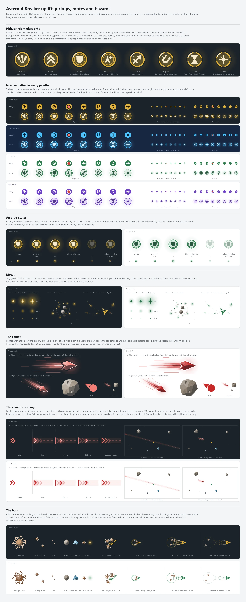

# Plan: an uplift for Asteroid Breaker

Written 2026-11-14, for the user's ask: put the game, graphics and sound
design hats on again and design one more uplift, for Asteroid Breaker;
research similar games without looking at their code or copying their
assets; find where the look and the sound can improve (the sounds are "quite
bad right now"), with detailed mocks and then real assets; find changes and
additions to the play, and say what to remove; make more of the fuzzball, in
how it looks and in how it plays; and keep a later progression system in
mind (levels, powers chosen from a random few) without designing it yet.

This is a design, its mocks and its assets. Nothing in the game is changed.
The plan makes every choice, so that it reads whole; "What the user settles"
lists the ones that are the user's more than the plan's.

Everything made for the plan is in this folder,
`docs/asteroid-breaker-uplift/`:

- **`plan.md`,** this file, and **`worklog.md`,** what was done in what
  order, to pick the work up from.
- **[`research/`](research/),** four notes.
  [`the-game-today.md`](research/the-game-today.md) is an inventory of the
  game as built, read from its own code, with its autopilot's figures for
  every wave. [`mechanics.md`](research/mechanics.md),
  [`look-and-feel.md`](research/look-and-feel.md) and
  [`sound.md`](research/sound.md) are what other games and their makers
  teach, read from reviews, wikis, interviews, talks' summaries and design
  essays. No game's source was opened and no asset was copied; each note
  ends with what it skipped to keep that rule.
- **[`art/`](art/),** the art: its direction and its kit
  ([`art/README.md`](art/README.md)), the scripts that draw it (`art/lib/`,
  `art/sheets/`), and the sheets they draw: [`rocks.svg`](art/rocks.svg),
  [`pilot-and-pod.svg`](art/pilot-and-pod.svg),
  [`sectors.svg`](art/sectors.svg),
  [`energy-and-effects.svg`](art/energy-and-effects.svg) and
  [`pickups-and-hazards.svg`](art/pickups-and-hazards.svg), each with a
  preview in `art/preview/`.
- **[`mocks/`](mocks/),** the game as it would look in play: the same
  moments now and after, on a laptop and on a phone, in a dark palette and
  a light one.
- **[`sound/`](sound/),** the sound: its direction and its kit
  ([`sound/README.md`](sound/README.md)), a synth written for the plan
  (`sound/lib/`), a recipe for every sound (`sound/recipes/`), each take's
  measurements (`sound/report/`) and its picture (`sound/sheets/`), and a
  page to hear them on (`sound/audition/`).
- **[`assets/`](assets/),** what the game can use as it is: the sounds as
  files, the art as sprites, atlases and the geometry they were drawn from.

## What was asked, and where it is answered

| Asked                                            | Answered in                                                           |
| ------------------------------------------------ | --------------------------------------------------------------------- |
| Research on similar games, no code and no assets | `research/`, and "What other games teach"                             |
| Where the look can improve                       | "The game today", "Look", `art/`                                      |
| Where the sound can improve                      | "The game today", "Sound", `sound/`                                   |
| Detailed mocks                                   | `art/`'s five sheets, and `mocks/`                                    |
| Real assets                                      | `assets/`, and "The assets"                                           |
| Changes and additions to the play                | "Play"                                                                |
| What to remove                                   | "What goes"                                                           |
| More of the fuzzball, in look and in play        | "The fuzzball", and the sheet `pilot-and-pod`                         |
| A later progression system kept in mind          | "Room for a progression system"                                       |
| A dedicated branch, regular commits, a work log  | The branch `claude/asteroid-breaker-uplift-a0bd76`, and `worklog.md` |

## The game today

`research/the-game-today.md` has all of it. In brief:

- **A ship on a field that wraps and fills the screen,** 40 units on its
  short side. It turns, thrusts, fires seven shots a second and dashes.
- **Seven kinds of rock in four sizes,** eight pickups, a comet, and stray
  fuzzballs to bring home. Thirty written waves in three sectors, then
  Endless. Three ships, and one more at 10,000 points and every 20,000
  after.
- **A chain:** breaks within 1.5 s of each other score double from the
  fifth, triple from the tenth and four times from the twentieth.
- **Rules that prove themselves.** The rules play the same from a seed, and
  an autopilot clears every wave in the specs.

What it lacks, by the inventory and the research:

- **Depth.** All art is drawn at run time from seven kinds of shape, each
  one flat, opaque color. A rock is one ink with marks in the field's
  color. Nothing is lit, nothing glows, and the backdrop is the same specks
  in every wave and sector.
- **Sound.** Fourteen sounds at 16,000 samples a second, from sine tones
  and one dull noise, dry, one take each. Measured, none has anything above
  8 kHz, and a phone's speaker, which gives little under 300 Hz, plays 4%
  of a large rock's break and 13% of a blast. Three sounds stand in for
  unrelated events, a boulder's break sounds as each hit it held, and the
  gun is one sample seven times a second. The game's own sound lab says the
  sounds "need designing again".
- **A fuzzball that acts.** The pilot is 5 to 14 CSS px across in the
  ship's window. It has one face, looks where the ship heads and blinks on
  a clock. A stray brought home scores 500 points and changes the color of
  the next ship's pilot, and nothing else. A pilot whose ship is lost
  floats off as a flourish.
- **Feedback.** Three events play nothing at all and six play a sound and
  show nothing. Nothing marks a dash charged again, an effect ending, or
  the chain reaching a step. Every pickup is the same hexagon.
- **A reason to fly into the rocks.** Shots carry 25 units, so the safest
  play is to stand off and shoot, and the chain pays that as well as it
  pays anything.
- **Flow.** The autopilot clears a wave in 7 to 31 seconds on a phone's
  field and 20 to 63 on the widest, and every wave has two cards, one as it
  is cleared and one before the next. A stray often never comes, because
  its wave is cleared first.

## The uplift in brief

- **The look: cut stone, soft fuzz, bright sparks.** Every rock is cut in
  flat facets and lit by one light from the upper left, which stays put as
  the rock spins. Energy glows. Each sector gets a place of its own behind
  the play. The fuzzballs are the only soft things on the field.
- **The pod.** The ship becomes a pod built round a glass canopy, with the
  fuzzball in it, large, upright whatever way the pod points, and acting:
  it looks, squints, startles, cheers, and its fur stands with static.
- **The crew flies with you.** The fuzzballs that were ships in the bar
  ride in tow behind the pod, each in a bubble. A hit knocks the last one
  loose to be caught again; a hit with no one in tow ends the run. A stray
  caught joins the line. Nobody is ever lost: a fuzzball that drifts off
  floats home.
- **Sparks and static.** A broken rock sheds sparks, and the pod gathers
  those near it. Sparks build static, static is the score's multiplier and
  the fur's lift, and at full static the next dash is a zap that arcs to
  the rocks around it. It replaces the chain's timer, and it is the reason
  to fly into the rocks.
- **Every sound made again,** with a synth written for the plan: struck
  things that ring by their material, several takes of anything heard
  often, everything pitched in one key, a chain that climbs a scale, a
  small voice for the fuzzball, and a bed under each sector.
- **Less of what was weak:** ships by points, the Extra ship and Nova
  pickups, the chain's timer, and one of the two cards between waves go.
- **Room for progression:** sparks are the thing a level would be earned
  with, the one card between waves is where a choice would be made, and
  each fuzzball in tow is a place a power could sit.

## What the user settles

Ten choices are the user's more than the plan's. "Decisions" marks each
**the user's** and says what it could be instead.

1. **The crew in tow is the run's lives** (decision 5), and not ships as
   now.
2. **Sparks and static replace the chain's timer** (decision 7).
3. **The zap is the dash at full static** (decision 8), and not a button
   of its own.
4. **Rocks are cut in facets and lit** (decision 1), and not soft or flat.
5. **Which pod** (decision 3): the sheet draws three.
6. **Nova and Extra ship go** (decision 10).
7. **The burr** (decision 12): the first thing on the field that is not a
   rock, a comet or a fuzzball.
8. **The fuzzball has a voice, and a bed plays under each sector**
   (decisions 15 and 16).
9. **One card between waves** (decision 11).
10. **Bests start again** at the slice that changes how a run scores
    (decision 18).

## Decisions

Each says what the plan chose, why, and what it could be instead.

### Look

1. **Rocks are cut in facets and lit from one side** (**the user's**). A
   flat ink can't show a rock turning, and a rock shaded once would carry
   its shadow round as it spins. A facet needs one flat color, which the
   game's renderer already draws, and its color follows from how it lies to
   the light. `art/rocks.svg` draws the three ways side by side.
   _Instead:_ soft blobs with a lit middle and a darker rim, which look the
   same at every turn and so never look lit; or flat, as now.
2. **Glow is a soft halo under plain alpha, never an additive blend.** Two
   of the four palettes have a white field, where added light shows
   nothing. A halo in the thing's own color tints white and brightens dark.
   Glow is rationed to what gives off light: shots, the flame, static, a
   crystal's gems, a volatile rock's seams, pickups and the comet.
   _Instead:_ additive glow in dark palettes and none in light ones, which
   makes two games.
3. **The ship becomes a pod built round its pilot** (**the user's**, for
   which pod). The canopy is round and sits at the pod's middle, so the
   fuzzball in it can stay upright while the hull turns around it. It is
   two fifths of the pod's length or more, where today it is a third of a
   small rocket. _Instead:_ today's rocket with a larger window.
4. **Each sector has a place behind the play, dim and nearly still.** The
   research's rule is that nothing behind the play may be as bright, as
   sharp or as saturated as anything that plays, and that a moving backdrop
   is a named complaint. Each place is washes, stars in three depths and
   one landmark, mixed from the palette's own colors. _Instead:_ none, as
   now.

### Play

5. **The crew in tow is the run's lives** (**the user's**). It makes the
   fuzzballs what the run is about, shows the lives on the field, and turns
   each hit into a rescue. The research's liked rescues give a window to
   recover and show where the rescued are (Yoshi's Island, Kirby Mass
   Attack, Defender); its resented ones scatter a crowd or fail by rules
   nobody explained (Sonic 3D Blast, Resogun). So one fuzzball is knocked
   loose at a time, it blinks before it goes, and it floats home rather
   than dying. _Instead:_ ships as now, with the tow line as decoration
   and the lost ship's pilot as the one thing to catch.
6. **Bubbles in tow can't be hit.** Only the pod is. A tail that could be
   hit would make the pod five times the target in a crowded field, which
   is Flicky's rule and its complaint.
7. **Sparks and static replace the chain's timer** (**the user's**).
   Geometry Wars 2 added things to fetch because its first game's best
   play was to circle the edge; here the best play is to stand off. Sparks
   leave no safe standing room, they are what a later system would count
   as experience, and one meter does what the chain, a charge and the fur
   would each have needed a display for. _Instead:_ keep the chain as it
   is and add sparks only when progression needs them.
8. **The zap is the dash at full static** (**the user's**). The deck has
   two buttons and a third costs every touch player room. The dash is
   already the fuzzball's own move. _Instead:_ a third button; or no zap,
   and static only multiplies.
9. **Static drains; it doesn't snap to nothing.** After two seconds with
   no spark it runs down a step every five seconds, and a hit costs one
   step. A multiplier that vanished at once is the harsher of the two
   models the research found (Resogun's), and phones are where that hurts
   most.
10. **Nova and Extra ship go** (**the user's**). The zap is the Nova,
    earned. A stray is the extra ship, rescued. The other six stay, all
    good, three of them weapons that last 12 s or less: the research found
    no asteroid game with a bad pickup, and games with builds keep such
    weapons as short surges over them. _Instead:_ keep all eight.
11. **One card between waves** (**the user's**). A wave still waits for
    the player's first move, which the research says to leave alone: it
    answers the genre's oldest complaint, no rest. But the cleared wave's
    tally and the next wave's name share one card, so one press goes on.
    _Instead:_ two cards, as now.
12. **The burr** (**the user's**). A small prickly seed that clings to the
    pod and slows it until a dash shakes it off. It never takes a
    fuzzball. The earlier plan chose no enemy ships, and this keeps to it:
    nothing shoots. The research's liked hazards drain rather than kill,
    and its complaint about chasers is that they bunch, so burrs are few
    and slow. _Instead:_ none.
13. **The last rocks come to the pod.** Every fix the research found for a
    wave's slow tail is a clock that sends something, which taxes the hunt
    without shortening it. Here the last few rocks lean toward the pod as
    a lodestone does. _Instead:_ send the comet sooner as a wave ages.
14. **Each sector's last wave is a set piece.** A boulder that sheds
    stones as it is hit, one with an iron rind, and a pair with volatile
    hearts. The research's complaints about bosses are length and
    pushovers; these are one wave each.

### Sound

15. **The fuzzball has a voice** (**the user's**): short, wordless and
    rare. A whee on a dash, an eep at a near miss, a trill at a rescue. It
    is the cheapest way to make the mascot a character, and the first
    thing to grate if it speaks too often, so it never speaks twice within
    two seconds. _Instead:_ none.
16. **A bed plays under each sector** (**the user's**): a slow, quiet
    drone in the game's key, with a pulse that joins when static is high.
    It is not a score, which is a body of work of its own. _Instead:_
    silence under the effects, as now.
17. **Every sound is synthesized again, with a synth of the plan's own.**
    The sound lab lists five ways to better sounds. Synthesis keeps every
    sound original and free to share, builds the same bytes every run, and
    lets a recipe make as many takes as wanted. What it lacks is an ear:
    nothing here was heard as it was built ("Risks").

### Keeping

18. **Bests start again at the slice that changes how a run scores**
    (**the user's**). Sparks and static change what a score means. A best
    is kept with the number of the rules it was made under, and one from
    older rules is shown as "earlier rules" and no longer beaten.
    _Instead:_ keep the old bests standing.
19. **Everything ships in slices,** sound first, since it changes no rule
    and is the worst of what is there; then the look; then the pod; then
    the rules, one at a time. Each slice leaves the game whole.

## Design reference

### Look

`art/README.md` is the direction in full: cut stone, soft fuzz, bright
sparks. Three materials, each drawn one way.

- **Rocks.** Each is a low dome of flat facets, 6 to 40 of them by its
  size, made from a seed. A kind is told by its silhouette and its mark
  before its ink: stone is round with cut dents; ice is long shards with
  glints; a crystal is gems standing out of stone, glowing; iron is blocky
  with a flat top, a seam and rivets; a volatile rock's seams glow; a
  lodestone is long, banded at its poles, with its field drawn round it;
  the boulder is the largest, with a seam its cracks follow.
- **One light.** It comes from the upper left and from the viewer's side.
  A face takes one of four tones of its ink by how it lies to the light:
  lit, ink, shade and deep. A blast, a zap and the comet are lights too,
  for as long as they last, and the faces turned to them take their color.
- **Hits held are cracks,** one more a hit, in from the edge, the same
  ones every time. The boulder shows five before its sixth breaks it.
- **The inks are the game's own,** as now, a set for light palettes and
  one for dark. The lit and shaded tones are mixes with white and with the
  palette's field or text, so nothing is added to a palette.

- **The pod.** A hull in the palette's accent, cut and lit as the rocks
  are, round a glass canopy at its middle. A clear prow and engines behind
  say which way it points at 14 px long. The sheet draws three to choose
  from: Bumble, a round collar with a beak of a prow and an engine each
  side; Dart, a slim rocket with a dome as wide as its body, nearest to
  today's ship; and Crescent, a swept wing wrapped round the canopy. The
  mocks use Bumble, whose canopy is the largest.
- **The pilot** is the brand's fuzzball exactly, at rest. It stays upright
  as the pod turns. It has nine faces, drawn with its eyes alone, and a
  look that shifts them toward where the pod points or what threatens it:
  at rest, blinking, set, startled, happy, dizzy, sleepy, pleading and
  squeezed shut. Its fur shows force (it lags a thrust and sweeps flat in
  a dash) and static (four steps, from flat to on end and sparking).
- **The state of the pod is on the pod.** Static is the fur and a thin
  ring round the canopy that fills. The dash charging again is a short arc
  behind the canopy, which pulses once when it is ready. A weapon's time
  left is an arc outside those. The Shield is a glass shell. No digits are
  drawn near the pod.
- **The bar's face cam.** On a phone the pilot's face is a few pixels, so
  the bar's first crew figure is the pilot at the controls, larger, with
  its face and its fur as they are on the field.

- **The Inner belt, the Iron reach, the Storm and Endless** each get a
  far wash, stars in three depths, one landmark cut off by the field's
  edge, a little air (dust, glints, wind) and a vignette. In a light
  palette a place is a pale wash and dark specks on white.
- **Each landmark:** the limb of a ringed planet low in the Inner belt; a
  cratered moon in a broken ring of girders in the Iron reach; a
  thunderhead up one side of the Storm, with forks inside it; and a
  galaxy's band across Endless, under the constellation the game already
  draws there.
- **Quiet by measure.** Nothing large in a backdrop stands out from the
  field by more than 1.3 to 1, where a rock keeps 3 to 1; the sheet prints
  each place's figure in each palette.
- **Nearly still.** The wash, the far stars and the landmark stay. The
  nearer stars slide against the pod's travel by 3% of it at most, each
  place's air drifts on a wind of its own, and a fork in the Storm's cloud
  flickers once in eleven seconds or so. Where motion isn't welcome nothing
  moves.

- **Shots** are a bright middle, a body and a halo, and a short tail, one
  shape for each weapon: the gun's bolt, Spread's three lighter ones,
  Rapid's small darts, Lance's long needle. The middle stays the field's
  text color, as a shot is now; the body and the halo take the accent, the
  pod's own color. **Static** is a jagged arc with a near-white middle, and
  the accent's densest ink on a white field.
- **A rock's break is its own facets flying apart,** tumbling and fading
  to the field's color so that no shard is taken for a small rock, with a
  ring of dust, a few sparks of light, and the sparks it sheds. The whole
  of it is over in under half a second.
- **A medium dose.** The research's one large study has both no feedback
  and too much doing worse than the middle. Every effect is quick and
  clears what is under it, and a player's own effects rank under threats:
  they fade faster as their count rises.

- **Pickups are round glass orbs,** since round is a friend, each with a
  bold symbol, grouped by its rim: one ring for a weapon, a doubled ring
  for protection, a ring cut in four arcs for what changes the field. The
  sheet draws all eight the game has; the plan keeps six.
- **The comet** is a long cut wedge in the danger color with a glowing
  tail, and its warning is chevrons at the edge with a faint line along
  its lane.
- **The burr** is a round seed with many thin hooked spines.

What some sizes come to. A field unit is the field's short side over 40.

| Screen                   | A unit | The pod | The pilot | A small rock | A spark |
| ------------------------ | ------ | ------- | --------- | ------------ | ------- |
| Small phone, upright     | 6 px   | 14 px   | 6 px      | 11 px        | 2 px    |
| Large phone, upright     | 9 px   | 22 px   | 10 px     | 16 px        | 3 px    |
| Laptop, 1280 × 720       | 15 px  | 36 px   | 16 px     | 27 px        | 5 px    |
| Desktop, 1920 × 1080     | 24 px  | 58 px   | 25 px     | 43 px        | 7 px    |

Under 10 px a unit each piece leaves out its fine marks, as its sheet
shows: rivets, glints, fractures, a lodestone's field, the pilot's glints.

### Sound

`sound/README.md` is the direction in full, and `research/sound.md` what
it rests on.

- **Layers, each with a job:** a transient that says when, a body that
  says what and how big, a tail that says where, and air above 6 kHz that
  says it is near. Most of today's sounds are a body alone.
- **Material is the ring.** Stone knocks and crumbles. Ice is glass. A
  crystal chimes in key. Iron clanks and rings on. A volatile rock thumps,
  roars and crackles. Size moves all of it down in pitch and out in time.
- **One key.** Everything pitched is in C major pentatonic, which is A
  minor pentatonic too: rewards lean on C, E and G, danger and loss on A,
  C and E. No two of its notes clash, however many sound at once.
- **Sparks run up a scale.** Each spark gathered plays the next note of
  the ladder, and a small bell under each break plays the step static has
  reached, so a good run of play is heard as a climb. Today's chain rises
  a semitone a break and stops at the eighth, before either of its last
  two steps.
- **Takes.** Anything heard often has three to five takes, and the game
  varies each play of a noisy sound a little more: up to 40 cents either
  way and 1.5 dB. A tuned sound varies by its takes alone, so it stays in
  key.
- **The gun stays dry, and a burst ends with air.** A shot is short and
  nearly dry, since seven a second would smear a room. When the fire stops,
  one tail plays: the last shot's echo.
- **Six levels are the mix** (`LEVELS` in `sound/build.mjs`): a shot's
  tick sits 16 dB under a blast, so nothing needs turning down in the
  game, and a crowd of breaks stays under the events that matter.
- **A phone must still hear it.** Every sound but a bed keeps 35% of its
  energy above 300 Hz, and the build warns of one that doesn't.
- **The voice.** Eight short calls, each with two or three takes, a
  source like a small reed through two or three moving resonances, between
  500 and 1,600 Hz. It speaks at a near miss, a rescue, being knocked
  loose, a wave cleared and a stray's arrival, at one dash in three, and
  never twice in four seconds. The research's makers of such voices agree
  on one thing: fewer than you think.
- **The comet's warning gets faster, not louder.** The research on
  warnings has rate carrying urgency and loudness carrying annoyance.
- **The beds.** One loop a sector, 16 s, in stereo, 12 dB under a shot,
  and two layers over it that fade in with static: a pulse from step two
  and a shimmer at step three. Muted by its own setting.

How the game plays them is as much of the uplift as the sounds are:

| Rule                 | What                                                                                              |
| -------------------- | ------------------------------------------------------------------------------------------------- |
| Takes in turn        | A sound with takes plays the next one each time, never the same twice running                           |
| Variation            | ±40 cents and ±1.5 dB a play, for a noisy sound at the levels `tick` and `small`; never a tuned one     |
| Place                | A sound is panned by where it happened across the field, to 60% of full left or right, its lows less    |
| Voices               | Four of one sound at once, eight of one family, twenty-four in all, the oldest and quietest giving way  |
| Once a frame         | Each sound plays once a frame at most, at the highest it was asked for, as now                          |
| A crowd              | More than three rocks broken in one frame play as the two largest and one `break-cluster`               |
| Ducking              | A sound at the level `huge` turns the `tick` and `small` levels down 6 dB for a third of a second       |
| The last word        | A limiter on everything, so thirty breaks under a blast never clip; busy play at about -17 LUFS         |
| The voice's patience | The fuzzball speaks at most once in four seconds, the rarer call winning                                |
| Rapid                | Its shot plays 3 dB under the gun's, since twice as many are heard                                      |
| A phone              | Sound starts at the first press; an iPhone on silent stays silent; a setting sums the two ears into one |

### Play

Every number here is a first guess in the game's own units, to be tuned by
hand and by the autopilot as each slice is built.

#### The crew in tow

- **A run starts with a crew of three:** one at the controls and two in
  tow. Six is the most: five in tow.
- **In tow,** each fuzzball rides in a bubble 0.7 units in radius, 1.6
  units behind the one ahead, on a line that swings as the pod turns and
  finds the short way across the field's edges. Rocks, comets and shots
  pass through a bubble in tow. Only the pod is hit, as now.
- **A hit with someone in tow** knocks the last one loose. The rock that
  hit breaks a size down, as it does against the Shield today, the pod
  can't be touched for 1.5 s, and static falls a step.
- **Loose,** a fuzzball flies from the pod at 6 units a second, slows to a
  stray's drift, and wraps with the field. For 6 s it can be caught again
  by touching it, as a stray is; it blinks for its last 2 s; then it
  floats home, and is out of the run.
- **A hit with no one in tow** ends the run. The pod bursts, the pilot
  bails out in a bubble and floats home, and the result says "Everyone is
  home."
- **A stray caught** joins the line and scores 500 times the multiplier,
  as now. With five in tow it goes straight home for 1,000.
- **Strays come when they can still matter.** Most waves send one, as
  now, but it comes within the first 5 s of play on any field, and a pilot
  with no one in tow is sent one at once, once a wave.
- **A wave cleared with no hit taken** pays what a clean wave pays now.
- **What they do in tow.** A fuzzball in tow gathers any spark within 1.2
  units of it, so a long tail sweeps more of the field. It looks at what
  is near, startles when a rock passes close, and cheers as a wave is
  cleared. Each is a place a power could later sit ("Room for a
  progression system").

#### Sparks and static

- **A broken rock sheds sparks:** one from a small rock, two from a
  medium, three from a large, eight from a boulder, two more from a
  crystal, and none from a rock a comet smashed. They fly 1 to 2 units
  out, hang for 4 s, and blink for the last one.
- **The pod draws sparks in** from 5 units, 8 at the Relaxed speed and 14
  under the Magnet. Each scores 5 points times the multiplier.
- **Static** runs from 0 to 40. Each spark adds one, and a near miss adds
  two: a rock or a comet passing within half a unit of the pod's hit
  circle without touching it.
- **Static is the multiplier:** times two from 10, three from 20 and four
  from 30. It is drawn as the pilot's fur: flat, lifted, standing, on end.
- **It drains.** After 2 s with no spark it falls by two a second. A hit
  drops it to the foot of the step below.
- **At 40 the next dash is a zap.** Arcs leap from the pod to the six
  nearest rocks within 6 units of its path, each takes a hit, and static
  falls by 20. What the zap breaks sheds sparks like any other, so a good
  zap pays for part of the next.

#### Pickups

| Pickup     | Now                                | In the plan                                   |
| ---------- | ---------------------------------- | --------------------------------------------- |
| Spread     | three shots a pull, 12 s           | as now                                        |
| Rapid      | a shot twice as often, 12 s        | as now                                        |
| Lance      | a shot breaks up to three, 10 s    | as now                                        |
| Shield     | the next hit breaks the rock       | as now; it is spent before anyone in tow is   |
| Magnet     | pickups and strays from 14 units   | and sparks, and a loose fuzzball              |
| Slow       | rocks and comets at half speed 8 s | as now                                        |
| Nova       | a ring that hits rocks in 12 units | gone: the zap is the Nova, earned             |
| Extra ship | one more ship                      | gone: a stray is the extra ship, rescued      |

- **A pickup says what it is** by its symbol and by its rim: a weapon's
  rim is one ring, protection's is doubled, and the rim of what changes the
  field is cut in four arcs.
- **A pickup dropped and a pickup fading are heard and seen,** which
  neither is now.

#### The wave

- **The last rocks come to the pod.** When three or fewer are left on a
  field of 40 by 40, more by the field's area, each leans toward the pod
  as a lodestone does, never faster than its size flies.
- **One card between waves.** It shows the cleared wave's tally, counting
  up, the crew cheering, and the next wave's name, and the next wave
  starts at the player's first move, as now. A sector's first wave shows
  the sector's name over its place.
- **Three set pieces.** Wave 10, Boulder: each hit the boulder holds
  knocks a medium stone off it. Wave 20, Iron heart: the boulder has an
  iron rind; its first three hits ring, and each knocks a plate off as a
  medium iron rock. Wave 30, Eye of the storm: each boulder has a volatile
  heart, and each hit it holds vents a blast that reaches 6 units and
  hurts only rocks. Each drops two pickups as it breaks.

#### The burr

- **From the Iron reach on,** in the waves that say so, as a wave's
  strays are said. A round seed 0.6 units in radius comes in off an edge
  at 2.5 units a second and, within 12 units of the pod, turns toward it
  by 30 degrees a second. One shot pops it, for 10 points and a spark.
- **It clings.** A burr that touches the pod sticks to it. Each one takes
  a fifth off the pod's thrust and top speed, and three is the most.
- **A dash sheds them all,** and each pops as it flies off.
- **Never a crowd:** two adrift at most on a field of 40 by 40.

#### What goes

- **Ships by points,** at 10,000 and every 20,000, and the **Extra ship**
  pickup. Lives come from strays.
- **The Nova pickup.**
- **The chain's timer.** The multiplier is static's.
- **The second card between waves.**
- **The new ship that waits where it is safest.** The pod is never
  replaced within a run, so nothing waits. The rule that a wave waits for
  the first move stays.
- **Sounds that stand in for others:** iron's ring for the Shield, the
  blast for the Nova, a large rock's break for a boulder's every hit.

#### What stays as it is

The field that wraps and fills the screen. The flight, the dash and the
three ways to steer. Seven kinds of rock and what each does. The comet's
rules. The thirty waves' rocks and Endless's. The three speeds. All-good
pickups. A wave that waits for the player.

### The fuzzball

| Where            | Now                                             | In the plan                                                               |
| ---------------- | ----------------------------------------------- | ------------------------------------------------------------------------- |
| At the controls  | 5 to 14 px in a window, one face                | 6 to 25 px in a canopy, nine faces, fur that shows force and static       |
| The lives        | Icons in the bar                                | Fuzzballs in tow behind the pod, and in the bar                           |
| A hit            | The ship bursts, and the pilot is gone for good | One is knocked loose, to be caught again in 6 s                           |
| A stray          | 500 points, and a color for a later pilot       | A life, in tow at once, sweeping up sparks                                |
| Its power        | None                                            | Static: its fur, the multiplier and the zap                               |
| Its voice        | None                                            | Eight short calls                                                         |
| The bar          | Still icons                                     | A face cam of the pilot, and the crew, who react                          |
| The cards        | Strays at home, on two cards                    | The crew cheers on the cleared card; "Everyone is home" at the end        |
| Nobody dies      | A pilot is lost with its ship                   | A fuzzball that goes, goes home                                           |

### Feel

Each is off where motion isn't welcome. There, what tells the player
something keeps a still mark (a crack on a rock that held a hit, one ring
at a blast's reach, at a dash's start and round a spent Shield, a
warning's chevrons held), and what only dresses a moment shows nothing, as
the sheet says of each.

| Moment                    | What is added                                                                   | How long    |
| ------------------------- | ------------------------------------------------------------------------------- | ----------- |
| A shot leaves             | a two-frame flash at the prow                                                   | 33 ms       |
| A rock breaks             | its facets fly apart, a ring of dust, sparks of light; the field kicks along it | 450 ms      |
| A hit is held             | the struck faces flash, a crack is added, a spark flies                         | 150 ms      |
| A blast                   | a flash, a ring with a hot inner edge, embers; rocks nearby take its light      | 600 ms      |
| A boulder breaks          | three beats, crack, split and throw; the field holds still first                | 90 + 700 ms |
| Static steps up           | a ring from the pod, the fur lifts, a chime                                     | 300 ms      |
| A zap                     | the field holds still, then arcs with a white core, each rock flashing as hit   | 60 + 350 ms |
| A fuzzball knocked loose  | the pod flashes, the bubble flies, the field shakes along the hit               | 300 ms      |
| A fuzzball caught         | a soft ring, the line springs                                                   | 300 ms      |
| A sector's last rock      | the field slows to a third for a moment, then the wave's ring                   | 250 ms      |
| The run's end             | the pod bursts, the pilot's bubble rises, and the card waits for it             | 1.4 s       |

- **A budget.** The field shakes for a hit and a boulder and for nothing
  else, along the way the hit came, and is still again within 0.3 s. It
  holds still for a boulder, a zap and the run's end only. The research's
  limit of three flashes a second is kept by the game's own limiter, one
  flash every 0.34 s.

### Accessibility

- **Nothing is told by color alone,** as now: every kind of rock has its
  silhouette and mark, every pickup its symbol and rim, and static its fur
  and ring.
- **Nothing is told by sound alone.** Every sound has something seen with
  it, which six events lack now.
- **The announcer says** a fuzzball knocked loose and how many are in
  tow, one caught again, one floated home, static full, a zap, and a burr
  clinging, as it says each turning point now.
- **Motion.** Every effect has a still form. The backdrops hold still.
- **Sound has its own settings:** effects, the voice and the bed, each on
  or off, beside the Sound button that mutes all three.
- **Contrast.** The lit tone of a rock in a light palette and the shaded
  tone in a dark one are held to 3:1 against the field with the rest, in
  the contrast spec, before the slice that draws them ships.

### What it keeps

- **Settings, progress and the records' other figures** carry over.
- **Bests** are kept with the number of the rules they were made under
  (decision 18).
- **A saved run** from before a slice that changes the rules is dropped,
  as one from another version is now. After it, a saved run keeps who is
  at the controls and who is in tow, and static. Sparks, a loose fuzzball
  and burrs go, as pickups and shots go now.

### Room for a progression system

The system is a later plan. This one leaves it:

- **A thing to earn it with.** Sparks are gathered one at a time, at a
  reach that is already a number a pickup changes. A level could be so
  many sparks.
- **A moment to choose in.** The one card between waves is a stop the
  game already has, and a wave waits for the player after it.
- **A place for a power to sit.** Each fuzzball in tow could carry one,
  which would make five slots, seen on the field, lost for a while when
  its fuzzball is knocked loose and won back when it is caught.
- **Numbers that are values and not constants.** The debug menu already
  hands the field nine of its numbers at run time. The uplift's rules add
  theirs the same way, so a power can change one: shots a second, shots in
  flight, a shot's speed and how many rocks it breaks, the reach sparks
  are drawn from, static's size and drain, the zap's arcs and reach, the
  dash's length and its time to charge, the most in tow, how long a weapon
  lasts.
- **Events to hang effects on.** The field logs a spark gathered, static
  stepping up or down, a zap and each rock it hits, a near miss, a
  fuzzball knocked loose, caught and gone home, a burr clinging and shed.
- **Headroom on the screen and in the mix.** A player's own effects rank
  under threats and fade faster as they multiply, the danger color and the
  comet's shape are no power's to use, and the levels of the mix leave
  12 dB between a shot and an event.
- **A sound and a mark held back.** `level-up` is made and unused, and
  the ring a step of static sends from the pod is the shape a level would
  send, larger.
- **A decision it must make.** Spread, Rapid and Lance are what such
  games sell as lasting powers. The plan keeps them as pickups that last
  12 s; a progression system would either leave them as surges over a
  build or take them over.

### The assets

`assets/` holds what the game can use as it is.

- **Sound:** every take as a WAV at 44,100 samples a second
  (`assets/sound/wav/<family>/`), `assets/sound/sounds.json` saying what
  each is, its level, its takes and the events that play it, and the beds
  as Ogg and M4A. The recipes build the same bytes every run, so the
  files can be made again from `sound/build.mjs`.
- **Art:** each piece as an SVG in a dark palette and a light one
  (`assets/art/sprites/`), atlases as PNG with their frames
  (`assets/art/atlas/`), and the geometry every piece was drawn from as
  JSON (`assets/art/geometry/`): points, facets and their normals, in
  field units, with roles in place of colors. The game draws its art at
  run time in the palette on the page, so the geometry is what it would
  take; the sprites and atlases are for anything that wants pictures.

### Where the code goes

The game's layers stay as they are: rules, view, scene, app.

- **Sound.** `@fz/dev/sounds` grows into the plan's synth, at 44,100
  samples a second, and a game's `tools/build-sounds.mjs` holds recipes as
  `sound/recipes/` does. The sprite becomes Ogg with an M4A beside it for
  Safari, with the times checked again, since a lossy file pads its
  start, and loops kept out of MP3. `@fz/phaser/sound`'s `SpritePlayer`
  learns takes, variation, place, voices, ducking and a limiter, which
  every game drawn with Phaser then has. The sound lab plays the new
  sounds beside the old.
- **The light.** A rock's faces must take the light as it turns. Two
  ways, and a spike decides between them before the slice is planned.
  _A normal map:_ Phaser 4.2.1, which the game is built on, lights an
  object with `setLighting(true)`, takes a texture made at run time as
  another's normal map (`Texture.setDataSource()`), and holds as many
  lights as the game's config says (`maxLights`), added with
  `lights.addLight()`. A blast is then a light for nothing. It costs a
  second atlas and a batch, and it is unused anywhere in this repository,
  so its cost on a phone and how it turns a spinning sprite's normals are
  what the spike must show. _Turns baked ahead:_ each outline is drawn lit
  at twelve turns and shown at the nearest, turned the last few degrees.
  It needs nothing new of the renderer and several times the atlas, and a
  blast's light becomes a tint. The plan's geometry serves both.
- **Glow.** One soft white disc, drawn once into a canvas texture as the
  points' lettering is, tinted and scaled for every halo. The drawing
  vocabulary needs no gradient.
- **Art.** `src/view/art/` draws the new pieces in the shapes
  `@fz/phaser/shapes` has: polygons in flat colors. The fuzzball's faces
  and fur go into `@fz/phaser/fuzzball`, for the other games to share.
- **Backdrops.** Drawn once a wave into one texture; one layer of stars
  may be a second that drifts.
- **Rules.** The crew's line and a loose fuzzball join `src/rules/ship/`
  and `src/rules/hazards/`; sparks and static a folder of their own; the
  burr joins the hazards as a third thing that crosses. All of it is
  drawn from the field's seed, as the rest is, so the autopilot plays it.
- **The autopilot** learns to gather sparks, to catch a loose fuzzball
  and to shed burrs. `report:waves` gains the static each play reached
  and the fuzzballs it lost.
- **The skills and `AGENTS.md`** change with the code they describe.

## Phases

Each is a slice that ships by itself.

1. **Sound (large).** The synth into `@fz/dev`, every sound the game has
   events for now, the play-back rules in `SpritePlayer`, and the ladder
   on today's chain. No rule changes.
2. **Rocks and light (large).** The spike, then the seven kinds cut and
   lit, hits held as cracks, and breaks that throw their own facets. New
   screenshots.
3. **Places and glow (medium).** The four backdrops, the halo, the shots,
   the comet and the pickups as orbs.
4. **The pod and the pilot (medium).** The pod, the faces, the fur by
   force, the state drawn on the pod, the face cam. The fur shows today's
   chain until static arrives.
5. **Feel (medium).** The table above, and a still form for each.
6. **The voice and the beds (small).** With their settings.
7. **The crew in tow (large).** The rule, the saved run, the cards and
   the result, the announcer.
8. **Sparks, static and the zap (large).** The rule, the pickups trimmed,
   bests by their rules.
9. **The wave (medium).** The last rocks, one card, the sectors' names,
   the three set pieces.
10. **The burr (small).**
11. **Progression (its own plan).**

Slices 1 to 6 change no rule of play. Slices 7 and 8 are where the risk
is, and the autopilot's report is run again after each.

## Risks

- **Nobody heard the sounds as they were made.** They were built with
  instruments in place of an ear: loudness, where the energy lies, a
  picture of each take. Those catch a sound that is broken, thin, dull or
  lost on a phone. They can't say whether a break is satisfying or a voice
  is charming. The page in `sound/audition/` is for that, and slice 1
  should start with the user's ear on it. Any sound may need its recipe
  changed, and a few may need a different idea.
- **The light may cost more than it looks.** Phaser 4's lighting is
  unused in this repository. Its types say a texture made at run time can
  be another's normal map; nothing here has tried it. Hence the spike, and
  the second way.
- **The crew in tow makes the game kinder.** A hit that can be undone is
  worth less than a ship lost. The balance is the strays: how often one
  comes, and how long a loose fuzzball waits. The autopilot can't judge
  it, since it almost never takes a hit; it needs playing by hand.
- **Sparks ask for movement,** and rotate-and-thrust is the genre's
  hardest control. A player on keys may find gathering a chore. The reach
  is the number to tune, and Relaxed already has a longer one.
- **More on the screen.** Sparks, a tow line, arcs and halos share a
  field that already holds a hundred rocks, at 6 px a unit on a small
  phone. The phone mock is the first test and not the last.
- **A frame's cost.** Tempest's slowest frames were already over the
  game's bar. Halos are large see-through sprites, which phones draw
  slowly. Each slice that adds some measures them first.
- **The numbers are guesses.** Every number under "Play" is.
- **A tow line across the wrap.** The line must find the short way across
  an edge and be drawn on both sides of it, which the game does for single
  things and not yet for a chain.

## Not in this plan

- **A progression system,** which gets its own.
- **Enemy ships,** and anything that shoots at the pod. The earlier plan
  chose none, and the burr keeps to it.
- **Weapons matched to kinds of rock.** They need a control to switch
  with, the series that had them cut them back, and they would fight the
  choices a build makes.
- **Bad pickups,** which no asteroid game the research read has.
- **A third button.**
- **A score.** The beds are drones.
- **A three-minute mode** with no lives to lose, which the research
  found asked for and liked on short sessions. It is small once sparks
  exist, and worth a slice of its own later.
- **Letting a shot change a waiting pickup** to another of its group. It
  would make a drop a choice; it also makes a pickup something to shoot
  at, which is one rule more than this plan can carry.
- **A gamepad,** as before.

## What other games teach

The three notes hold the detail and their sources. What the plan took:

- **Give the rescued a job, and a way back.** Galaga's designer changed a
  rescue's reward from an extra life to a ship that fights beside you.
  Yoshi's Island makes a passenger knocked loose the thing to catch.
  Sonic 3D Blast scatters a crowd and makes regathering the game, which
  is the warning.
- **A multiplier that must be fetched moves the player.** Geometry Wars 2
  added geoms because the first game's guides said to circle the edge.
- **Meters that waste a full charge get used.** Resogun's overdrive.
- **An escape that pays** is the series' answer to hyperspace, which its
  own designer regretted.
- **Every fix for the slow tail of a wave is a clock.** None shortens the
  hunt; this plan brings the rocks to the pod.
- **No bad pickups, and pickups come to the ship.**
- **Rotate-and-thrust is the biggest barrier.** The game already offers a
  stick that aims and a mouse; the plan adds nothing that needs more
  hands.
- **Glow turns to noise.** Six games drew the same complaint: the
  player's own effects bury the ship. Hence the ration, and the rank.
- **Additive light needs dark behind it,** which two palettes don't have.
- **Eyes do the acting,** and at 16 px they are a pixel or two: draw the
  pilot larger than the hit circle, and repeat a big reaction somewhere
  larger.
- **A wave's rest is worth keeping.** Asteroids' first testers said it
  gave no break; Nova Drift's pause to choose is praised as time to
  think.

## How this was made

- **The research** was read by three agents from prose sources. Each note
  lists what it skipped, and marks what it took from a search listing
  alone.
- **The inventory** was read by a fourth agent from the game's own code,
  and its figures are the game's own autopilot's.
- **The art** is drawn by the scripts in `art/`, from shapes and seeds.
  Nothing was traced or copied. Each sheet was looked at as a picture, in
  a dark palette and a light one, as it was drawn.
- **The sounds** are made by the synth in `sound/lib/`, written for the
  plan, from arithmetic alone: no recording, no sample, no pack and no
  generated audio. Each take was measured and its spectrum looked at.
  None was heard.
- **Not checked:** the sounds by ear; the art in the game's renderer; the
  light's cost; a frame's cost with halos; every number under "Play".
