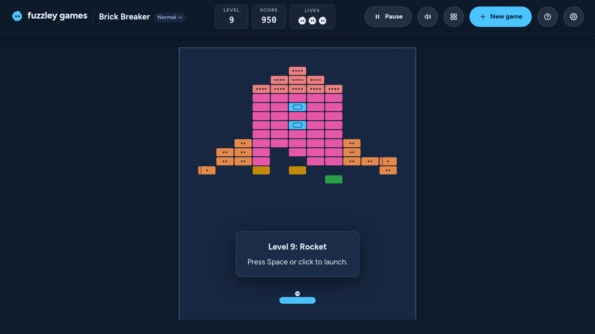
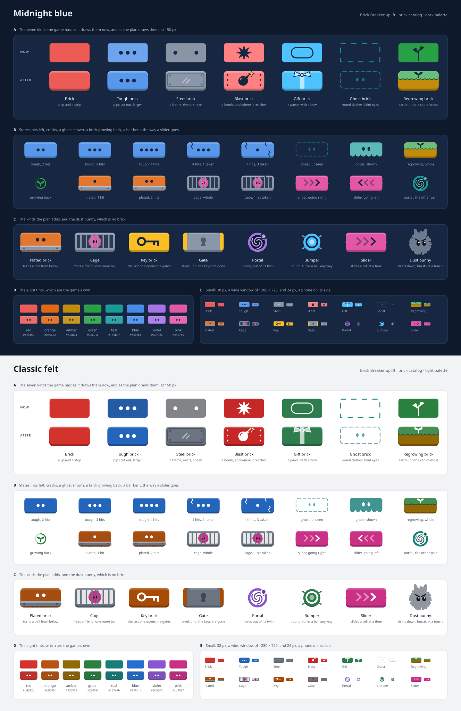
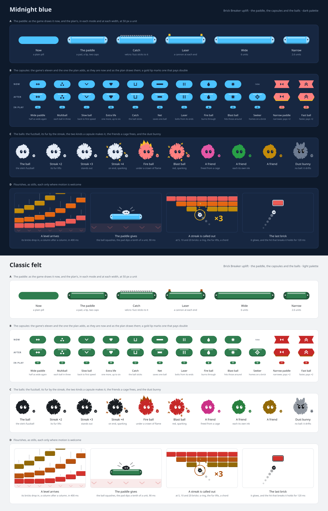
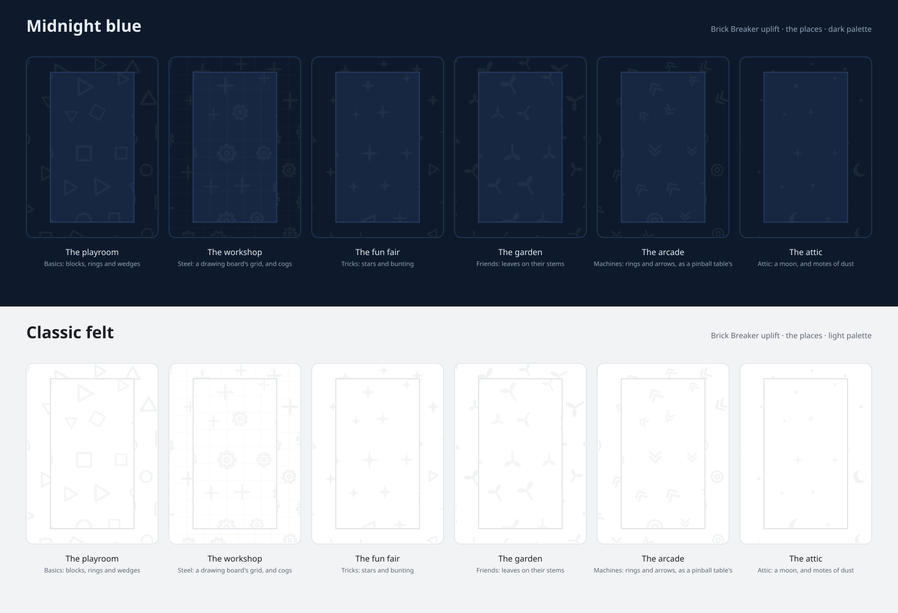
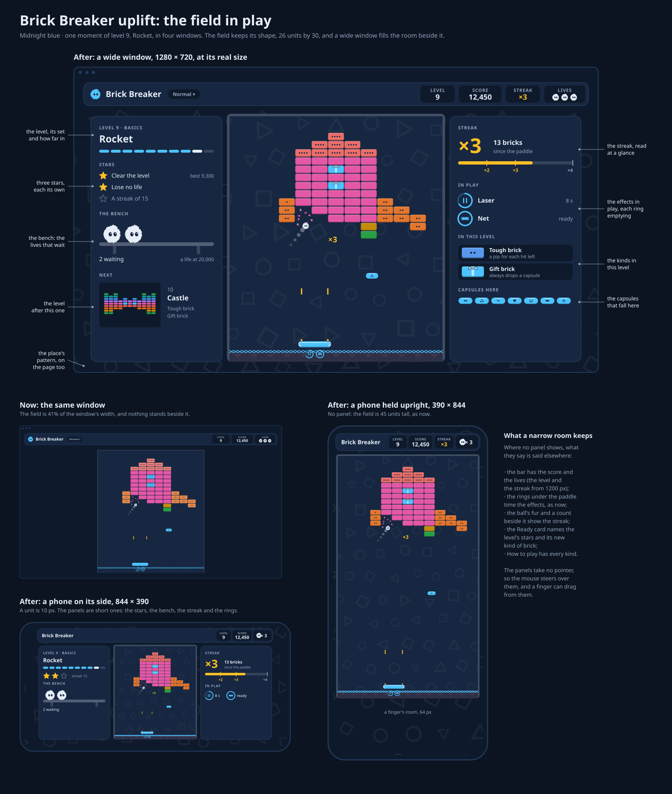
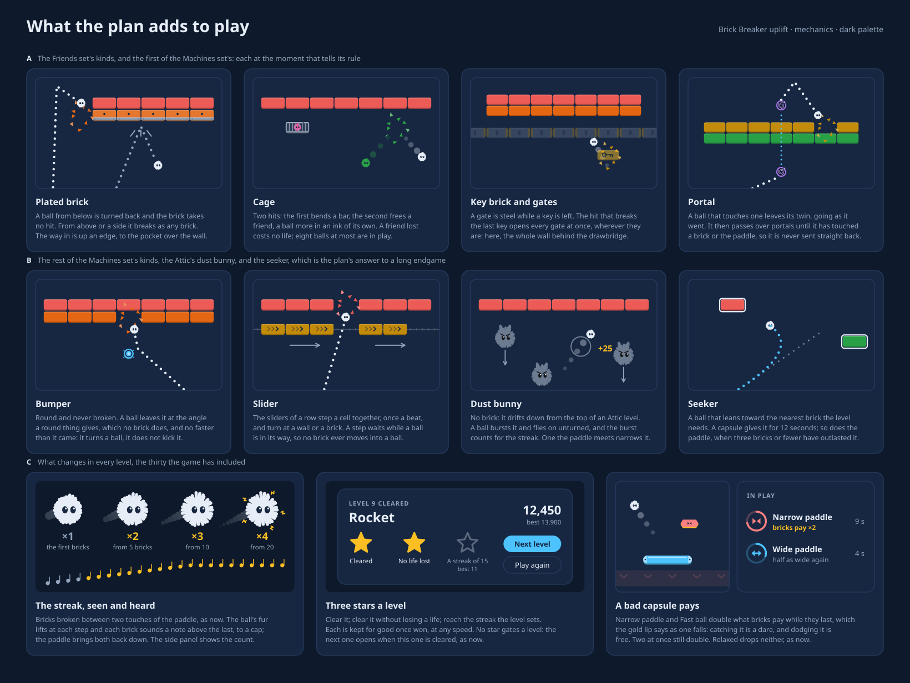
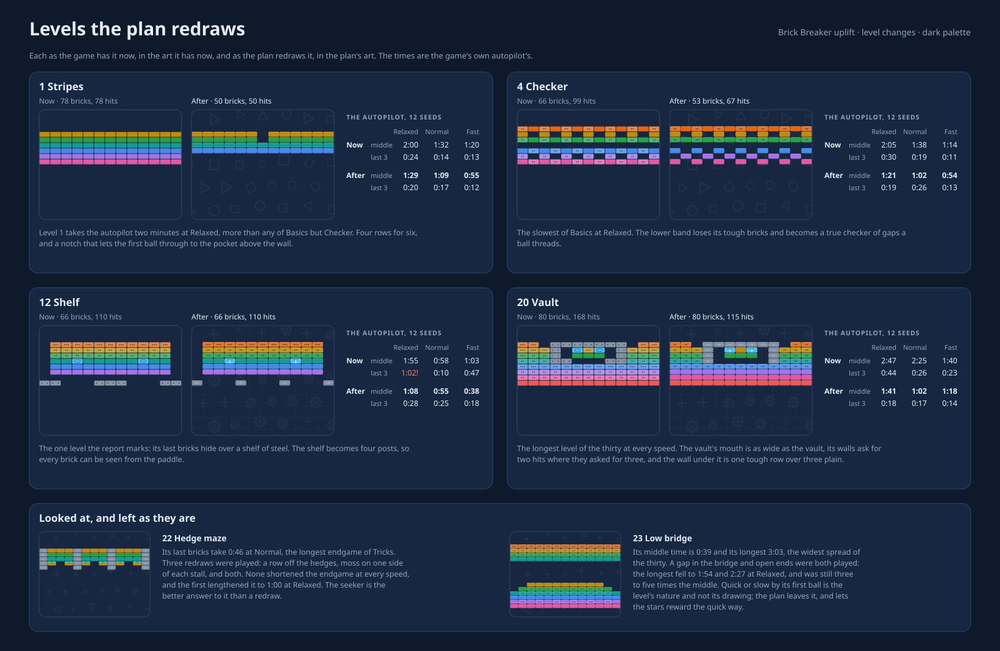
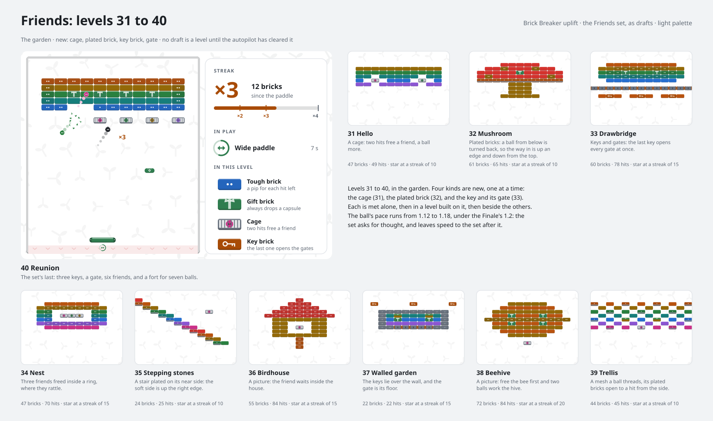
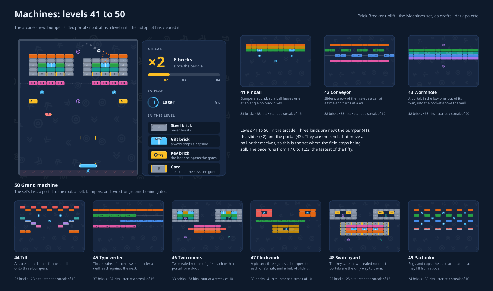

# Plan: an uplift for Brick Breaker

Written 2026-11-10, for the user's ask: give the existing Brick Breaker,
the one with a paddle, an uplift in its assets and art direction and in its
features; research similar paddle games for ideas and patterns without
looking at their code or copying their assets; think about how to use the
free space of a wide screen, possibly as Brick Fuzz Pop and Rickashay do;
and write a detailed plan with mocks for assets, new mechanics and any
level changes.

This is a design and an order of work. Nothing in the game is changed yet.
Seven of its choices were the user's more than the plan's, and the user
kept all seven as written; "What the user settled" lists them.

Everything made for the plan is in this folder, `docs/brick-breaker-uplift/`:

- **`plan.md`,** this file.
- **[`research/`](research/),** three notes on what other paddle brick
  breakers do, read from reviews, wikis, manuals, interviews and design
  essays: [`mechanics.md`](research/mechanics.md),
  [`look-and-feel.md`](research/look-and-feel.md) and
  [`layout-and-levels.md`](research/layout-and-levels.md). No asset was
  copied, and no game's source was opened but for one slip: a student's
  devlog on juicing a breakout, opened for the look-and-feel note, carried
  code snippets throughout. It was dropped, and nothing from it is used.
  Each note ends with what it skipped to keep the rule.
- **[`art/`](art/),** the concept art, five sheets:
  [`bricks.svg`](art/bricks.svg),
  [`paddle-and-capsules.svg`](art/paddle-and-capsules.svg),
  [`field.svg`](art/field.svg), [`mechanics.svg`](art/mechanics.svg) and
  [`places.svg`](art/places.svg). `art/make-art.mjs` draws them all again.
  The art is drawn from nothing but the family's own kit, which it takes
  from `docs/brick-fuzz-pop/art/make-art.mjs`.
- **[`levels/`](levels/),** the level changes as data, in the shape of
  the game's own level files with notes more (`mark`, `teaches`, `why`),
  which the game's reader refuses until a slice adds or drops them:
  [`revisions.json`](levels/revisions.json), four levels redrawn;
  [`friends.json`](levels/friends.json) and
  [`machines.json`](levels/machines.json), twenty draft levels in two new
  sets; `check-levels.mjs`, which holds the drafts to what a picture can
  prove; and `report-before.txt` and `report-after.txt`, the game's own
  autopilot report on the thirty levels as they are and as redrawn.
- **[`mocks/`](mocks/),** the level mocks:
  [`level-changes.svg`](mocks/level-changes.svg),
  [`friends.svg`](mocks/friends.svg) and
  [`machines.svg`](mocks/machines.svg). `mocks/make-mocks.mjs` draws them
  again from `levels/` and the art.

## What was asked, and where it is answered

| Asked                                            | Answered in                                                                        |
| ------------------------------------------------ | ---------------------------------------------------------------------------------- |
| An uplift in assets and art direction            | "Look", and the sheets `bricks`, `paddle-and-capsules`, `places`                   |
| An uplift in features                            | "What the plan adds to play", "Stars", "Feel and sound", and the sheet `mechanics` |
| Research on similar games, no code and no assets | `research/`, and "What other games teach"                                          |
| The free space of a wide screen                  | "Wide screens", and the sheet `field`                                              |
| Mocks for assets                                 | `art/`, five sheets                                                                |
| Mocks for new mechanics                          | `art/mechanics.svg`                                                                |
| Level changes                                    | "The levels", `levels/`, and the three sheets in `mocks/`                          |
| A detailed plan                                  | "Decisions", "Design reference", "Phases", "Risks"                                 |

## The game today

- **A field of 26 by 30 units,** 13 bricks across and up to 16 rows, the
  paddle near its foot. A tall phone gets a field up to 45 units tall, the
  room gained lying between the bricks and the paddle.
- **Thirty levels in three sets:** Basics, Steel and Tricks. Seven kinds of
  brick (plain, tough, steel, blast, gift, ghost, regrowing), eleven
  capsules, three kinds of ball.
- **Three lives, a streak, four speeds.** Bricks broken between two touches
  of the paddle score twice from 5, three times from 10 and four times
  from 20. Relaxed, Normal, Fast and Custom set the ball's speed.
- **Rules that are their own proof.** The rules are deterministic from a
  seed, physics included, and an autopilot clears every level in the
  specs. `yarn report:levels` prints how long it took.

What it lacks, by the research and by looking at it:

- **A look of its own.** Bricks are flat rounded rectangles, the paddle a
  plain pill, the field an empty panel. Brick Fuzz Pop and Rickashay are
  designed in chunky tiles with a lip; this game was drawn before that
  look existed.
- **Anything beside the field.** In a window of 1280 by 720 the field is
  about 40% of the width, and the rest is the page's color.
- **A reason to come back to a level.** A cleared level shows a tick and a
  best score, and nothing else to earn.
- **An answer to the last bricks.** The game glows them and nudges a ball
  that loops, but the last brick can still take half a minute. All three
  notes in `research/` take it up, and `layout-and-levels.md` calls it the
  genre's most repeated complaint.
- **New things after level 30.** The last new kind of brick arrives at
  level 21.

## The uplift in brief

- **The look** becomes the family's: a chunky slab with a lip for every
  brick, a paddle with a body, capsules as two-tone pills, and the fuzzball
  whose fur lifts with the streak. Shape and mark come before color.
- **Wide windows** keep the field's shape and stand two panels beside it,
  as the siblings do: the bench on the left (the level, its stars, the
  lives that wait, the level after), and what is in play on the right (the
  streak, the effects running, the kinds of brick in this level).
- **Each set gets a place:** a dim, still pattern behind the field and
  across the page. The playroom, the workshop, the fun fair.
- **Every level gets three stars:** clear it, lose no life, reach a streak.
- **The last bricks get a seeker:** a ball that leans toward the nearest
  brick, lent by the paddle when three or fewer have outlasted it.
- **Bad capsules pay.** Narrow paddle and Fast ball double what bricks pay
  while they last, so catching one is a dare.
- **Four of the thirty levels are redrawn,** each with the autopilot's
  times before and after.
- **Two new sets of ten** follow level 30. Friends brings cages, plated
  bricks, and keys with gates. Machines brings bumpers, sliders and
  portals. A third, the Attic, is sketched.

## What the user settled

The plan makes every choice, so that it reads whole. Seven of them were
the user's more than the plan's, and were put to them as it was handed
over. The same day, 2026-11-10, the user kept all seven as written. Six
are decisions, which "Decisions" marks **the user's** and still follows
with what each could be instead; the seventh is the names:

1. **Panels beside an unchanged field** (decision 1), and not a wider
   field or some other use of the wide room.
2. **A backdrop per set** (decision 4), and not none.
3. **The third star is a streak** (decision 5), and not a time.
4. **Bad capsules pay double** (decision 8); they are neither left as
   they are nor dropped.
5. **Both new sets** (decision 10), and not Friends alone first.
6. **Bests on the four redrawn levels start again** (decision 12), and do
   not stand.
7. **The names stand:** the sets Friends, Machines and the Attic, the
   garden and the arcade for the first two's places, the levels' names,
   and "cage" for a brick though Steel has a level called Cage.

## Decisions

Each says what the plan chose, why, and what it could be instead. **The
user's** marks what the user kept on 2026-11-10, of the choices "What the
user settled" lists.

1. **The field keeps its shape on every screen, and wide windows get
   panels** (**the user's**). A field stretched to the window was the
   other way to use the room. The plan turns it down for four reasons.
   The thirty levels are drawn for 13 columns, and the autopilot proves
   them at that width. A best score would mean a different thing at each
   window size.
   Resizing the window in play would change the game. And the research
   found a wider field outrunning its paddle (Banananoid), a sideways
   field patched back to upright (Breakout Beyond), and one game that
   drew separate wide boards rather than stretch its old ones (DX-Ball 2,
   as its store page reads).
   _Instead:_ a second, wider set of levels played only on wide screens,
   which is a second game's worth of levels.
2. **The panels hold what the player would otherwise have to remember.**
   Left, the bench: what this level is and what there is to earn in it.
   Right, in play: the streak, the effects with their time left, and a
   legend of the kinds of brick here. The best-received side panels the
   research found are live information (M2's Gadgets on vertical
   shooters), and the two standing jobs of a side panel are what is coming
   and what is left (Tetris, Peggle). _Instead:_ art only, as a cabinet's
   bezel; a bezel maker the research quotes calls a drawn cabinet
   redundant, and prefers the instruction card.
3. **The look is the family's chunky slab, stretched to a brick of two by
   one.** One look across three brick games, and a kit that already
   exists. _Instead:_ a look of its own, such as neon, which the
   research has critics calling dated and tiring in this genre.
4. **A place per set, dim and still** (**the user's**). World theming is
   what players remember of Ricochet and DX-Ball 2, and nothing changes
   an empty panel more. A moving backdrop is the most named layout
   complaint (Arkanoid: Eternal Battle), so the pattern never moves and
   is washed to about 5% over the field. _Instead:_ no backdrop, which
   costs nothing and loses the sets their character.
5. **Three stars: clear it, lose no life, reach the level's streak**
   (**the user's**). The streak is the game's own measure of aim, and it
   reads the same at every speed. _Instead:_ a star for time, the genre's
   usual third. Time punishes Relaxed, whose ball is a fifth slower,
   unless every level carries a time for each speed.
6. **Stars gate nothing.** The next level opens when this one is cleared,
   as now. Kirby's Block Ball withheld its ending behind score lines, and
   it is the research's cautionary case.
7. **The answer to the last bricks is a seeker, lent late.** A ball that
   leans toward the nearest brick the level needs. Steering at will
   (Shatter's pull, BreakQuest's gravity) is the most praised answer, but
   it is a second control on every device and it makes a steel maze
   trivial. A zap that breaks the brick outright (DX-Ball's lightning)
   takes the last hit from the player. The seeker keeps the ball the
   player's own. _Instead:_ either of those.
8. **Bad capsules pay double** (**the user's**). The research's finding
   is that bad capsules are accepted where they pay something or read at
   a glance, and resented where they do neither. A gold lip marks the
   two, from the slice that makes them pay. _Instead:_ leave them as they
   are, or drop them.
9. **New kinds of brick come in new sets, after level 30.** The thirty
   keep the kinds they have, so their bests still mean what they meant.
   _Instead:_ fold new kinds into the old levels, which redraws them all.
10. **Two sets now, a third sketched** (**the user's**). Friends and
    Machines are drafted, twenty levels. The Attic, with dust bunnies, is
    described and not drawn. _Instead:_ one set first, to learn what a
    new kind costs.
11. **Four levels are redrawn, and only where the autopilot cleared the
    redraw sooner at every speed.** Stripes, Checker, Shelf and Vault:
    each one's middle time and longest play are shorter at all three
    speeds. Hedge maze and Low bridge were tried three and two ways and
    left, because no redraw mended what was wrong with them.
12. **A redrawn level starts its bests again** (**the user's**). Stripes
    loses 28 of its 78 bricks, so its old best could never be beaten. The
    level keeps its id and its cleared tick. Its best score at each
    speed, the only best the game keeps for a level, is stored with the
    number of the layout it was made on, and one from an older layout is
    dropped. _Instead:_ keep the old bests and accept that four of them
    stand for good.
13. **A friend lost costs no life.** A life is lost when the last ball is,
    as now with Multiball.
14. **Sliders step as a row, on a beat.** Bricks that glide would make the
    field's bricks moving bodies; a row that steps a whole cell keeps
    every brick on the grid, where the rules and the autopilot already
    reason. A step waits while a ball is in its way.
15. **Nothing is drawn over the field but numbers.** A streak's step and a
    burst's points may show beside the ball. Words, toasts and cards stay
    in the panels and the bar; oversized pop-ups over the field are a
    named complaint.
16. **No music in this plan.** The sounds gain a scale and a voice per
    surface. A score is a body of work of its own (Shatter's first was
    scrapped after seven months) and is listed under "Not in this plan".
17. **Everything ships in slices.** The look first, since it changes no
    rule; then the places and the panels; then feel, the redrawn levels,
    the two rule changes and the stars; then each new set with its kinds.
    Each slice leaves the game whole.

## Design reference

### Look

- **One slab.** Every brick is a body in its tint, a darker lip along its
  foot and a paler strip along its top, with rounded corners. Drawn in a
  box of 200 by 100, the lip is 9 and the strip 7.
- **Shape and mark before color.** A kind is told by what is drawn on it,
  never by its tint alone: pips for a tough brick, rivets and a sheen for
  steel, a bomb for blast, a bow for a gift, round dashes and faint eyes
  for a ghost, moss over earth for a regrowing brick. Tint stays
  decoration, as the research's readability note asks: color means one
  thing or the other, never both.
- **The seven kinds the game has keep their meaning.** Section A of the
  sheet shows each as it is drawn now and as the plan draws it.
- **States are drawn, not tinted.** A tough brick loses a pip and gains a
  crack at each hit. A regrowing brick shows how far back it has grown. A
  cage's bar bends at its first hit.
- **Eight tints, the game's own.** A level that is a picture sets its own
  tints, as Rocket and Finale do now; one that is a pattern keeps its rows
  as stripes.
- **Small sizes.** A brick is 38 CSS px wide in a window of 1280 by 720
  and about 24 on a phone on its side. Section E draws every kind at both,
  the full art scaled down, which shows what crowds. Under 30 px the art
  that is built is to leave out cracks, rivets and sheen, as Brick Fuzz
  Pop's plan has its art do.

- **The paddle has a body:** a bar in the accent color with a pale pad
  along its top and a cap at each end. Its modes are drawn on it. Catch is
  velcro, a row of hooks, since what sticks to it is a ball of fuzz. Laser
  is a cannon at each end.
- **Capsules are told by shape.** A good one is a pill. A bad one is
  notched at each end, and sits on a gold lip from the slice that makes
  it pay (decision 8). Each carries its symbol, as now. The research is
  plain that color alone fails here, for colorblind players always and
  for everyone in a crowd.
- **The ball is the site's fuzzball, and it acts.** Its fur lifts at each
  step of the streak: flat, lifted at times two, standing at three, on end
  and sparking at four. Its eyes are the field's color, as now. A friend
  freed from a cage is a fuzzball in an ink of its own.
- **The field has an edge.** A chunky rim on three sides, and under the
  paddle a gutter tinted toward the danger color with chevrons pointing
  down: the one place a ball must not go.

- **Six places:** the playroom for Basics, the workshop for Steel, the fun
  fair for Tricks, the garden for Friends, the arcade for Machines and the
  attic for the Attic. Each is a pattern of a few motifs drawn from mixes
  of the palette's own colors, so all four palettes get it without a new
  color.
- **Dim and still.** Over the field the pattern is washed to about 5%,
  over the page a little more. It never moves. A greyscale screenshot of
  the busiest moment should still show the ball first, which is the check
  the research gives.

### Wide screens

- **The field is as large as the room allows, as now,** and stands at the
  room's middle.
- **Where 184 CSS px or more are spare each side,** a panel stands either
  side of the field, as tall as it, 12 px from it and 172 to 320 wide.
  These are the siblings' numbers, so one rule holds for all three games.
  Past the panels the page shows, in the place's pattern.
- **Where less is spare,** the field stands alone, as now. The bar there
  has room for the score and the lives, and for the level and the streak
  only from 1200 px wide, as now. So what the panels say is said
  elsewhere: the Ready card names the level, its stars and a kind met for
  the first time; the ball's fur and the count beside it tell the streak;
  and the effects still ride under the paddle as rings.
- **The panels take no pointer and no focus.** They are part of the page,
  not the canvas: an Angular component each, beside the board. They are
  not live regions: the announcer says each turning point, as now.
- **They change on events only:** a brick, a capsule, a life. Nothing in
  them moves by itself, so nothing beside the field pulls the eye off the
  ball.

What some windows come to, worked out from the rooms the sibling plans
give (the bar and the margins taken off). The layout check will hold the
real figures. The sheet above draws the laptop window at 20 px a unit and
the phone on its side at 10, each within two of this table.

| Window                         | A unit | The field, px | Spare a side | Panels           |
| ------------------------------ | ------ | ------------- | ------------ | ---------------- |
| Roomy, 1280 × 800              | 22 px  | 572 × 660     | 330          | two, 318 px each |
| Laptop, 1280 × 720             | 19 px  | 494 × 570     | 369          | two, 320 px each |
| Desktop, 1920 × 970            | 28 px  | 728 × 840     | 572          | two, 320 px each |
| Ultra-wide, 3440 × 1300        | 39 px  | 1014 × 1170   | 1189         | two, 320 px each |
| Tablet on its side, 1180 × 820 | 23 px  | 598 × 690     | 267          | two, 255 px each |
| Phone on its side, 844 × 390   | 12 px  | 312 × 360     | 222          | two, 210 px each |
| Small phone on its side        | 9 px   | 234 × 270     | 123          | none             |
| Square, 1000 × 1000            | 29 px  | 754 × 870     | 99           | none             |
| Tablet upright, 820 × 1180     | 29 px  | 754 wide      | 9            | none             |
| Phone upright, 390 × 844       | 14 px  | 364 wide      | 1            | none             |

**The left panel, the bench:**

- The level's number, set and name, and a row of pips for how far through
  the set it is.
- The three stars, each with what it asks, lit when held. The third names
  its streak. Micro Breaker's players complain that a level's goals show
  only after it ends; here they show throughout.
- The bench: the lives that wait, as fuzzballs sitting on a plank, and the
  score the next life comes at.
- The level after this one, as a small picture with its kinds.

**The right panel, in play:**

- The streak: its multiplier, large; the bricks since the paddle; and a
  meter with a tick at 5, 10 and 20.
- The effects in play, each a ring that empties, with its name and seconds
  left. The research found no breaker that shows this well, and a player
  asking for it.
- The kinds of brick in this level, each drawn with a line on what it
  does. A new kind is taught here, at the moment it is met.
- The capsules that can fall in this level.

A panel under 400 px tall, on a phone on its side, keeps the first two of
each and drops the rest.

### What the plan adds to play

Seven kinds of brick, in two sets. Each has a character for a level's
picture, beside the game's nine.

| Kind         | Character | Needed to clear | The rule                                                                                                                                        |
| ------------ | --------- | --------------- | ----------------------------------------------------------------------------------------------------------------------------------------------- |
| Plated brick | `u`, `U`  | yes             | A ball that meets its underside is turned back and the brick takes no hit. From above or a side it takes one. `U` takes two.                    |
| Cage         | `c`       | yes             | Two hits. The first bends a bar; the second frees a friend, a ball more, which leaves upward. Eight balls at most, as now.                      |
| Key brick    | `k`       | yes             | One hit. The hit that breaks a level's last key opens every gate.                                                                               |
| Gate         | `=`       | no              | Steel while a key is left; gone, all at once, when none is.                                                                                     |
| Portal       | `@`, `%`  | no              | A ball that touches one leaves its twin, going as it went. It then passes over portals until it has touched a brick or the paddle. Two pairs.   |
| Bumper       | `O`       | no              | Round, never broken. A ball leaves it at the angle a circle gives, no faster than it came.                                                      |
| Slider       | `>`, `<`  | yes             | One hit. The sliders of a row step one cell together each beat, 800 ms, and turn at a wall or a brick. A step waits while a ball is in its way. |

- **What else meets a plate.** Its underside turns back all that flies:
  a ball of any kind, Fire ball included, and a bolt, which is spent
  there. Neither takes a hit off it, and a ball turned back sets off no
  blast. A blast takes a hit off it from any side.
- **Why these seven.** The research's list of bricks other games have and
  this one lacks is long. These are the ones that keep the field on its
  grid, need no second control, and each make one level type the game
  can't draw now. A plated wall makes the pocket above it the goal, which
  is Breakout's best-remembered play. A cage pays out the multiball inside
  the wall, where it rattles. Keys and gates give a level two acts.
  Portals make a sealed room possible. Bumpers and sliders are the first
  things in the field that turn a ball oddly or move.
- **Where they come from.** Five have forebears in the research: the cage
  in Super Breakout's Cavity, which holds spare balls in its wall; the
  portal in Block Breaker Deluxe 2's teleporter; the bumper in the design
  essay's pinball bumpers; and the key and its gate in the same essay's
  switches that open a room, though the research found no named game with
  key-and-lock bricks. The plated brick and the slider are the plan's own:
  it found none with a one-way gate or a conveyor either.
- **The dust bunny, for the Attic.** Not a brick. It drifts down from the
  top of a level that has them, one every few seconds, a few at most. A
  ball bursts it and flies on unturned, for 25 points and one toward the
  streak. One that reaches the paddle narrows it for 5 seconds. Arkanoid's
  drifting enemies keep a thin board lively; Strikey Sisters' drew
  complaints for batting the ball away at random, so these never turn it.
- **The seeker.** A ball that turns toward the middle of the nearest brick
  the level needs, by up to 45 degrees a second, and never flatter than
  the flattest a ball travels now. Two things give it:
  - _A capsule,_ Seeker, for 12 seconds, from the Steel set on.
  - _The paddle,_ when three bricks or fewer are needed and the ball has
    left the paddle three times since the last one broke. The ball it next
    touches is a seeker until it breaks a brick the level needs. The glow
    on the last bricks stays as it is, and so does the nudge for a looping
    ball until the Machines set ("Where the code goes").
- **Bad capsules pay.** While Narrow paddle or Fast ball is in effect,
  bricks pay double, after the streak's multiplier. Two at once still
  double. Relaxed drops neither, as now.

### The capsules

| Capsule       | Now                         | In the plan                              |
| ------------- | --------------------------- | ---------------------------------------- |
| Wide paddle   | 6 units for 20 s            | as now                                   |
| Multiball     | each ball in three          | as now                                   |
| Slow ball     | back to first speed, 15 s   | as now                                   |
| Extra life    | one more, to six            | as now                                   |
| Catch         | the ball sticks, 20 s       | as now; drawn as velcro                  |
| Net           | saves one ball              | as now                                   |
| Laser         | bolts from the paddle, 12 s | as now; drawn as cannons                 |
| Fire ball     | burns through, 10 s         | as now                                   |
| Blast ball    | hits those around, 12 s     | as now                                   |
| **Seeker**    |                             | new: the ball leans toward a brick, 12 s |
| Narrow paddle | 2.6 units for 15 s          | and bricks pay double while it lasts     |
| Fast ball     | a quarter faster for 12 s   | and bricks pay double while it lasts     |

### Stars

- **Three a level, each kept for good once won, at any speed.**
  1. Clear the level.
  2. Clear it without losing a life: the clean clear the game already
     pays for. A ball of several that falls costs no life, as now, and so
     no star (decision 13).
  3. Reach the streak the level sets, its _mark_, in a play that clears it.
- **A star won stays won,** whatever its level's layout or mark later
  becomes.
- **A level's mark comes from the autopilot.** `report:levels` gains a
  column, the best streak of each play. A level's mark is the middle of
  those over twelve seeds at Normal, rounded down to a five, and never
  under 5. So a mark is one a careful player reaches, and it is set by a
  rule and not by hand. The drafts carry a guess until their kinds have
  rules.
- **Where they show.** In the left panel, throughout a level. On the
  Ready card, each with what it asks, which is where a screen without
  panels tells them. Beside the ball, where the streak's count shows at
  each step and at the mark. On the card a cleared level shows, with the
  one just won marked. In the Levels dialog, three small stars on each
  level, and a count on each set.
- **What they are worth.** Nothing but themselves, and a total. No level,
  setting or look is locked behind them (decision 6).

### The levels

#### What changes in the thirty

The game's autopilot played every level from twelve seeds at each speed,
as they are and as redrawn. The redrawn ones were played in a copy of the
game outside the repository; the game's own files are untouched. The
figures are the middle time and, in brackets, the longest the last three
bricks took. `levels/report-before.txt` and `levels/report-after.txt` hold
all of it.

| Level     | What changes                                                                       | Relaxed, now | Relaxed, after | Normal, now | Normal, after |
| --------- | ---------------------------------------------------------------------------------- | ------------ | -------------- | ----------- | ------------- |
| 1 Stripes | four rows for six, and a notch to the pocket above; 50 bricks for 78               | 2:00 (0:24)  | 1:29 (0:20)    | 1:32 (0:14) | 1:09 (0:17)   |
| 4 Checker | the lower band loses its tough bricks and gains gaps; 67 hits for 99               | 2:05 (0:30)  | 1:21 (0:19)    | 1:38 (0:19) | 1:02 (0:26)   |
| 12 Shelf  | the steel shelf becomes four posts; the bricks are as they were                    | 1:55 (1:02)  | 1:08 (0:28)    | 0:58 (0:10) | 0:55 (0:25)   |
| 20 Vault  | a wider mouth, walls of two hits for three, a lighter wall under; 115 hits for 168 | 2:47 (0:44)  | 1:41 (0:18)    | 2:25 (0:26) | 1:02 (0:17)   |

- **Stripes** is level 1, and Relaxed is where a new player is most likely
  to be. It took the autopilot two minutes there, more than any of Basics
  but Checker. The notch gives the first ball a way above the wall.
- **Checker** was the slowest of Basics at Relaxed, and its longest play
  there ran to 2:57.
- **Shelf** held the one play the report marks as too long over its last
  bricks. It no longer does, and no other level gains one.
- **Vault** was the longest of the thirty at every speed: 2:47 at Relaxed,
  where the next longest took 2:05. Thinning only the wall under it barely
  moved Relaxed (2:42); the time was in the vault's mouth and walls.
- **What decided a redraw** was the middle time and the longest play: each
  of the four is shorter in both at all three speeds. The last three
  bricks did not all get quicker. At Normal they took longer on Stripes,
  Checker and Shelf (0:14 to 0:17, 0:19 to 0:26, 0:10 to 0:25), each still
  under what seven levels the plan leaves alone take there.
- **After the four,** no level's middle time at Relaxed is past 2:00
  (Lanterns, 1:58), and no endgame there is past 0:33. The longest endgame
  left at any speed is Hedge maze's, 0:46 at Normal. The thirty together
  take the autopilot 40.5 minutes at Relaxed, down from 43.6.
- **Hedge maze and Low bridge are left.** Three redraws of the first and
  two of the second were played, and the sheet says what each did. Hedge
  maze's fault is its endgame alone, and no redraw shortened that at every
  speed; the seeker is the better answer to it. Both redraws of Low bridge
  shortened its longest play, and neither closed the gap between its quick
  plays and its slow ones, which is the level's nature. The reports of the
  redraws that were not kept were not kept either: their figures, here and
  on the sheet, are as read from those runs.
- **Pictures get their tints.** Pyramid, Arch, Diamond, Castle, Lanterns,
  Gears and Hourglass are pictures that take their rows' stripes. Each
  gets tints of its own, as Rocket and Finale have. This changes no brick,
  so no best.
- **Ids stay.** Every level keeps its id, so progress carries over. Bests
  on the four redrawn levels start again (decision 12).

#### The rules a level keeps

The game's content skill lists what a level's file must hold. These are
rules of design beside it, from the research's one real level-design
source (Nelson's "Breaking Down Breakout") and from what the report
showed.

- **A strong first hit and a first choice,** and a ball that comes back
  promptly.
- **Voids.** A crowded field restricts the ball and makes the opening
  dull. Every level leaves a way to the pocket above its wall, or says why
  not.
- **Steel steers, and never hides.** No needed brick sits where it can't
  be seen from the paddle past steel. That was Shelf's fault.
- **A level is no longer than its set.** `report:levels` marks a level
  whose middle time at Relaxed is past 2:00, as it marks a long endgame
  now.
- **One new thing at a time.** A kind is met alone, then in a level built
  on it, then beside others.
- **Every tenth level is the set's signature,** the one that shows what
  only this set does.

#### Two new sets

**Friends, levels 31 to 40, in the garden.** Cages, plated bricks, keys
and gates. The pace runs 1.12 to 1.18, under the Finale's 1.2: the set
asks for thought and leaves speed to the next.

| No. | Level           | Built on                                                            |
| --- | --------------- | ------------------------------------------------------------------- |
| 31  | Hello           | Two cages in easy reach: the first friends                          |
| 32  | Mushroom        | A cap plated underneath: go up an edge and in from the top          |
| 33  | Drawbridge      | Three keys under a gate that spans the field                        |
| 34  | Nest            | Three friends freed inside a ring, where they rattle                |
| 35  | Stepping stones | A stair plated on its near side; the soft side is up the right edge |
| 36  | Birdhouse       | A picture, the friend inside the house                              |
| 37  | Walled garden   | The keys lie over the wall, and the gate is its floor               |
| 38  | Beehive         | A picture: free the bee first and two balls work the hive           |
| 39  | Trellis         | A mesh a ball threads, plated bricks open from the side             |
| 40  | Reunion         | Three keys, a gate, six friends, and a fort for seven balls         |

**Machines, levels 41 to 50, in the arcade.** Bumpers, sliders and
portals: the kinds that move a ball or themselves. The pace runs 1.16 to
1.22, the fastest of the fifty.

| No. | Level         | Built on                                                            |
| --- | ------------- | ------------------------------------------------------------------- |
| 41  | Pinball       | Three bumpers under a wall                                          |
| 42  | Conveyor      | Two rows of sliders, one against the other                          |
| 43  | Wormhole      | A portal from the foot of the field to the pocket above the wall    |
| 44  | Tilt          | Plated lanes that funnel a ball onto bumpers                        |
| 45  | Typewriter    | Three trains of sliders sweeping under a wall                       |
| 46  | Two rooms     | Two sealed rooms of gifts, a portal the only door to each           |
| 47  | Clockwork     | A picture: gears with a bumper for a hub, and a belt of sliders     |
| 48  | Switchyard    | The keys are in sealed rooms; the portals lead to them              |
| 49  | Pachinko      | Pegs and plated cups that fill from above                           |
| 50  | Grand machine | A portal to the roof, a belt, bumpers, and strongrooms behind gates |

- **The drafts are pictures, not levels yet.** `levels/check-levels.mjs`
  holds each to what a picture can prove: its shape, its characters, its
  pairs, and that a ball can come at every brick it needs by the rules
  above. All twenty hold. None is a level until the new kinds have rules
  and the autopilot has cleared it, and the report will change some.
- **Drops.** Both sets drop capsules at 0.14, as Tricks does.
- **The Attic, levels 51 to 60, sketched only.** Dust bunnies, ghost
  bricks and regrowing ones: a set about what can't be seen or won't
  stay. It is the place to try a level type the research describes and
  the plan otherwise leaves out, such as a wall that steps down. No level
  of it is drawn.

### Feel and sound

The game already pops a brick that holds, throws shards from one that
breaks, rings a blast, shakes at a lost ball, glows the last bricks, and
raises a broken brick's note a semitone for each brick of the streak, up
to a fifth. The plan adds to these, and every addition is off where motion
isn't welcome, as the present ones are.

| Moment                    | What is added                                                                                 | How long   |
| ------------------------- | --------------------------------------------------------------------------------------------- | ---------- |
| A level arrives           | its bricks drop in, a column after a column; a key press skips it                             | 400 ms     |
| The ball meets the paddle | the ball squashes and the pad dips a tenth of a unit, in the picture only                     | 90 ms      |
| A streak's step           | a ring about the ball, its fur lifts, the count shows beside it; the same at the level's mark | 300 ms     |
| The ball in a streak      | a tail behind it, longer at each step, eight dots at most                                     | throughout |
| A brick breaks            | its shards fade and dim as they fall, so they never look like a ball                          | 350 ms     |
| The last brick breaks     | the hit holds, then the clear's chord                                                         | 120 ms     |

- **Deform the picture, never the body.** The ball's circle and the
  paddle's edges decide the bounce, so squash and dip are drawn and the
  rules don't know of them.
- **A medium dose.** The one large study the research found has both no
  juice and extreme juice doing worse than the middle. No new shake, and
  no hit stop but the last brick's.
- **The streak's notes go up a scale.** A major pentatonic, one step a
  brick, capped at an octave and a fifth, in place of bare semitones, so a
  long streak sounds like a run and not a siren. The paddle brings it back
  to its first note.
- **A voice per surface.** Wall, paddle, steel and brick already differ.
  The new kinds each get one: a clank for plate, a rattle for a cage, a
  chime for a key and a low sweep for the gates, a whoosh for a portal, a
  boing for a bumper. They are synthesized by `tools/build-sounds.mjs`, as
  the ten are.

### Cards, the bar and the Levels dialog

- **The bar** is as now: the score and the lives always, the level and the
  streak from 1200 px wide.
- **The Ready card,** the one a level opens on, gains the three stars
  under the level's name, each with what it asks and the third with its
  mark, lit where held. A kind of brick met for the first time is drawn
  there with its line. On a screen without panels this is where a level's
  goals are told. No sheet draws it yet.
- **The card a cleared level shows** gains the three stars over its tally,
  the ones just won marked. `art/mechanics.svg` has it.
- **The Levels dialog** gains three small stars under each level and a
  count beside each set's name. Its text says what the stars are for.
- **How to play** gains the new kinds and the stars. The catalog writes
  most of it, as now.

### Accessibility

- **Nothing is told by color alone.** Every kind has its mark, every
  capsule its shape and symbol, and a friend its own ink only as flavor.
- **The announcer says** a star won and a gate opened, as it says each
  turning point now.
- **Motion.** Every flourish above is off where motion isn't welcome. The
  backdrops never move.
- **Contrast.** The art is drawn from each palette's own roles and mixes.
  Each mark is checked against its brick in all four palettes before its
  slice ships.
- **The panels** add no stop to the keyboard's order and no live region.

### What it keeps

- **Progress** carries over: ids don't change.
- **Stars** are a new record beside progress, by level id, with a version
  of its own. A player who cleared a level before the stars has its first
  star at once, from progress. A star won is kept through a redraw and a
  new mark.
- **Bests** on the four redrawn levels start again: a best is stored with
  its level's layout number, and an older layout's is dropped (decision
  12). So the stored stats change shape in that slice.
- **A saved run** from before a slice that changes the rules is dropped,
  as a saved run from another version is now. The Machines slice also
  changes what a saved run holds, since a slider's brick is no longer
  where its level drew it.

### Where the code goes

The game's layers stay as they are: rules, view, scene, app.

- **Rules.** The new kinds are entries in `src/rules/catalog/bricks.ts`
  with characters in `src/rules/levels/legend.ts`; the seeker a capsule
  and a ball's state. The field's travel learns four things: a face that
  takes no hit (plate), a round body (bumper), a jump (portal) and a beat
  on which a row steps (slider). Gates read the count of keys. All of it
  is deterministic, as the rest is, so the autopilot plays it.
- **A brick that changes its cell.** A slider is the first. The saved run,
  the rules' reading of which faces of a brick are open (`exposureOf()`)
  and the brick painter each take a brick's cell as fixed now, and each
  learns otherwise in the Machines slice.
- **The nudge in a sealed room.** The nudge for a looping ball turns it
  only at a wall of the field now. A room walled in steel has none, so
  from the Machines slice the nudge turns a ball at any bounce off what
  can't break.
- **Level data and stats.** A level's data gains a layout number, which a
  redraw raises, and with the stars a mark. The stats keep the layout a
  best was made on.
- **The autopilot** must foresee a seeker's turn, a portal's jump and a
  slider's step. This is the largest unknown in the plan ("Risks").
- **View and scene.** The art is `src/view/art/`, drawn in the shapes
  `@fz/phaser/shapes` has, and the painters under `src/scene/painters/`
  place it. The plan's sheets use only such shapes.
- **App.** Two panel components beside the board, the stars in the
  progress the app keeps, the Levels dialog and the cleared card.
- **Tools.** `report:levels` gains the best streak and a flag for a long
  level. `check:layout` gains the panels, all or none, as the sibling
  plans have theirs.
- **The skills and `AGENTS.md`** change with the code they describe, in
  the same slice.

## Phases

Each is a slice that ships by itself. Sizes are small, medium or large, as
the sibling plans use them.

1. **The look (large).** New art for the seven kinds, the paddle and its
   modes, the capsules, the ball's fur by streak, the rim and the gutter.
   A bad capsule is notched, and has no gold lip yet. No rule changes, no
   saved data changes. New screenshots.
2. **Places (small).** The backdrop for the three sets the game has.
3. **Wide screens (medium).** The two panels, their compact forms, the
   layout check. The left panel shows no stars yet. The Ready card names
   a kind met for the first time, for the screens without panels.
4. **Feel and sound (medium).** The six flourishes and the scale. New
   voices come with their kinds.
5. **The thirty (medium).** The four redraws, the pictures' tints, the
   report's flag for a long level, and a layout number on a level with
   the stats that keep a best by it.
6. **The seeker and paying capsules (medium).** Two rule changes that
   touch every level, so the autopilot's report is run again. The gold
   lip arrives with the pay.
7. **Stars (medium).** The best streak in the report and the mark in the
   level data, set once for the thirty now that their layouts and rules
   are settled; the record; the Ready card, the cleared card, the Levels
   dialog and the left panel.
8. **Friends (large).** Cage, plate, key and gate, then the ten levels,
   each cleared by the autopilot and given its mark.
9. **Machines (large).** Bumper, slider and portal, then the ten levels.
   The nudge learns a sealed room, and the saved run, the rules and the
   painter learn that a brick can change its cell.
10. **The Attic (large, later).** Designed when Machines has shipped.

Slices 1 to 4 change no rule of play. Slice 5 changes four levels, slice
6 two rules, and slice 7 neither. Slices 8 and 9 are where the risk is.
Stars come after 5 and 6 so that no star is won under a mark the next
slice moves.

## Risks

- **The autopilot and the new kinds.** It proves a level by playing it. A
  portal, a slider and a seeker each change where a ball will be. If it
  can't be taught one of them at a fair cost, that kind's levels have no
  proof, and the kind should be dropped rather than shipped unproven.
  Friends' four kinds are the simpler ones, which is why it comes first.
- **The autopilot's time is not a player's.** The redraws rest on it, and
  the marks will. It never misses and it doesn't aim as a person does, so
  a level it clears in a minute may take a player three, and a streak it
  reaches often may be rare by hand. Slices 5 and 7 should be played by
  hand before their figures are trusted.
- **The drafts will change.** Twenty levels drawn without playing them.
  The four redraws show how far a guess can be off: the first redraw of
  Vault barely moved it.
- **A sealed room can strand the player, or hold a ball for good.** In Two
  rooms and Switchyard a ball can be out of reach for a while. The check
  for that is Nelson's: would the level hold up if the ball vanished for
  ten seconds? If not, a second ball should be in play, and the report
  should count the longest time between two touches of the paddle. And a
  ball could circle a cleared room for ever, since the nudge that breaks
  a loop turns a ball only at a wall of the field and a room walled in
  steel has none. The Machines slice changes the nudge for that ("Where
  the code goes"), and the report must show no play that hangs.
- **Small bricks.** On a phone on its side a brick is about 24 px. The new
  marks must read there, and section E of the brick sheet is the first
  test, not the last.
- **The backdrop against the ball.** It is drawn dim, and it must be
  checked in all four palettes, in greyscale, with three balls in play.
- **Friends that make a level trivial.** Six cages are six more balls.
  Reunion is built on that. Nest holds three and no other draft more than
  two; the report will say whether three is too many.
- **More balls end a streak sooner.** A streak ends when any ball meets
  the paddle, so every friend freed makes the third star harder, while
  the drafts' marks rise with their cages (Reunion's is 25). Those marks
  are guesses. The autopilot's best streak sets the real ones, and may
  set them low where the cages are.
- **Paying capsules and the scores that stand.** Double pay raises what a
  level can score, so bests made before it are easier to beat, not
  harder. That is the kinder way round, but it should be said in the
  notes of the slice.
- **The layout figures are worked out, not measured.** The table in "Wide
  screens" comes from the sibling plans' rooms.

## Not in this plan

- **A wider field,** or one on its side (decision 1).
- **Steering the ball at will,** and a recall (decision 7).
- **Bosses.** The research finds them liked where a weak point shows and
  nothing regrows, and costly everywhere. The signature level of each set
  does their job here.
- **Bricks that shoot, and enemies that hurt.** The fair ones stun rather
  than kill; the plan's one hazard, the dust bunny, narrows the paddle.
- **A wall that steps down** as a rule of the game. DX-Ball's left three
  stages unclearable. It is a level type to try in the Attic.
- **Shops, coins, upgrades and runs of drafted levels.** The 2025 and 2026
  breakers are mostly these. They are a different game on the same field
  and deserve their own plan.
- **Music** (decision 16).
- **An editor and shared levels.** They kept Ricochet and DX-Ball 2 alive
  for years, and are the costliest thing in the research.
- **Endless and daily modes.** Cheap once the sets exist; reviewers say
  they fade after a few high scores.
- **Assists beyond the speeds:** a floor that returns three balls, a
  half-speed key for the keyboard, a pause when the pointer leaves the
  window. Each is small and none is art or a level; they are noted for a
  slice of their own.

## What other games teach

The three notes hold the detail and their sources. What the plan took
from them:

- **The last brick is the genre's named fault.** Shatter's makers listed
  it as a problem to design against. The admired answers steer the ball
  (Shatter, BreakQuest), recall it (Ricochet) or end the stall outright
  (DX-Ball). The plan's seeker is the mildest of the first kind.
- **Side space is best spent on live information.** M2's Gadgets, Tetris's
  next queue, Peggle's tube and meter. Moving backdrops and pop-ups over
  the field are what reviewers complain of.
- **Fields that changed shape paid for it.** Breakout Beyond on its side,
  Banananoid too wide, Arkanoid DS too narrow.
- **Variety from level to level is the stated pull, sameness the stated
  push.** BreakQuest is praised for it; Alleyway's eight layouts shown
  three ways are the warning. Hence new kinds in new sets, and a signature
  level every ten.
- **Bad pickups are accepted when they pay or read at a glance.** Revenge
  of Doh's Reduce pays while the paddle is small.
- **Material says what a brick is; color only decorates.** Arkanoid's
  silver and gold, Breakout: Recharged's little wall for a tough brick.
- **Juice the frequent act, at a medium dose.** The paddle hit and the
  brick break, not the rare event.
- **Pitch is the cheapest variety in sound.** Peggle steps its hits up a
  scale that fits the music.
- **Stars and medals give old levels a second pass,** and gating by them
  is resented.

What the research could not find: how any paddle game shows the time left
on a power-up, a stated target for a level's length, or an accessibility
review of one. The plan's answers to those are its own.

## How this was made

- **The research** was read by three agents from prose sources. Each note
  lists the code it kept shut and the pages that would not open, and
  `look-and-feel.md` lists the one page with code snippets that was
  opened and then dropped. Facts taken from a search summary alone are
  marked "(listing)".
- **The art** is drawn by the scripts in `art/`, from shapes. Nothing was
  traced or copied.
- **The four redraws** were played by the game's autopilot, twelve seeds
  at three speeds, in a copy outside the repository. Stripes and Vault
  were each drawn three ways and the best kept; Hedge maze was drawn
  three ways and Low bridge two, and both were left as they are. All were
  played the same way. Only the kept redraws' report is in the folder.
- **The twenty drafts** pass `levels/check-levels.mjs` and nothing more.
- **Not checked:** the layout table, the art at real size in a browser,
  the contrast of the new art, and every number in "Feel and sound".
