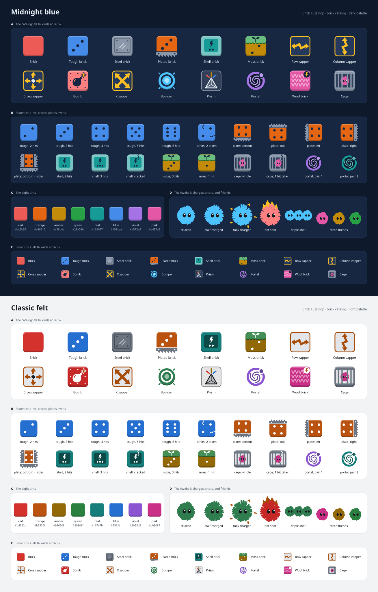
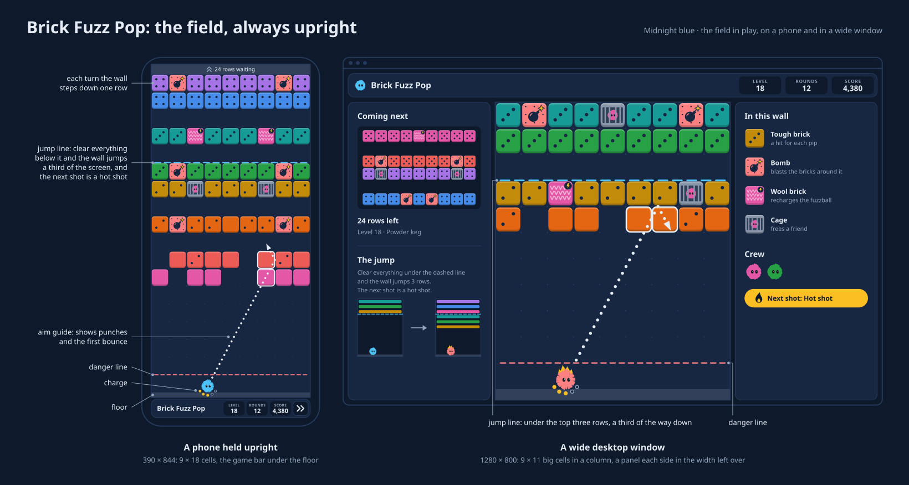

# Plan: Brick Fuzz Pop, a charge-and-release brick breaker

Written 2026-11-10, for the user's ask: a brick-breaking game in which the
player charges a ball at an angle and releases it, the ball bounces off the
walls and the bricks until it reaches the ground, the bricks then come down
one row or more by how many were broken, and the level is lost when bricks
touch the floor; with special bricks that change how the ball bounces or
break other bricks in patterns, bricks that are harder to break, the
fuzzball in it, a field that fills the screen at any size and either way
up, original brick art, and thirty levels or more, harder as they go, each
guaranteed beatable.

This is the design and the build in one document, as the breakers' plans in
`docs/archive/` were once their decisions were answered. Nothing is built
yet. The plan's first draft, the same day, left four choices to the user:
the name, what charge means, how the wall comes down and how the field
fills a wide screen. The user answered all four, and this is the plan
rewritten for the answers. "Decisions" marks them **the user's**, and lists
the rest of what the plan chose, each with what it could be instead.

Later the same day, [`implementation-plan.md`](implementation-plan.md) took
the build further. It asked the user six questions the design had left
open, and the user took its recommendation on each. They are in
"Decisions" too, marked **the user's**. The design reference below now says
the rest of what that plan settled. How the game is built, in what order,
and in which streams side by side, is now that file's. "How the work runs"
and "Phases" say what it changed.

Everything made for the plan is in this folder, `docs/brick-fuzz-pop/`:

- **`plan.md`,** this file.
- **[`implementation-plan.md`](implementation-plan.md),** how the game is
  built:
  - what Part 1 lifts into the libraries;
  - the contracts the game's parts share;
  - each piece of work, with its specs;
  - the practices and budgets it keeps;
  - the streams it runs in, side by side.
- **[`art/`](art/),** the concept art. Two sheets:
  [`bricks.svg`](art/bricks.svg), every kind of brick, its states, and the
  fuzzball at each charge, as a hot shot and as a triple shot, in a dark
  palette and a light one, and [`field.svg`](art/field.svg), the field in
  play on a phone and in a wide window. Each kind of brick and each of the
  fuzzball's states is a file of its own too, under `art/bricks/` and
  `art/fuzzball/`, in both palettes, and `art/make-art.mjs` draws them all
  again. They are drawn only in the shapes `@fz/phaser/shapes` has, so the
  game's art can be written from them.
- **[`levels/`](levels/),** the thirty-six draft levels, a JSON file a set,
  in the form "The levels" gives them, and `levels/build.mjs`, which stacks
  each wall from its courses and writes the four files. "Appendix: the
  draft levels" shows the courses.
- **[`mocks/`](mocks/),** a mock of each draft level as it opens, drawn
  with the art: the whole wall, the level on a phone and in a wide window,
  its boon and the kinds of brick in it, the kinds it introduces marked.
  There is a file a level under `mocks/levels/` and a sheet a set, and
  `mocks/make-mocks.mjs` draws them all again from `levels/` and the art.
- **[`sketch/`](sketch/),** throwaway code written for this plan, not the
  game's: the flight, the sixteen kinds of brick as "Design reference" has
  them, the wall's step and its jump, the two boons, a solver and a
  careless player. It played every draft level on every field depth, and
  its numbers are quoted where they decided something ("The sketch");
  [`sketch/results.md`](sketch/results.md) is what it printed. Its
  `README.md` says how to run it and where it differs from the plan.

Behind it too is a reading of similar games, their store pages, reviews,
guides and design write-ups ("What other games teach"). No other game's
code was read, here or by the agent that did the reading.



## What was asked, and where it is answered

| Asked for                                                    | In this plan                                                                                                                                 |
| ------------------------------------------------------------ | -------------------------------------------------------------------------------------------------------------------------------------------- |
| Charge a ball at an angle, release to send it                | Decisions 2, 3 and 15; "The flight", "Charge", "Controls"                                                                                    |
| It bounces off walls and bricks until it hits the ground     | Decision 2; "The flight"                                                                                                                     |
| The bricks descend one level or more by how many were broken | Decisions 4 and 5; "The wall": a row a round, and a third of the screen at once, with a boon, when a round leaves the lower two-thirds clear |
| Lost when bricks touch the floor after a round               | Decisions 2 and 11; "The wall"                                                                                                               |
| Special bricks that change the bounce                        | Decision 9; "The bricks": steel, bumper, prism, portal, wool, plated, shell                                                                  |
| Special bricks that break others in patterns                 | Decision 9; "The bricks": row, column, cross and X zappers, bomb                                                                             |
| Bricks that are harder to break                              | Decisions 9 and 10; tough (to six hits), plated, shell, moss                                                                                 |
| The fuzzball, somehow                                        | Decisions 3, 5, 8 and 21; "Fuzzley flavor": it is the ball, its static is the charge, it is the hot shot, and caged ones are freed           |
| Any orientation or size, the whole screen but the game's UI  | Decisions 6 and 7; "The field": always upright, as deep as the room allows, a wide room's sides the game's own panels; the layout check      |
| Other games read for patterns, no source code                | "What other games teach"                                                                                                                     |
| Original art for the bricks, the special ones above all      | Decision 18; "Look"; `art/`                                                                                                                  |
| Thirty levels or more, harder as they go                     | Decision 12; "The levels"; `levels/` and the appendix (thirty-six)                                                                           |
| Every level guaranteed beatable                              | Decision 13; "The guarantee"                                                                                                                 |

## The game in brief

Brick Fuzz Pop would be the seventh game built in this repository, at
`/play/brick-fuzz-pop/`, in Arcade beside Asteroid Breaker, Brick Breaker and
Snake. A wall of square bricks, nine across and taller than the screen,
hangs over a floor. The site's fuzzball sits on the floor. The player aims
it, charges it with static, its fur standing on end, and lets go. It flies
in straight lines, turning off the walls and the bricks and taking a hit
off each brick it strikes; while it holds a charge it punches straight
through the bricks it breaks, a point of charge for each hit. When it comes
back to the floor the round is over: it waits where it landed, and the wall
comes down a row. A round that leaves the lower two-thirds of the screen
clear does more: the wall jumps down a third of the screen at once, new
rows coming in over it, and the next shot is a hot shot, a fuzzball at full
charge that nothing drains and that bounces off the floor once before it
lands. Clear every brick the level needs and it is cleared; let one reach
the floor and it is lost. It is turn-based, so nothing in it needs quick
hands, and its rules draw no random number, so a shot from the same place
at the same aim and charge always ends the same way.

Its rules are plain TypeScript, its field a Phaser scene and its shell
Angular on the shared libraries, in Brick Breaker's four layers. What is
its own: charge as punch; a wall that jumps when the player gets ahead of
it, and pays for it with a boon; a field that is always an upright column
of nine square bricks, as deep as the room allows, with the game's own
panels beside it where the room is wide; a round decided the moment it is
released and then played back, which makes fast-forward, the aim guide and
a proof of every level cheap; and that proof, a winning line for every
level on every field depth, replayed by the specs.

## Decisions

The plan's choices, cited by number below. "Asked for" marks what the ask
settled; **the user's** marks what the user answered on 2026-11-10, to the
four choices the first draft put to them, then to four questions about
what they had said, and then to the six questions `implementation-plan.md`
asked (decisions 6, 9, 18 and 21).

1. **The name is Brick Fuzz Pop** (**the user's**), at
   `/play/brick-fuzz-pop/`, workspace `games/brick-fuzz-pop`, port 9006, in
   Arcade. The game is about breaking through the wall, a charged fuzzball
   drilling through the bricks it breaks (decision 3); a game that wins
   more by bouncing off the bricks and walls is to be designed apart,
   later. The first draft called it Wall Breaker, and the second Fuzz Hot
   Shot, after the boon a jump pays (decision 5), which keeps its name.
2. **The round** (asked for): aim, charge, release; the fuzzball flies until
   it touches the floor; the wall comes down; a brick on the floor loses
   the level.
3. **Charge is punch** (the plan's, and **the user's** yes). The ask says
   the ball is charged; in a game where a ball flies straight and keeps its
   speed, power as speed would change nothing. So charge is the fuzzball's
   static, 0 to 5: each point takes one more hit off the brick it strikes,
   and a brick a charged fuzzball breaks doesn't turn it, so a charged shot
   drills into the wall and a plain one bounces off its face. Both are worth
   choosing: in the sketch a careless player's best shot was at full charge
   three times in ten and at each lower charge between 7% and 23% of the
   time. None of the games read gives charge a meaning, so this is the
   game's own. Instead: charge as speed alone, for feel, every shot then
   being a full one; or a meter that swings, which makes it a test of timing
   and shuts out players the rest of the game doesn't.
4. **The wall comes down a row a round, and jumps a third of the screen
   when the lower two-thirds are clear** (**the user's**). In their words:
   "Bricks always go down by one row unless at least 2/3rds of bottom to
   top rows are eliminated on screen. If that happens brick rows move down
   by 1/3 row space and player gets a positive effect for one turn." Asked
   which of two readings each half meant, the user chose: the test is the
   screen as a round leaves it, nothing a level needs in its lower
   two-thirds, however many rounds that took; and the wall then comes down
   a third of the screen at once. So a level's wall is taller than the
   screen, and the rows over the ceiling wait their turn. Thirds are whole
   rows (the plan's): on a field D rows deep a jump is the whole part of
   (D − 1) / 3, 3 to 7 rows, and the rows left over go to the third by the
   floor, so a jump lands the wall five rows or more above it. A level
   opens as a jump leaves it. This is the ask's "one level or more
   depending on how many bricks the user broke": one, or a third of the
   screen for breaking enough. The first draft had more rows for a round
   that broke too few; that is gone.
5. **A jump makes the next shot a boon** (**the user's**; which, the
   plan's). The user: "This could be a stronger ball that lasts longer or
   multiple balls etc." Both are here, and a level names the one its jumps
   give. The **hot shot** flies at full charge whatever was charged, loses
   none of it to a brick, steel, a plate or a bumper, and bounces off the
   floor once before it lands: stronger, and longer. The **triple shot**
   sends two mates out behind the player's fuzzball, each with the charge
   it was given. The first nine levels give the hot shot, and about
   half of the rest the triple. A boon lasts one shot; a boon shot that
   leaves the lower two-thirds clear again earns the next, so a player
   ahead of the wall stays hot. Instead: the player picks either as the
   wall lands; or the hot shot alone.
6. **The field is always upright, nine square columns** (**the user's**),
   11 to 22 rows deep as the room allows. A tall room it fills from side to
   side. In a wider room it is a column at the middle, as tall as the room
   and eleven rows deep, its bricks as large as they can be, and (**the
   user's**) the room either side holds a panel of the game's own: the rows
   coming next on one, the level's kinds of brick, the crew and the boon on
   the other. The first draft turned the field a quarter turn in a wide
   room so its bricks filled it; the user chose upright, and square bricks
   with panels over a wider grid. A lintel of half a unit or more over the
   ceiling, on every shape, says how many rows wait (**the user's**). It
   costs a wide window about 4% of a brick, and about every other upright
   phone a row.
7. **The depth follows the room, between rounds.** It is taken from the
   room as a level starts, and again when the room changes, a phone turned
   or a window dragged, once no fuzzball is in the air. The wall keeps its
   distance from the floor: a shallower field sends its top rows back over
   the ceiling to wait, a deeper one lets more in, and the jump line moves
   with it. Instead: a level keeps the depth it began on, which leaves a
   phone turned on its side mid-level with bricks 19 CSS px across.
8. **One fuzzball a round, and it waits where it lands.** The next round is
   released from there. A cage frees a friend, which flies behind the
   player's for the rest of the level, a prism splits one fuzzball into
   three for the rest of a round, and a triple shot's two mates fly for its
   round alone.
9. **Sixteen kinds of brick** ("The bricks"): the plain brick; four that are
   harder to break (tough, plated, shell, moss); steel, which never breaks;
   five that break others in a pattern (row, column, cross and X zappers,
   and the bomb); and five that change the flight (bumper, prism, portal,
   wool and the cage). A zap or a blast passes through steel. A zapped cage
   frees its friend, and a zapped prism or wool brick only breaks
   (**the user's**).
10. **Hits are pips,** as on a die, six at most, with a crack for each hit
    taken. The genre writes numbers; pips need no font in the atlas, read
    without color and suit a wall of squares.
11. **A level is cleared when no brick it needs is left,** in the field or
    waiting above it, and lost when one it needs stands in the floor's row
    after the wall has come down a row. A jump can't lose a level. Steel,
    bumpers and portals aren't needed, and sink into the floor when they
    reach it.
12. **Thirty-six levels in four sets of nine,** as data: Warm-up, Sparks,
    Tricks and Thick walls. A level's wall is 15 to 33 rows tall, a stack
    of courses of one to seven rows with a row of air between them. Each
    kind first comes in a level built around it; each set ends on a wall
    that mixes what it taught; an easy level follows a hard one.
13. **Every level is proved beatable on every depth,** by a certificate: a
    line of shots that clears it, found by a solver, kept beside the level
    and replayed by the specs on each of the twelve depths. A careless
    player written for the purpose must also clear it often enough, so no
    level is beatable only by a line no person would find. The rules use
    only arithmetic every browser rounds alike, so what Node proved holds in
    the player's browser ("The guarantee").
14. **A round is decided as it is released, then played back.** The rules
    turn a shot into the list of everything that happens in it; the scene
    plays the list. So a flight can be sped up or skipped, the aim guide is
    the rules' own cast and can't mislead, and a page reloaded mid-flight
    loses nothing.
15. **Aiming:** by touch, pull back anywhere and let go, the pull's length
    the charge; by mouse, point and hold, the charge climbing while held; by
    keys, a degree at a time, or a quarter of one with Shift. A setting picks
    the touch or the mouse's way for either. A guide shows the flight to its first turn.
16. **No speeds and no lives.** A run plays on from the level it starts at
    until one is lost; a level is tried again as often as wanted, and the
    next opens once one is cleared. Each level keeps its best points and its
    stars, three for clearing it within its par of rounds on the depth it
    began on.
17. **Scoring** by the hits a brick took, more for each brick a round has
    already broken, and a bonus for each jump and each star.
18. **Flat art in the site's palettes,** drawn in code as the other games'
    is, the bricks in `@fz/phaser/color`'s `TILE_INKS`, Brick Breaker's eight
    inks lifted in Part 1, told apart by shape and mark before color; the sheets in `art/` are its design. Plain and tough
    bricks take their row's ink; every other kind that breaks keeps an ink
    of its own, as the art has it (**the user's**).
19. **Twenty sounds,** on by default, a broken brick's rising along its
    round.
20. **A game taken up after a reload** keeps its level, its wall, where the
    fuzzball waits, its friends, a boon it has earned, its rounds and its
    score, and comes back between rounds.
21. **Fuzzley flavor, four ways:** the fuzzball is the ball, its fur the
    charge's meter, a look for each of the six charges; the hot shot is the
    fuzzball itself, red-hot; caged fuzzballs are freed and fly along, each
    in one of Asteroid Breaker's pilot inks, and two mates join it for a
    triple shot; and the bar counts the crew as fuzzballs (the looks and
    the inks **the user's**).
22. **Part 1 lifts eight pieces into the libraries:** Brick Breaker's swept
    ball into `@fz/core`, and a lint block for arithmetic every engine
    rounds alike into `@fz/dev`, as the first draft had it; then Asteroid
    Breaker's debug menu into `@fz/game-ui`, the breakers' inks and Brick
    Breaker's areas into `@fz/phaser`, a spec's variant read from its name
    into `@fz/core/testing`, panels checked all or none into `@fz/dev`,
    and three icons and three ways to drive a scene into `@fz/ui` and
    `@fz/phaser/testing` (`implementation-plan.md`'s §4).
23. **The feel is settled by the user at Q3,** on real phones, upright and
    on their sides, and in a desktop window, on the first nine levels,
    before the other twenty-seven and eleven kinds are built, through a
    debug menu in development builds and at `?debug`.
24. **Not now:** a gamepad, haptics, an endless mode, hints for players, a
    level editor ("Not in this plan").

## How the work runs

The breakers' process, as `docs/archive/asteroid-breaker-execution-plan.md`
kept it.

[`implementation-plan.md`](implementation-plan.md) now runs the work. Its
§6 breaks the phases below into packages, its §7 runs them in four streams
side by side, and its §2 maps each phase here to its packages there. What
this section says still holds, with three changes:

- each stream works on a branch of its own, `bfp/<stream>`, in a worktree
  of its own, and is merged into `brick-fuzz-pop` by fast-forward;
- each stream keeps its own log, `worklog/<stream>.md`, merged into
  `worklog.md` when the game is done;
- Q1, Q2 and Q3 ask more, as the table below says.

### Branches

- **Part 1** is built on `brick-fuzz-pop-lift`, cut from `main`.
- **Part 2** is built on `brick-fuzz-pop`, cut from Part 1's tip, so it starts
  on the lifted pieces without waiting for a merge.
- **Nothing is pushed, and nothing reaches `main`, without the user's
  go-ahead.** `brick-fuzz-pop-lift` merges first and alone, since it changes a
  live game.

### A step is a commit

Each step under "Phases" ends in one commit, in the repository's form
(`feat(core): …`, `feat(brick-fuzz-pop): …`, `test(…)`, `docs: …`, a
lower-case sentence, no attribution lines), once:

- the workspaces it touched pass their own `lint`, `typecheck` and `test`,
  and `yarn prettier:check` passes;
- what it adds is covered by specs, at the workspace's floor;
- the docs it makes untrue are brought up to date in the same commit;
- its review is answered;
- the work log has its entry.

The last step of each phase runs `yarn verify` too, green before the next
phase starts.

### Every change is reviewed before it is committed

As the `commit-review-process` skill says: the change is staged, a fresh
`general-purpose` agent, never a fork, reviews the staged diff with only the
project's and the phase's context, and the author answers every comment
before committing. Its brief names this plan and the step, and the skills
to read: `phaser-core` and `phaser-canvas-performance` for the scene,
`angular-testing` and `fuzzley-ui` for the shell, `web-game-accessibility`
for the board and the dialogs, and `brick-breaker-testing` for Part 1.

### The work log

`docs/brick-fuzz-pop/worklog.md`, committed with the step it records: the
date, the commit, what was built, any choice this plan didn't make and why,
what the checks reported, the review's comments and what became of each,
and numbers worth keeping (bundle sizes, the certificates' lengths, the
report). A design change found on the way is made in this plan too.

### QA checkpoints

| Checkpoint | When                                        | What                                                                                                                                                                                                                                                                                                                                                                                                                                                                                                                                                         |
| ---------- | ------------------------------------------- | ------------------------------------------------------------------------------------------------------------------------------------------------------------------------------------------------------------------------------------------------------------------------------------------------------------------------------------------------------------------------------------------------------------------------------------------------------------------------------------------------------------------------------------------------------------ |
| Q1         | L4, the other plan's L10                    | Brick Breaker and Asteroid Breaker unchanged: `yarn verify`, both games' `check:layout`, Brick Breaker's `yarn report:levels` and Asteroid Breaker's `yarn report:waves` the same numbers, both games at `?debug` in a production build, and a level of each played in its dev server by keys, mouse and touch                                                                                                                                                                                                                                               |
| Q2         | after W5                                    | The rules alone: the first nine levels certified on all twelve depths and their certificates replayed; ten thousand seeded random shots at random walls, none throwing, running past its caps or leaving a fuzzball inside a brick; the report's table; the solver's and a replay's cost timed in Node, and how long `playRound()` and the `sim` project take in CI, against the other plan's budgets                                                                                                                                                        |
| Q3         | after W9, W10, W12 and W13.1, the feel gate | The first nine levels played by keys and mouse in windows from 320 × 480 to 2560 × 1440, and by the user on real phones, upright and on their sides, Android's Chrome and, if one is to hand, an iPhone's Safari, from the dev server on the local network: both ways of aiming, the charge, the jump and the hot shot, the panels in a wide window, the flight's speed, tuned through the debug menu; the settings, the levels, help, the saved game and the sounds, which the other plan builds before this gate. The build waits here for the user's word |
| Q4         | after W11                                   | All thirty-six levels certified and inside the report's floors; each level's certificate watched in the scene through the debug menu on the shallowest and the deepest field                                                                                                                                                                                                                                                                                                                                                                                 |
| Q5         | W15                                         | The full pass W15 lists                                                                                                                                                                                                                                                                                                                                                                                                                                                                                                                                      |
| Q6         | W17, before asking to ship                  | The site's build and the Docker image: the game reached from the catalog, played at `/play/brick-fuzz-pop/` with the console open, no "Refused to load"                                                                                                                                                                                                                                                                                                                                                                                                      |

Screenshots go to the user as they are taken, from Q3 on. A problem a
checkpoint finds is fixed in a commit of its own, reviewed as any other,
before the next phase.

## Phases

These are superseded by `implementation-plan.md`'s §6, and its §2 maps them
to its packages; they are kept here as the first account of the order.
Part 1's L3 and L4 are its L9 and L10, after six more lifts. W10, W12 and
W13.1 move before Q3 there.

Sizes are rough: small is an hour or two, medium half a day, large a day or
more. Paths in Part 1 are under `frontend/lib/` or
`frontend/games/brick-breaker/`; in Part 2, under
`frontend/games/brick-fuzz-pop/` unless they say otherwise.

### Part 1: the lift (`brick-fuzz-pop-lift`)

#### L1: the swept ball (small)

- **L1.1** `@fz/core/sweep`: `src/sweep.ts` and its spec, from Brick
  Breaker's `src/rules/sweep.ts` (`Move`, `MISSED`, `sweepFace()`,
  `sweepCorner()`) and the part of its `src/rules/grid.ts` that knows
  nothing of its grid: `Box`, `SIDE`, `ALL_SIDES`, `Face`, `Corner`,
  `FACES`, `CORNERS`, `FACE_NORMAL`, `CORNER_AT`, `Solid` and
  `exposureOf()`. Nothing in them changes, their arithmetic above all,
  which is already only what L2 allows. Brick Breaker's `grid.ts` keeps its
  cells and `brickBox()`, and its files import the rest from the library,
  `src/rules/field/travel.ts` among them; its `sweep.ts` goes, its cases
  and `exposureOf()`'s moved to the library's spec, held to 100% as
  `@fz/core` asks. `package.json`'s `exports` gains the entry. One commit.

#### L2: arithmetic every engine rounds alike (small)

- **L2.1** `@fz/dev/eslint`'s `phaserGameLayers()` takes `exact`, files of
  the rules held, beyond what `deterministic()` holds them to, to `+`, `-`,
  `*`, `/` and `Math.sqrt()`: no `Math.sin()`, `cos()`, `tan()`, `atan()`,
  `atan2()`, `hypot()`, `pow()`, `exp()`, `log()` or `**`, nor any other of
  `Math`'s whose last digit the standard leaves to the engine. The list
  joins `deterministic()`'s rather than following it, since a later
  `no-restricted-properties` would replace it. Specced in `eslint.spec.ts`
  as the other blocks are. No game asks for it yet. One commit.

#### L3: docs (small)

- **L3.1** `@fz/core`'s and `@fz/dev`'s `AGENTS.md`, Brick Breaker's
  `AGENTS.md` and its `brick-breaker-testing` skill, each naming the lifted
  piece where it named Brick Breaker's. `yarn skills:check` passes. One
  commit.

#### L4: proof (small)

- **L4.1** `yarn verify`, Brick Breaker's `check:layout`, then Q1.

### Part 2: the game (`brick-fuzz-pop`)

#### W1: the workspace (small)

- **W1.1** `frontend/games/brick-fuzz-pop/`, from Brick Breaker's:
  `package.json` (`brick-fuzz-pop`, with `phaser` and the libraries, and the
  scripts `certify:levels`, `report:levels`, `build:aims`, `build:sounds`,
  `check:layout` and `capture:screenshots` beside the four the constraints
  ask for), `vite.config.ts` (`gameConfig()` with port 9006 and the name
  Brick Fuzz Pop), `vitest.config.ts` with the floors on the rules and the
  view and the `pure`, `dom` and `sim` projects, `eslint.config.js` with
  `@fz/dev`'s blocks and `phaserGameLayers({ heldAsRules, exact })`, the
  tsconfig solution, `stylelint.config.js`, `src/test-setup.ts` with the
  headless Phaser, `index.html`, `src/main.ts` with a shell that shows only
  the game's name, `LICENSE`, `README.md`, `AGENTS.md` and `CLAUDE.md`.
  `yarn install`; its lint, typecheck, test and build pass. `games.json`
  doesn't list it yet. One commit.

#### W2: the field and the flight (large)

- **W2.1** `src/rules/tuning.ts`, the numbers of "The feel, in numbers", and
  `src/rules/aims.ts`, the 657 ways a fuzzball can leave, each a unit vector
  written out as two numbers, made by `tools/build-aims.mjs`
  (`yarn build:aims`, the same bytes every run). Its spec holds each to its
  angle's cosine and sine within 1e-15 and to a length of 1. One commit.
- **W2.2** `src/rules/grid.ts`: a cell's index, rows counted from the floor,
  `brickBox()`, and the names of a brick's faces in this field (toward the
  floor, toward the ceiling and the two sides) over `@fz/core/sweep`'s
  `SIDE`, which names them for a `y` that grows down a screen where this
  field's grows out from its floor; a plate is a set of those faces.
  Specced by pictures. One commit.
- **W2.3** `src/rules/flight/cast.ts`: `cast()`, what a flying fuzzball
  meets next and how far off, the walls, the floor and the exposed faces
  and corners of the bricks in the cells along its way, through
  `@fz/core/sweep`, everything met at one moment gathered. Specced by
  cases: a face, a seam between two bricks, a corner, an inside corner, a
  brick beyond the ceiling passed over. One commit.
- **W2.4** `src/rules/flight/flight.ts`: `Flight`, a round's list of
  `FlightEvent`s, each with the moment it happens at, in units flown, and
  `fly()`, which makes one from a wall, a place, an aim, a charge and
  whether the shot is a hot one: the turns, the punch, the landing, a hot
  shot's charge that nothing takes and its one bounce off the floor, the
  boredom, the caps ("The flight"). With `src/testing/wall_picture.ts`
  (`wallFrom()`), a wall laid out from a picture. Specced by flights; one
  spec flies two thousand seeded random shots at random walls and holds each
  to ending, inside its caps, with no fuzzball ever nearer a brick's box
  than its radius. One commit, and `yarn verify` with it.

#### W3: the first five kinds (large)

- **W3.1** `src/rules/catalog/bricks.ts` (`BRICK_KINDS`, `BrickKind`,
  `BrickTrait`), `as const satisfies`, with the plain brick, tough, steel
  and the row and column zappers, and `src/rules/catalog/catalog.spec.ts`.
  One commit.
- **W3.2** `src/rules/bricks/bricks.ts`: `Brick`, `strike()`, what a
  fuzzball does to a brick it meets and whether it turns, and `TRAIT_RULES`,
  typed so a trait without its rule fails to compile: `zaps` (its pattern,
  its hits, its beat) and `earths`. Zaps join the flight's list at their
  moments. Specced trait by trait. One commit.

#### W4: the wall and the round (medium)

- **W4.1** `src/rules/wall/wall.ts`: `Wall`, a level's bricks and how far it
  has come down, a value each round replaces; `thirds()`, a depth's jump,
  its jump line and the row a wall opens on; `lowerWall()`, a row or a
  jump, what sinks and whether the level is lost; `isCleared()`. Specced
  at every depth. One commit.
- **W4.2** `src/rules/round/round.ts`: `playRound()`, a wall, a depth, a
  place and a shot in, the flight and the wall after it out, with what the
  round came to (`RoundOutcome`: the bricks broken, the rows the wall came
  down, the boon the next shot has, cleared or lost, where the fuzzball
  waits, the points). It changes nothing it is handed, so the guide, the
  solver and the game all call it. Specced, the same shot twice making the
  same round among it. One commit, `yarn verify` with it.

#### W5: levels and their proof (large)

- **W5.1** `src/rules/levels/`: `legend.ts`, `level.ts`, `levels.ts`
  (`LEVEL_SETS`, `LEVELS`, `parseLevel()`, which throws an error that names
  what is wrong with a level's data) and `warm-up.json`, levels 1 to 9,
  from the draft in `docs/brick-fuzz-pop/levels/`. `levels.spec.ts` holds
  every level to "The rules a level keeps". One commit.
- **W5.2** `src/testing/solver.ts` (`solve()`, a beam search over aims and
  charges) and `src/testing/casual.ts` (`playCasually()`), both held as the
  rules are, and their specs over small walls. One commit.
- **W5.3** `tools/certify-levels.mjs` (`yarn certify:levels`), which writes
  `src/rules/levels/certificates/<set>.json`, a line for every level on
  every depth, the same bytes every run, and `tools/report-levels.mjs`
  (`yarn report:levels`), on `@fz/dev/script` and `@fz/dev/report`, each
  with a spec over made-up levels as Brick Breaker's report has. The specs
  in `src/rules/levels/every_level/`, one file a depth, replay each level's
  certificate and hold the careless player to the set's floor, in the `sim`
  project. One commit, `yarn verify` with it, then Q2.

#### W6: the run (medium)

- **W6.1** `src/rules/run/`: `run.ts` (`Run`, from its first level to its
  end), `scoring.ts`, `describe.ts` (what the announcer says),
  `progress.ts`, `stats.ts` and `saved_game.ts`, as Brick Breaker's are
  laid out. Specced. One or two commits.

#### W7: the view (large)

- **W7.1** `src/view/field/`: `field_metrics.ts` (`fieldShape()`, the unit
  and the depth a room gives; `fieldMetrics()`, where the field, its floor
  band, its lintel and the two panels lie, through `@fz/phaser/layout`'s
  `roomInside()`, `framePixels()` and `cssRectOf()`; `toCanvas()` and
  `toField()`), `frame.ts` and `layers.ts`. Specced at every shape of "The
  field"'s table. One commit.
- **W7.2** `src/view/steering/`: `controls.ts` (the keys by `event.code`)
  and `steering.ts` (`Steering`, the keys, the mouse
  and a finger into an aim, a charge and a release, both ways of aiming).
  Specced. One commit.
- **W7.3** `src/view/round_play.ts`: `RoundPlay`, a round in play: the
  flight played by the frames' time at the speed set, sped up, skipped,
  paused; where each fuzzball is and what the wall looks like at that
  moment; the wall's step or its jump after it; and `guide.ts`, the guide's
  points from `playRound()`. Specced. One commit.
- **W7.4** `src/view/colors/` (`palette.ts`, `inks.ts`, `contrast.spec.ts`)
  and `src/view/art/` (`brick_art.ts`, `fuzzball_art.ts`, `art.ts`,
  `symbols.ts`), the first five kinds and the fuzzball at each charge and as
  a hot shot, from the sheets. Specced as Brick Breaker's art is. One or two
  commits.
- **W7.5** `src/view/effects/` (`effects.ts`, `flourish.ts`, `timing.ts`).
  One commit, `yarn verify` with it.

#### W8: the scene (large)

- **W8.1** `src/scene/wall_scene.ts` and `atlas.ts`: `WallScene`, handed
  plain functions over the game, laid out by `fieldMetrics()`, with
  `FieldPainter` (the frame, the floor's band, the lintel, the jump line
  and the danger line) and `WallPainter`. Specced through
  `runKeyedScene()`, as Brick Breaker's scene spec is, and through the
  board with `runShownScene()`, both `@fz/phaser/testing`'s wrappers over
  `runScene()`. One commit.
- **W8.2** `GuidePainter`, `BallPainter`, `EffectsPainter` and
  `MeterPainter` (the charge's pips), the input handed to `Steering`, and
  How to play's pictures through `picturesWhenAsked()`. One or two commits.

#### W9: a level played (large)

- **W9.1** `src/app/play/` (`GameService` on `RunLifecycle`), `board/`
  (`<fz-phaser-canvas>`, the placeholder, the ring, the Ready, Paused and
  Cleared cards, `data-field`), `panels/` (a wide room's two panels,
  `data-panels`), a first `bar/` and `app.component`. One or
  two commits.
- **W9.2** `settings/` with the debug menu alone ("The debug menu"), in
  development builds and at `?debug`. The site lists the game, in
  `frontend/site/games.json` and its catalog, badged "In development"
  (`inDevelopment: true`), so the user's phone can reach it from the
  catalog too. One commit, `yarn verify`, then Q3. **The build waits
  here.**

#### W10: the rest of the shell (large)

- **W10.1** `settings/` (aiming, the flight's speed, the guide, sound, the
  palette) and `SettingsService`. One commit.
- **W10.2** `levels/`, `result/` and `stats/` (`StatsService`,
  `ProgressService`). One or two commits.
- **W10.3** `help/`, every kind from the catalog with its picture. One
  commit.
- **W10.4** `SavedGameService`, through `@fz/ui/storage`'s `keepSaved()`.
  One commit, `yarn verify` with it.

#### W11: the other eleven kinds and twenty-seven levels (large)

Each step adds its kinds to the catalog, their rules, art, sounds and How
to play entries, its set's levels, from the draft in
`docs/brick-fuzz-pop/levels/`, and certificates, and the report's floor for
the set.

- **W11.1** The bomb, the cross and X zappers, wool and the cage, with
  friends in the flight and the triple shot; `sparks.json`, levels 10 to 18.
  Two commits, the kinds then the levels.
- **W11.2** The bumper, the prism, the portal and plated bricks;
  `tricks.json`, levels 19 to 27. Two commits.
- **W11.3** Shell and moss bricks; `thick-walls.json`, levels 28 to 36. Two
  commits, `yarn verify`, then Q4.

#### W12: sound (small)

- **W12.1** `tools/build-sounds.mjs` on `@fz/dev/sounds`, the sprite in
  `src/scene/sounds/`, and `SpritePlayer` in the scene. One commit.

#### W13: the checks in a browser (medium)

- **W13.1** `tools/check-layout.mjs` on `@fz/dev/layout`'s
  `checkPhaserLayout()` ("The layout check"). One commit.
- **W13.2** `tools/capture-screenshots.mjs` on `@fz/dev/screenshots`, a
  kept run on level 18 after two rounds, on Midnight blue; the site's
  `thumb.webp` and `preview.webp`. One commit.

#### W14: docs (medium)

- **W14.1** The game's `AGENTS.md`, its skills `brick-fuzz-pop-testing` and
  `brick-fuzz-pop-content`, the repository's and the frontend's `AGENTS.md`
  where they list the games, `frontend/games/AGENTS.md` (9007 is the next
  port), `README.md` and `docs/operations.md`. `yarn skills:check` passes.
  One commit.

#### W15: the full pass (medium)

- **W15.1** Q5: every level of the first set and the last of each other, by
  mouse, keys and touch; both ways of aiming; a phone turned and a window
  dragged wide and narrow, mid-flight and between rounds; every dialog by
  keyboard; every palette; a saved game taken up; AZERTY; a lost context;
  the accessibility tree; a screen reader through a level by keys;
  Lighthouse; a performance trace of level 36's longest flight at ×4; the
  bundle's sizes; and the certificates of levels 1, 18 and 36 played to a
  win through the debug menu in Chrome, Firefox and Safari. Fixes in commits
  of their own.

#### W16 and W17: the site and shipping (small)

- **W16.1** The catalog entry loses its badge.
- **W17.1** Q6, then the merge on the user's word, and this folder moves to
  `docs/archive/brick-fuzz-pop/`, its plan saying what was built.

## Design reference

### The field

- **Nine cells across, 11 to 22 deep,** each cell a unit square. Places are
  `x`, across, from 0 to 9, and `y`, up from the floor, from 0 to the
  depth. Rows are counted from the floor: row 0 is the floor's, where no
  brick may stand, and the last is under the ceiling.
- **Always upright** (decision 6): the floor is the field's bottom edge and
  the wall comes down, on every screen.
- **It is as large as the room allows.** The room is what the bar leaves,
  inside a margin of 12 CSS px on a compact screen and 24 on a roomy one,
  with a frame of 2 CSS px. A unit is the smaller of the room's width over
  9 and its height over 12.1, a whole number of device pixels: eleven rows
  are the fewest a field has, 0.6 of a unit is the floor's band at its
  thinnest, and 0.5 the lintel's over the ceiling, which says how many
  rows still wait (decision 6). The depth is as many whole rows as the
  room's height holds at that unit, less the band and the lintel, 22 at
  most. What is left over, under a row's worth, thickens the floor's band,
  to 1.1 units, and then the lintel.
- **A tall room it fills from side to side,** 12 to 22 rows deep: a phone
  held upright. **A wide room it fills from top to bottom,** eleven rows
  deep, a column at the room's middle.
- **The panels take the room beside that column** (decision 6). Where 184
  CSS px or more are spare each side, a panel stands either side of the
  field, as tall as it, 12 CSS px from it, and 172 to 320 wide, the layout
  check's least for a zone and a most; "Cards and
  dialogs" says what they hold. Past them the page shows. Where less is
  spare, in a room near square or on a small phone on its side, the field
  stands alone at the middle.
- **The depth follows the room** (decision 7). It is worked out as a level
  starts and again when the room changes, between rounds: a flight in the
  air ends in the field it began in. The wall keeps its distance from the
  floor, so a shallower field sends its top rows back over the ceiling,
  with the hits they have taken, and a deeper one brings rows in. A
  level's par stays that of the depth it began on.

What the shapes the layout check holds, and some it doesn't, come to:

| Window                             | The room, CSS px | Cells  | A unit | A jump, rows | Floor band, units | Lintel, units | Panels                    |
| ---------------------------------- | ---------------- | ------ | ------ | ------------ | ----------------- | ------------- | ------------------------- |
| Roomy, 1280 × 800                  | 1232 × 679       | 9 × 11 | 56 px  | 3            | 0.6               | 0.5           | two, 320 px each          |
| Phone upright, 390 × 844           | 366 × 760        | 9 × 17 | 40 px  | 5            | 1.1               | 0.9           | none                      |
| Phone on its side, 844 × 390       | 756 × 366        | 9 × 11 | 30 px  | 3            | 0.7               | 0.5           | two, 231 px each          |
| Small phone upright, 375 × 553     | 351 × 469        | 9 × 11 | 38 px  | 3            | 0.8               | 0.5           | none                      |
| Small phone on its side, 568 × 320 | 480 × 296        | 9 × 11 | 24 px  | 3            | 0.8               | 0.5           | none, 132 px spare a side |
| Smallest, 320 × 480                | 296 × 396        | 9 × 11 | 32 px  | 3            | 0.9               | 0.5           | none                      |
| Tall phone, 360 × 800              | 336 × 716        | 9 × 18 | 37 px  | 5            | 0.9               | 0.5           | none                      |
| Folded phone, 280 × 653            | 256 × 569        | 9 × 19 | 28 px  | 6            | 0.8               | 0.5           | none                      |
| Tablet upright, 820 × 1180         | 772 × 1059       | 9 × 11 | 85 px  | 3            | 1.0               | 0.5           | none                      |
| Tablet on its side, 1180 × 820     | 1132 × 699       | 9 × 11 | 57 px  | 3            | 0.8               | 0.5           | two, 297 px each          |
| Desktop, 1920 × 970                | 1872 × 849       | 9 × 11 | 70 px  | 3            | 0.6               | 0.5           | two, 320 px each          |
| Square, 1000 × 1000                | 952 × 879        | 9 × 11 | 72 px  | 3            | 0.7               | 0.5           | none, 152 px spare a side |
| Ultra-wide, 3440 × 1300            | 3392 × 1179      | 9 × 11 | 97 px  | 3            | 0.7               | 0.5           | two, 320 px each          |

So a brick is 37 to 40 CSS px on a phone held upright and 56 to 97 in a
wide window, large enough for its art to read. On a phone on its side it is
24 to 30, where six pips and a zapper's arrowheads are past their limit:
under 30 CSS px a unit the art leaves out its cracks and rivets ("Look"),
and the Ready card says the game is larger upright ("Risks"). The layout
check's floor for a unit is 24 CSS px, which a small phone on its side
meets exactly. The lintel costs a wide window about 4% of a brick, and a
phone of 390 × 844 a row: 17 deep where the first rule made it 18, so a
jump lands the wall on row 7, not 8. The atlas is baked at no more than
128 device px a unit and scaled past that.



### The flight

- **A fuzzball flies in straight lines at one speed,** from where it waits
  on the floor, its middle 0.25 units out, along one of 657 aims a quarter
  of a degree apart, from 8° above the floor on one side to 8° on the
  other. Its radius is 0.25 units, so it fits a gap one cell wide and can't
  pass between two bricks that touch at a corner.
- **It turns as a mirror** off the side walls, the ceiling and a brick's
  face, and off a brick's corner about the line from the corner to its
  middle. Bricks side by side make one face, and a corner turns it only
  where nothing touches the corner, as `exposureOf()` works out. Everything
  it meets at one moment is struck, and it turns once: the faces' normals
  are added together, and a corner turns it only where no face did, about
  the line to its middle measured as it is, not as the radius.
- **The floor ends its flight.** It waits where it touched, no nearer a
  side wall than half a unit, and the next round leaves from there. A
  level's first round leaves from the floor's middle, x = 4.5. A hot
  shot turns off the floor once first ("Boons").
- **It strikes each brick it meets,** as "Charge" says.
- **Everything is geometry.** A flight is measured in units flown, not in
  time: friends leave 0.7 units behind one another, a zap lands half a unit
  after the break that set it off, and what happens first is what is
  reached first, ties going to the fuzzball that left first. So a round
  comes out the same at any frame rate and any speed, and `fly()` works it
  out whole before the scene draws any of it (decision 14).
- **A bored fuzzball comes home.** One that flies 60 units without taking
  a hit off a brick yawns and drops to the floor from where it is, through
  whatever lies between. The yawn comes at 60 units exactly, wherever the
  fuzzball is; a strike on steel, a plate, a bumper or a shell it can't
  hurt doesn't count as one. In the sketch a round had a bored fuzzball
  18 times in 100, 16 on the shallowest field and 21 on the deepest, friends
  and a prism's twos among them, so the number is the first to tune at Q3.
  One that has flown 600 units, or turned eight times running without
  flying between, comes home the same way; neither should be seen in play, and the random flights'
  spec counts them.
- **Only what every engine rounds alike.** The flight adds, subtracts,
  multiplies, divides and takes square roots, and nothing else: the aims
  are numbers written out, a mirror is a change of sign, a corner's turn
  needs one square root, and a prism's 30° is two numbers written out. L2's
  lint holds `src/rules/` to it.

### Charge

- **Charge is 0 to 5,** chosen as the fuzzball is released, and shown by
  its fur ("Fuzzley flavor") and by five pips beside it.
- **A plain fuzzball,** at 0, takes one hit off a brick and turns.
- **A charged one** spends as much charge as the brick has hits left, or
  all it has, taking that many hits off it. If the brick breaks, the
  fuzzball flies on through where it stood, unturned, with what charge is
  left. If it doesn't, the charge is spent and the fuzzball turns.
- **Steel earths it:** a charged fuzzball that meets steel, a plate or a
  bumper loses its charge and turns. A hot shot keeps its own ("Boons").
- **Wool fills it again,** to 5, mid-flight.
- **Friends and a prism's two carry none;** a triple shot's mates carry
  what the player chose.
- **The guide shows it:** the bricks a shot would punch through are
  outlined, and the dots run on past them to the first turn.

So charge sets how deep a shot drills before it starts to bounce: 0 skims
the wall's face, 2 goes two plain bricks in and rattles there, 5 comes out
behind a thin wall, where a fuzzball caught between the wall and the
ceiling breaks the most.

### The wall

- **A wall is taller than the screen.** A level's is 15 to 33 rows of
  bricks and air. The field shows its lowest rows, and the rest wait over
  the ceiling, out of play: nothing strikes or zaps them until they come
  in.
- **Thirds are whole rows.** On a field D rows deep the jump, J, is the
  whole part of (D − 1) / 3. The top third is the J rows under the
  ceiling, the **jump line** runs under them, and the lower two-thirds are
  every row below it, the floor's among them.

  | Depth                           | 11  | 12  | 13  | 14  | 15  | 16  | 17  | 18  | 19  | 20  | 21  | 22  |
  | ------------------------------- | --- | --- | --- | --- | --- | --- | --- | --- | --- | --- | --- | --- |
  | A jump, rows                    | 3   | 3   | 4   | 4   | 4   | 5   | 5   | 5   | 6   | 6   | 6   | 7   |
  | A wall opens on, and lands, row | 5   | 6   | 5   | 6   | 7   | 6   | 7   | 8   | 7   | 8   | 9   | 8   |

- **A level opens as a jump leaves it,** its wall's lowest row in row
  D − 2J: wall in the top two-thirds, and five to nine clear rows over the
  floor.
- **After a round,** unless it cleared the level: moss grows back a hit;
  the wall comes down; what isn't needed and reached the floor's row
  sinks; and if a brick the level needs stands there, the level is lost.
- **It comes down one row,** unless the round left no brick the level
  needs below the jump line. **Then it jumps** J rows at once, and the
  next shot has the level's boon ("Boons"). How many rounds the clearing
  took doesn't matter, nor whether rows still wait over the ceiling.
  Steel, bumpers and portals below the line don't count, as a level
  doesn't need them.
- **A jump can't lose a level.** The lowest brick it brings down stood at
  the jump line or over it, so it lands in row D − 2J or higher, five rows
  above the floor's at least.
- **Jumps can follow one another.** A boon shot that leaves the lower
  two-thirds clear again earns the next jump and the next boon. A level's
  last rows always come down in jumps, since nothing is left to step: the
  boon is there to finish them.
- **The jump line** is drawn across the field, dashed, in the accent. The
  bricks under it are what stands between the player and a jump; once
  nine or fewer are left, their count shows at the line's end.
- **The danger line** runs along the top of the floor's row. A brick in the
  row over it is one step from losing the level: the line brightens, the
  bricks there take a warning frame, and the announcer says so.

In the sketch a careless player's rounds ended in a jump 38 times in 100
on the shallowest field, 23 on one 16 deep and 14 on the deepest, since a
third of the first is three rows and of the last seven. Its levels jumped
4.4, 2.3 and 1.4 times each at the mean, and its longest run of jumps was
8, 5 and 3 ("Risks").

### Boons

A boon is the next shot's alone, earned by a jump and named by the level
(decision 5).

- **The hot shot** flies at charge 5 whatever was charged, and nothing
  takes its charge: it goes on through every brick it breaks, a brick of
  six hits turns it and is left with one, and steel, a plate and a bumper
  turn it without earthing it. It bounces off the floor once, as off a
  wall, and lands at its second touch, which is where the fuzzball waits.
  Friends fly behind it as ever, plain.
- **The triple shot** sends two mates out behind the player's fuzzball,
  fuzzballs in its own ink, 0.7 units apart and ahead of any friends, each
  with the charge the player chose. They fly for that round and aren't
  kept.
- **The player still aims and charges.** With a hot shot the charge
  changes nothing, and the pips show five, lit.
- **The board says which is coming:** the fuzzball waits as a hot shot,
  red-hot, or with its two mates beside it ("Fuzzley flavor"), and the
  guide runs on through everything a hot shot would break.

In the sketch a plain shot broke 8 bricks at the middle, a hot shot 17 and
a triple shot 16, and 23, 33 and 36 in the best tenth of each. So a boon
is worth about a second shot, and the two are worth much the same.

### The bricks

Every kind is an entry in `BRICK_KINDS`, with its name and its sentence for
How to play, its hits, whether a level needs it, its points and its traits.
A zap or a blast takes 2 hits off each brick it reaches. It passes through
steel, a bumper and a portal and harms none of them, so a zapper behind
steel still reaches the bricks beyond (decision 9). A zapped cage frees its
friend, as a broken one does; a zapped prism or wool brick only breaks,
since a split and a charge are a fuzzball's, and a zap has none.

| Kind          | Hits   | Needed | What it does                                                                                                                             | First level |
| ------------- | ------ | ------ | ---------------------------------------------------------------------------------------------------------------------------------------- | ----------- |
| Brick         | 1      | yes    | Breaks at a hit                                                                                                                          | 1           |
| Tough brick   | 2 to 6 | yes    | Takes as many hits as it has pips                                                                                                        | 3           |
| Steel brick   | never  | no     | Turns every fuzzball and earths its charge; sinks at the floor                                                                           | 5           |
| Row zapper    | 1      | yes    | As it breaks, zaps every brick in its row                                                                                                | 6           |
| Column zapper | 1      | yes    | As it breaks, zaps every brick in its column, as far as the ceiling                                                                      | 7           |
| Bomb          | 1      | yes    | As it breaks, blasts the eight bricks around it                                                                                          | 10          |
| Cross zapper  | 1      | yes    | Its row and its column                                                                                                                   | 11          |
| X zapper      | 1      | yes    | Both diagonals, three cells each way                                                                                                     | 13          |
| Wool brick    | 1      | yes    | Breaks, and charges the fuzzball that broke it to 5                                                                                      | 14          |
| Cage          | 2      | yes    | Frees a friend, which flies behind the player's fuzzball in every round left of the level                                                | 15          |
| Bumper        | never  | no     | Round; kicks a fuzzball straight away from its middle, and takes its charge                                                              | 19          |
| Prism         | 1      | yes    | Breaks, and two more fuzzballs leave from it, 30° either side of the first, until they land                                              | 20          |
| Portal        | never  | no     | Not solid: a fuzzball whose middle enters comes out of its twin, flying the same way; shut while its twin waits above, gone once it sank | 21          |
| Plated brick  | 2 to 3 | yes    | A tough brick with steel over one face or more; a strike there does nothing and earths the charge; zaps and blasts still hurt it         | 22          |
| Shell brick   | 2 to 3 | yes    | Only charge, a zap or a blast hurts it; a plain fuzzball turns off it                                                                    | 28          |
| Moss brick    | 2 to 3 | yes    | Grows a hit back after each round it survives, to its full hits                                                                          | 29          |

- **Zaps ripple.** Each lands half a unit of flight after the break that
  set it off, so a chain plays as one, and a fuzzball close behind may still
  meet a brick about to go.
- **Strikes at one moment** spend the charge on faces before corners, and
  within each, from the floor up, then left to right.
- **A corner is plated only where both its faces are.**
- **A portal takes a fuzzball** as its middle crosses into the portal's
  cell. One out of a portal ignores every portal until it next turns off
  something, so it can't bounce back in through the cell it came out of.
- **A prism's two** leave from where the fuzzball struck it, 30° either
  side of the heading it leaves with, each with a bored count and a
  600-unit cap of its own.
- **Sixteen fuzzballs fly at once at most:** the player's, a triple shot's
  two mates, six friends at most, and a prism's twos while there is room.
  A split that would pass sixteen makes fewer, the one at +30° first.
- **Considered and left out:** a brick that eats the fuzzball, which
  players of the genre call arbitrary ("What other games teach"); a brick
  that turns it at random, for the same reason and because nothing here is
  drawn by chance; a chute that fires it one way, until a level wants one;
  weight, which would bend every flight and the guide with it.

### The levels

Thirty-six, in four sets of nine, each set a JSON file in
`src/rules/levels/` as Brick Breaker's are: its id, its name and its
levels, each with an id, a name, its boon (`"hot"` or `"triple"`) and a
picture of its wall, top row first, nine characters a row, in `legend.ts`'s
characters with any of its own, and, for a picture, a grid of tints.

A wall is built in courses: a few rows of bricks, a row of air, the next
course. The air is where a fuzzball that has punched through one course
gets to work on the next from behind, and a course is about what a field
shows of a wall at once on a wide screen. The same two or three courses
come round again as a wall climbs, so a level has one idea, seen several
times.

| Set         | Levels   | New kinds                             | Walls, rows | What it teaches                                                    |
| ----------- | -------- | ------------------------------------- | ----------- | ------------------------------------------------------------------ |
| Warm-up     | 1 to 9   | tough, steel, row and column zappers  | 15 to 27    | Aiming, getting behind the wall, charge, the jump and the hot shot |
| Sparks      | 10 to 18 | bomb, cross and X zappers, wool, cage | 23 to 27    | Setting off chains, charging mid-flight, friends, the triple shot  |
| Tricks      | 19 to 27 | bumper, prism, portal, plated         | 22 to 27    | Shots that go where a straight line can't                          |
| Thick walls | 28 to 36 | shell, moss                           | 21 to 33    | Walls that need charge, and ones that grow back                    |

#### The rules a level keeps

`levels.spec.ts` holds every level to them, and `parseLevel()` to the first
four:

- Nine characters a row, every one in the legend; an id and a name no other
  level has; a boon; 12 to 40 rows, the lowest and the highest not air.
- No more than two rows of air together, so a jump is earned by breaking
  bricks and not handed over by a gap.
- Portals in twos, a twin no more than four rows from the other, so both
  stand in the shallowest field at once, and two pairs in a wall at most,
  one for each of the art's two marks.
- A full row of steel only in a wall's top course: over everything, or
  with a portal past it.
- Six cages at most, one for each friend a crew can hold.
- No brick the level needs sealed in: each can be reached by a fuzzball, or
  by a zap or a blast of a brick that can.
- Nothing the level needs in the wall's lowest row with more than 3 hits,
  and no lowest row of plates facing the floor, so the first round always
  has something to break ("Too many low blocks with high values", a
  complaint of the genre).
- Each kind first appears in the level "The bricks" names, and no level
  uses a kind before it.
- Its certificates and its floor, as "The guarantee" says.

#### The drafts

The data is in [`levels/`](levels/), a file a set, written by
`levels/build.mjs` from each wall's courses, which "Appendix: the draft
levels" shows. They are drafts: the sketch cleared each on every depth, with
the certificate's margin of a row kept, but W5 and W11 certify them again
with the game's own rules, and a level that can't be certified, or falls out
of its set's floor, is redrawn until it can. "Certificates" is the fewest
and the most rounds the sketch's solver took over the twelve depths. The
rest is its careless player's forty games a depth: how often it cleared the
level on fields 11, 16 and 22 deep, the least over all twelve depths and the
first depth it fell to, and its rounds and the wall's jumps at the mean on
those three. [`sketch/results.md`](sketch/results.md) has every depth.

| #   | Level          | Built around                             | Boon   | Rows | Bricks | Hits | Certificates, rounds | Careless, % on 11, 16, 22 | Its least | Its rounds | Its jumps     |
| --- | -------------- | ---------------------------------------- | ------ | ---- | ------ | ---- | -------------------- | ------------------------- | --------- | ---------- | ------------- |
| 1   | Hello, wall    | Thin courses any shot breaks             | hot    | 17   | 64     | 64   | 2 to 5               | 100, 100, 100             | 100       | 6, 4, 4    | 3.8, 1.7, 1.0 |
| 2   | Stripes        | Single rows, gaps to get behind          | hot    | 18   | 74     | 74   | 2 to 5               | 100, 100, 100             | 100       | 6, 4, 4    | 4.0, 2.1, 1.4 |
| 3   | Pips           | The first tough bricks                   | hot    | 19   | 110    | 140  | 3 to 6               | 100, 100, 100             | 100       | 8, 6, 6    | 3.8, 1.9, 1.1 |
| 4   | Punch through  | Tough fronts: charge                     | hot    | 15   | 83     | 116  | 3 to 5               | 100, 100, 100             | 100       | 7, 7, 7    | 2.2, 1.0, 0.6 |
| 5   | Girder         | Steel under the courses' ends            | hot    | 19   | 78     | 86   | 2 to 6               | 100, 100, 100             | 100       | 8, 8, 8    | 4.2, 1.8, 1.0 |
| 6   | Zip line       | The row zapper                           | hot    | 21   | 134    | 198  | 4 to 7               | 100, 100, 100             | 98, on 19 | 9, 7, 7    | 4.3, 1.9, 1.1 |
| 7   | Plumb line     | Column zappers under tall columns        | hot    | 23   | 162    | 282  | 4 to 8               | 95, 100, 98               | 93, on 13 | 12, 9, 9   | 3.6, 2.3, 1.2 |
| 8   | Pyramid        | A rest: pyramids, a zapper at each heart | hot    | 23   | 100    | 120  | 4 to 8               | 100, 100, 100             | 100       | 8, 6, 6    | 5.6, 3.0, 1.8 |
| 9   | Gatehouse      | The set's last: steel over both zappers  | hot    | 27   | 154    | 230  | 5 to 10              | 90, 100, 100              | 90, on 11 | 13, 12, 15 | 4.6, 2.6, 1.4 |
| 10  | Fuse           | Bombs, and the first triple shot         | triple | 23   | 162    | 280  | 5 to 9               | 98, 100, 100              | 98, on 11 | 13, 13, 13 | 4.1, 1.8, 1.1 |
| 11  | Crossroads     | The cross zapper in rows of 3s           | hot    | 23   | 162    | 322  | 4 to 8               | 100, 100, 100             | 100       | 11, 9, 8   | 4.1, 1.9, 1.4 |
| 12  | Chain reaction | A rest: bombs that set each other off    | triple | 26   | 189    | 258  | 3 to 8               | 100, 100, 100             | 100       | 8, 5, 4    | 7.0, 4.1, 2.0 |
| 13  | Crisscross     | The X zapper in a lattice                | hot    | 27   | 105    | 251  | 6 to 10              | 100, 100, 100             | 98, on 14 | 12, 9, 10  | 5.7, 3.0, 1.9 |
| 14  | Wool socks     | Wool in thick rows                       | triple | 23   | 156    | 256  | 5 to 8               | 100, 100, 100             | 100       | 13, 10, 10 | 4.2, 2.3, 1.2 |
| 15  | Jailbreak      | Cages in rings, five friends to free     | hot    | 23   | 103    | 244  | 4 to 8               | 100, 100, 100             | 98, on 13 | 10, 7, 6   | 4.7, 2.3, 1.5 |
| 16  | Honeycomb      | A rest: bombs in a lattice               | triple | 27   | 115    | 155  | 4 to 9               | 100, 100, 100             | 100       | 10, 8, 7   | 7.2, 3.9, 2.6 |
| 17  | Switchboard    | Zappers behind steel                     | hot    | 26   | 173    | 318  | 5 to 10              | 93, 100, 100              | 93, on 11 | 14, 13, 14 | 4.1, 2.1, 1.2 |
| 18  | Powder keg     | The set's last: bombs, wool and cages    | hot    | 26   | 198    | 437  | 5 to 10              | 100, 100, 100             | 100       | 12, 10, 10 | 4.9, 2.5, 1.5 |
| 19  | Pinball        | Bumpers                                  | hot    | 27   | 147    | 192  | 5 to 10              | 100, 100, 100             | 98, on 15 | 13, 12, 13 | 5.8, 2.9, 1.4 |
| 20  | Prism break    | Prisms                                   | triple | 23   | 162    | 258  | 3 to 8               | 95, 100, 100              | 95, on 11 | 11, 8, 7   | 4.6, 2.4, 1.3 |
| 21  | Wormhole       | A steel row only the portal passes       | hot    | 22   | 123    | 142  | 3 to 7               | 100, 100, 100             | 100       | 8, 7, 7    | 4.8, 2.1, 1.4 |
| 22  | Shutters       | Plates toward the floor                  | triple | 27   | 142    | 192  | 5 to 9               | 98, 100, 100              | 90, on 13 | 16, 14, 14 | 4.5, 2.5, 1.4 |
| 23  | Kaleidoscope   | Prisms, bumpers and X zappers            | hot    | 27   | 91     | 211  | 3 to 9               | 100, 100, 100             | 100       | 10, 6, 5   | 6.9, 3.6, 2.1 |
| 24  | Bumper cars    | Rows of bumpers                          | triple | 27   | 85     | 145  | 4 to 10              | 100, 100, 100             | 100       | 14, 12, 13 | 5.8, 3.0, 1.9 |
| 25  | Split decision | Prisms in front, steel behind            | hot    | 25   | 118    | 201  | 3 to 8               | 100, 100, 100             | 100       | 10, 6, 6   | 6.5, 3.4, 2.4 |
| 26  | Back door      | Plated rows, a portal past each          | triple | 23   | 82     | 108  | 4 to 8               | 90, 100, 100              | 90, on 11 | 13, 12, 9  | 4.3, 2.3, 1.7 |
| 27  | Fun house      | The set's last: every trick              | hot    | 27   | 122    | 191  | 4 to 9               | 98, 95, 100               | 95, on 13 | 12, 9, 9   | 6.2, 3.3, 2.2 |
| 28  | Nutcracker     | Shells: charge or nothing                | triple | 21   | 116    | 132  | 4 to 7               | 100, 100, 100             | 100       | 10, 10, 9  | 4.7, 2.1, 1.5 |
| 29  | Moss garden    | Moss                                     | hot    | 27   | 162    | 234  | 6 to 10              | 90, 100, 100              | 90, on 11 | 15, 12, 12 | 4.2, 2.4, 1.8 |
| 30  | Thunderhead    | A rest: every zapper, 444 hits           | triple | 23   | 180    | 444  | 5 to 9               | 100, 100, 100             | 100       | 14, 11, 9  | 3.7, 1.9, 1.3 |
| 31  | Overgrown      | Moss four deep, zappers in it            | hot    | 23   | 171    | 326  | 4 to 8               | 90, 90, 98                | 83, on 13 | 12, 10, 9  | 3.1, 1.7, 1.2 |
| 32  | Armory         | Shells and plates round bombs            | triple | 23   | 161    | 267  | 7 to 10              | 83, 88, 98                | 80, on 13 | 14, 16, 16 | 2.5, 0.8, 0.3 |
| 33  | Bank vault     | A steel box with shells for doors        | hot    | 23   | 123    | 198  | 5 to 9               | 93, 95, 100               | 90, on 13 | 11, 12, 13 | 3.4, 1.4, 0.8 |
| 34  | Labyrinth      | Steel mazes, portals and cages           | triple | 23   | 126    | 198  | 11 to 14             | 78, 98, 100               | 78, on 11 | 19, 17, 19 | 1.0, 0.6, 0.3 |
| 35  | Six-pack       | Bricks of 5 and 6                        | hot    | 21   | 118    | 276  | 5 to 8               | 43, 68, 100               | 43, on 11 | 14, 15, 16 | 0.9, 0.5, 0.2 |
| 36  | The Great Wall | The last: 33 rows, 252 bricks            | triple | 33   | 252    | 580  | 9 to 15              | 83, 98, 100               | 83, on 11 | 29, 22, 18 | 2.6, 2.2, 1.9 |

The ramp is a draft's. Every level has a certificate on every depth, and
every one is inside the floors "The guarantee" sets. What rises through the
sets is the wall, 64 to 282 hits in Warm-up, 155 to 437 in Sparks and 132
to 580 in Thick walls, and the careless player's rounds with it: 6 to 13,
8 to 14 and 10 to 29 on the shallowest field. What doesn't rise enough yet
is the risk. The careless player cleared twenty of the first twenty-seven
levels at least 98 times in 100 on every depth, and none under 90, so the
first three sets differ in what they teach more than in how hard they are;
Tricks, at 108 to 258 hits, is lighter than Sparks; and only the last six
levels ask for care. The fields 11 and 13 deep, where a jump lands the wall
five rows over the floor, are the worst for every level it cleared fewer
than 95 times in 100. The report is how W11 evens it out: hits and air first, the pictures
after.

### The guarantee

"Beatable" is held four ways, each by a check that fails loudly.

1. **A certificate for every level on every depth.** `yarn certify:levels`
   runs `solve()`, a beam search over the aims a degree apart and the six
   charges, widening to every aim and a wider beam where that fails, for
   each level on each depth from 11 to 22, on a pool of worker threads, off
   CI, and writes the line it finds, its shots as pairs of an aim's number
   and a charge, to `src/rules/levels/certificates/<set>.json`, and each
   level's par on each depth to `src/rules/levels/par.json`. Both are
   checked in. A line counts only if no
   brick the level needs ever stands in the row over the floor's, so no
   certificate wins by a hair. It exits with 1 if a level has none.
2. **Every certificate is replayed** by the `sim` specs, through
   `playRound()`, the function the game plays with: 432 replays, each of 2
   to 15 rounds in the sketch. A change to the flight, a kind, the tuning or
   a level that breaks a line fails the suite until the lines are found
   again, so the proof can't go stale quietly.
3. **A careless player's floor.** `playCasually()` looks at sixteen shots
   drawn from a seed, plays whichever leaves the wall best, and so on. It
   must clear a level of Warm-up 90 times in 100, of Sparks 85, of Tricks
   80 and of Thick walls 40, on every depth. So a level proved by a line
   nobody would find still fails. `yarn report:levels` plays forty seeds
   on each of the twelve depths and prints the table the floors are tuned
   by; the specs hold the floors over twenty seeds on fields 11, 13 and 22
   deep, the two shapes of the shallowest fields and the deepest.
4. **The same answer in every browser.** A certificate found in Node proves
   something about a phone only if the phone's arithmetic agrees, and
   chaotic bounces forgive no last digit. So the rules use only operations
   IEEE 754 fixes the result of, which L2's lint holds them to, and draw no
   random number. Q5 plays three certificates to their win in Chrome,
   Firefox and Safari through the debug menu.

What it doesn't say: that a level is easy, or that a player who has let the
wall down to the danger line can still win from there, or one whose field
changed its depth on the way (decision 7). It says a level can be won from
its start, on the screen it is played on, by shots a person can make.

### Controls

- **Pull back,** a finger's default: press anywhere on the field and drag.
  The aim is opposite the drag; its length past a dead zone of half a unit
  is the charge, a notch each 0.9 units. Let go to release; let go inside
  the dead zone to call it off. The canvas keeps the pointer, so a drag
  that runs over the bar goes on.
- **Point and hold,** a mouse's default: the guide follows the pointer.
  Press and hold to charge, a notch each quarter second, to 5 and back down
  and up again, so any charge comes round without letting go; release to
  fly. A click is a plain shot. The wheel nudges the aim a quarter of a
  degree; a right click or Escape calls a charge off.
- **Keys,** by `event.code`: Left and Right swing the aim a degree, four
  aims, or a quarter of one with Shift held; Up and Down raise and lower
  the charge a notch; Space releases. A and D, W and S do the same. F holds
  the flight fast, and X skips it. The run's keys are the libraries'
  (`RUN_KEYS`), which keep Enter, Escape and P. Escape calls a charge off
  while one builds, and pauses otherwise; `GameService` overrides
  `command()` for it.
- **Aims are numbered** 0 to 656: aim `i` points `8° + i/4°` from the floor
  on the right, turning toward the ceiling. A pointer's angle snaps to the
  nearest, held between 8° and 172°.
- **Settings:** Aiming (by the pointer, pull back, point and hold); the
  flight's speed (Normal, Fast); speed up long flights (on); the aim
  guide (on); sound; the palette.
- **The flight is never a wait.** Fast-forward, ×4, is in the bar and on F
  from the first moment of every flight, not after a delay; a flight eight
  seconds old doubles its speed by itself unless the setting says no; and
  Skip lands it at once, which costs nothing, since the round was decided
  as it was released.

### The feel, in numbers

First guesses, kept in `src/rules/tuning.ts` and `src/view/effects/timing.ts`
and settled at Q3; those of one kind are its catalog entry's.

| What               | Value                                                                                                                                |
| ------------------ | ------------------------------------------------------------------------------------------------------------------------------------ |
| The field          | 9 across, 11 to 22 deep; the floor's row is row 0                                                                                    |
| The fuzzball       | radius 0.25; waits no nearer a side wall than 0.5                                                                                    |
| Aims               | 657, a quarter of a degree apart, from 8° above the floor either way                                                                 |
| Charge             | 0 to 5                                                                                                                               |
| A zap or a blast   | 2 hits; half a unit of flight after what set it off                                                                                  |
| An X zapper        | 3 cells along each diagonal                                                                                                          |
| A bumper           | radius 0.38                                                                                                                          |
| A prism            | two more fuzzballs, 30° either side                                                                                                  |
| Friends            | 6 at most, 0.7 units apart; 16 fuzzballs in flight at most                                                                           |
| Bored              | 60 units without taking a hit off a brick; the yawn at 60 exactly                                                                    |
| The caps           | 600 units a fuzzball, a prism's two each their own; 8 turns running without flying between                                           |
| The wall           | a row a round; a jump of J rows, the whole part of (D − 1) / 3, when nothing needed is left below the jump line; opens on row D − 2J |
| A hot shot         | charge 5, never spent or earthed; one bounce off the floor                                                                           |
| A triple shot      | two more fuzzballs, 0.7 units apart, with the charge chosen                                                                          |
| The flight's speed | 14 units a second at Normal, 22 at Fast; ×4 held fast; ×2 by itself after 8 s                                                        |
| The wall's step    | 260 ms a row; a jump 480 ms in all                                                                                                   |
| The guide          | to the first turn and 1.5 units past it                                                                                              |
| Pull back          | a dead zone of 0.5 units, a notch each 0.9                                                                                           |
| Point and hold     | a notch each 250 ms, up and back                                                                                                     |
| Points             | 10 for each hit a brick had, as it breaks; 30 for a zapper, a bomb, a prism or wool; 50 for a cage; 100 for a jump                   |
| A round's streak   | ×2 from its 5th brick, ×3 from its 10th, ×4 from its 20th (`@fz/core/math`'s `multiplierAt()`)                                       |
| Stars              | three within par, two within par and three more rounds, one for clearing; 200 points a star                                          |
| Par                | the level's certificate for the depth, and half as many rounds again, rounded up                                                     |

At 14 units a second the sketch's flights last no more than 7 seconds at
the middle, 21 at the ninth in ten and 68 at the ninety-ninth in a hundred,
which is what fast-forward is for. Those numbers add up every fuzzball's
distance, so they overstate a round with friends or a prism in it; Q2
measures them again by each round's longest fuzzball. The charge shares in
decision 3 are measured again there too, leaving hot shots out, since a
hot shot's charge isn't chosen.

### Look

Flat art in the site's palettes, drawn in code in `@fz/phaser/shapes`'s
commands and baked into one atlas, again at each palette and each unit, as
Brick Breaker's is. The sheets in [`art/`](art/) are the design, each kind
a file of its own in `art/bricks/` too; this is what they hold to.

- **A brick is a chunky tile:** a rounded square in its tint, a lighter
  strip along its top and a darker lip along its bottom, three flat shapes.
  The tints are eight inks for light palettes and eight for dark,
  `@fz/phaser/color`'s `TILE_INKS`, which are Brick Breaker's, lifted in
  Part 1. Plain and tough bricks take their row's tint, the rows taking
  them in turn unless the level's picture has tints of its own; every
  other kind that breaks keeps the ink its art gives it (decision 18).
- **Shape and mark before color.** Every kind reads in grey and at 32 CSS
  px, and what a special brick does is drawn on it:

  | Kind          | Its art                                                                                                             |
  | ------------- | ------------------------------------------------------------------------------------------------------------------- |
  | Brick         | The tile, bare                                                                                                      |
  | Tough brick   | The tile with a die's pips for the hits left, cut out in the field's color; a crack from an edge for each hit taken |
  | Steel brick   | Steel grey, a bevelled frame, a rivet in each corner, two strokes of sheen                                          |
  | Plated brick  | A tough brick with a steel bar over each plated edge, two rivets and a row of teeth                                 |
  | Shell brick   | A thick pale shell round a dark core, a small bolt in the core over pips for its hits: only charge opens it         |
  | Moss brick    | An earthy tile under a scalloped cap of moss with a two-leaved sprout in it, pips below for its hits                |
  | Row zapper    | A dark tile outlined in the warning color, a zigzag bolt across it from edge to edge, an arrowhead at each end      |
  | Column zapper | The same, the bolt up and down                                                                                      |
  | Cross zapper  | The same tile, straight shafts along its row and its column, an arrowhead at each end, a diamond where they cross   |
  | X zapper      | The same, the shafts corner to corner                                                                               |
  | Bomb          | A tile in the danger color, a round bomb, a short fuse, a spark at its end, dots around it where it reaches         |
  | Bumper        | Round, not a tile: a disc in the accent, a ring, a boss, four ticks where it kicks                                  |
  | Prism         | A pale tile, a faceted triangle, three rays leaving it in three tints                                               |
  | Portal        | No tile: a thick ring, spiral arms and a dark middle; a dot on one pair's rings and a diamond on the other's        |
  | Wool brick    | A knitted patch, rows of stitches, a spark in a corner                                                              |
  | Cage          | A steel frame and bars, a fuzzball behind them in a friend's ink; a bar broken after its first hit                  |

- **Few frames, stacked.** A tough brick is its tint's tile, a pips frame
  and a cracks frame, three images, so the atlas holds 8 tiles, 5 pips and
  5 cracks rather than every pairing (the art draws two of the cracks, and
  the game all five); plates, the shell and the moss cap
  are frames over a tile too. A spec holds the atlas under 2048 × 2048 at
  128 device px a unit with `atlasSize()`.
- **The field** takes the palette's `field` role (Brick Breaker's takes
  `panel`), its frame the field's line, the floor's band a wash of the text
  over it; steel is mixed from the palette with `mixColors()`, as Brick
  Breaker's is, so every palette has its own; the jump line the palette's
  accent, dashed; the danger line its danger; the zappers and sparks its
  warning; the player's fuzzball its accent.
- **The fuzzball has eight looks:** one for each charge, 0 to 5, its fur
  combed further in proportion to the charge and sparking at 5 alone
  (decision 21; the art's relaxed, half and full looks are charges 0, 2 to
  3 and 5); the hot shot, the fuzzball in the danger color under a crown
  of flame in the warning color; and the triple shot, three in a row.
  `art/fuzzball/` has the art's five.
- **Friends** each take one of `@fz/phaser/color`'s `FUZZBALL_INKS`,
  Asteroid Breaker's eight pilot inks for each mode, lifted in Part 1, so
  six friends never share one (decision 21).
- **Small bricks drop detail.** Under 30 CSS px a unit a brick's cracks and
  steel's rivets are left out and a plate's teeth are fewer; the sheet's
  small row shows every kind at 36, above the rule, so what drops is still
  to be drawn, and specced at 29 and 31.
- **`contrast.spec.ts`** holds every ink, the steel, each special brick's
  body and glyph, the fuzzball, the hot shot, the guide, the jump line, the
  danger line and the meter to 3:1 against the field in every palette, the
  pips and marks against every ink, and each friend's ink against the field
  and the bar.

### Flourishes

Only where motion is welcome (`GameViewportService`'s `allowsMotion`), each
record from `@fz/core/turns`: a struck brick swells and settles; a broken
one bursts into shards of its color; a punch leaves a short streak; a zap
draws its bolt along the row, the column or the diagonals it reaches, a
blast its ring; a cage's bars fly apart and its friend hops out; the wall's
step eases in; a jump drops with a flash along the jump line, and the
fuzzball flares into its boon; a lost level shakes once. Without motion the
wall steps and jumps at once, bricks vanish as they break, and the flight,
which is the game, still flies, and can be skipped.

### Sound

Twenty sounds from `@fz/dev/sounds`, one sprite, played through
`@fz/core/frame_sounds` and `@fz/phaser/sound`: a tick for each notch of
charge, the release, a boon's release, a wall's knock, a brick struck, a
brick broken, a punch, steel's clank, a zap, a blast, a bumper, a portal,
a cage opened, the landing, a yawn, the wall's step, the jump, the danger
line's warning, a level's chime and a lost level. A broken brick's
rises with each brick the round has broken, as far as an octave.

### Cards and dialogs

As Brick Breaker's, every overlay an `<fz-dialog>` and the board's cards
`@fz/style`'s `board-card()`:

- **Ready,** over the wall before a level's first round: its number and
  name, its boon in words ("Clear to the dashed line and the wall jumps:
  your next shot is a hot shot"), and, in a level that brings a new kind,
  that kind's picture and sentence. On a phone on its side it adds that
  the game is larger upright.
- **Paused;** **Cleared,** with the stars, the rounds against par, how the
  points added up, and Next level; **the result** over a lost level or a
  finished run, with Try again, Choose a level and Close.
- **Levels:** each set under its name, its levels as buttons, a level's
  stars and best once cleared, "Locked" until the one before it is.
- **How to play:** the aim, charge, the wall's step and its jump, the two
  boons, the controls, and every kind from the catalog with its picture.
- **Settings,** `<fz-settings-drawer>`.

The bar is `@fz/game-ui`'s: the level, the rounds against par, the rows
left, the score and the crew, each friend a fuzzball in its ink;
Fast-forward, which is Pause's neighbor while a flight plays; Pause, Sound,
Levels, New game, How to play and Settings.

The panels stand beside the field where the room is wide ("The field").
They are the board's, Angular components over the canvas's spare room,
placed by `fieldMetrics()`:

- **Coming next,** on the left: the level's number and name; the rows
  waiting over the ceiling, drawn small, the next to come in lowest, as
  many as fit; how many are left; and the jump in a sentence, with a
  picture of it.
- **In this wall,** on the right: each kind of brick the level has, its
  picture, its name and a few words; the crew; and the boon, a badge that
  lights once a jump has earned it ("Next shot: hot shot").

Their pictures are the scene's, through `picturesWhenAsked()` as How to
play's are. They take no pointer, so a pull back can start over them, and
each is a region with a heading for a screen reader. Where they don't
show, nothing is lost: the lintel and the bar count the rows left, the
Ready card names the boon, the waiting fuzzball shows it, and How to play
has the kinds.

### The debug menu

`@fz/game-ui/debug_menu`, lifted from Asteroid Breaker in Part 1: in a
development build, and in a production one at `?debug`, the settings
drawer also offers: a slider for each number of the flight's speed, the
guide's length and the bored distance, with the lines of `tuning.ts` they
would replace; the field's depth, overriding the room's, so every depth can be
tried in one window; any level, open; and **Play the
certificate,** which plays the level's line for the depth in the scene, a
round at a time. It is how Q3 tunes, how Q4 watches every proof and how Q5
tries three engines. A run played on retuned numbers keeps no records, as
Asteroid Breaker's doesn't, and while a number the rules read has moved,
the menu says the certificates are stale.

### What it keeps

Each in `localStorage` through `@fz/ui/storage`, versioned, its reader
dropping what it can't trust:

- `brick-fuzz-pop-settings`: the way of aiming, the flight's speed, whether
  long flights speed up, the guide and the sound.
- `brick-fuzz-pop-stats`: the runs, the best run's score and the furthest
  level reached; and for each level's id, its best points, its fewest
  rounds and its stars.
- `brick-fuzz-pop-progress`: the ids of the levels cleared.
- `brick-fuzz-pop-game`: the run under way, between rounds: the level, the
  depth it began on, for its par, each brick left and its hits, how far the
  wall has come, where the fuzzball waits, the friends, a boon earned, the
  rounds and the score. A round is kept as it is released, with its outcome,
  so a reload mid-flight comes back after it. A game taken up comes back
  paused, between rounds, as the breakers' do.

### Accessibility

By the `web-game-accessibility` skill, and further than the other arcade
games can go, since nothing here is timed:

- **Every part of the game is in a keyboard's reach,** the aim in quarter
  degrees and the charge in notches, with no key to hold against a clock.
- **The board is an application** named for its level ("Brick Fuzz Pop, level
  6: Zip line"), described by its keys, the canvas in it hidden.
- **The announcer says** each level begun, with its boon; the aim and the
  charge as the keys change them ("62 degrees, charge 3"); each round's end
  ("Broke 4. The wall came down 1 row: 5 rows from the floor, 7 bricks to a
  jump."); each jump ("The lower two-thirds are clear. The wall jumped 3
  rows. Next shot: hot shot."); the danger line; a friend freed; a level
  cleared, with its stars; a pause, going on and the end. R reads the wall's
  three lowest rows, from the floor ("Row 4: brick, brick, gap, tough brick,
  3 hits, …"), so a level can be played by ear, if not planned by it.
- **Color is never the only signal:** kinds by shape, hits by pips, the
  danger by a line, a frame and words.
- **Motion follows the player's preference,** and a flight can always be
  skipped.

### Fuzzley flavor

The fuzzball is the site's mark, its shapes in `@fz/style/fuzzball` and its
drawing in `@fz/phaser/fuzzball`, which Brick Breaker's balls already wear.
Here it is the whole game's one actor (decision 21):

1. **Its fur is the charge.** At 0 it is the fuzzball's own; as the charge
   climbs the strands straighten and lengthen, combed as Brick Breaker's
   `FUR` combs its kinds'; at 5 they stand on end with sparks between them.
   As a flight spends the charge the fur settles, so the fuzzball itself
   shows what punch it has left. Its eyes look the way it flies
   (`FUZZBALL_LOOK`), and where it waits on the floor they follow the aim.
2. **The hot shot is the fuzzball itself.** After a jump it waits red-hot,
   its fur the danger color under a crown of flame, and it flies with
   sparks where it punches. The game is named for it.
3. **Caged fuzzballs to free.** A cage holds one, in an ink of its own;
   freed, it hops to the floor and flies behind the player's for the rest
   of the level. A triple shot is two mates lining up beside the player's
   fuzzball for one round. The bar counts the crew as fuzzballs, and the
   Cleared card lines them up.
4. **It yawns.** A bored fuzzball's flight ends with a yawn rather than a
   rule the player never sees ("The flight").

Not taken: fuzzy bricks, since the mark shouldn't be what the player
breaks.

### Where the code goes

Brick Breaker's four layers, fenced by `phaserGameLayers()`, and its layout,
each folder named for what it holds:

- **`src/rules/`** — `tuning.ts`, `aims.ts`, `grid.ts`; `flight/` (`cast.ts`,
  `flight.ts`, `events.ts`); `bricks/` (`bricks.ts`); `wall/` (`wall.ts`);
  `round/` (`round.ts`); `run/` (`run.ts`, `scoring.ts`, `describe.ts`,
  `progress.ts`, `stats.ts`, `saved_game.ts`); `levels/` (the four sets,
  `legend.ts`, `level.ts`, `levels.ts`, `certificates/`, `every_level/`);
  `catalog/` (`bricks.ts`). It imports `@fz/core` alone, reads no clock and
  draws no number, and is held to exact arithmetic.
- **`src/view/`** — `round_play.ts`, `guide.ts`; `field/` (`field_metrics.ts`,
  `frame.ts`, `layers.ts`); `steering/`; `colors/`; `art/`; `effects/`.
- **`src/scene/`** — `wall_scene.ts`, `atlas.ts`, `painters/`, `sounds/`.
- **`src/app/`** — `play/`, `board/`, `panels/`, `bar/`, `levels/`,
  `result/`, `help/`, `settings/`, `stats/`, `styles/`, `tokens.ts`.
- **`src/testing/`** — `wall_picture.ts`, `solver.ts`, `casual.ts`,
  `every_level.ts`, `art_frames.ts`, `roles.ts`, `play.ts`, `kept_run.ts`,
  `screenshot_api.ts`, `script_api.ts`.
- **`tools/`** — `build-aims.mjs`, `certify-levels.mjs`, `report-levels.mjs`,
  `build-sounds.mjs`, `check-layout.mjs`, `capture-screenshots.mjs`.

What it takes from the libraries, as Part 1 leaves them: `@fz/core`'s
sweep, run, run numbers, JSON readers, formats, math, records, event log,
frame sounds, turns, keys, testing loop and `variantOfSpec()`, and
`@fz/core/clock`'s `Countdown` for a long flight's doubling and a card's
wait;
`@fz/phaser`'s layout, shapes with their areas, `outlineRoundRect()` and
`dashes()`, fuzzball, color with `TILE_INKS` and `FUZZBALL_INKS`, scene
helpers, sound and canvas; `@fz/game-ui`'s bar, viewport, play room,
`RunLifecycle` and debug menu; `@fz/ui`'s storage, dialogs, announcer,
theme and icons, `fast-forward`, `skip` and `star` among them; `@fz/dev`'s
presets, layout check with decks all or none, screenshots, sounds, script
and report. It doesn't take `@fz/core/field_play`, which steps a field in
time: `RoundPlay` plays a list instead.

### Tests

The repository's rules for specs, in three Vitest projects as Brick
Breaker's: `pure` for the rules, the view and `tools/` in Node, `dom` for
the scene and the shell in jsdom with headless Phaser, and `sim` for the
certificates and the careless player, without coverage. The rules and the
view are held to Brick Breaker's floor, 100% of statements, functions and
lines and 95% of branches; the scene and the shell to Asteroid Breaker's,
98% of statements, 92% of branches, 100% of functions and 99% of lines for
the scene, and 98, 97, 97 and 98 for the shell.
What is new to this game's specs: every flight spec states a wall as a
picture and a shot as an aim and a charge, and reads back the events; the
random flights; `aims.spec.ts`; the certificates; and the layout check
below.

### The layout check

`tools/check-layout.mjs`, on the build, in headless Chrome at
`@fz/dev/layout`'s shapes and at 320 × 480, each at 2×, and turned from
upright to its side and back: no error, no scroll, the bar's controls in
the window, the canvas at its size times the pixel ratio, and the field
where the placeholder drew it and inside the ring, its card on it, as
`checkPhaserLayout()` holds every board. Its own inspection adds: nine
units across the floor, each 24 CSS px or more; a depth from 11 to 22, the
one the room's shape asks for (`data-room`); the field filling the room's
width where it is deeper than 11 and its height where it is 11, within a
device pixel a cell; the panels (`data-panels`) either side of the field
wherever 184 CSS px a side are spare, inside the window, clear of the
field, the bar and each other, and absent where they aren't; and, after
the turn and back, the wall where it was, the same rows from the floor.

## The sketch

Nine hundred lines of JavaScript, written for this plan and kept in
[`sketch/`](sketch/), where its `README.md` says how to run it and
[`results.md`](sketch/results.md) is what it printed. It has the flight as
"The flight" has it, by casting rather than stepping, charge, the wall's
step and its jump, the two boons, and every kind as "The bricks" has it,
with small differences from the plan that its `README.md` lists: a zap
lands at once, and aims are a degree apart, above all. Its solver is a
greedy search, with a beam of four where that fails; its careless player is
decision 13's. It proves nothing about the game, whose rules aren't
written: it says the design can be built, and that these walls can be
cleared under rules like it. What it found:

- **The user's rule plays.** Under it the careless player cleared 1,057 of
  1,080 games, ten of each draft on fields 11, 16 and 22 deep, and its
  rounds ended in a jump 38, 23 and 14 times in 100 on the three.
- **A wall has to be taller than the screen for the rule to matter.** The
  first draft's walls were four to seven rows, and a deep field cleared
  them before a jump could come. At 15 to 33 rows every depth sees jumps:
  4.4 a level at the mean on the shallowest field, 1.4 on the deepest.
- **Where a jump lands decides how hard a level is.** With thirds rounded
  the other way, fields 10 and 12 deep landed the wall four rows over the
  floor, and the careless player cleared the harder walls there a third to
  a half as often as on fields that landed it at six. So the odd rows go
  to the third by the floor, a field is never under eleven rows, and a
  jump lands at five or more (decision 4).
- **A boon is worth about a second shot.** A plain shot broke 8 bricks at
  the middle, a hot shot 17 and a triple shot 16.
- **One fuzzball is enough.** It breaks 2 bricks in the worst tenth of a
  careless player's rounds, 9 at the middle and 27 in the best tenth, 97
  at the most, because a fuzzball that gets behind a course stays there.
- **Charge is a choice.** Over 11,306 rounds the careless player's pick was
  charge 5 in 31%, 4 in 23%, 3 in 17%, 2 in 13%, 1 in 9% and 0 in 7%.
- **Every draft is beatable on every depth,** in 2 to 15 rounds by the
  solver, with no brick ever let into the row over the floor's. The 432
  lines and the careless player's 17,280 games took four minutes on
  twenty-four cores.
- **A round costs 185 microseconds to decide,** unoptimized and with every
  brick of a tall wall looked at for every cast, so replaying the
  certificates is seconds' work and the guide can be cast every frame.
- **Flights:** 95 units flown at the middle, 292 at the ninth in ten, 950
  at the ninety-ninth in a hundred, all fuzzballs of a round together; 25
  things met at the middle, 874 at the most.
- **Two bugs worth a spec:** a rule that kept flights from going flat sent
  a fuzzball back into the corner it had just turned off, for ever, so the
  plan has no such rule and the bored fuzzball covers it; and a portal
  whose twin had sunk led nowhere, so a portal goes with its twin.

## Risks

- **The jump helps the player who is ahead.** A wall cleared to the line
  jumps and pays a boon, which makes the next clearing easier; a player
  behind gets a row a round and nothing else. That is the rule as asked,
  and it is what makes the lower two-thirds worth clearing. The sketch's
  careless player rode runs of up to eight jumps on the shallowest field
  and still lost the hardest levels there. If Q3 finds levels run away
  either way, the knobs are a boon's strength, the air in a wall and
  whether a boon shot can earn the next boon.
- **Shallow fields jump most and forgive least.** A third of an 11-deep
  field is three rows, so a wide screen's player jumps nearly three times
  as often as a tall phone's, and lands five rows over the floor where the
  phone lands eight. The careless player's worst depths are 11 and 13 on
  every hard level. The certificates and the floors hold on every depth,
  so no screen has a level that can't be won, but a level isn't the same
  game on each, which is why par is the depth's own.
- **The hot shot may be too strong, or too dull.** It breaks twice what a
  plain shot does with nothing to choose but the aim. Q3 plays it; its
  knobs are its bounce off the floor and whether steel earths it.
- **A wide screen is mostly not field.** At 1920 × 970 the field is 657 CSS
  px of the room's 1872, and the panels 640 more. That is the choice made
  (decision 6), and it gives large bricks; the panels have to earn their
  room, and Q3 looks at them on a desktop.
- **A phone on its side has small bricks,** 31 CSS px on a large phone and
  25 on a small one. The art drops detail there, the Ready card says
  upright is larger, and pull back still starts anywhere.
- **Levels are long for a game with no undo.** The careless player's took 6
  to 29 rounds on the shallowest field, and a level lost at its twentieth
  round starts again. Try again is one press and a flight can be skipped;
  Thick walls' lengths are the first thing the report trims if Q4 finds
  them a slog.
- **Charge as punch is new,** with no game to have tested it. The sketch
  says it is a choice for a program; only Q3 says whether a person feels
  one. If not, the way back is charge as speed alone, every shot a full
  one, and the levels' hits come down.
- **Bounces are chaotic.** A quarter of a degree changes a round, and the
  guide shows only the first turn, so a great shot can feel like luck. What
  the player does decide, where it enters the wall, how deep it drills and
  what it sets off, is what the pattern bricks and the punch are for; if
  it still feels like dice, the guide grows to the second turn.
- **Long flights.** One in ten lasts twenty seconds at Normal, and a
  fuzzball behind a thick course much longer. Fast-forward, the doubling
  and Skip are in from the start; a Holedown reviewer found its cull of
  slow balls too harsh, so the bored rule has its yawn and a number to
  tune.
- **The proof rests on arithmetic agreeing across engines.** The lint keeps
  the rules to what must agree, and Q5 tries three engines; a difference
  found there would be a bug in a browser's square root, and would show as
  a certificate that fails to win.
- **Certificates go stale with every change to the flight or the tuning.**
  That is the point of them, but it makes tuning two steps.
  `yarn certify:levels` finds them all again in minutes, and the spec's
  message says to run it.
- **A field that changes depth mid-level leaves its proof** (decision 7).
  The wall keeps its distance from the floor, so the change itself costs
  the player nothing; but a level begun on one depth and finished on
  another was certified on neither.
- **Thumbs near the bar.** Upright on a phone the bar is under the floor.
  Pull back starts anywhere and keeps the pointer; the floor's band is the
  room between.
- **Sixteen kinds are more drawing and more rules than Brick Breaker's
  seven,** which is why eleven of them come after the feel gate, in three
  steps that can each stop.

## Not in this plan

- A gamepad; haptics, until Asteroid Breaker's `HapticsService` is lifted
  for a second game; full screen.
- An endless mode, rows made from a seed. The rules would carry it, but it
  can't be certified as a level can.
- Hints, or the certificate shown to players; a level editor; a daily
  level; online bests.
- A chute, a ball-eater, a random bouncer, weight, moving bricks.
- A wider grid on a wide screen, or a field turned on its side to fill
  one: the user chose upright (decision 6).
- A choice of boon, or boons beyond the two.
- A game won more by bouncing than by breaking through: the user means to
  design one apart, later (decision 1).

## What other games teach

Read for this plan by an agent told to open no source code, which it
confirms: store pages, reviews, guides, wikis and design write-ups of
Ballz, BBTAN, Holedown, Bricks n Balls, Bricks Breaker Quest, One More
Brick, Peggle, Puzzle Bobble and Peglin. Quotes are as it reported them.

- **Pull back, or drag anywhere.** Ballz is "pull back and release"
  ([Wikipedia](<https://en.wikipedia.org/wiki/Ballz_(mobile_game)>));
  Holedown swings its aim under a finger dragged anywhere
  ([Pocket Gamer](https://www.pocketgamer.com/holedown/review/)). Reviews of
  Bricks Breaker Quest complain that lifting the finger moves the shot. So
  pull back keeps a dead zone, and the keys and the wheel step the aim
  (decision 15).
- **Fine aim is a feature.** Bricks n Balls added a slider for it, Peggle 2
  slows the aim on its triggers and steps it on its bumpers
  ([Wikipedia](https://en.wikipedia.org/wiki/Peggle)). No web version read
  can be aimed by keys; this one can.
- **Nobody makes charge matter.** Every game read fires at one speed; pull
  length means strength only in slingshot games. Holedown's developer cut
  bombs and damage upgrades for adding "control or math complexity"
  ([Game Developer](https://www.gamedeveloper.com/design/the-ins-and-outs-of-bouncing-balls-in-the-joyful-brick-breaker-i-holedown-i-)).
  So charge is one number with one rule (decision 3).
- **A guide that lies is worse than none.** A reviewer of Bricks Breaker
  Puzzle found its line ignores the blocks. Ours is the rules' own cast
  (decision 14). A longer guide is a reward in Peggle and BBTAN; here it is
  only a risk's way back.
- **One row a round is the genre's descent,** in Ballz, BBTAN and One More
  Brick; Puzzle Bobble's ceiling drops every few shots
  ([Wikipedia](https://en.wikipedia.org/wiki/Puzzle_Bobble)). A wall that
  jumps a third of the screen when the player is ahead of it, and pays a
  boon for it, is the user's rule and this game's own (decisions 4 and 5).
- **Say when the floor is near.** Ballz added a danger overlay and Puzzle
  Bobble's music hurries. So the danger line.
- **Icons that draw what they do.** One More Brick's laser is a
  double-ended arrow; Peglin's bomb shows its lit fuse after the first hit
  ([Peglin wiki](https://peglin.wiki.gg/wiki/Bomb)). So each zapper is
  drawn as its own pattern (decision 18).
- **Don't eat the ball, and don't roll dice with it.** One More Brick's
  skull, which removes a ball, and its random redirect are what its players
  resent most. So neither is here ("The bricks").
- **Numbers for hits are universal,** and Peggle's color-blind mode adds
  symbols rather than changing colors. Pips are both at once (decision 10).
- **Waiting is the genre's worst complaint.** Ballz shows its speed-up only
  after a wait, and players ask for it always and for a finish-now button;
  BBTAN's players disliked a speed-up forced on them; Holedown removes
  balls that bounce too long, which one reviewer found harsh. So
  fast-forward from the first moment, a doubling that can be turned off,
  Skip, and a bored fuzzball that yawns ("Controls").
- **One new thing at a time, and a rest after a climb.** Peggle's fifty-five
  levels come in stages of five, each bringing one power. Players of Bricks
  n Balls and Bricks Breaker Quest name the levels where they stopped, and
  why: "Too many low blocks with high values, and nothing to ricochet the
  balls off of". So decision 12 and "The rules a level keeps".
- **Nobody fills a wide screen.** The games read are upright; on a desktop
  or a tablet they are boxed in. Peggle is wide by design, its launcher at
  the top. This one is upright too, as the user chose, and gives a wide
  screen's sides to panels of its own (decision 6).
- **Sound that climbs.** Peggle's pegs rise in pitch through a shot, and
  Holedown, honored for its audio, keeps its effects for "important changes
  and events" ([Holedown](https://holedown.com)). So a broken brick's
  rising note, and flourishes kept small.

## Appendix: the draft levels

As the sketch played them and [`levels/`](levels/) holds them. Each wall is
shown as its courses, top row first, under the boon its jumps give, its
height and the order its courses are stacked in, the lowest first, a row of
air between each two. `levels/build.mjs` stacks them, and prints this
appendix with `node build.mjs pictures`.

The legend: `.` nothing; `o` a brick; `2` to `6` a tough brick of that many
hits; `#` steel; `-`, `|`, `+` and `x` the row, column, cross and X
zappers; `*` a bomb; `W` wool; `C` a cage; `B` a bumper; `P` a prism; `@` a
portal and its twin, a wall's second pair written `&` in its data; `v` a
brick of 2 hits plated toward the floor; `U` one of 2 plated toward the
floor and on both sides; `S` a shell of 2; `M` and `N` moss of 2 and of 3.
`legend.ts` keeps three more, which no draft uses, so each kind of 2 to 3
hits has both: `T` a shell of 3, `V` a brick of 3 plated toward the floor
and `^` one of 2 plated toward the ceiling.

### Warm-up, levels 1 to 9

```text
1 Hello, wall: hot shot, 17 rows, stacked a b c a b c

a            b            c
.ooooooo.    ..ooooo..    ...ooo...
..ooooo..    .ooooooo.    ..ooooo..

2 Stripes: hot shot, 18 rows, stacked a b a b c d a b c

a            b            c            d
.ooooooo.    ooooooooo    o.o.o.o.o    ooooooooo
                                       .ooooooo.

3 Pips: hot shot, 19 rows, stacked a b c a b c

a            b            c
o2o2o2o2o    2o2o2o2o2    ..2o2o2..
ooooooooo    ooooooooo    .o2o2o2o.
.ooooooo.

4 Punch through: hot shot, 15 rows, stacked c b a c b

a            b            c
ooooooooo    ooooooooo    .ooooooo.
ooooooooo    22.222.22    ..22222..
222222222

5 Girder: hot shot, 19 rows, stacked a b c a b c

a            b            c
ooooooooo    o2ooooo2o    ooooooooo
o2ooooo2o    #..ooo..#    .##...##.
##.....##

6 Zip line: hot shot, 21 rows, stacked a b c a b c

a            b            c
222222222    2222-2222    22-222-22
2222-2222    ooooooooo    ooooooooo
ooooooooo
.o.o.o.o.

7 Plumb line: hot shot, 23 rows, stacked a b c a b c

a            b            c
3o3o3o3o3    3o3o3o3o3    3o3o3o3o3
3o3o3o3o3    3o3o3o3o3    o|o|o|o|o
3o3o3o3o3    ooo|o|ooo
o|ooooo|o

8 Pyramid: hot shot, 23 rows, stacked a b a b

a            b
....o....    ooooooooo
...o2o...    .o2ooo2o.
..o2-2o..    ..o2-2o..
.o2ooo2o.    ...o2o...
ooooooooo    ....o....

9 Gatehouse: hot shot, 27 rows, stacked a b c b a c

a            b            c
##.###.##    2222-2222    ##.###.##
3o3o|o3o3    ooooooooo    3o3o|o3o3
222-2-222                 222-2-222
ooooooooo                 ooooooooo
o.o.o.o.o
```

### Sparks, levels 10 to 18

```text
10 Fuse: triple shot, 23 rows, stacked a b c a b c

a            b            c
222222222    2*22222*2    22*222*22
2*22222*2    222222222    222222222
222222222    ooooooooo
ooo2*2ooo

11 Crossroads: hot shot, 23 rows, stacked a b c a b c

a            b            c
222222222    3333+3333    33+333+33
33+333+33    222222222    222222222
222222222    ooooooooo
ooooooooo

12 Chain reaction: triple shot, 26 rows, stacked a b a b a b

a            b
2*2*2*2*2    *2*2*2*2*
*2*2*2*2*    2*2*2*2*2
2*2*2*2*2    ooooooooo
ooooooooo

13 Crisscross: hot shot, 27 rows, stacked a b a b a

a            b
3.3.3.3.3    .3.3.3.3.
.3.3.3.3.    3.x.3.x.3
3.3.x.3.3    .3.3.3.3.
.3.3.3.3.    o.o.o.o.o
o.o.o.o.o

14 Wool socks: triple shot, 23 rows, stacked a b c a b c

a            b            c
222222222    3W33.33W3    2W22W22W2
3W3.3.3W3    22W222W22    ooooooooo
2W22W22W2    ooooooooo
ooooooooo

15 Jailbreak: hot shot, 23 rows, stacked a b b a b

a            b
..33333..    ..33333..
.3ooooo3.    .3o.C.o3.
.3o.C.o3.    ..33333..
.3ooooo3.
..33333..

16 Honeycomb: triple shot, 27 rows, stacked a b a b a

a            b
o.o.o.o.o    .2.2.2.2.
.2.2.2.2.    o.o*o*o.o
o.o*o*o.o    .2.2.2.2.
.2.2.2.2.    o.o.o.o.o
o.o.o.o.o

17 Switchboard: hot shot, 26 rows, stacked a b b a b

a            b
#-#3#3#-#    #3#-#-#3#
333|3|333    333333333
22+222+22    22+222+22
ooooooooo    ooooooooo
o2o2o2o2o

18 Powder keg: hot shot, 26 rows, stacked a b c a b

a            b            c
444444444    2*22222*2    444444444
4*4*4*4*4    222222222    4*4*4*4*4
333C3C333    ooo2*2ooo    333C3C333
22W222W22                 22W222W22
2*2ooo2*2
ooooooooo
```

### Tricks, levels 19 to 27

```text
19 Pinball: hot shot, 27 rows, stacked a b a b a

a            b
ooooooooo    o.B.o.B.o
o.B.o.B.o    222222222
222222222    .B.ooo.B.
.B.ooo.B.    ooooooooo
ooooooooo

20 Prism break: triple shot, 23 rows, stacked a b c a b c

a            b            c
222222222    2P22222P2    222P2P222
2P22222P2    222222222    ooooooooo
222222222    ooooPoooo
ooooPoooo

21 Wormhole: hot shot, 22 rows, stacked a b a b a c

a            b            c
oo2o2o2oo    ooooooooo    ooooooooo
ooooooooo    o2o2o2o2o    oo2o@o2oo
             .ooooooo.    #########
                          .........
                          ...o@o...

22 Shutters: triple shot, 27 rows, stacked a b a b a

a            b
ooooooooo    v.v.v.v.v
v.v.v.v.v    .o.o.o.o.
.o.o.o.o.    v.v.v.v.v
v.v.v.v.v    ooooooooo
ooooooooo

23 Kaleidoscope: hot shot, 27 rows, stacked a b a b a

a            b
3.3x3x3.3    .P.....P.
.P.....P.    3.B.3.B.3
3.B.3.B.3    .3.3.3.3.
.3.3.3.3.    2.2.P.2.2
2.2.P.2.2

24 Bumper cars: triple shot, 27 rows, stacked a b a b a

a            b
2.2.2.2.2    .B.B.B.B.
.B.B.B.B.    2.2.2.2.2
2.2.2.2.2    .2.2.2.2.
.2.2.2.2.    o.o.o.o.o
o.o.o.o.o

25 Split decision: hot shot, 25 rows, stacked a a b a a b a

a            b
222222222    222222222
#2#2.2#2#    P.o.P.o.P
P.o.P.o.P

26 Back door: triple shot, 23 rows, stacked a a b a b

a            b
..ooooo..    ...o@o...
.v.v.v.v.    ..ooooo..
ooooooooo    .UUUUUUU.
             .........
             ....@....

27 Fun house: hot shot, 27 rows, stacked a b c a b

a            b            c
ooo333o3o    o.B.o.B.o    v.v.v.v.v
o@o3x3ooo    222222222    .o.o.o.o.
###3P3###    .B.ooo.B.    ooooooooo
.B..2..B.    ooooooooo
2v2...2v2
..@...P..
```

### Thick walls, levels 28 to 36

```text
28 Nutcracker: triple shot, 21 rows, stacked a b c a b c

a            b            c
ooooooooo    o.S.-.S.o    S.o.S.o.S
oSo.W.oSo    ooooooooo    ooooWoooo
.o.oSo.o.
ooooooooo

29 Moss garden: hot shot, 27 rows, stacked a b a b a

a            b
MMMMMMMMM    ooooooooo
ooooooooo    M.M.M.M.M
M.M.M.M.M    ooooooooo
ooooooooo    .M.M.M.M.
.M.M.M.M.

30 Thunderhead: triple shot, 23 rows, stacked a b a b

a            b
4-4|4|4-4    3+33x33+3
444444444    333333333
3+33x33+3    2*22-22*2
333333333    222222222
2*22-22*2
222222222

31 Overgrown: hot shot, 23 rows, stacked a b b a b

a            b
NNNNNNNNN    N-NNWNN-N
N-NNWNN-N    MMMMMMMMM
MMMMMMMMM    ooooooooo
M|MMMMM|M
ooooooooo

32 Armory: triple shot, 23 rows, stacked a b b a b

a            b
3v3v3v3v3    S*S*S*S*S
S*S*S*S*S    2v2v2v2v2
2v2v2v2v2    ooooooooo
SS.....SS
ooooooooo

33 Bank vault: hot shot, 23 rows, stacked a b a b a b c

a            b            c
S2S2S2S2S    2*2+2*2..    #########
ooooooooo    ..2222222    #2*2+2*2#
                          #2222222#
                          #SS#.#SS#
                          ooooooooo

34 Labyrinth: triple shot, 23 rows, stacked a a b a a b

a            b
2S2S2S2S2    222C2C222
ooooooooo    2##.#.##2
             2#@...2#2
             2..2#2.@2
             ooooooooo

35 Six-pack: hot shot, 21 rows, stacked a b a b

a            b
.6.5W5.6.    4.4.W.4.4
4.4.4.4.4    .3.3.3.3.
.3.3.3.3.    222222222
222222222    ooooooooo
ooooooooo

36 The Great Wall: triple shot, 33 rows, stacked a b c a b c

a            b            c
2S2W2W2S2    4v4S4S4v4    4v4S4S4v4
22-222-22    44*444*44    44*444*44
ooooooooo    3M3M3M3M3    3M3M3M3M3
             33+333+33    33+333+33
             2S2W2W2S2
             22-222-22
             ooooooooo
```
