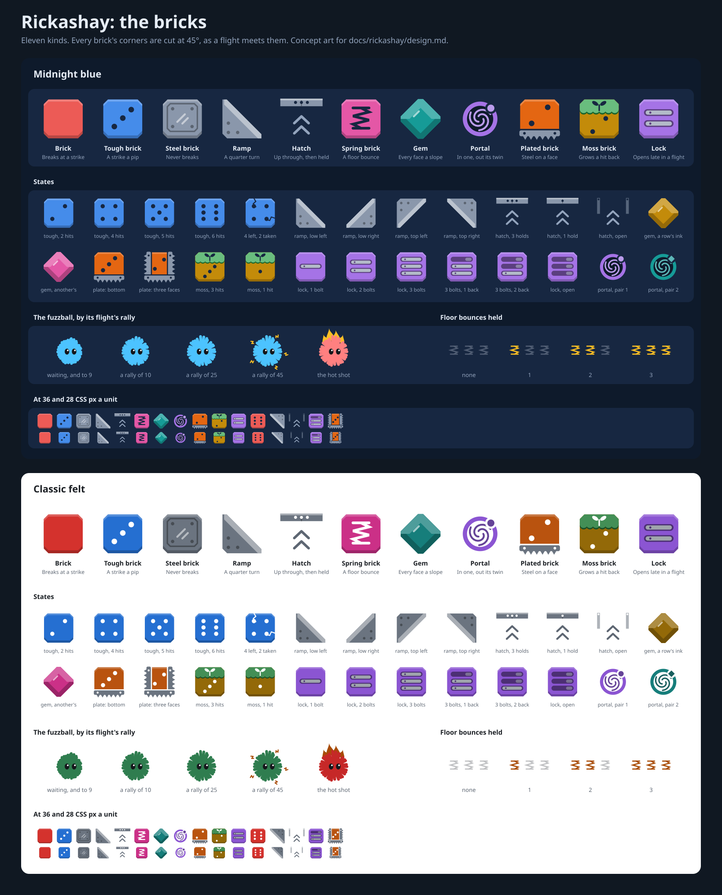
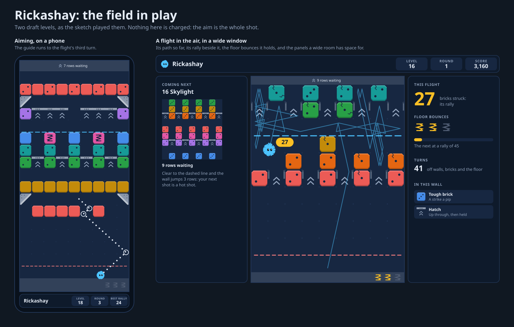
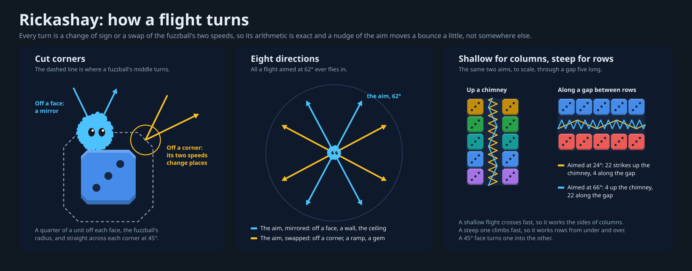

# Design: Rickashay, a bank-shot brick breaker

Written 2026-11-10, for the user's ask: look over the Brick Fuzz Pop design
and its mocks, research a variant of it, and design that variant as a game
called "Rickashay". It differs in three ways, in the user's words:

- "There is no charging the ball before release."
- "Balls bounce off of bricks instead of going through them, even when they
  are destroyed."
- "Level design puts more emphasis on balls bouncing around walls and in
  between bricks so players have a chance to maximize the up time of a
  single ball."

Other games of the kind were to be read for inspiration, and no source
code.

This is a design, not a build plan. Nothing is built, and nothing here says in
what order to build it. [Brick Fuzz Pop's
plan](../archive/brick-fuzz-pop/plan.md) set this game aside in its first
decision, "a game that wins more by bouncing off the bricks and walls is to be
designed apart, later", and this is that game. It keeps Brick Fuzz Pop's field,
its wall and its round, and changes what a shot is: with no charge and no punch,
a shot is an aim and nothing else, and the game is about how long one fuzzball
can be kept in the air.

Everything made for the design is in this folder, `docs/rickashay/`:

- **`design.md`,** this file.
- **[`research/`](research/),** the reading: three files of notes, each
  finding with its source.
  [`brick-shooters.md`](research/brick-shooters.md) is the aim-and-release
  brick games, [`long-flights.md`](research/long-flights.md) how games
  score, celebrate and bound one ball's time in the air, and
  [`ricochet-puzzles.md`](research/ricochet-puzzles.md) the games of one
  banked shot. "What other games teach" is what the design took from them.
- **[`art/`](art/),** the concept art, three sheets:
  [`bricks.svg`](art/bricks.svg), every kind of brick, its states, the
  fuzzball as its rally grows and the floor bounces it holds, in a dark
  palette and a light one; [`flight.svg`](art/flight.svg), how a flight
  turns; and [`field.svg`](art/field.svg), the field in play on a phone and
  in a wide window. `art/make-art.mjs` draws them all again. It borrows its
  palettes, its fuzzball and its drawing commands from Brick Fuzz Pop's
  `art/make-art.mjs`, so the two games' art can't drift apart.
- **[`levels/`](levels/),** the thirty-six draft levels, a JSON file a set,
  and `levels/build.mjs`, which stacks each wall from its courses and writes
  the four files. "Appendix: the draft levels" shows the courses.
- **[`mocks/`](mocks/),** a mock of each draft level as it opens, drawn with
  the art: the whole wall, the level on a phone and in a wide window, the
  kinds of brick in it, and over each field the longest flight its opening
  allows, as the sketch flew it. There is a file a level under
  `mocks/levels/` and a sheet a set
  ([Warm-up](mocks/warm-up.svg), [Angles](mocks/angles.svg),
  [Tricks](mocks/tricks.svg), [Long rallies](mocks/long-rallies.svg)), and
  `mocks/make-mocks.mjs` draws them all again from `levels/`, the art and
  the sketch.
- **[`sketch/`](sketch/),** throwaway code written for this design, not the
  game's: the flight, the eleven kinds of brick as "Design reference" has
  them, the wall's step and its jump, a solver and three players. It played
  every draft level on every field depth, and its numbers are quoted where
  they decided something ("The sketch");
  [`sketch/results.md`](sketch/results.md) is what it printed. Its
  [`README.md`](sketch/README.md) says how to run it and where it differs
  from the design.

No other game's code was read, here or by the agents that did the reading:
store pages, reviews, guides, wikis, rule sheets, interviews and design
essays only, and each research file says what it skipped to keep to that.



## What was asked, and where it is answered

| Asked for                                                             | In this design                                                                                                                        |
| --------------------------------------------------------------------- | ------------------------------------------------------------------------------------------------------------------------------------- |
| Look over the Brick Fuzz Pop design and mocks                         | Decisions 8 and 26; "What it shares with Brick Fuzz Pop": the field, the wall and the round are its, cited and not copied             |
| Research a variant of the game                                        | "What other games teach"; `research/`                                                                                                 |
| A game called "Rickashay"                                             | Decision 1                                                                                                                            |
| No charging the ball before release                                   | Decisions 2 and 18; "The flight", "Controls": a shot is an aim and a release                                                          |
| Balls bounce off bricks, even the ones they destroy                   | Decisions 3 and 9; "The flight": every strike turns the fuzzball, the hot shot's too                                                  |
| Levels that put the emphasis on bouncing off walls and between bricks | Decisions 5, 11 and 14; "The levels": chimneys, alleys, doors and attics; ramps, hatches and gems; `levels/`, `mocks/`                |
| A chance to maximize the up time of a single ball                     | Decisions 6, 7, 10, 20 and 21; "The rally and the floor bounce": one fuzzball, its rally counted, paid and given more time in the air |
| Similar games read for inspiration and design ideas                   | "What other games teach"; `research/`                                                                                                 |
| No source code looked at                                              | The research files' own notes; the sketch was written from this design alone                                                          |
| A design under `docs/`, as before                                     | This folder, laid out as `docs/archive/brick-fuzz-pop/` is                                                                            |

## The game in brief

Rickashay would be built after Brick Fuzz Pop, at `/play/rickashay/`, in
Arcade beside it. A wall of square bricks, nine across and taller than the
screen, hangs over a floor. The site's fuzzball sits on the floor. The
player aims it and lets go: there is nothing to charge. It flies in
straight lines and turns off everything it strikes, the side walls, the
ceiling and every brick, and it takes a hit off each brick. A brick that
breaks is gone the next time the fuzzball comes by, but it turned the
fuzzball first. So nothing is drilled through: the way into a wall is
around it, up a gap one brick wide, in through a door at its side, over
its top.

The bricks struck in one flight are its **rally**, and the rally is what
the game counts, shows, pays and celebrates. A flight that reaches a rally
of 10 earns a **floor bounce**: the next time it comes down, the floor
throws it back up. A second comes at 25 and a third at 45, so a long flight
buys itself a longer one. When the fuzzball at last lands, the round is
over: it waits where it landed, and the wall comes down a row. A round that
leaves the lower two-thirds of the screen clear makes the wall jump down a
third of the screen at once, and the next shot is a hot shot, as in Brick
Fuzz Pop. Clear every brick the level needs and it is cleared; let one
reach the floor and it is lost.

It is turn-based, so nothing in it needs quick hands, and its rules draw no
random number, so a shot from the same place at the same aim always flies
the same way. What is its own: a shot that is only an aim; corners cut at
45°, so every turn is exact and a flight only ever travels in eight
directions; the rally, and the floor bounces it earns; kinds of brick that
steer a flight where Brick Fuzz Pop's broke the wall for it; and walls
built as places to bounce in.

## What the user settled

The design makes every choice, so that it reads whole. Seven of them were
the user's more than the design's, and were put to them as it was handed
over. The same day, 2026-11-10, the user kept all seven as written.
"Decisions" marks them **the user's**. Each is still written so that it
can be changed without unpicking the rest:

1. **The name has a namesake** (decision 1): a small free browser game on
   itch.io is already called Rickashay.
2. **One boon, the hot shot** (decision 9). A boon is what a jump pays, a
   stronger next shot, and this says what a hot shot does in a game where
   nothing punches through.
3. **How far the aim guide shows** (decision 17). The guide is the dotted
   line that shows where an aim will fly, and it runs to the flight's
   third turn. It is the game's largest lever on how hard it is.
4. **Nothing breaks a brick but a strike** (decision 4): no zappers and no
   bomb, which are five of Brick Fuzz Pop's sixteen kinds.
5. **Two kinds with rules of their own** (decision 11), the only ones that
   take more than a sentence to explain: the hatch, a bar a fuzzball rises
   through and is then held up by, and the lock, a brick that opens only
   once the flight has turned often enough.
6. **Where the next shot leaves from** (decision 19): where the last one
   landed, as in Brick Fuzz Pop, and not wherever the player slides the
   fuzzball.
7. **The rally's rewards** (decisions 7, 20 and 21): floor bounces at 10,
   25 and 45 strikes, a star for a long flight, and points that climb with
   the rally.

## Decisions

The design's choices, cited by number below. "Asked for" marks what the ask
settled; **the user's** marks what the user kept on 2026-11-10, of the
seven choices "What the user settled" lists; and "Brick Fuzz Pop's" marks
what is taken from that plan as it stands, several of them the user's own
answers there. Each of the rest says what it could be instead.

1. **The name is Rickashay** (asked for, and **the user's** to keep), at
   `/play/rickashay/`, workspace `games/rickashay`, port 9007, in Arcade.
   The name is taken already, by a small one:
   [Rickashay](https://crystal-studios.itch.io/rickashay), a free browser
   game by Deex on itch.io, made for the GMTK Game Jam 2020, a top-down
   shooter whose bullets ricochet. No brick game found uses the name, and
   the brick games called Ricochet (Reflexive's Xtreme, Lost Worlds and
   Infinity) are played with a paddle. That is a search of the web, not of
   trademarks. Told of the namesake, the user kept the name. Instead: a name
   nobody has.
2. **A shot is an aim** (asked for). A round is aim, release, and the
   flight. With nothing to charge, the aim carries the whole game, so the
   design spends its effort on what makes an aim worth choosing: a flight
   that can be read (decision 5), a guide that shows enough of it
   (decision 17) and walls with something to aim for (decision 14).
3. **Every strike turns the fuzzball** (asked for), the one that breaks a
   brick too. A strike takes one hit. The brick is gone when the fuzzball
   next comes by, so a flight opens its own way in, a brick at a time.
4. **Nothing breaks a brick but a strike** (**the user's**). Brick Fuzz Pop
   has zappers and a bomb, which break others in a pattern. Here the pattern
   is the flight, and a brick the fuzzball didn't reach is a brick still to
   reach. It also keeps the rally honest: a rally of 30 is thirty strikes.
   Instead: keep the row and column zappers, which gives the player bricks
   to hunt and takes away some of the reason to stay up.
5. **Corners are cut at 45°, so a flight has eight directions.** The rules
   fly the fuzzball's middle. It meets a flat a quarter of a unit off each
   face, and where two open faces meet at a corner, a short 45° face across
   it, in place of the quarter circle a round ball would roll about. A
   flat mirrors the flight; a 45° face makes its two speeds, across and up,
   change places. So a flight aimed at 62° only ever travels at 62° or 28°
   from the floor, up or down, left or right: eight directions, all known
   as it leaves. A nudge of the aim moves each bounce a little along its
   face and can never send it off at a new angle, and the arithmetic is
   exact, with no square root in it. In the sketch cut corners gave as
   many long flights as round ones and steadier aims ("The sketch", 7).
   Instead: round corners, as Brick Fuzz Pop has, which is what a ball
   does, and what spreads two flights a hair apart until they have nothing
   in common.
6. **The rally is the game's number.** The bricks struck in one flight,
   counted beside the fuzzball as it flies. It is what the points, the
   floor bounces, a star, the fuzzball's fur and the sound all follow
   (decisions 7, 20, 21, 24 and 25). A Holedown reviewer counts a shot's
   brick touches as a challenge of their own, in a game that shows no
   count; no brick game read counts them for the player.
7. **A long rally earns floor bounces** (**the user's**). The first at a
   rally of 10, the next 15 strikes later, at 25, then 20 later, at 45, and
   so on, each 5 dearer than the last. A fuzzball holds three at most and
   spends one by itself each time it reaches the floor, turning off it as
   off a wall. None is kept past the flight. So the reward for staying up is
   more time up, and each costs more than the last, as pinball's awards do,
   so that no flight feeds itself forever. In the sketch two flights in
   five earned one ("The rally and the floor bounce"). Instead: Peggle's
   bucket, which is timing and luck; a floor bounce as a pickup alone, as
   One More Brick has, which this game has too, as a brick (decision 11);
   or none, and a rally that is only a score.
8. **The round and the wall are Brick Fuzz Pop's,** its decisions 2, 4, 6,
   7 and 11: the fuzzball flies until it lands; the wall then comes down a
   row; a round that leaves the lower two-thirds of the screen clear makes
   it jump a third of the screen and pays a boon; a brick the level needs
   in the floor's row loses the level; the field is nine square columns,
   always upright, 11 to 22 rows deep as the room allows, with the game's
   panels beside it in a wide room. The user chose most of that there, and
   two games that share a field and a wall can share their code and their
   players. Instead: a wall that never comes down, and a level as a count
   of shots, which is Peggle's shape and a different game.
9. **One boon, the hot shot, and here it is a harder hit and a spare
   bounce** (**the user's**). A jump makes the next shot a hot shot, as in
   Brick Fuzz Pop. There it punches through everything; here nothing may
   (decision 3). So a hot shot takes two hits a strike where a plain one
   takes one, and leaves with one floor bounce already in hand. It still
   turns off every brick. Brick Fuzz Pop's other boon, the triple shot,
   isn't here: the game is one fuzzball's flight (decision 10). The sketch
   found it a modest boon, and its second hit spends strikes its own
   rally could have had ("The hot shot", "Risks"). Instead: one hit a
   strike and two floor bounces in hand, which takes nothing from the
   rally; or a boon that lengthens the guide for a shot.
10. **One fuzzball, always.** No friends, no cages, no prisms, no triple
    shot. The ask is the up time of a single ball, and a second ball
    halves what the first one means.
11. **Eleven kinds of brick** ("The bricks"; the hatch and the lock
    **the user's** to keep). The plain brick; four that are harder to break
    (tough, plated, moss and the lock); the spring brick, which pays a floor
    bounce; and five that steer a flight and never break (steel, the ramp,
    the hatch and the portal) or steer it and break (the gem). Six are Brick
    Fuzz Pop's, the plated brick and moss changed to suit; the ramp, the
    hatch, the spring brick, the gem and the lock are new. Each is here for
    what it does to a flight's route, not for what it breaks. Its bumper,
    prism, wool, shell, cage, zappers and bomb are left out, each for a
    reason "The bricks" gives.
12. **Hits are pips** (Brick Fuzz Pop's decision 10), six at most, with a
    crack for each hit taken.
13. **Cleared and lost** as Brick Fuzz Pop's decision 11. Steel, ramps,
    hatches and portals aren't needed, and sink into the floor when they
    reach it. A jump can't lose a level.
14. **Thirty-six levels in four sets of nine,** as data: Warm-up, Angles,
    Tricks and Long rallies. A wall is 13 to 29 rows tall, a stack of
    courses with a row of air between them, and each course is one of a
    few shapes a fuzzball can rattle in: a chimney, an alley, a door, an
    attic, a gap, a hatch floor, a launcher, a lattice ("The levels"). Each
    kind first comes in a level built around it; each set ends on a wall
    that mixes what it taught; an easy level follows a hard one. They are
    sparser than Brick Fuzz Pop's, 30 to 99 bricks a wall where its have
    64 to 252, because the air in a wall is where the game is played.
15. **Every level is proved beatable on every depth,** as Brick Fuzz Pop's
    decision 13. A certificate, a line of shots that clears the level, is
    kept and replayed by the specs. And a careless player, one that looks
    at sixteen aims a round and plays the best of them, must clear it
    often enough: its floor. Three checks are added, for what this game
    asks of a level. Aims drawn blind must not clear it too often, or it plays
    itself. A long flight must not hang on one aim: the aims that rally 8
    or more must run three or more side by side as the level opens. And
    the star for a long flight must be shown to be in reach ("The
    guarantee").
16. **A round is decided as it is released, then played back** (Brick Fuzz
    Pop's decision 14). It earns more here. The guide is the rules' own
    cast, so three turns of it are exact. The scene knows a flight's last
    strike as it happens, and can hurry the rest home (decision 22). And
    the announcer can say what a flight did the moment it leaves.
17. **The guide shows a flight to its third turn** (**the user's**). A ring
    marks each turn, and the bricks it strikes on the way are marked too. A
    setting makes it the first turn or the fifth. Brick Fuzz Pop's stops at
    the first, which is the genre's habit, and in Okay? where the complaints
    of trial and error sit; and the retry such games lean on doesn't exist
    here, since the wall moves every round. The whole path would make the
    game a search for a number. In the sketch a player who chose by the
    guide alone cleared several times as many levels seeing three turns as
    seeing one ("The sketch", 9), so this one setting moves the game
    further than any other number in it. Instead: the first turn and one
    more, the least that is fair; or the fifth, for a gentler game.
18. **Aiming:** a finger and a mouse alike point and hold: press where to
    aim, the guide follows as the finger or the mouse drags, and letting
    go releases. Holding charges nothing, as there is nothing to charge.
    Pulling back is a setting, for the mouse and fingers alike. By keys, a
    degree at a time, or a quarter of one with Shift. Two buttons nudge
    the aim a quarter of a degree, and a setting has a shot wait for a
    Release button, so lifting a finger can't spoil an aim. Brick Fuzz
    Pop's fingers have aimed this way since 2026-11-13, as a phone had no
    room under its field to pull back into. It costs a finger's view of
    the guide where it presses, which Release with a button gives back,
    and a stray tap fires. Instead: a finger pulls back by default, which
    keeps it off the guide and swallows a tap, but wants room below its
    press.
19. **The fuzzball waits where it lands** (**the user's**), and the next
    round leaves from there (Brick Fuzz Pop's decision 8). So an aim also
    chooses where the next one starts, as Bounzy's does, and a long flight
    can leave it anywhere. Instead: the player slides it along the floor
    before each shot, which is a second thing to tune and, in Okay?, twice
    the nudging.
20. **Three stars, each its own** (**the user's**): one for clearing the
    level, one for clearing it within its par of rounds, and one for a
    flight that reaches the level's rally mark on the way, a rally the
    careless player's best flight reaches every other game ("The
    guarantee"). Brick Fuzz Pop's three are all for rounds. Here one is
    for the thing the game is about, and it can be had on a slow clear.
    They are honours, and nothing is locked behind them.
21. **Scoring by the rally** (**the user's**). Ten points a strike, times a
    step that climbs with the flight's rally, and a bonus for each floor
    bounce earned, each jump and each star.
22. **The flight is never a wait.** It quickens as its rally grows, it
    dashes home once its last strike is behind it, and fast-forward and
    Skip are there from its first moment, as in Brick Fuzz Pop. Its timer
    that doubles a flight's speed after eight seconds is not: here a long
    flight is the prize, and the game shouldn't hurry the player past it.
23. **Flat art in the site's palettes,** Brick Fuzz Pop's tiles with their
    corners cut, so a brick's picture is the shape a flight meets. The
    sheets in `art/` are its design.
24. **Sound follows the rally:** a struck brick's note climbs a scale with
    each strike of the flight, and a floor bounce earned sounds a chord.
25. **Fuzzley flavor:** the fuzzball is the ball; its fur lifts as its
    rally grows, where Brick Fuzz Pop's stands up with its charge; it
    yawns when it is bored; the hot shot is the fuzzball itself, red-hot.
26. **Built after Brick Fuzz Pop, on its parts.** The field's sizes, the
    wall, the round played back, the certificates, the panels, the bar and
    the debug menu are that game's, and what both need is lifted into the
    libraries when this one is built. How, and in what order, is a build
    plan's to say, once Brick Fuzz Pop's feel is settled.
27. **Not now:** a gamepad, haptics, an endless mode, a daily wall, moving
    bricks, a level editor ("Not in this design").

## Design reference

### The field

The field is Brick Fuzz Pop's, to the pixel: its plan's "The field" is the
reference, with its table of what each window comes to, and nothing here
changes it.

- **Nine cells across, 11 to 22 deep,** each cell a unit square, always
  upright. Places are `x`, across, from 0 to 9, and `y`, up from the floor.
  Rows are counted from the floor: row 0 is the floor's, where no brick may
  stand.
- **A tall room it fills from side to side,** 12 to 22 rows deep; **a wide
  room it fills from top to bottom,** eleven rows deep, with a panel either
  side where the room allows ("Cards, the bar and the panels").
- **A lintel over the ceiling** says how many rows wait, and **a band under
  the floor** takes what height is left over. The band is where the floor
  bounces a flight holds are drawn, three small springs.
- **The depth follows the room,** between rounds.

The mocks draw each level on the two shapes Brick Fuzz Pop's do: a phone
held upright, 390 × 844, nine by seventeen, and a wide window, 1280 × 800,
nine by eleven.



### The flight

- **A fuzzball flies in straight lines,** from where it waits on the floor,
  its middle 0.25 units up, along one of 657 aims a quarter of a degree
  apart, from 8° above the floor on one side to 8° on the other. Its radius
  is 0.25 units, so it fits a gap one cell wide with its own width to spare
  and can't pass between two bricks that touch at a corner.
- **The rules fly its middle.** The side walls, the ceiling and each open
  face of a brick are met a quarter of a unit out, as flats. Bricks side by
  side make one face.
- **Every flat is a mirror.** Off a side wall or a brick's side the
  fuzzball's speed across changes sign; off the ceiling, or a brick's top
  or bottom, its speed up does.
- **Every corner is cut** (decision 5). Where two open faces of a brick
  meet, and no other brick, ramp or wall touches the corner, a 45° face
  joins their two flats, a quarter of a unit out along each. A fuzzball
  that meets it has its two speeds change places: the one across becomes
  the one up, with the signs that send it away. A ramp's long face and a
  gem's four faces are the same face, longer ("The bricks").
- **So the faces close.** Flats and cuts run round every brick and every
  clump of bricks without a gap, which leaves a fuzzball's middle no way
  into one, nor nearer a wall than its radius. The sketch looks for a
  flight that found one, and finds none ("The sketch", 14).
- **So a flight has eight directions.** An aim's speeds are a pair of
  numbers, and no turn does anything to them but change a sign or swap
  them. Aimed at 62°, a fuzzball flies at 62° or at 28° from the floor,
  left or right, up or down, for as long as it flies. A player who has
  seen one bounce off a corner has seen them all.
- **Shallow for columns, steep for rows.** A flight near the floor's angle
  crosses fast and climbs slowly, so in a gap between two columns it turns
  many times for each row it gains. A steep one does the same between two
  rows. In the art's picture a flight at 24° strikes 22 times climbing a
  chimney five bricks tall and 4 times along a gap five bricks long, and
  one at 66° the other way about. A 45° face turns one into the other,
  which is what ramps and gems are for.
- **It strikes each brick it turns off,** taking one hit, two as a hot
  shot. Steel, a ramp, a hatch, a plated face and a lock still shut turn
  it and take nothing; they aren't strikes.
- **Everything it meets at one moment is struck, and it turns once.**
  Flats turn it first; then a long 45° face, if it still flies into one;
  and a corner's cut only where nothing else turned it. So a fuzzball that
  flies into the foot of a wall, where a brick's bottom and its neighbor's
  side meet, comes back the way it came, and strikes both.
- **The floor ends its flight,** unless it holds a floor bounce ("The rally
  and the floor bounce"). It waits where it touched, no nearer a side wall
  than half a unit, and the next round leaves from there (decision 19). A
  level's first round leaves from the floor's middle, x = 4.5.
- **A bored fuzzball comes home,** as Brick Fuzz Pop's does: one that flies
  60 units without a strike yawns and drops to the floor from where it is.
  A floor bounce in hand doesn't save it; it has stopped caring. In the
  sketch 17 flights in 100 ended this way, at a rally of 9 at the middle:
  flights that had done their work and found nothing more in reach. Two in
  five were under the wall when they yawned, as many among its bricks and
  one in five over it ("Risks").
- **So no flight is endless.** Every 60 units it must take a hit off a
  brick, and a wall has only so many hits: 52 to 207 in the drafts. Two
  guards stand behind that rule and should never be met: 4,000 units of
  flight, where the careless player's longest plain flight was 897, and
  eight turns running without flying between, which the sketch never saw.
- **Everything is geometry.** A flight is measured in units flown, not in
  time, so a round comes out the same at any frame rate and any speed, and
  `fly()` works it out whole before the scene draws any of it
  (decision 16). In the sketch a flight took 0.7 milliseconds to decide on
  the largest draft.
- **Only what every engine rounds alike.** The flight adds, subtracts,
  multiplies and divides, and nothing else. The aims are numbers written
  out, a mirror is a change of sign, a cut corner is a swap, and how far a
  45° face stands off, a quarter of a unit times the square root of 2, is
  one more number written out. Brick Fuzz Pop's round corners need a
  square root; this flight needs none.



### The rally and the floor bounce

- **A flight's rally is the bricks it has struck,** each strike one,
  whatever it took off the brick. It starts at nothing with every release.
- **It is shown where the player is looking:** a number beside the fuzzball
  as it flies, and again in the bar or the panel ("Cards, the bar and the
  panels").
- **A floor bounce is earned at a rally of 10,** another at 25, another at
  45, then at 70, 100, 135 and on: the first costs ten strikes and each
  further one five more than the last.
- **A fuzzball holds three at most.** One earned while it holds three is
  lost. A spring brick gives one as it breaks ("The bricks"), and a hot
  shot leaves with one ("The hot shot").
- **It is spent by itself.** A fuzzball that reaches the floor with one in
  hand turns off the floor as off a wall and flies on, one fewer in hand.
  There is nothing to press and nothing to time.
- **Nothing is kept past the flight.** What it holds when it is bored, or
  when the level is cleared, is gone.
- **Each is drawn** as a spring in the floor's band, grey until it is
  earned, and the fuzzball's fur lifts with the first three ("Fuzzley
  flavor").

What the numbers do, over the careless player's 6,023 plain flights in
the sketch, its hot shots left out ("The sketch"): a flight's rally was 7
at the middle, 33 at the ninth in ten, 79 at the ninety-ninth in a hundred
and 162 at the most. Of each hundred flights, 39 earned a floor bounce, 38
spent one, 15 spent two or more, and 11 were duds, a strike or none. So
most flights are short, two in five are long enough to be given more, and
one in ten is the kind a player remembers.
That shape is the intent. Peggle gives a free ball at 25,000, 75,000 and
125,000 points in one shot for the same reason, and PopCap's John Vechey
says that without them its players wouldn't care about the score.

Why 10: an aim taken with no thought rallies 1 at the middle and 7 at the
ninth in ten (every aim, from every level's opening), and the careless
player's chosen flights 7 at the middle. Ten is just past what comes by
itself.

### The wall

The wall is Brick Fuzz Pop's too ("The wall" in its plan), and the user's
there:

- **A wall is taller than the screen.** A level's is 13 to 29 rows of
  bricks and air here. The field shows its lowest rows, and the rest wait
  over the ceiling, out of play.
- **Thirds are whole rows.** On a field D rows deep the jump, J, is the
  whole part of (D − 1) / 3, and a level opens as a jump leaves it, its
  wall's lowest row in row D − 2J.

  | Depth                           | 11  | 12  | 13  | 14  | 15  | 16  | 17  | 18  | 19  | 20  | 21  | 22  |
  | ------------------------------- | --- | --- | --- | --- | --- | --- | --- | --- | --- | --- | --- | --- |
  | A jump, rows                    | 3   | 3   | 4   | 4   | 4   | 5   | 5   | 5   | 6   | 6   | 6   | 7   |
  | A wall opens on, and lands, row | 5   | 6   | 5   | 6   | 7   | 6   | 7   | 8   | 7   | 8   | 9   | 8   |

- **After a round,** unless it cleared the level: moss grows back a hit;
  the wall comes down; what isn't needed and reached the floor's row sinks,
  a portal taking its twin with it; and if a brick the level needs stands
  there, the level is lost.
- **It comes down one row,** unless the round left no brick the level needs
  below the jump line. **Then it jumps** J rows at once, and the next shot
  is a hot shot. A jump can't lose a level, and jumps can follow one
  another.
- **The jump line** runs under the J rows below the ceiling, with the
  lower two-thirds under it, and **the danger line** along the top of the
  floor's row: a brick in the row over it is one step from losing the
  level. Both are drawn as Brick Fuzz Pop draws them.

The open rows under a wall matter more here than there. They are where a
fuzzball coming down is turned back up by a floor bounce, and where a
shallow flight crosses from one side wall to the other before it reaches
the bricks. A level opens with five to nine of them, the floor's among
them.

In the sketch a careless player's rounds ended in a jump 34 times in 100 on
the shallowest field, 23 on one 16 deep and 13 on the deepest, and a level
it cleared took 9, 7 and 6 rounds and jumped 3.1, 1.6 and 0.8 times, at
the mean of the thirty-six.

### The hot shot

A jump makes the next shot a hot shot (decision 9).

- **It takes two hits a strike,** so it breaks a brick of two in one, and
  it still turns off every brick it strikes. A strike is still one for the
  rally.
- **It leaves with a floor bounce in hand,** and earns more as any flight
  does.
- **Steel, a plated face and a shut lock** treat it as they treat any
  fuzzball.
- **The board says it is coming:** the fuzzball waits red-hot, under a
  crown of flame, with one spring lit in the floor's band.
- **It lasts one shot.** A hot shot that leaves the lower two-thirds clear
  again earns the next.

In the sketch a hot shot's rally was 8 at the middle against a plain
shot's 7, and it broke 8 bricks against 5. In the best tenth of each it
broke 16 against 20: a hot shot follows a jump, when only a third of the
screen has bricks in it, so there is less for its best flights to find.
Its second hit is also a strike the wall no longer has to give: a tough
brick of four is two strikes to a hot shot and four to a plain one, so a
hot shot's rally has less to draw on. It is a help and not a rescue
("Risks").

### The bricks

Eleven kinds. `o`, `2` and the rest are how a level's picture writes them
("The levels").

| Kind         | In a picture    | Hits    | What it does                                                                                                                  | First level    |
| ------------ | --------------- | ------- | ----------------------------------------------------------------------------------------------------------------------------- | -------------- |
| Brick        | `o`             | 1       | Breaks at a strike                                                                                                            | 1 First bounce |
| Tough brick  | `2` to `6`      | 2 to 6  | A strike takes a pip                                                                                                          | 4 Pips         |
| Steel brick  | `#`             | never   | Turns the fuzzball and takes nothing                                                                                          | 7 Girders      |
| Ramp         | `L` `J` `F` `7` | never   | A steel wedge, half a cell: its long face is at 45° and turns a flight a quarter turn                                         | 10 Launcher    |
| Hatch        | `=`             | never   | A steel bar along the top of its cell: a fuzzball rises through it and is held up coming down, three times a flight in all    | 12 Trapdoor    |
| Spring brick | `S`             | 1       | Breaking it gives the flight a floor bounce                                                                                   | 13 Springboard |
| Gem          | `G`             | 1       | A brick set on its point: all four of its faces are at 45°                                                                    | 19 Gems        |
| Portal       | `@` `&`         | never   | A fuzzball that flies into its eye comes out of its twin's, flying the same way                                               | 21 Elevator    |
| Plated brick | `v` `V` `U`     | 2, 3, 2 | A tough brick with steel on its lower face, or on that and both sides: a strike on steel takes nothing                        | 22 Shutters    |
| Moss brick   | `M` `N`         | 2, 3    | Grows a hit back after every round it survives                                                                                | 28 Moss garden |
| Lock         | `x` `y` `z`     | 1       | Has 1, 2 or 3 bolts, and a bolt slides back at every fourth turn of the flight: shut, it turns the fuzzball and takes nothing | 29 Combination |

The details that decide a flight:

- **Steel, ramps, hatches and portals aren't needed** to clear a level, and
  the rest are.
- **A ramp** is named for the corner of its cell its right angle sits in:
  `L` low left, `J` low right, `F` top left, `7` top right. Its two short
  sides are flats, like a brick's, and make one face with the bricks
  beside them. A fuzzball that climbs into its long face leaves flying
  sideways, and one that flies into it sideways leaves climbing or
  falling. Its two points are cut by a short flat each, so its long face
  ends square.
- **A hatch** has nothing under its bar. A fuzzball flying up passes it
  as air, and still meets the bricks about its cell: their faces are open
  toward it, and their corners cut, as if the hatch weren't there. One
  coming down meets the bar's flat and is turned back up. That is a hold,
  and not a strike. Two hatches side by side are one bar, and a bar's ends
  are cut like a brick's corners where nothing stands beside them; a turn
  off an end is a hold too, whichever way the fuzzball was flying. The
  hatches hold a flight three times between them: at the third hold every
  hatch in the field swings open, and stays open until the fuzzball lands.
  Three dots on each bar count the holds left. So a hatch floor is a
  room a fuzzball climbs into and is kept in for a while, and never a
  cage: the first drafts counted each hatch's holds apart, and their
  flights rattled between a hatch floor and steel until they were bored,
  73 to 100 flights in 100 on some walls.
- **A spring brick** gives its floor bounce as it breaks, if the fuzzball
  holds fewer than three. It is One More Brick's floor-bounce pickup, made
  a brick so that reaching it is the price.
- **A gem** takes its strike on any face, and every one swaps the
  flight's two speeds, as a cut corner does, where a flat only mirrors
  them. So a gem always moves a flight from four of its eight directions
  to the other four. Its four points are cut by short flats, as a ramp's
  are.
- **A portal** takes a fuzzball as its middle reaches the portal's eye,
  the half-unit square at the middle of its cell, and puts it at the same
  place in its twin's eye, flying the same way. The eye keeps a quarter of
  a unit from the cell's edges, as far as a fuzzball's middle keeps from
  any face, so a twin never sets one down inside a brick beside it or in a
  side wall. A fuzzball that only clips the cell's corner flies on. It
  can't go back into the eye it came out of until it has turned off
  something. A portal whose twin still waits over the ceiling is shut, and
  a fuzzball flies through it as air. Passing a portal isn't a turn.
  Portals come in twos, a pair marked with a dot and a pair with a
  diamond, and a level has two pairs at most.
- **A plated brick** is plated underneath (`v`, `V`) or underneath and on
  both sides (`U`). It must be struck on a bare face: from the side, or
  from over it. A cut corner between a plated face and a bare one counts
  as bare. Brick Fuzz Pop's plates earth a charge; these send a flight the
  long way round.
- **Moss** grows back one hit after each round it is left standing, up to
  what it began with. A moss brick of two wants two strikes in one flight,
  which is a rally's work and not a round's.
- **A lock's bolts are the flight's own count.** Every fourth turn of the
  flight, off anything, slides a bolt back on every lock in the field: a
  lock of one bolt is open once the flight has turned four times, of two
  after eight, of three after twelve. Open, it breaks at a strike. A
  flight's turns off the floor and off a hatch count; passing a portal
  doesn't. The bolts are drawn sliding, and they shut again as the
  fuzzball lands. A lock is a brick only a flight that has stayed up can
  break.

Left out of Brick Fuzz Pop's sixteen, and why:

| Its kind               | Why not here                                                                                |
| ---------------------- | ------------------------------------------------------------------------------------------- |
| The four zappers, bomb | Decision 4: nothing breaks a brick but a strike                                             |
| Bumper                 | A round face sends a flight off its eight directions, and nearby flights apart (decision 5) |
| Prism, cage            | Decision 10: one fuzzball                                                                   |
| Wool, shell            | They fill a charge and need one; there is none                                              |

Considered from the research and not taken:

- **A bonus for a bank shot,** Peggle's Off the Wall. In the sketch 91
  flights in 100 had a strike straight off a side wall or the ceiling, 5.0
  of them a flight, so it would pay nearly every flight and say nothing.
- **A target that doesn't turn the ball,** Okay?'s string. The ask rules it
  out.
- **Rings to collect before the last brick breaks,** Ricochet Infinity's
  second goal. The rally mark is this game's (decision 20), and it needs
  no new thing in the field.
- **A brick that pays more each strike of a flight,** pinball's bumper
  value. The rally's step does this for every brick alike ("The feel, in
  numbers").
- **Bricks that move.** They put timing into a game that has none.

### The levels

A level is data: an id, a name, what its wall is built around, and its
wall as rows of nine characters, the top row first, in the letters "The
bricks" gives and `.` for air. A set is a JSON file of nine. A level names
no boon, since there is one. The drafts are in [`levels/`](levels/), their
mocks in [`mocks/`](mocks/), and their courses in the appendix.

What a wall is made of. Each is a place for one kind of flight, and the
levels are named for them:

| A wall's part | What it is                                                         | The flight it suits                                                            |
| ------------- | ------------------------------------------------------------------ | ------------------------------------------------------------------------------ |
| A chimney     | A column of air one cell wide between two columns of bricks        | A shallow one, which strikes side to side all the way up it                    |
| An alley      | A clear column along a side wall                                   | A shallow one again: the side wall, a brick's side, the side wall              |
| A door        | One cell of air in a row that is otherwise full                    | Any that finds it; it is the way to what is behind                             |
| A gap         | The row of air between two courses                                 | A steep one, which strikes the course over it and the course under it in turn  |
| An attic      | The air over a wall's top course, under the ceiling or the next    | A steep one, reached by an alley or a door: Breakout's oldest trick            |
| A hatch floor | A course whose lowest row has hatches in it                        | One that rises through a hatch and is held in the room over it                 |
| A launcher    | A ramp at the head of an alley or a chimney                        | A climbing one, thrown sideways along a gap or across an attic                 |
| A lattice     | Bricks or gems on every other cell, touching at their corners only | One that works its way in a cell at a time; with gems, on all eight directions |

The four sets:

| Set          | Levels   | Brings in                             | What it teaches                                                        | A wall, rows |
| ------------ | -------- | ------------------------------------- | ---------------------------------------------------------------------- | ------------ |
| Warm-up      | 1 to 9   | The brick, tough bricks, steel        | That the way in is around: gaps, doors, chimneys, alleys and the attic | 15 to 21     |
| Angles       | 10 to 18 | The ramp, the hatch, the spring brick | That a flight can be turned, held up and given another bounce          | 15 to 23     |
| Tricks       | 19 to 27 | The gem, the portal, the plated brick | That some bricks must be come at from the right side                   | 13 to 21     |
| Long rallies | 28 to 36 | Moss, the lock                        | That some bricks only a long flight breaks                             | 13 to 29     |

#### The rules a level keeps

A spec holds every level to each:

- **Nine wide, 13 to 33 rows tall,** no row of air at its top or its foot,
  and never two rows of air together. The drafts are 13 to 29.
- **One new kind a level at most,** and a kind's first level is built
  around it.
- **The lowest row is workable:** no brick in it of more than four hits,
  and no lock. It is the row a level opens on, and the first a round must
  thin.
- **No steel in a row that has a hatch.** A fuzzball held over a hatch
  floor must be striking something it can break ("The bricks").
- **Portals in twos, a pair no more than three rows apart,** so one is
  never long in the field without its twin, and two pairs a level at
  most.
- **A set's last level mixes what the set taught,** and each set has a
  rest or two, a level easier than the one before it.
- **Each level passes "The guarantee"** on every depth.

Plain and tough bricks take their row's ink, the rows taking the eight in
turn from the wall's foot, as Brick Fuzz Pop's do.

#### The drafts

Thirty-six walls, drawn in [`mocks/`](mocks/) and played by the sketch on
every field depth. Three numbers with strokes between them are for fields
11, 16 and 22 deep. "Solver's rounds" is the fewest and the most its lines
took over the twelve depths. The rest is the careless player's forty games
a depth: how often it cleared the level, the least of that over all twelve
depths and the first depth it fell to, its rounds in the games it won, and
the middle one of its games' longest rallies, which is what the level's
rally mark is set from. "Sweet spot" is the widest run of neighboring aims
that each rally 8 or more as the level opens.
[`sketch/results.md`](sketch/results.md) has the rest, each level's
narrowest sweet spot and its most games cleared blind among it.

| #   | Level           | Built around                                         | Rows | Bricks | Hits | Solver's rounds | Cleared, %      | Its least | Its rounds   | A game's best rally | Sweet spot, °   |
| --- | --------------- | ---------------------------------------------------- | ---- | ------ | ---- | --------------- | --------------- | --------- | ------------ | ------------------- | --------------- |
| 1   | First bounce    | Thin courses with a gap at each side                 | 17   | 64     | 64   | 3-6             | 100 / 100 / 100 | 100       | 8 / 6 / 5    | 18 / 24 / 36        | 2.2 / 1.3 / 3.0 |
| 2   | Side door       | Rows with one door, left then right                  | 17   | 72     | 72   | 3-6             | 100 / 100 / 100 | 100       | 9 / 8 / 8    | 18 / 23 / 24        | 1.9 / 2.0 / 1.7 |
| 3   | Columns         | Chimneys: columns of bricks a cell apart             | 15   | 60     | 60   | 3-6             | 100 / 100 / 100 | 100       | 8 / 6 / 4    | 15 / 28 / 40        | 2.1 / 2.9 / 2.1 |
| 4   | Pips            | The first tough bricks, as chimney walls             | 15   | 54     | 84   | 3-6             | 100 / 100 / 100 | 100       | 8 / 7 / 5    | 24 / 42 / 56        | 5.3 / 4.9 / 3.7 |
| 5   | Alleys          | Towers with an alley up each side wall               | 20   | 87     | 87   | 4-7             | 100 / 100 / 100 | 100       | 11 / 9 / 7   | 19 / 29 / 30        | 4.0 / 3.3 / 2.8 |
| 6   | Stairs          | A rest: two flights of steps, a slanted lane between | 16   | 64     | 64   | 3-6             | 100 / 100 / 100 | 100       | 10 / 7 / 7   | 16 / 23 / 21        | 2.2 / 1.4 / 1.9 |
| 7   | Girders         | Steel posts: chimney walls that never break          | 15   | 30     | 60   | 3-5             | 100 / 100 / 100 | 100       | 7 / 7 / 5    | 13 / 23 / 40        | 2.7 / 3.8 / 2.6 |
| 8   | Attic           | Thick slabs: up an alley and in over the top         | 17   | 78     | 117  | 4-6             | 98 / 95 / 100   | 95, on 12 | 11 / 9 / 8   | 29 / 42 / 67        | 2.4 / 1.8 / 2.8 |
| 9   | Gatehouse       | The set's last: posts, chimneys and side doors       | 21   | 64     | 96   | 3-7             | 100 / 100 / 100 | 100       | 9 / 6 / 6    | 17 / 33 / 43        | 3.4 / 2.7 / 2.8 |
| 10  | Launcher        | Ramps: up an alley, thrown across the top            | 19   | 92     | 92   | 4-7             | 100 / 100 / 100 | 98, on 13 | 11 / 9 / 8   | 20 / 33 / 30        | 1.4 / 1.8 / 1.5 |
| 11  | Banked turn     | Ramps over the tops of chimneys                      | 15   | 36     | 52   | 3-5             | 98 / 100 / 100  | 95, on 13 | 7 / 6 / 6    | 15 / 22 / 31        | 3.1 / 3.3 / 2.6 |
| 12  | Trapdoor        | Hatches: up through one, then held up three times    | 15   | 54     | 90   | 3-6             | 100 / 100 / 100 | 100       | 6 / 5 / 5    | 21 / 34 / 42        | 4.7 / 3.9 / 3.2 |
| 13  | Springboard     | A rest: spring bricks, a floor bounce each           | 15   | 54     | 54   | 2-5             | 100 / 100 / 100 | 100       | 6 / 4 / 3    | 20 / 33 / 42        | 4.9 / 4.4 / 3.4 |
| 14  | Loft            | Storeys with a hatch or two in each floor            | 17   | 66     | 132  | 3-6             | 100 / 100 / 100 | 100       | 7 / 6 / 5    | 32 / 42 / 62        | 2.2 / 2.9 / 1.9 |
| 15  | Slalom          | A door at one end, a ramp at the other               | 23   | 96     | 138  | 4-9             | 98 / 100 / 100  | 95, on 12 | 13 / 11 / 10 | 24 / 35 / 46        | 3.0 / 3.3 / 2.7 |
| 16  | Skylight        | Chimneys with a hatch at each foot                   | 15   | 54     | 132  | 3-5             | 100 / 100 / 100 | 95, on 14 | 6 / 5 / 4    | 40 / 68 / 102       | 5.4 / 4.7 / 3.5 |
| 17  | Bounce house    | A rest: springs behind side doors                    | 17   | 68     | 68   | 2-5             | 100 / 100 / 100 | 100       | 7 / 5 / 5    | 18 / 30 / 37        | 2.2 / 1.8 / 2.0 |
| 18  | Clockwork       | The set's last: ramps, hatches and springs           | 19   | 73     | 100  | 3-6             | 100 / 100 / 100 | 100       | 8 / 8 / 7    | 27 / 37 / 47        | 2.0 / 2.1 / 1.8 |
| 19  | Gems            | Gems: bricks set on a point, every face a slope      | 15   | 60     | 100  | 4-7             | 100 / 100 / 100 | 100       | 10 / 8 / 6   | 29 / 35 / 62        | 2.9 / 3.5 / 2.8 |
| 20  | Chandelier      | A lattice of gems under plain rows                   | 15   | 64     | 64   | 3-7             | 100 / 100 / 100 | 98, on 13 | 9 / 7 / 6    | 17 / 23 / 32        | 1.0 / 0.9 / 1.0 |
| 21  | Elevator        | A steel floor only the portal passes                 | 17   | 38     | 76   | 2-6             | 93 / 98 / 100   | 88, on 13 | 8 / 7 / 8    | 18 / 28 / 35        | 3.5 / 3.3 / 2.7 |
| 22  | Shutters        | Plates toward the floor, on chimney walls            | 15   | 54     | 96   | 3-7             | 90 / 100 / 100  | 90, on 11 | 9 / 7 / 5    | 29 / 50 / 73        | 5.3 / 4.1 / 3.3 |
| 23  | Kaleidoscope    | A rest: gems and springs in a mesh                   | 15   | 56     | 56   | 3-6             | 100 / 100 / 100 | 100       | 8 / 6 / 6    | 15 / 19 / 25        | 0.9 / 0.8 / 0.9 |
| 24  | Awning          | Slabs plated underneath: in over the top             | 17   | 54     | 81   | 4-6             | 100 / 100 / 100 | 98, on 13 | 10 / 8 / 7   | 20 / 32 / 37        | 1.7 / 2.8 / 2.2 |
| 25  | Back door       | A plated row, and a chimney up to the portal past it | 13   | 56     | 86   | 2-5             | 100 / 100 / 100 | 100       | 10 / 8 / 7   | 22 / 36 / 50        | 3.1 / 2.7 / 2.6 |
| 26  | Prism hall      | Gems where the ramps throw a fuzzball                | 15   | 68     | 80   | 3-6             | 93 / 100 / 100  | 93, on 11 | 9 / 8 / 7    | 21 / 30 / 27        | 1.5 / 1.5 / 1.0 |
| 27  | Fun house       | The set's last: every trick                          | 21   | 69     | 110  | 4-7             | 98 / 100 / 100  | 98, on 11 | 9 / 7 / 7    | 26 / 44 / 57        | 1.8 / 1.5 / 0.9 |
| 28  | Moss garden     | Moss: break it in one flight or it grows back        | 15   | 54     | 78   | 2-5             | 95 / 98 / 100   | 95, on 11 | 8 / 6 / 4    | 24 / 35 / 56        | 4.6 / 4.1 / 3.1 |
| 29  | Combination     | Locks: one bolt, drawn by the flight's fourth turn   | 15   | 54     | 100  | 3-6             | 98 / 100 / 100  | 95, on 13 | 9 / 6 / 5    | 27 / 51 / 77        | 5.3 / 4.1 / 3.3 |
| 30  | Greenhouse      | A rest: moss over floors of hatches                  | 15   | 40     | 68   | 3-5             | 100 / 100 / 98  | 95, on 13 | 7 / 5 / 5    | 19 / 29 / 38        | 1.7 / 2.3 / 2.6 |
| 31  | Overgrown       | Towers of moss, three hits at their hearts           | 13   | 58     | 100  | 1-5             | 90 / 95 / 88    | 80, on 13 | 10 / 8 / 6   | 37 / 46 / 68        | 5.9 / 4.9 / 3.5 |
| 32  | Vault           | Locks of two bolts over floors with a hatch or two   | 15   | 64     | 138  | 3-5             | 95 / 95 / 98    | 93, on 13 | 7 / 6 / 6    | 39 / 65 / 66        | 5.5 / 4.4 / 3.6 |
| 33  | Deadbolt        | Locks of three bolts at the top of tall chimneys     | 19   | 72     | 136  | 3-7             | 63 / 90 / 73    | 63, on 11 | 11 / 9 / 7   | 32 / 54 / 84        | 4.7 / 4.3 / 3.3 |
| 34  | Thicket         | Moss behind plates, ramps to reach it                | 15   | 52     | 86   | 3-6             | 63 / 88 / 93    | 63, on 11 | 10 / 8 / 9   | 20 / 31 / 36        | 1.6 / 1.2 / 1.0 |
| 35  | Six-pack        | Bricks of 5 and 6: a wall to rally on                | 13   | 44     | 180  | 3-7             | 88 / 100 / 100  | 88, on 11 | 10 / 8 / 6   | 67 / 90 / 130       | 5.9 / 5.8 / 4.0 |
| 36  | The long way up | The last: 29 rows, and every trick in them           | 29   | 99     | 207  | 6-10            | 75 / 90 / 80    | 75, on 11 | 12 / 10 / 11 | 33 / 52 / 65        | 5.4 / 4.3 / 3.4 |

What the table says:

- **Every level has a line on every depth,** of 1 to 10 rounds. The 1 is
  Overgrown's: a single flight that strikes a hundred times and clears
  the wall.
- **The first two sets are safe:** the careless player clears each of
  their levels 95 times in 100 or more on every depth. **Tricks dips on
  the shallower fields:** at their least, Elevator 88 on a field 13 deep,
  and Shutters 90 and Prism hall 93 on the shallowest, which a wide
  window gets. **Long rallies is meant to be lost sometimes:** at their
  least, Deadbolt and Thicket 63, The long way up 75 and Overgrown 80.
- **A deeper field makes longer flights.** A game's best rally is 24, 38
  and 50 at the mean of the levels on fields 11, 16 and 22 deep, so a
  level's rally mark is set for the depth it is played on.
- **The longest rallies are where the wall is hard, not where it is big:**
  Six-pack, 44 bricks of 3 to 6 hits, 67 to 130; Skylight, chimneys over
  hatches, 40 to 102.
- **The narrowest sweet spots are the gem lattices,** Chandelier and
  Kaleidoscope, a degree or less: every face a slope, so a flight changes
  its mind at every strike ("Risks").

### The guarantee

Brick Fuzz Pop holds "beatable" four ways. This holds them, and three more
that this game needs, each by a check that fails loudly.

1. **A certificate for every level on every depth,** found by
   `yarn certify:levels` as Brick Fuzz Pop's are and kept beside the
   level. With no charge a round has 657 choices where its has 3,942, so
   the search is a sixth of the work. A line counts only if no brick the
   level needs ever stands in the row over the floor's. It also writes
   each level's par and its rally mark for each depth.
2. **Every certificate is replayed** by the specs, through the function
   the game plays with: 432 replays, of 1 to 10 rounds each in the sketch.
3. **A careless player's floor.** It looks at sixteen aims drawn from a
   seed and plays whichever leaves the wall best. It must clear a level of
   Warm-up 90 times in 100, of Angles 85, of Tricks 80 and of Long rallies
   50, on every depth. The drafts' worst are 95, 95, 88 and 63.
4. **Not by luck.** A player whose every aim is drawn blind must clear no
   level more than 75 times in 100 on any depth, or the level plays
   itself and the aim means nothing. Over all the levels it cleared 5
   games in 100. The drafts' most, each on its worst depth, are the two
   rests with spring bricks, Springboard at 70 and Bounce house at 63, and
   Trapdoor at 60 ("Risks").
5. **Room for a hand.** As a level opens, with the fuzzball at the left,
   the middle and the right of the floor, the widest run of neighboring
   aims that each rally 8 or more must be 0.75° or more at the mean of the
   three: three aims side by side. A long flight that hangs on one quarter
   of a degree is a pixel hunt, which is what players of Okay? complain
   of. The drafts' narrowest is Kaleidoscope's on a field 21 deep, 0.75°,
   the least that passes, and they are 2.9° at the mean of the three
   fields the table shows ("Risks").
6. **The rally mark can be reached.** It is the middle one of the careless
   player's best rallies over its games on that depth, so a player who
   looks no further than sixteen aims a round earns the star about every
   other game. A line that reaches it is kept beside the certificate and
   replayed with it.
7. **The same answer in every browser.** The rules add, subtract, multiply
   and divide numbers written out, and nothing else, which IEEE 754 fixes
   the result of ("The flight"); Brick Fuzz Pop's lint holds them to it.

What it doesn't say: that a level is easy, that a player who has let the
wall down to the danger line can still win from there, or that a long
flight can be planned. It says a level can be won from its start, on the
screen it is played on, by aims a person can find, and that the star for a
long flight isn't out of reach.

### Controls

- **Point and hold,** the default, for a finger and a mouse alike. A
  finger presses where to aim, and the guide follows as it drags; nothing
  flies until it lets go, however long it holds, still or moving. A
  mouse's guide follows it unpressed, and a press keeps the aim the guide
  shows, a nudge included, until the mouse moves, so a click releases
  what the guide shows. The aim runs from the fuzzball to the finger or
  the pointer, so the further from the fuzzball, the finer it turns.
- **Pull back,** a setting, for a finger and a mouse alike: press anywhere
  on the field and drag. The aim is opposite the drag, so a finger never
  covers the guide, but it wants room below its press, and on a phone the
  screen ends close under the field. The pull's length means nothing but
  care: the further it is from where it pressed, the finer it turns the
  aim. Let go to release; let go inside a dead zone of half a unit to
  call it off.
- **Calling a shot off,** either way of aiming: a right-click, or a second
  finger on the field, while a shot is pressed.
- **Nudge,** two buttons in the bar while a shot is being aimed, a quarter
  of a degree each, for a finger that can't hold still. A mouse's wheel
  nudges the same.
- **Release with a button,** a setting, off by default: the aim stays
  where the finger or the pointer left it, and the bar's Release button
  sends it. Lifting a finger then can't move an aim, and shows the guide
  it covered. A mouse's guide, once its press lets go, stops following it
  until it presses again, so the way to the button can't move the aim
  either.
- **Keys,** by `event.code`: Left and Right swing the aim a degree, four
  aims, or a quarter of one with Shift held; Space releases. A and D do
  the same. F holds the flight fast, and X skips it. G reads the guide and
  R the wall's lowest rows ("Accessibility"). The run's keys are the
  libraries'.
- **Aims are numbered** 0 to 656, as Brick Fuzz Pop's.
- **Settings:** Aiming (point and hold, pull back), for the mouse and
  fingers alike; Release with a button; the aim guide (to the first turn,
  the third, the fifth); the flight's speed (Normal, Fast); sound; the
  palette.

### The feel, in numbers

First guesses, to be settled on real screens once Brick Fuzz Pop's are;
where a number is that game's, this takes whatever it settles on.

| What               | Value                                                                                                                       |
| ------------------ | --------------------------------------------------------------------------------------------------------------------------- |
| The field          | Brick Fuzz Pop's: 9 across, 11 to 22 deep; the floor's row is row 0                                                         |
| The fuzzball       | radius 0.25; waits no nearer a side wall than 0.5                                                                           |
| Aims               | 657, a quarter of a degree apart, from 8° above the floor either way                                                        |
| A face             | a flat 0.25 out from a brick's side; a 45° cut across each open corner, 0.25 out along each flat                            |
| A strike           | 1 hit; a hot shot's, 2                                                                                                      |
| Floor bounces      | at a rally of 10, 25, 45, 70, 100, 135 and on; 3 in hand at most; none kept past the flight                                 |
| A hot shot         | 2 hits a strike; 1 floor bounce in hand                                                                                     |
| A hatch            | the hatches hold a flight 3 times in all, then all open until it lands                                                      |
| A lock             | 1, 2 or 3 bolts; a bolt back at every 4th turn of the flight                                                                |
| A portal's eye     | the middle half of its cell, 0.5 by 0.5                                                                                     |
| Moss               | a hit back after each round, to what it began with                                                                          |
| Bored              | 60 units without a strike                                                                                                   |
| The guards         | 4,000 units a flight; 8 turns running without flying between                                                                |
| The wall           | Brick Fuzz Pop's: a row a round; a jump of J rows when nothing needed is left below the jump line; opens on row D − 2J      |
| The flight's speed | 14 units a second; 17 from a rally of 10, 20 from 25, 24 from 45. Fast: 22, 26, 30 and 36                                   |
| The dash home      | 3 times the flight's speed, from its last strike to the floor                                                               |
| Fast-forward       | 4 times, held                                                                                                               |
| The wall's step    | Brick Fuzz Pop's: 260 ms a row; a jump 480 ms in all                                                                        |
| The guide          | to the third turn and 1.5 units past it; a setting, the first or the fifth                                                  |
| Pull back          | the setting's dead zone, 0.5 units, to call a shot off                                                                      |
| Points             | 10 a strike, times the rally's step; 100 for each floor bounce earned; 100 for a jump                                       |
| The rally's step   | 2 from the flight's 5th strike, 3 from its 10th, 4 from its 25th, 5 from its 45th (`@fz/core/math`'s `multiplierAt()`)      |
| Stars              | one for clearing; one for clearing within par; one for a flight at the rally mark, in a game that clears; 200 points a star |
| Par                | the level's certificate for the depth, and half as many rounds again, rounded up                                            |
| The rally mark     | the middle one of the careless player's best rallies on that depth                                                          |

**How long a flight lasts.** At a flat 14 units a second the sketch's plain
flights would last 6 seconds at the middle, 16 at the ninth in ten, 33 at
the ninety-ninth in a hundred and 64 at the longest. With the quickening
and the dash home the same four marks come at about 5, 13, 23 and 47
seconds, each flight reckoned with its strikes spread evenly along it;
the marks are of the flights' seconds, so the longest needn't be the
flight that flew furthest. The flight quickens because its
rally has: Breakout's ball speeds up after 4 and 12 hits, and Pong's the
longer it stays in play. Here it costs nothing in skill, since nothing is
steered after release, and it makes a long flight feel like one.

**The dash home** is this game's own, and comes free with a round decided
as it is released: the scene knows which strike is a flight's last. From
there the fuzzball flies at three times its speed, with a streak behind
it, and what is left is short: 16 units at the middle and 62 at the ninth
in ten, most of that the 60 a bored fuzzball flies before it yawns. So a
player never watches a fuzzball that has nothing left to do, which is the
wait Ron Dippold's essay on Breakout names, and never has to guess whether
to skip.

**Scoring** pays what the game is about. A rally of 7 pays 100 points, of
33 pays 950 and of 79 pays 3,140, before its floor bounces; a jump pays
a hundred. So one long flight is worth a level of short ones, as Peggle's
shot is a product of what it hit and how many.

### Look

Flat art in the site's palettes, drawn in code as Brick Fuzz Pop's is and
baked into one atlas. The sheets in [`art/`](art/) are the design, and
`art/make-art.mjs` draws them with Brick Fuzz Pop's own palettes, fuzzball
and commands.

- **A brick is Brick Fuzz Pop's chunky tile with its corners cut:** an
  eight-sided tile in its tint, a lighter strip along its top and a darker
  lip along its bottom. The cut is the rule made visible: where a tile's
  corner is cut, a fuzzball turns as "The flight" says. Bricks side by
  side are drawn each with its own cuts; the flight's faces follow what is
  open.
- **Shape and mark before color.** Every kind reads in grey and at 28 CSS
  px, and what a special brick does is drawn on it:

  | Kind         | Its art                                                                                                              |
  | ------------ | -------------------------------------------------------------------------------------------------------------------- |
  | Brick        | The tile, bare                                                                                                       |
  | Tough brick  | The tile with a die's pips for the hits left; a crack from an edge for each hit taken                                |
  | Steel brick  | Steel grey, a bevelled frame, a rivet in each corner, two strokes of sheen                                           |
  | Ramp         | A steel triangle, half the tile, two rivets along its short sides and a bright edge on its long face                 |
  | Hatch        | No tile: a steel bar along the top of its cell with a dot for each hold left, and two chevrons under it, pointing up |
  | Spring brick | A pink tile with a coiled spring on it, the spring a floor bounce is drawn as                                        |
  | Gem          | A diamond, faceted, a glint on one face; in its row's ink or its own                                                 |
  | Portal       | No tile: a thick ring, spiral arms and a dark eye; a dot on one pair's rings and a diamond on the other's            |
  | Plated brick | A tough brick with a steel plate over each plated face, two rivets and a row of teeth                                |
  | Moss brick   | An earthy tile under a scalloped cap of moss with a two-leaved sprout in it, pips below for its hits                 |
  | Lock         | A violet tile with a slot for each bolt, the bolt in it; a slot stands empty once its bolt is back                   |

- **A hatch that has swung open** is drawn as two short posts at its
  cell's sides, the bar gone, the chevrons left.
- **A floor bounce** is a small coiled spring. Three stand in the floor's
  band, at its right end, grey until earned and in the warning color once
  held.
- **The rally** rides beside the fuzzball in a pill of the warning color,
  and the guide, the jump line and the danger line are Brick Fuzz Pop's.
- **The guide** is a line of dots along the flight to its third turn, a
  ring at each turn, fading for a unit and a half past the last.
- **The fuzzball has five looks:** waiting, and to a rally of 9; from 10;
  from 25; from 45, its fur on end with sparks about it; and the hot shot,
  red-hot under a crown of flame ("Fuzzley flavor").
- **Small bricks drop detail** under 30 CSS px a unit, as Brick Fuzz Pop's
  do: cracks, rivets and a lock's slot lines.
- **Contrast** is held as Brick Fuzz Pop's `contrast.spec.ts` holds it, the
  springs, the rally's pill and the guide's rings added.

### Flourishes

Only where motion is welcome. A struck brick swells and settles; a broken
one bursts into shards of its color; a ramp flashes along its long face; a
hatch's bar dips under a hold and loses a dot, and at the third every
hatch swings down at once; a portal draws the fuzzball in and its twin
lets it out; a lock's bolts slide a slot at each fourth turn; a plated
face sparks. At a rally of 10, 25 and 45 a ring leaves the fuzzball, its fur
lifts and a spring in the floor's band lights. A floor bounce spent kicks
its spring and throws the fuzzball up with a puff. The dash home leaves a
streak. The wall's step and its jump are Brick Fuzz Pop's. Without motion
bricks vanish as they break and the fur changes at once; the flight, which
is the game, still flies, and can be skipped.

### Sound

About twenty sounds from `@fz/dev/sounds`, one sprite: the release, a hot
shot's release, a wall's knock, a brick struck, a brick broken, steel's
clank, a ramp's ring, a hatch's thud, the hatches swinging open, a spring
brick, a gem, a portal, a plated face, a lock's bolt, a lock opening, a floor
bounce earned, a floor bounce spent, the landing, a yawn, the wall's step,
the jump, the danger line's warning, a level's chime and a lost level.

**A struck brick's note climbs with the rally,** a step of a five-note
scale a strike, two octaves up and then holding, so a flight is heard
getting long, and a rally of 10 sounds like nothing a rally of 3 could.
Peggle 2 does this with its pegs. A floor bounce earned is a chord on the
note the rally has reached.

### Cards, the bar and the panels

As Brick Fuzz Pop's, every overlay an `<fz-dialog>`:

- **Ready,** before a level's first round: its number and name, what its
  wall is built around, its par and its rally mark for this screen, and, in
  a level that brings a new kind, that kind's picture and sentence.
- **Paused;** **Cleared,** with its three stars each named ("Cleared",
  "Within 9 rounds", "A rally of 24"), the level's best rally, how the
  points added up, and Next level; **the result** over a lost level or a
  finished run.
- **Levels:** each set under its name, a level's stars and its best rally
  once cleared, "Locked" until the one before it is.
- **How to play:** the aim; that every strike turns the fuzzball; the cut
  corner and the eight directions, with the art's picture; the bank, drawn
  as pool players are taught it, by aiming at a gap's reflection in the
  side wall; the rally and its floor bounces; the wall's step and its
  jump; the hot shot; and every kind with its picture.
- **Settings,** `<fz-settings-drawer>`.

The bar is `@fz/game-ui`'s: the level, the rounds against par, the rows
left, the level's best rally against its mark, and the score; Nudge while
a shot is aimed, and Release where the setting asks for it; Fast-forward
and Skip while a flight plays; Pause, Sound, Levels, New game, How to play
and Settings.

The panels stand beside the field where the room is wide, as Brick Fuzz
Pop's do, and take no pointer:

- **Coming next,** on the left: the level's number and name; the rows
  waiting over the ceiling, drawn small; how many are left; and the jump
  in a sentence.
- **This flight,** on the right: the rally, large; the floor bounces in
  hand, three springs; a bar that fills toward the next and the rally it
  comes at; the flight's turns; and under them **In this wall,** each kind
  the level has, with its picture, its name and a few words.

Where the panels don't show, nothing is lost: the rally rides beside the
fuzzball, the springs are in the floor's band, the lintel counts the rows
and How to play has the kinds.

### The debug menu and what it keeps

Brick Fuzz Pop's debug menu, with this game's numbers on its sliders: the
flight's speeds, the guide's length, the bored distance, the floor
bounces' first cost and its step, and the hatches' holds; the field's
depth; any level, open; **Play the certificate** and **Play the rally
line.** A run played on retuned numbers keeps no records.

Each in `localStorage` through `@fz/ui/storage`, versioned:
`rickashay-settings`; `rickashay-stats`, the runs and, for each level, its
best points, its fewest rounds, its best rally and its stars;
`rickashay-progress`, the levels cleared; and `rickashay-game`, the run
under way between rounds, a round kept as it is released, with its
outcome, so a reload mid-flight comes back after it.

### Accessibility

By the `web-game-accessibility` skill, and as far as Brick Fuzz Pop goes,
since nothing here is timed either:

- **Every part of the game is in a keyboard's reach,** the aim in quarter
  degrees, with no key to hold against a clock and, with no charge, one
  thing fewer to set.
- **The board is an application** named for its level ("Rickashay, level
  12: Trapdoor"), described by its keys, the canvas in it hidden.
- **The guide can be heard.** G reads what the guide shows of the aim as it
  stands: "62 degrees. A brick in row 7, the right wall, a tough brick in
  row 8, 2 hits." It is the rules' own cast, so it is as true as the dots.
- **The announcer says** each level begun, with its par and its rally
  mark; the aim as the keys change it; each floor bounce earned ("Rally
  10: a floor bounce"); each round's end ("A rally of 14. Broke 6. The
  wall came down 1 row: 5 rows from the floor."); each jump; the danger
  line; a level cleared, with its stars; a pause, going on and the end. R
  reads the wall's three lowest rows, from the floor.
- **Color is never the only signal:** kinds by shape, hits by pips, bolts
  by slots, holds by dots, the floor bounces by springs lit and unlit and
  by a count.
- **Motion follows the player's preference,** and a flight can always be
  skipped. The quickening is the flight's speed and not a flourish; the
  Fast setting and Skip are there for a player who would sooner not watch
  it.

### Fuzzley flavor

The fuzzball is the game's one actor, as in Brick Fuzz Pop, and what its
fur shows is what this game counts:

1. **Its fur is the rally.** It waits as the site's fuzzball. At a rally of
   10 its strands lift, at 25 they stand out, and at 45 they stand on end
   with sparks between them, each step at the moment a floor bounce is
   earned. Brick Fuzz Pop's fur is its charge, set before the flight; this
   one's is earned in it. Its eyes look the way it flies.
2. **The hot shot is the fuzzball itself,** red-hot under a crown of
   flame, as there.
3. **It yawns.** A bored fuzzball's flight ends with a yawn and a drop
   home.
4. **It says the name.** A flight that reaches the level's rally mark gets
   one call across the field: "Rickashay!" It is the only shout in the
   game, and it is for the thing the game is named for.

### What it shares with Brick Fuzz Pop

|                 | Brick Fuzz Pop                                             | Rickashay                                                           |
| --------------- | ---------------------------------------------------------- | ------------------------------------------------------------------- |
| A shot          | An aim and a charge, 0 to 5                                | An aim                                                              |
| A strike        | Takes hits by the charge; a charged shot flies on through  | Takes one hit, and always turns the fuzzball                        |
| Corners         | Round                                                      | Cut at 45°: eight directions                                        |
| What is counted | Bricks broken, rounds                                      | The rally, and rounds                                               |
| Staying up      | Charge 5 to reach the attic                                | Floor bounces, earned by the rally                                  |
| The field       | Nine across, upright, 11 to 22 deep, panels beside it      | The same                                                            |
| The wall        | A row a round; a jump of a third when two-thirds are clear | The same                                                            |
| Boons           | The hot shot or the triple shot, by the level              | The hot shot: two hits a strike and a floor bounce                  |
| Fuzzballs       | One, and friends, a prism's two, a triple shot's mates     | One                                                                 |
| Kinds           | Sixteen, six of them breaking others or splitting the ball | Eleven, six of them shared; none breaks another or splits the ball  |
| Levels          | 36, walls of 64 to 252 bricks, to be drilled               | 36, walls of 30 to 99 bricks, to be got into                        |
| The guide       | To the first turn                                          | To the third                                                        |
| Stars           | Three, by rounds                                           | Three: cleared, within par, a flight at the rally mark              |
| The proof       | Certificates, a careless floor, exact arithmetic           | Those, and a ceiling on luck, room for a hand, and a reachable mark |

What Rickashay would use as it stands: the field's sizes and its layout
check, the wall's step and jump, the round played back, the flight's speed
controls, the certificates' tooling, the cards, the bar, the panels, the
debug menu, the storage and the announcer. What it needs of its own: the
flight's faces, the kinds, the rally, the levels and the art.

## The sketch

[`sketch/`](sketch/) is throwaway code that plays the design: the flight
with its cut corners, the eleven kinds, the rally and its floor bounces,
the wall, the hot shot, a solver and three players.
[`sketch/results.md`](sketch/results.md) is what it printed. It drew the
flights in the art and the mocks too, so every path pictured is one it
flew. What it found, and what the design did about it:

1. **Every draft has a line on every depth:** 432 certificates, of 1 to 10
   rounds, none with a brick the level needs ever in the row over the
   floor's.
2. **A careless player clears them:** 1,050 of 1,080 games, and each set
   over its floor ("The guarantee").
3. **The aim is worth a great deal.** Of every aim from every level's
   opening, 212,868 flights, half strike one brick or none and nine in ten
   strike 7 or fewer; 9 aims in 100 rally 8 or more, and one in a hundred
   55 or more. A player who takes any aim clears 5 levels in 100; one who
   looks at sixteen and takes the best clears 97. With no charge, that was
   the question the sketch was written to answer.
4. **And a hand can find it.** The aims that rally 8 or more come in runs
   2.9° wide at the mean, eleven or twelve aims side by side, and those
   that rally 15 or more in runs of 1.8°.
5. **A flight is long enough to be the game.** The careless player's plain
   flights turned 17 times at the middle, 60 at the ninth in ten, 127 at
   the ninety-ninth in a hundred and 249 at the most, and flew 81, 228,
   469 and 897 units; "The rally and the floor bounce" has their rallies.
6. **Floor bounces go to two flights in five** ("The rally and the floor
   bounce").
7. **Cut corners cost nothing and steady the aim.** On the walls of square
   bricks, 11.0 aims in 100 rallied 8 or more with cut corners and 10.9
   with round ones; 64 in 100 of those had a long aim on both sides with
   cut corners and 56 with round; the widest run was 3.3° against 2.9°;
   and the careless player cleared 98 levels in 100 against 97.
8. **Eight directions hold.** Of the careless player's 7,967 flights, none
   flew a leg off its aim's eight.
9. **How far the guide shows decides how the game plays.** A player who
   chose by the guide alone, taking the aim that had struck the most by
   the guide's end and was still in the air, cleared 9 levels in 100
   seeing one turn, 30 seeing two, 48 seeing three, 64 seeing five and 82
   seeing eight. So a guide to the first turn, which is the genre's, isn't
   enough for a game with nothing but the aim, and the design shows three.
10. **A hot shot is a modest boon:** a rally of 8 at the middle against 7,
    and 8 bricks broken against 5 ("The hot shot").
11. **The wall jumps as Brick Fuzz Pop's does:** 34, 23 and 13 rounds in
    100 ended in a jump on fields 11, 16 and 22 deep, where its sketch
    had 38, 23 and 14.
12. **Bank shots are everywhere:** 91 plain flights in 100 struck a brick
    straight off a side wall or the ceiling, five times a flight. So a
    bonus for one was dropped ("The bricks").
13. **Hatches had to change.** With each hatch counting its own holds, and
    steel beside them, 73 to 100 flights in 100 on the hatch walls ended
    bored, rattling over a floor they couldn't break. Counting the holds
    across the whole flight, and keeping steel out of a hatch's row,
    brought bored flights to 17 in 100 over all the levels.
14. **Nothing sticks, and nothing is flown through.** No flight stopped
    turning in place, and none had its middle inside a brick still
    standing as it ended, or nearer a wall than its radius: not the
    careless player's 7,967, nor the 212,868 flown from every aim. That
    check was written after a review of this design found two holes in
    the faces by reading the sketch. A portal set a fuzzball down wherever
    in its twin's cell it had come in, which could be behind the face of a
    brick beside the twin, or in a side wall. And a hatch's bar kept the
    corners of the bricks about it from being cut, though it is air from
    below. About one flight in 600 went through a brick one way or the
    other. The portal's eye and the hatch's rule in "The bricks" closed
    both, and two drafts were redrawn after them. Back door fell under its
    set's floor on the shallowest field, where its portal's twin opened
    over the ceiling, and now has its portal at a chimney's head. Prism
    hall was short of the room "The guarantee" asks for on a field 21
    deep, 0.67° for 0.75°, which the report hadn't printed until then,
    and has a door in each course's foot.
15. **A flight is cheap to decide:** 0.7 milliseconds on the largest
    draft, so the guide's cast is free, and a solver's round of 657
    flights takes half a second.

## Risks

1. **An aim may not be enough to do.** Brick Fuzz Pop's player sets two
   things and this one's sets one. The sketch says the one matters, and
   that its good values come in runs a hand can find; it can't say whether
   finding them is fun for thirty-six levels. Only play on a real screen
   answers that, and the first nine levels would be enough to.
2. **Past the guide, a long flight is found more than planned.** A rally
   of 40 has seventy turns or more in it and the guide shows three. What
   keeps that from being Peggle's luck is that the faces are flat, the
   corners exact and the directions eight, so a player who learns that a
   shallow flight climbs a chimney is right every time. But the star for a long
   flight will sometimes come by accident. Its mark is set where a
   careless player reaches it every other game, so it is neither a gift
   nor a wall.
3. **The guide's length is one number doing a great deal** ("The
   sketch", 9). Three is a first guess from pool, where one rail is aimed
   by eye, two with practice and three by arithmetic. It is a setting, and
   the first thing to try both ways.
4. **Most aims are duds.** Half of all aims at an opening strike one brick
   or none. The guide shows a dud before it is sent, since its third turn
   is the floor, but a new player's first rounds may be a string of them.
   Warm-up's first walls are thin and gapped for this: First bounce and
   Side door clear in every careless game.
5. **A long flight is a wait to some players.** The ninety-ninth flight in
   a hundred lasts about 23 seconds with the quickening. Fast-forward and
   Skip are always there. BBTAN's players resented a speed-up forced on
   them; this one is tied to the rally, and if it still reads as being
   hurried, it becomes a setting.
6. **The bored rule is Brick Fuzz Pop's, and suits this game less.** Sixty
   units is by distance, and a shallow aim spends distance crossing the
   field: 8° from the floor needs 57 units to climb eight rows. Of the
   sketch's 1,354 bored flights, 53 had struck nothing at all. Counting
   from a flight's first strike, or counting turns in place of units, are
   the two things to try; the sketch's numbers would move with either.
7. **The hot shot may feel like too little, and it works against the
   rally.** It is what clearing two-thirds of the screen pays, and its
   best flights broke fewer bricks than a plain shot's. Its second hit is
   also a strike the wall no longer has to give, so the reward for getting
   ahead shortens the longest rally the next flight can make. The user
   kept it as it is. If it is to change, a second floor bounce in hand
   lengthens a flight and costs the rally nothing, where a third hit a
   strike would cost it more.
8. **Three walls play themselves more than they should.** Aims drawn
   blind clear Springboard 70 times in 100 on its worst depth, Bounce
   house 63 and Trapdoor 60. The first two are rests and may stand;
   Trapdoor is the level that teaches the hatch, and a hatch floor is
   forgiving by nature. Nothing else is over 43.
9. **The hatch and the lock take a paragraph each.** Every other kind is
   a sentence. The bar's dots and the lock's sliding bolts are there so
   that neither needs reading, and each has a level to itself first. If
   one must go, it is the lock, whose count of turns nobody can aim for;
   the hatch earns its place: Skylight, chimneys over hatches, has the
   longest flights of any wall but Six-pack.
10. **Gem lattices are twitchy.** Chandelier's and Kaleidoscope's sweet
    spots are a degree or less. Every face is a slope, so every strike
    swaps the flight's directions, and near aims part early. On their
    worst depths the drafts with gems pass "The guarantee" with little or
    nothing to spare: Kaleidoscope's narrowest is 0.75°, the least
    allowed, and Chandelier's and Prism hall's 0.83°, one aim more
    between the three places. Greenhouse, with no gem in it, is at 0.83°
    too.
11. **The shallowest field is the hardest, and a wide window gets it.**
    Deadbolt and Thicket are cleared 63 times in 100 on a field 11 deep
    and 73 to 93 on the deepest. It is the same in Brick Fuzz Pop, and it
    is the field's, not this game's, to fix.
12. **The players in the sketch aren't people.** The careless one sees
    sixteen whole flights a round, which no person does, and plans no
    round ahead, which a person does. Par and the rally mark are set from
    it and the solver, and both want checking against real play.
13. **The name is shared** (decision 1). The user kept it knowing so; it
    wants a trademark search before the game ships.
14. **It leans on a game that isn't built.** If Brick Fuzz Pop's field,
    wall or boon change when its feel is settled, this design takes the
    change.
15. **The drafts are built by pattern.** Each wall is a few courses
    stacked and repeated, which the sketch can measure and a player may
    find samey by the third repeat. None is a picture. They are a proof
    that such walls work, and a start.

## Not in this design

- **How it is built:** the phases, the specs, the branches, and what is
  lifted into the libraries from Brick Fuzz Pop. That is a build plan's,
  after that game.
- **A gamepad, haptics, music.**
- **An endless mode and a daily wall.** Both suit it, a best rally being a
  number worth chasing, and both want the levels proved first.
- **A level editor.**
- **Moving bricks, and anything timed.**
- **A second ball of any kind.**
- **A readout of the rally an aim would make.** The rules know it before
  release; showing it would turn aiming into sweeping for the biggest
  number.
- **A trail of the last flight.** The research suggests one, as what
  teaches between tries. Here the wall has stepped and the fuzzball has
  moved by the next aim, so it would line up with nothing.
- **The field mirrored past the side walls,** the pool player's picture of
  a bank drawn into the game. It is in How to play as a picture; in the
  field it is one more thing on a phone's screen.

## What other games teach

From the reading in [`research/`](research/): store pages, reviews, guides,
wikis, rule sheets, interviews and design essays. Each finding's source is
in those files. Points already in Brick Fuzz Pop's plan aren't repeated.
No source code was read.

- **Nobody found has built this game.** The aim-and-release brick games
  (Ballz, BBTAN, Holedown, One More Brick, Bricks n Balls) are swarms: the
  ball count is the power, and no one ball matters. The nearest to one
  ball's long flight are Okay?, where one shot must clear every shape, and
  Kill the Brickman, where a bullet's bounces are a stat bought between
  levels.
- **The trapped ball is the genre's best moment.** Electron Dance says
  Holedown is built on it, and Holedown's designer names the ball that
  slips behind the blocks and goes wild as the appeal. Ballz guides say
  the angle decides how high a ball climbs and so how long it stays up,
  and to aim for gaps; a guide to a Ballz-like names the ball caught in a
  vertical column. These are the chimney and the attic.
- **A side door and an attic is the level players are taught to look
  for.** Three hand-made Bricks n Balls levels are solved the same way: a
  gap or a tunnel at one side, a hollow over the wall. Breakout's tunnel
  is the same, and KBreakout's handbook adds that the smaller the hole,
  the longer the ball stays up.
- **Unbreakable blocks are for living off.** A paddle game's guide calls
  shots set up on its blocks that give the ball back the best strategy;
  Mark Nelson's essay lists channels, ball traps and wedges as a level's
  tools, and warns against a crowded screen and a block almost nothing
  can reach.
- **Slanted bricks are wanted, and round ones are trouble.** Brick Breaker
  Journeys has right-triangle bricks in four orientations, and its help
  says a round brick's ricochet is harder to get right; players of Ballz
  Shooter welcome angled blocks as a way to aim. The mathematics agrees:
  flat faces keep two near paths near, and a round one spreads them at
  every hit. So ramps and gems, and no bumper.
- **Corners are where a skilled player steers,** in Electron Dance's
  reading of Holedown, and where a careless design hides its luck. So the
  corner here is a face with a rule.
- **A floor bounce exists, as a pickup.** One More Brick has one, and
  Brick Breaker Journeys covers part of the floor with blockers. Peggle
  gives a free ball for points made in one shot, which needs no timing and
  no luck; pinball's kickback is earned, lit and spent once. Those fit a
  game with no clock. Peggle's moving bucket and its coin flip for a miss
  don't.
- **A reward that feeds itself needs a rising price.** Attack from Mars
  asks 100 bumper hits for its richer state, then 125, then 150. So 10,
  25, 45.
- **Points that climb through a shot.** Brick Breaker Journeys raises each
  brick's points through a shot, and Peggle multiplies a shot's sum by its
  count. So the rally's step.
- **How far a guide shows.** To the first surface is the floor of what
  games give, and one bounce past it the common ceiling; more is sold
  (Bricks n Balls' Golden Aim, to three corners; 8 Ball Pool's cues) and
  distrusted where it is wrong (BBTAN's, One More Brick's). A whole path
  is called too easy and none at all frustrating. Every one of those games
  lets a shot be tried again from the same place. This one doesn't, so its
  guide carries what the retry carries there.
- **A thin answer is a pixel hunt.** Okay?'s commonest complaint is
  exact aim on a touchscreen, and one reviewer asks to be shown the range
  of angles that work. So "Room for a hand" is a check, and the aim has
  keys, a nudge and a Release button. Ablockalypse aims by keys too.
- **Players mind losing the flat shot.** Bricks Breaker Quest took the
  shallow angles away and a reviewer missed them. The aims here go down to
  8°.
- **Waiting is the genre's old complaint.** Ballz players ask for a button
  to end a round; Peglin added a speed-up because it was asked for so
  often; BBTAN's players liked fast-forward and disliked speed forced on
  them; One More Brick once let balls bounce wall to wall for ever. Ron
  Dippold's essay names the wait for a ball that has nothing left to hit.
  So the dash home, the bored rule, and Skip from the first moment.
- **The finish is where to spend the drama.** Peggle's team kept its
  loudest moment for a level's end, and Peggle 2's notes climb a scale
  through a shot. So the rising note, and one shout.
- **Never nudge a bounce.** One of Peggle's makers says its bounces are
  sometimes bent in the player's favor, and that players who sense help
  feel patronised and suspect it where there is none. With exact
  arithmetic there is nothing to bend.
- **One rail by eye, two with practice, three by arithmetic,** in pool,
  where the mirror picture teaches the bank. So a guide to the third
  turn, and that picture in How to play.
- **Budgets elsewhere are caps or gates.** Ping breaks the cube past a
  number of bounces and gives stars for fewer; three-cushion billiards
  counts a point only after three rails. The lock is a gate. Ping's
  history says to keep such thresholds as honours and never as the way
  on, which is why no level is locked behind a star.
- **One idea a pack, and teach by cover.** Lazors builds each pack of
  levels on one idea; Ricochet Kills teaches the bank with a level whose
  straight line is blocked. So each kind's first level, and Side door.
  Players of Bricks Breaker Quest like a hard level followed by easier
  ones.
- **The angle that chooses the next position.** In Bounzy the shooter
  moves to where the first shot crossed the wall, so an aim is also a
  place. Here it is where the fuzzball lands.

## Appendix: the draft levels

The courses each wall is stacked from, as `levels/build.mjs` has them;
`node levels/build.mjs pictures` prints this. A course is drawn as it
stands, its top row first, and "stacked" lists the courses from the
wall's foot up. A row of air stands between two courses, unless a digit
says how many do.

`.` is air, `o` a brick, `2` to `6` a tough brick, `#` steel, `L` `J` `F`
`7` a ramp by its right angle's corner, `=` a hatch, `S` a spring brick,
`G` a gem, `@` and `&` a portal pair, `v` `V` `U` plated bricks, `M` `N`
moss, and `x` `y` `z` locks of one, two and three bolts.

### Warm-up, levels 1 to 9

```text
1 First bounce: 17 rows, stacked a b c a b c

a            b            c
.ooooooo.    ..ooooo..    ...ooo...
..ooooo..    .ooooooo.    ..ooooo..

2 Side door: 17 rows, stacked a b a b a b a b a

a            b
.oooooooo    oooooooo.

3 Columns: 15 rows, stacked a b c b

a            b            c
oo..o..oo    o.o.o.o.o    o..ooo..o
oo..o..oo    o.o.o.o.o    o..ooo..o
oo..o..oo    o.o.o.o.o    o..ooo..o

4 Pips: 15 rows, stacked b a b a

a            b
2.o.2.o.2    .2.o.o.2.
2.o.2.o.2    .2.o.o.2.
2.o.2.o.2    .2.o.o.2.

5 Alleys: 20 rows, stacked a b a b a b

a            b
.oo.o.oo.    oo.ooo.oo
.oo.o.oo.    oo.ooo.oo
.oo.o.oo.

6 Stairs: 16 rows, stacked a 0 a

a
oo...oo..
.oo...oo.
..oo...oo
o..oo...o
oo..oo...
.oo..oo..
..oo..oo.
...oo..oo

7 Girders: 15 rows, stacked a b a b

a            b
#.2.#.2.#    2.#.2.#.2
#.2.#.2.#    2.#.2.#.2
..2...2..    2...2...2

8 Attic: 17 rows, stacked a b a b a b

a            b
.2222222.    222...222
.ooooooo.    ooo...ooo

9 Gatehouse: 21 rows, stacked a b c d a b c d

a            b            c            d
#.2.#.2.#    .oooooooo    2.2.2.2.2    oooooooo.
#.2.#.2.#                 2.2.2.2.2
..2...2..
```

### Angles, levels 10 to 18

```text
10 Launcher: 19 rows, stacked a a a a

a
ooooooooo
F.......7
.ooooooo.
.ooooooo.

11 Banked turn: 15 rows, stacked a b a b

a            b
F.7.F.7.F    7.F.7.F.7
o.2.o.2.o    .2.o.o.2.
o.2.o.2.o    .2.o.o.2.

12 Trapdoor: 15 rows, stacked a b a b

a            b
222222222    222222222
.........    .........
oo=====oo    o==ooo==o

13 Springboard: 15 rows, stacked a b a b

a            b
o.S.o.S.o    .o.o.o.o.
o.o.o.o.o    .o.S.S.o.
o.o.o.o.o    .o.o.o.o.

14 Loft: 17 rows, stacked a b a b

a            b
222222222    2.2.2.2.2
.........    2.2.2.2.2
2=22222=2    .........
             222=2=222

15 Slalom: 23 rows, stacked a b a b a b

a            b
ooooooooo    ooooooooo
F........    ........7
2222222..    ..2222222

16 Skylight: 15 rows, stacked a b a b

a            b
2.2.2.2.2    .3.3.3.3.
2.2.2.2.2    .3.3.3.3.
2=2=2=2=2    =3=3=3=3=

17 Bounce house: 17 rows, stacked a b c a b c a b

a            b            c
.ooSooSoo    ooSooSoo.    o.o.S.o.o
                          o.o.o.o.o

18 Clockwork: 19 rows, stacked c b a c b

a            b            c
2o2o2o2o2    o.S.o.S.o    ooooooooo
F.......7    2.2.2.2.2    F.......7
2===.===2    2=2=2=2=2    .ooooooo.
```

### Tricks, levels 19 to 27

```text
19 Gems: 15 rows, stacked a a a a

a
2.G.2.G.2
2.2.2.2.2
G.2.G.2.G

20 Chandelier: 15 rows, stacked a b a b

a            b
oo.ooo.oo    ooo.o.ooo
G.G.G.G.G    .G.G.G.G.
.G.G.G.G.    G.G.G.G.G

21 Elevator: 17 rows, stacked b a b a

a            b
222222222    2.2.2.2.2
.........    2.2.2.2.2
@........
#########
........@

22 Shutters: 15 rows, stacked a b a b

a            b
v.v.v.v.v    .v.o.o.v.
v.v.v.v.v    .v.o.o.v.
v.v.v.v.v    .v.o.o.v.

23 Kaleidoscope: 15 rows, stacked a b a b

a            b
G.o.G.o.G    o.G.o.G.o
.S.G.G.S.    .G.o.o.G.
G.o.G.o.G    o.G.o.G.o

24 Awning: 17 rows, stacked a b a b a b

a            b
..ooooo..    oo.....oo
..vvvvv..    vv.....vv

25 Back door: 13 rows, stacked a a

a
o.@.o.o.o
vvvvvvvvv
...@.....
o.2.o.2.o
o.2.o.2.o
o.2.o.2.o

26 Prism hall: 15 rows, stacked a b a b

a            b
ooooooooo    ooooooooo
F..G.G..7    F.G...G.7
.2o2.2o2.    .o2o.o2o.

27 Fun house: 21 rows, stacked c b c b a

a            b            c
222222222    2.G.2.G.2    ooooooooo
.........    v.2.o.2.v    F..G.G..7
@........    2=2=2=2=2    .v.v.v.v.
#########
........@
```

### Long rallies, levels 28 to 36

```text
28 Moss garden: 15 rows, stacked a b a b

a            b
o.M.o.M.o    .M.o.o.M.
o.M.o.M.o    .M.o.o.M.
o.M.o.M.o    .M.o.o.M.

29 Combination: 15 rows, stacked a b a b

a            b
2.x.2.x.2    .2.2.2.2.
2.2.2.2.2    .x.2.2.x.
2.2.2.2.2    .2.2.2.2.

30 Greenhouse: 15 rows, stacked a b a b

a            b
MMMMMMMMM    MoMoMoMoM
.........    .........
=========    ===o=o===

31 Overgrown: 13 rows, stacked a b a b

a            b
.Mo.M.oM.    oM.MNM.Mo
.Mo.M.oM.    oM.MNM.Mo
.Mo.M.oM.

32 Vault: 15 rows, stacked a b a b

a            b
2y2y2y2y2    y2y2y2y2y
.........    .........
33=333=33    3=33333=3

33 Deadbolt: 19 rows, stacked a b a b

a            b
2.z.2.z.2    .2.2.2.2.
2.2.2.2.2    .2.2.2.2.
2.2.2.2.2    .2.z.z.2.
2.2.2.2.2    .2.2.2.2.

34 Thicket: 15 rows, stacked a b a b

a            b
MoMoMoMoM    oMoMoMoMo
F.......7    F.......7
.v.v.v.v.    .2.2.2.2.

35 Six-pack: 13 rows, stacked b a b a

a            b
4.5.6.5.4    .3.4.4.3.
4.5.6.5.4    .3.4.4.3.
             .3.4.4.3.

36 The long way up: 29 rows, stacked a b d c a b d

a            b            c            d
2.x.2.x.2    MMMMMMMMM    3y3y3y3y3    .N.S.S.N.
2.2.2.2.2    F..G.G..7    .........    .N.3.3.N.
2=2=2=2=2    .vvvvvvv.    @........    =N=3=3=N=
                          #########
                          ........@
```
